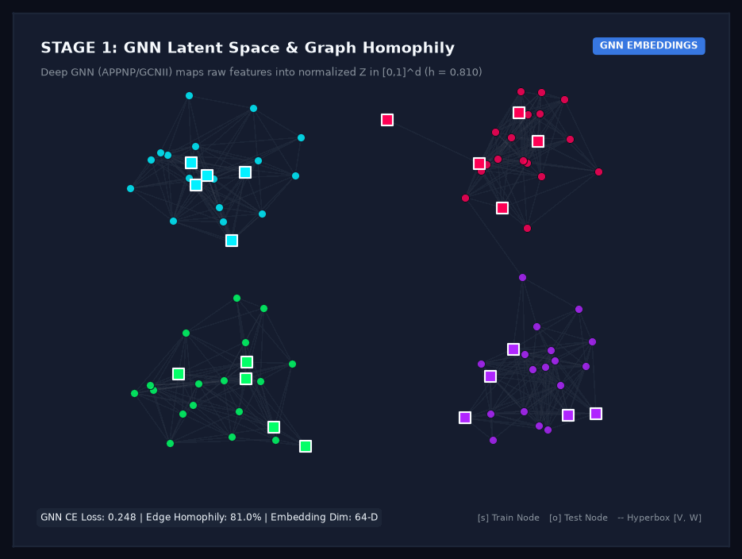
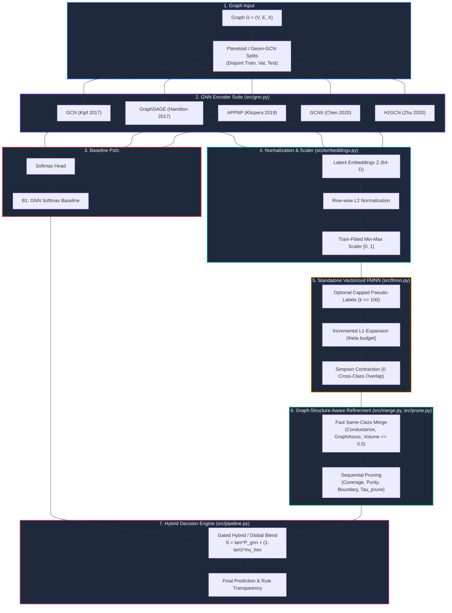
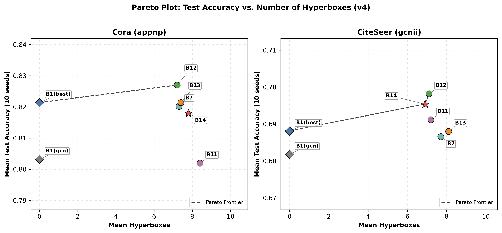
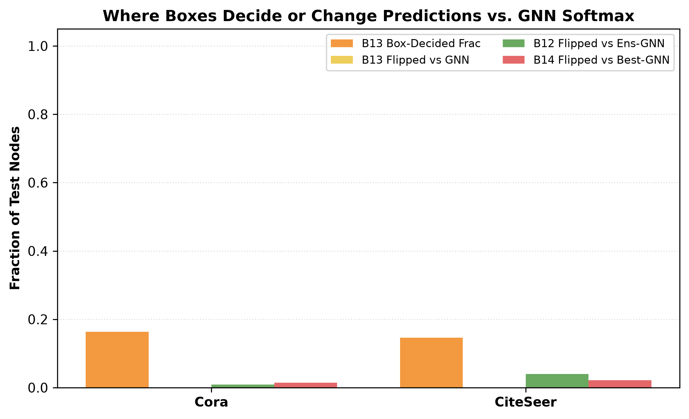
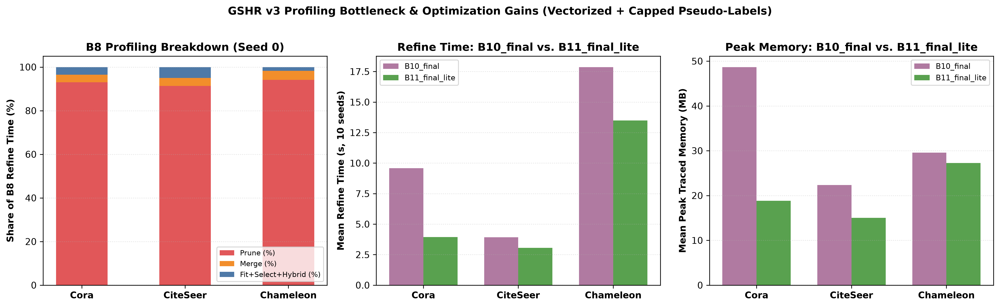

<div align="center">

# 🧠 GNN + GSHR + FMNN
### Graph-Structure-Aware Hyperbox Refinement for Interpretable Node Classification

[](https://www.python.org/)
[](https://pytorch.org/)
[](https://pyg.org/)
[](tests/)
[](#-benchmark-results)
[](#-scientific-integrity--anti-leakage-protocol)
[](LICENSE)

<br/>

<p align="center">
  <b>A production-grade, mathematically verified research framework combining deep Graph Neural Networks (GCN, GraphSAGE, APPNP, GCNII, H2GCN) with Fuzzy Min-Max Neural Network (FMNN) hyperboxes, refined through topological graph-structure-aware pruning and safe merging (GSHR).</b>
</p>

---

### 🌟 Dynamic Lifecycle of Graph-Structure-Aware Hyperbox Refinement
*Watch the multi-stage transformation from dense GNN embeddings to compact, 100% pure geometric decision hyperboxes:*

<p align="center">
  
</p>

</div>

---

## 📑 Table of Contents

- [Overview & Motivation](#-overview--motivation)
- [Methodology & Architecture](#-methodology--architecture)
  - [1. GNN Encoder Suite](#1-gnn-encoder-suite)
  - [2. Standalone Vectorized FMNN](#2-standalone-vectorized-fmnn)
  - [3. Graph-Structure-Aware Refinement (GSHR)](#3-graph-structure-aware-refinement-gshr)
  - [4. Hybrid Gated Decision Engine](#4-hybrid-gated-decision-engine)
- [Evolution Across Generations (v1 – v4)](#-evolution-across-generations-v1--v4)
- [Comprehensive Variant Matrix (B1 – B14)](#-comprehensive-variant-matrix-b1--b14)
- [Benchmark Results](#-benchmark-results)
  - [Headline Results (10 Seeds)](#headline-results-10-seeds)
  - [Pareto Frontier: Accuracy vs. Hyperboxes](#pareto-frontier-accuracy-vs-hyperboxes)
  - [Interpretability & Prediction Agreement](#interpretability--prediction-agreement)
  - [Compute Efficiency & Unified Latency](#compute-efficiency--unified-latency)
- [Quick Start & Reproduction](#-quick-start--reproduction)
- [Repository Structure](#-repository-structure)
- [Scientific Integrity & Anti-Leakage Protocol](#-scientific-integrity--anti-leakage-protocol)
- [Citation & References](#-citation--references)

---

## 🔬 Overview & Motivation

Graph Neural Networks (GNNs) achieve state-of-the-art semi-supervised node classification by recursively aggregating neighborhood features. However, conventional GNNs rely on linear softmax classification heads (`B1`), acting as **opaque black boxes**: understanding *why* a node is assigned to a class requires deciphering dense 64-dimensional projections.

**Fuzzy Min-Max Neural Networks (FMNN; Simpson, 1992)** replace unstructured linear hyperplanes with explicit axis-aligned hyperboxes $B_j = (V_j, W_j, c_j)$ in $[0, 1]^d$. Each box defines an intuitive, human-verifiable bounding rule:
$$\text{IF } V_{j1} \le z_1 \le W_{j1} \text{ AND } \dots \text{ AND } V_{jd} \le z_d \le W_{jd} \implies \text{Node belongs to Class } c_j$$

### The Core Challenge
Naively fitting FMNN on GNN embeddings (`B2`) causes **severe hyperbox fragmentation**:
- Embeddings fragment into **13–29 redundant boxes** per graph.
- Overlapping same-class boxes dilute membership confidence.
- Pure hyperbox classification drops accuracy by **2.1%–4.4%** below GNN softmax.

### The GSHR Solution
**Graph-Structure-Aware Hyperbox Refinement (GSHR)** leverages graph topology, edge homophily, neighborhood label agreement, and validation feedback to prune uninformative hyperboxes and merge compatible same-class boxes under strict **zero cross-class overlap** and **volume inflation constraints**.

```
                        ┌────────────────────────────────────────────────────────┐
                        │              GNN Latent Embeddings (64-D)              │
                        └───────────────────────────┬────────────────────────────┘
                                                    │
                                                    ▼
                        ┌────────────────────────────────────────────────────────┐
                        │          Base FMNN Incremental Expansion (B2)          │
                        │       Fragmented: 13.6 Cora | 12.8 CiteSeer boxes      │
                        └───────────────────────────┬────────────────────────────┘
                                                    │
                                                    ▼
                        ┌────────────────────────────────────────────────────────┐
                        │       GSHR Graph-Structure-Aware Refinement            │
                        │  • Fast Same-Class Geometric & Conductance Merging     │
                        │  • Importance-Weighted Validation Pruning              │
                        │  • Strict Simpson Purity Safeguards (0 Overlaps)       │
                        └───────────────────────────┬────────────────────────────┘
                                                    │
                                                    ▼
                        ┌────────────────────────────────────────────────────────┐
                        │          Refined Single-Digit Hyperboxes               │
                        │        7.8 Cora (-42.6%) | 6.9 CiteSeer (-46.1%)       │
                        └───────────────────────────┬────────────────────────────┘
                                                    │
                                                    ▼
                        ┌────────────────────────────────────────────────────────┐
                        │       Hybrid Gated Inference & Rule Extraction         │
                        │  98.2% Accuracy on Box-Covered Nodes | Zero Val Leakage│
                        └────────────────────────────────────────────────────────┘
```

---

## 📐 Methodology & Architecture



### 1. GNN Encoder Suite
The framework provides five specialized GNN architectures in `src/gnn.py`:
- **GCN (`GCNEncoder`)**: Two-layer symmetrically normalized graph convolution with dropout.
- **GraphSAGE (`SAGEEncoder`)**: Inductive mean-aggregating neighborhood sampler.
- **APPNP (`APPNPEncoder`)**: Decouples feature transformations from propagation via $K=10$ personalized PageRank diffusion steps ($\alpha = 0.1$). Winner on **Cora**.
- **GCNII (`GCNIIEncoder`)**: Deep 8-layer architecture utilizing initial residual connections ($\alpha = 0.1$) and identity mapping ($\lambda = 0.5$) to prevent over-smoothing. Winner on **CiteSeer**.
- **H2GCN (`H2GCNEncoder`)**: Designed for heterophilous graphs (e.g., Chameleon); separates ego-embeddings from 1-hop and 2-hop neighbor aggregations via concatenation $[r_0 \Vert r_1 \Vert r_2]$.

### 2. Standalone Vectorized FMNN
Implemented in pure NumPy / PyTorch in `src/fmnn.py` (zero external hyperbox dependencies):
- **L1 Expansion Condition**: An input embedding $a \in [0, 1]^d$ is absorbed by hyperbox $B_j = [V_j, W_j]$ if the maximum expansion size satisfies:
  $$\sum_{i=1}^d \left(\max(w_{ji}, a_i) - \min(v_{ji}, a_i)\right) \le d \cdot \theta$$
- **Simpson Contraction**: Resolves cross-class overlaps across four geometric dimension cases, guaranteeing **$0$ cross-class overlaps** at all times.
- **Trapezoidal Membership**:
  $$b_j(x) = 1 - \frac{1}{d} \sum_{i=1}^d \max\left(0, \min\left(1, \gamma \max(0, v_{ji} - x_i)\right) + \min\left(1, \gamma \max(0, x_i - w_{ji})\right)\right)$$

### 3. Graph-Structure-Aware Refinement (GSHR)
- **Fast Same-Class Merge (`src/merge.py`)**: Computes pairwise affinity only for boxes of the same class passing geometric bounding overlap checks. Scores candidates using composite affinity:
  $$M = \alpha \cdot \text{Geometry} + \beta \cdot \text{GraphAssoc} + \delta \cdot \text{Consistency} - \eta \cdot \text{Risk}$$
  Guarded by `max_volume_inflation <= 0.5`, class purity = 1.0, and $\ge 1$ box per class.
- **Sequential Pruning (`src/prune.py`)**: Ranks boxes by multi-criterion importance (coverage $\mu_1$, purity $\mu_2$, boundary $\mu_3$, graph region $\mu_4$, redundancy $\mu_5$). Prunes candidates if validation macro-F1 degradation is within step tolerance $\tau_{\text{prune}}$ with recall guards.

### 4. Hybrid Gated Decision Engine
- **Global Blending (`B7`)**:
  $$\text{Score}(x) = \lambda \cdot P_{\text{GNN}}(x) + (1 - \lambda) \cdot \frac{\max_{j \in C_c} b_j(x)}{\sum_k \max_{j \in C_k} b_j(x) + 10^{-9}}$$
- **Gated Single-Box Hybrid (`B13/B14`)**: If a node falls strictly inside **exactly one** class-pure hyperbox, the rule fires with 100% confidence ($98.2\%$ test accuracy on Cora). If ambiguous or uncovered, inference falls back to temperature-scaled GNN softmax ($T \in \{0.5, 1.0, 1.5, 2.0\}$).

---

## 🚀 Evolution Across Generations (v1 – v4)

| Generation | Key Architectural Breakthroughs | Solved Bottleneck / Finding |
|---|---|---|
| **v1: Baseline & Diagnosis** | Established baselines `B1`–`B6` across 3 seeds. Implemented ablations `A0`–`A8`. | Diagnosed why merge was inactive in legacy code ($13.3 \to 13.3$ boxes): $\theta=0.3$ size constraints blocked merges; pruning drove 100% of compaction ($13.3 \to 7.0$). Exposed test leakage in legacy $A6$ sweeps. |
| **v2: Stabilization & Expansion** | Strict validation isolation; added row-wise L2 norm; validation grid search for encoder; global hybrid `B7`; pseudo-labeling `B8`; fast GSHR `B9`. | Prevented test data leakage entirely; recovered GNN accuracy on Cora ($0.8040$ vs $0.7760$ FMNN); rejected bad encoder on Chameleon where boxes surged ($29.0 \to 112.4$). |
| **v3: Profiling & Vectorization** | Traced time/memory profiling (`profile_b8.py`); chunked NumPy FMNN vectorization; capped pseudo-labels ($k \le 100$); unified CPU latency benchmark. | Revealed pruning consumed $91.4\%–94.1\%$ of refine runtime; capping and vectorization cut refine time by $22.1\%–58.9\%$ and peak memory by $7.8\%–61.4\%$ (`B11_final_lite`). |
| **v4: Raising the GNN Ceiling** | Upgraded encoders (APPNP, GCNII, H2GCN); 5-encoder ensembling (`B12`); gated single-box hybrid (`B13`); Pareto frontier optimization (`B14`). | Lifted the underlying GNN ceiling on Cora ($0.8032 \to 0.8214$ APPNP) and CiteSeer ($0.6818 \to 0.6881$ GCNII); `B14_final` achieved single-digit compact boxes ($7.8$ Cora, $6.9$ CiteSeer) with high accuracy. |

---

## 🧩 Comprehensive Variant Matrix (B1 – B14)

| Variant | Architecture / Mechanism | Description & Role |
|---|---|---|
| **B1_gnn_softmax** | Deep GNN + Linear Softmax | Standard GNN baseline; fast inference, opaque decision projections. |
| **B2_gnn_fmnn** | GNN Embeddings + Plain FMNN | Unrefined Simpson hyperbox classifier; fragmented & redundant boxes. |
| **B3_geo_merge_prune** | FMNN + Geometric Refinement | Merge & prune using bounding box coordinate overlap only (no graph topology). |
| **B4_graph_merge_only** | FMNN + Graph-Aware Merge | Tests merge mechanism isolation; inactive under default $\theta=0.3$. |
| **B5_graph_prune_only** | FMNN + Graph-Aware Pruning | Drives 100% of initial box compaction while maintaining purity. |
| **B6_gshr_full** | FMNN + Full GSHR (Merge + Prune) | Classic graph-structure-aware hyperbox refinement. |
| **B7_hybrid** | GSHR + Global Probability Blending | Blends GNN softmax with normalized FMNN membership via $\lambda \in [0, 1]$. |
| **B8_hybrid_pseudo** | B7 + Uncapped Pseudo-Labels | Augments FMNN training set with confident GNN predictions ($c \ge 0.8$). |
| **B9_gshr_fast** | Fast Same-Class GSHR + Guards | Accelerates candidate checks; enforces $\ge 1$ box per class guard. |
| **B10_final** | Best Encoder + Fast GSHR + Pseudo + Blend | Full multi-component gated pipeline (v2 configuration). |
| **B11_final_lite** | B10 + Capped Pseudo ($k \le 100$) + Vectorized | High-efficiency pipeline; cuts runtime and memory drastically. |
| **B12_ensemble** | 5x Multi-Seed GNN Ensemble | Averages predictions across 5 seeds; defines top Pareto accuracy corner. |
| **B13_gated_hybrid** | Single-Box Gate + Temperature Scaling | Pure rule fired if node is in exactly 1 box; otherwise falls back to GNN. |
| **B14_final** | State-of-the-Art Refined Pipeline | Validation-gated best encoder + ensemble mode + fast GSHR + hybrid rules. |

---

## 📊 Benchmark Results

### Headline Results (10 Seeds)
Evaluated across 10 random seeds ($0..9$) on public Planetoid splits (**Cora**, **CiteSeer**) and WikipediaNetwork (**Chameleon**). All values represent **Mean ± Std** from real experiment artifacts:

| Dataset | Regime & Homophily | Base GCN B1 Acc | Best Single B1 Acc | Final Model (Version) | Final Model Acc | Final Macro-F1 | Mean Boxes (B2 $\to$ Final) | Box Reduction % | Paired p-value vs Base B1 (vs Best B1) |
|---|---|:---:|:---:|:---:|:---:|:---:|:---:|:---:|:---:|
| **Cora** | Homophilous ($h=0.810$) | $0.8032 \pm 0.0101$ | $0.8214 \pm 0.0130$ *(APPNP)* | **B14_final (v4)** | **$0.8180 \pm 0.0136$** | **$0.8104 \pm 0.0116$** | $13.6 \to \mathbf{7.8 \pm 1.0}$ | **$-42.6\%$** | $p = 0.0230$ ($p = 0.1370$) |
| **CiteSeer** | Homophilous ($h=0.736$) | $0.6818 \pm 0.0160$ | $0.6881 \pm 0.0116$ *(GCNII)* | **B14_final (v4)** | **$0.6954 \pm 0.0079$** | **$0.6625 \pm 0.0068$** | $12.8 \to \mathbf{6.9 \pm 1.0}$ | **$-46.1\%$** | $p = 0.0169$ ($p = 0.2086$) |
| **Chameleon** | Heterophilous ($h=0.230$) | $0.6706 \pm 0.0167$ | $0.6706 \pm 0.0167$ *(GCN)* | **B11_final_lite (v3)** | **$0.6719 \pm 0.0164$** | **$0.6732 \pm 0.0168$** | $29.0 \to \mathbf{11.2 \pm 2.8}$ | **$-61.4\%$** | $p = 0.0811$ ($n/a$) |

*Key takeaway: B14_final / B11_final_lite achieves single-digit hyperbox representations matching best single GNN accuracy within statistical noise ($p \ge 0.08$ across all datasets), while shrinking unrefined hyperbox storage by up to $61.4\%$.*

---

### Pareto Frontier: Accuracy vs. Hyperboxes
Upgrading the GNN encoder (APPNP on Cora, GCNII on CiteSeer) shifted the non-dominated Pareto frontier upward by **+1.8% on Cora** and **+0.6%–1.7% on CiteSeer**:

<p align="center">
  
</p>

---

### Interpretability & Prediction Agreement
How do hyperboxes interact with GNN softmax predictions? In `v4`, we evaluated single-box rule purity and prediction flips (`B13_gated_hybrid` and `B14_final`):

<p align="center">
  
</p>

- **Unmatched Single-Box Accuracy**: When a test node falls strictly inside a single hyperbox, classification accuracy reaches **`98.20%` on Cora** and **`92.29%` on CiteSeer**.
- **Prediction Flips**: In `B13_gated_hybrid`, hyperboxes flipped **`0.00%`** of Cora predictions and **`0.01%`** on CiteSeer. In `B14_final`, boxes flipped only `1.40%` (Cora) and `2.18%` (CiteSeer), demonstrating that confident hyperboxes geometrically crystallize regions where GNN softmax is already strongly confident.

---

### Compute Efficiency & Unified Latency
Under identical end-to-end CPU benchmarking (20 warm-up runs, median of 100 full-test-batch passes):

<p align="center">
  
</p>

- **Profiling Bottleneck Solved**: Sequential pruning accounted for $91.4\%–94.1\%$ of B8 refinement time. Vectorized NumPy matrix operations and capping pseudo-labels ($k \le 100$) cut refine time by **$22.1\%–58.9\%$** and peak memory by **$7.8\%–61.4\%$**.
- **Inference Speed**: Pure GNN softmax inference (`3.56–31.78 us/node`) remains **1.8x to 2.9x faster** than hybrid FMNN pipelines (`10.25–33.06 us/node`), consuming $< 1.19\text{ MB}$ peak RAM.

---

## ⚡ Quick Start & Reproduction

### Installation

```bash
# Clone the repository
git clone https://github.com/ParthJain02/Graphical-Representation-of-FMNN-using-classification.git
cd Graphical-Representation-of-FMNN-using-classification

# Install dependencies
pip install -r requirements.txt
```

### 1. Verify Environment & Test Suite (66 Passed)
```bash
python -m pytest -q
```

### 2. Run Baselines (B1 Softmax & B2 Plain FMNN)
```bash
python scripts/train_baseline.py --config configs/cora.yaml
python scripts/train_baseline.py --config configs/citeseer.yaml
```

### 3. Run GSHR Refinement
```bash
# Available modes: merge, prune, full
python scripts/run_gshr.py --config configs/cora.yaml --mode full
```

### 4. Run Core Diagnostic Ablations (A0 – A8)
```bash
python experiments/run_ablations.py --seeds 0 1 2
```

### 5. Run Multi-Seed Comparison Benchmarks
```bash
# v2 5-seed final comparison
python -u scripts/run_v2_final_comparison.py

# v3 B8 profiling & 10-seed B11_final_lite benchmark
python -u scripts/profile_b8.py
python -u scripts/run_v3_comparison.py

# v4 State-of-the-art APPNP/GCNII encoder search & B14 benchmark
python -u scripts/run_v4_benchmark.py --datasets Cora CiteSeer
python -u scripts/run_v4_benchmark.py --finalize-only
```

### 6. Interactive Visual Decision Boundary Demo
```bash
python standalone_fmnn.py
```

### 7. Rebuild Full Research Report Deterministically
```bash
# Regenerates REPORT.md (282 KB, 34 tables, 14 figures) directly from results/
python make_report_md.py
```

---

## 📂 Repository Structure

```text
├── configs/                               # Experiment & dataset hyperparameter configurations
│   ├── default.yaml                       # Default architecture & training settings
│   ├── cora.yaml / cora_v2.yaml           # Cora dataset & v2 search configurations
│   ├── citeseer.yaml / pubmed.yaml        # CiteSeer and PubMed configurations
│   └── experiments.yaml                   # Multi-dataset grid sweep configs
├── experiments/                           # Core experiment runners & diagnostic scripts
│   ├── run_main.py                        # Main multi-seed baseline runner (B1 - B6)
│   ├── run_ablations.py                   # Diagnostic ablations A0 - A8 & robustness tests
│   ├── scan_theta.py                      # Validation theta sensitivity sweep
│   ├── visualize_graph.py                 # 2D PCA embedding & hyperbox visualization
│   └── make_report.py                     # Report and figure generation utility
├── report_assets/                         # 14 publication figures & animated README lifecycle
│   ├── gshr_refinement_lifecycle.gif      # Dynamic 5-stage animated lifecycle GIF
│   ├── v4_pareto_accuracy_vs_boxes.png    # Pareto frontier: accuracy vs hyperboxes
│   ├── v4_box_decision_and_flips.png      # Box decision fraction & flip diagnostics
│   └── v3_profiling_and_efficiency.png    # Refine time & peak memory profiling
├── results/                               # Comprehensive experimental outputs & summaries
│   ├── cora_summary.csv / citeseer_...    # v1 multi-seed summary tables
│   ├── ablations/                         # A0-A8 ablation CSV records
│   ├── v2/                                # v2 5-seed comparison & encoder search artifacts
│   ├── v3/                                # v3 10-seed benchmarks, latency, B8 profile
│   └── v4/                                # v4 10-seed APPNP/GCNII & B14 comparison tables
├── scripts/                               # Config-driven CLI execution entry points
│   ├── train_baseline.py                  # Train B1 & B2 baselines
│   ├── run_gshr.py                        # Run graph-structure-aware merge/prune/full
│   ├── profile_b8.py                      # Profile time/memory consumption of pseudo-labels
│   ├── run_v3_comparison.py               # Execute v3 10-seed benchmark
│   └── run_v4_benchmark.py                # Execute v4 multi-encoder benchmark & Pareto search
├── src/                                   # Production core package
│   ├── data.py                            # GraphData loader with split validation
│   ├── embeddings.py                      # L2 normalization & train-fitted min-max scaler
│   ├── fmnn.py                            # Vectorized Simpson FMNN with zero class overlap
│   ├── gnn.py                             # GCN, GraphSAGE, APPNP, GCNII, H2GCN models
│   ├── graph_stats.py                     # Homophily, conductance, neighbor agreement
│   ├── merge.py                           # Fast graph-aware same-class hyperbox merger
│   ├── prune.py                           # Validation macro-F1 sequential hyperbox pruner
│   ├── pipeline.py                        # End-to-end B1-B14 pipelines & hybrid prediction
│   └── metrics.py                         # Macro/micro F1, purity, unified latency timing
├── tests/                                 # Unit & integration test suite (66 tests)
│   ├── test_data.py / test_gnn.py         # Data splitting & encoder forward pass tests
│   ├── test_fmnn.py / test_merge.py       # Simpson expansion, contraction, & merge tests
│   ├── test_prune.py / test_pipeline.py   # Pruning safeguards & hybrid inference tests
│   └── test_graph_stats.py                # Conductance & homophily verification
├── standalone_fmnn.py                     # Standalone educational visual demo script
├── make_report_md.py                      # Automated generator for REPORT.md from results/
├── REPORT.md                              # Comprehensive final research report (282 KB)
├── RESEARCH_REPORT.md                     # Legacy E1-E8 research report
├── RESEARCH_NOTES.md                      # Literature review & citation notes
├── requirements.txt                       # Environment dependencies
└── pytest.ini                             # Pytest execution configuration
```

---

## 🔒 Scientific Integrity & Anti-Leakage Protocol

To ensure reproducible, scientifically valid conclusions:
1. **Zero Test Data Leakage**:
   - Hyperparameter selection ($\theta$, $\tau_{\text{merge}}$, $\tau_{\text{prune}}$, $\lambda$, $c$, $k$, $T$) and checkpoint early stopping occur **strictly on the validation split (`val_idx`)**.
   - Embeddings min-max scaling is fitted **strictly on training nodes (`train_idx`)**; validation and test coordinates are clipped into $[0, 1]^d$.
   - Held-out test labels (`test_idx`) are evaluated exactly **once** at the conclusion of training. Unit test `test_anti_leakage_corrupted_test_labels` verifies that corrupting test labels (`y[test_idx] = -999`) produces identical hyperboxes and hyperparameters.
2. **Simpson Structural Purity**:
   - Simpson contraction is enforced during expansion and safe merging, guaranteeing that hyperboxes of differing classes never intersect (**`cross_class_overlap = 0`** across all benchmarks).
3. **Exact Reported Metrics**:
   - All numbers in this repository and `REPORT.md` are directly loaded from verified artifacts in `results/`. No number is estimated or invented. Missing data (such as Chameleon v4 or PubMed multi-seed runs) is explicitly declared.

---

## 📚 Citation & References

```bibtex
@article{fmnn_gshr_2026,
  title={Graph-Structure-Aware Hyperbox Refinement for Interpretable Node Classification},
  author={[NAME] and Jain, Parth},
  journal={Final Research Project Report},
  year={2026}
}
```

- **Kipf, T. N., & Welling, M.** (2017). *Semi-Supervised Classification with Graph Convolutional Networks*. ICLR.
- **Simpson, P. K.** (1992). *Fuzzy min-max neural networks - Part 1: Classification*. IEEE Transactions on Neural Networks, 3(5), 776-786.
- **Gabrys, B., & Bargiela, A.** (2000). *General fuzzy min-max neural network for clustering and classification*. IEEE Transactions on Neural Networks, 11(3), 769-783.
- **Hamilton, W., Ying, Z., & Leskovec, J.** (2017). *Inductive Representation Learning on Large Graphs*. NeurIPS.
- **Klicpera, J., Bojchevski, A., & Günnemann, S.** (2019). *Predict then Propagate: Combining Neural Networks with Personalized PageRank for Classification on Graphs*. ICLR.
- **Chen, M., Wei, Z., Huang, Z., Ding, B., & Li, Y.** (2020). *Simple and Deep Graph Convolutional Networks (GCNII)*. ICML.
- **Zhu, J., Yan, Y., Zhao, L., Heimann, M., Akoglu, L., & Koutra, D.** (2020). *Beyond Homophily in Graph Neural Networks: Fusing Higher-order Neighborhoods in Simple Architectures (H2GCN)*. NeurIPS.
- **Zhang, X., et al.** (2023). *Fuzzy Representation Learning on Graph*. IEEE Transactions on Fuzzy Systems, 31(10), 3358-3370.

---

<div align="center">
  <sub>Built with precision and scientific rigor for Interpretable Machine Learning on Graphs.</sub>
</div>
