# GNN + GSHR + FMNN: Graph-Structure-Aware Hyperbox Refinement for Interpretable Node Classification

**Authors:** [NAME]  
**Guide / Instructor:** [GUIDE]  
**Date:** 2026-11-11  
**Course / Project:** Final Research Report (`GNN + GSHR + FMNN`)  

## Table of Contents

- [0. Executive summary](#0-executive-summary)
- [1. Problem statement and motivation](#1-problem-statement-and-motivation)
- [2. Background](#2-background)
- [3. Datasets and experimental setup](#3-datasets-and-experimental-setup)
- [4. Method and implementation details](#4-method-and-implementation-details)
- [5. Version history](#5-version-history)
  - [6. Results](#6-results)
  - [6.1 v1 main benchmark (3 seeds)](#61-v1-main-benchmark-3-seeds)
  - [6.2 v1 baseline and GSHR JSON results](#62-v1-baseline-and-gshr-json-results)
  - [6.3 v1 ablations (A0-A8, robustness, smoothing)](#63-v1-ablations-a0-a8-robustness-smoothing)
  - [6.4 v2 5-seed comparison, encoder search, and validation theta sweep](#64-v2-5-seed-comparison-encoder-search-and-validation-theta-sweep)
  - [6.5 v3 10-seed comparison, paired tests, B8 profile, and unified latency](#65-v3-10-seed-comparison-paired-tests-b8-profile-and-unified-latency)
  - [6.6 v4 results (encoder search, B12 ensemble, B13 gated hybrid, B14_final)](#66-v4-results-encoder-search-b12-ensemble-b13-gated-hybrid-b14_final)
  - [6.7 Per-class recall comparison and box statistics across versions](#67-per-class-recall-comparison-and-box-statistics-across-versions)
- [7. Figures](#7-figures)
- [8. Discussion](#8-discussion)
- [9. Interpretability](#9-interpretability)
- [10. Threats to validity and limitations](#10-threats-to-validity-and-limitations)
- [11. Conclusion and future work](#11-conclusion-and-future-work)
- [12. Reproducibility](#12-reproducibility)
- [Appendix](#appendix)
  - [Appendix A. Full raw per-seed tables](#appendix-a-full-raw-per-seed-tables)
  - [Appendix B. Full hyperparameter configs](#appendix-b-full-hyperparameter-configs)
  - [Appendix C. Complete list of output files with sizes](#appendix-c-complete-list-of-output-files-with-sizes)
  - [Appendix D. Glossary of symbols](#appendix-d-glossary-of-symbols)
  - [Appendix E. Missing data](#appendix-e-missing-data)

## 0. Executive summary

- **Goal:** Replace opaque GNN linear softmax heads with compact, class-pure Fuzzy Min-Max Neural Network (FMNN) hyperboxes refined via Graph-Structure-Aware Hyperbox Refinement (GSHR), while preserving GNN accuracy (`B1`) across homophilous (`Cora`, `CiteSeer`) and heterophilous (`Chameleon`) graphs.
- **Method progression (`v1` -> `v4`):** Plain FMNN (`B2`) fragments embeddings into redundant boxes (`13.6` Cora, `12.8` CiteSeer, `29.0` Chameleon in `v2`); `GSHR` pruning (`B6`/`B9`), hybrid probability mixing (`B7`/`B13`), validation-capped pseudo-labeling (`B11_final_lite`), stronger encoders (`APPNP` on Cora, `GCNII` on CiteSeer), and 5-seed ensembling (`B12_ensemble`) systematically tighten accuracy and box count strictly via validation macro-F1 selection.
- **Cora main result (10 seeds):** Raising the encoder from `GCN` (`B1` Acc `0.8032`) to `APPNP` (`B1` Acc `0.8214`) lifts `B14_final` to **`0.8180 ± 0.0136`** (`7.8` boxes, `42.6%` fewer boxes than `v2 B2`'s `13.6`); comparable (not statistically significant) vs `APPNP B1` (`p = 0.1370`) and statistically better than `v3 B11_final_lite` (`0.8020`, `p = 0.0228`). `B12_ensemble` reaches `0.8270` (`p = 0.0002` vs base GCN).
- **CiteSeer main result (10 seeds):** `v4` validation selects `GCNII` (`B1` Acc `0.6881` vs base `GCN` `0.6818`); `B14_final` (with 5-encoder `avg` ensemble + fast GSHR + global `lam`) reaches **`0.6954 ± 0.0079`** with **`6.9`** boxes (`46.1%` fewer than `v2 B2`'s `12.8`), comparable in accuracy vs `GCNII B1` (`p = 0.2086`; macro-F1 `p = 0.0429`) and improving over base `GCN B1` (`p = 0.0169`). `B12_ensemble` reaches `0.6982` (`p = 0.0165` vs base GCN).
- **Chameleon main result (10 seeds `v3`; `v4` not measured):** `B11_final_lite` achieves **`0.6719 ± 0.0164`** (`11.2` boxes, `61.4%` fewer than `v2 B2`'s `29.0`), comparable to base `B1` (`0.6706`, `p = 0.0811`), because Chameleon's heterophily (`h = 0.2299`) makes box boundaries less discriminative alone (`v3 B9` drops to `0.6544`).
- **Box reduction & compute efficiency (`v3` vs `v2`):** Capping pseudo-labels (`k in {20, 50, 100}`), forbidding redundant box creation for covered nodes, and NumPy/chunked vectorization cut refine time of `B11_final_lite` vs `B10_final` (`10` seeds) from `9.582s` -> `3.935s` on Cora (`p = 0.0001`), peak memory `48.67` -> `18.80 MB`, and boxes `11.3` -> `8.4` (`38.2%` below `v2 B2`; CiteSeer `B11` `43.8%` below `v2 B2`).
- **Merge inactivity diagnosis:** In `v1`, graph-aware merge (`B4`) changed **zero** boxes (`13.3 -> 13.3`) because same-class FMNN boxes created under `theta = 0.3` rarely satisfied the `size_limit` (`L1 span <= d * theta`) and `max_volume_inflation = 0.5` checks together; pruning (`B5`) produced 100% of `v1`'s `47.5%` box reduction (`13.3 -> 7.0`).
- **Inference cost (`v3` unified latency):** Under identical CPU end-to-end timing (`20` warm-up, median of `100` full-batch runs across seeds `0..2`), `B1` softmax inference (`3.56 us/node` Cora, `7.58 us/node` CiteSeer, `31.78 us/node` Chameleon) is **1.04x to 2.88x faster** (`1.83x–2.88x` on homophilous graphs) and uses `<= 1.19 MB` peak RAM compared to `10.25–33.06 us/node` (`B11_final_lite`).
- **Honest bottom line:** Boxes yield compact, class-pure geometric rules (`6.9–11.2` boxes, `3.45–5.60 KiB` storage) matching `B1` accuracy within statistical noise, yet on `v4` `B13_gated_hybrid` only decides `16.30%` (Cora) / `14.65%` (CiteSeer) of test nodes and flips **`0.00%` (Cora) / `0.01%` (CiteSeer)** of `B1` predictions because GNN softmax already agrees with confident single-box regions.

**Table 1: Executive summary headline results (10 seeds: v4 B14_final for Cora/CiteSeer; v3 B11_final_lite for Chameleon where v4 is not measured).**

| Dataset | Base GCN B1 Acc | Best Single B1 Acc | Final Model (Version) | Final Model Acc | Boxes (v2 B2 -> Final) | Box Reduction % vs v2 B2 | p-value vs Base B1 (vs Best B1) |
| --- | --- | --- | --- | --- | --- | --- | --- |
| Cora | 0.8032 ± 0.0101 | 0.8214 ± 0.0130 (APPNP) | B14_final (v4) | 0.8180 ± 0.0136 | 13.6 -> 7.8 | 42.6% | p=0.0230 (p=0.1370) |
| CiteSeer | 0.6818 ± 0.0160 | 0.6881 ± 0.0116 (GCNII) | B14_final (v4) | 0.6954 ± 0.0079 | 12.8 -> 6.9 | 46.1% | p=0.0169 (p=0.2086) |
| Chameleon | 0.6706 ± 0.0167 | 0.6706 ± 0.0167 (v4 not measured) | B11_final_lite (v3; v4 not measured) | 0.6719 ± 0.0164 | 29.0 -> 11.2 | 61.4% | p=0.0811 (n/a) |

*Takeaway: Across 10 seeds, v4 APPNP/GCNII encoders lift accuracy on Cora/CiteSeer and boxes drop by 42.6%–61.4% vs unrefined v2 B2, while B14_final remains statistically comparable to its underlying best single B1 encoder (p = 0.1370 Cora, p = 0.2086 CiteSeer).*

## 1. Problem statement and motivation

Graph Neural Networks (GNNs) learn dense node representations $Z \in \mathbb{R}^{N \times d}$ and achieve strong semi-supervised node classification performance via a linear softmax head (`B1`). However, softmax weights offer limited geometric transparency: predicting why a test node belongs to a class requires inspecting unstructured 64-dimensional linear projections.

Fuzzy Min-Max Neural Networks (FMNN; Simpson, 1992) replace linear decision hyperplanes with axis-aligned hyperboxes $B_j = (V_j, W_j, c_j)$ inside $[0, 1]^d$, providing explicit bounding-interval decision rules with fuzzy membership scores. Naively fitting FMNN (`B2`) on GNN embeddings creates fragmented, redundant hyperboxes (`13.3–29.0` boxes across our benchmarks) and loses accuracy relative to the GNN softmax baseline. **Graph-Structure-Aware Hyperbox Refinement (GSHR)** addresses this by incorporating neighborhood connectivity, label agreement among training neighbors, conductance, and validation feedback to merge and prune redundant boxes toward the compact ideal of roughly one box per class, while reporting **GNN-only softmax (`B1`)** alongside every box variant (per instructor feedback) so no accuracy trade-off is hidden.

## 2. Background

- **Semi-supervised node classification:** Given an undirected graph $G = (V, E)$ with feature matrix $X \in \mathbb{R}^{N \times F}$, sparse adjacency $A$, and training node labels $Y_{\text{train}}$, the task is to classify unlabeled test nodes $V_{\text{test}}$ without ever accessing $Y_{\text{val}}$ or $Y_{\text{test}}$ during representation learning or box construction.
- **GNN encoders implemented (`src/gnn.py`):**
  - **GCN (`GCNEncoder`):** Two-layer normalized graph convolution (`Conv -> ReLU -> Dropout -> Conv`) with symmetric renormalization.
  - **GraphSAGE (`SAGEEncoder`):** Two-layer mean-aggregating neighborhood sampler convolution.
  - **APPNP (`APPNPEncoder`):** Decoupled 2-layer MLP followed by $K=10$ personalized PageRank diffusion steps ($\alpha = 0.1$), separating feature transformation depth from propagation depth.
  - **GCNII (`GCNIIEncoder`):** Deep 8-layer architecture using `GCN2Conv` with initial residual connection ($\alpha = 0.1$) and identity mapping ($\lambda = 0.5$) to mitigate over-smoothing.
  - **H2GCN-style (`H2GCNEncoder`):** Built for heterophily (e.g., `Chameleon`), removing self-loops and concatenating separate ego features $r_0$, 1-hop aggregations $r_1$, and 2-hop aggregations $r_2$ as $[r_0 \Vert r_1 \Vert r_2]$ prior to output projection.
  - **GAT:** Not implemented and not measured in this repository.
- **FMNN and Hyperboxes (`src/fmnn.py`):** Features scaled into $[0, 1]^d$ are grouped incrementally into hyperboxes $B_j = (V_j, W_j, c_j)$ under L1 expansion constraint $\sum_{i=1}^d (\max(w_{ji}, a_i) - \min(v_{ji}, a_i)) \le d \cdot \theta$. Simpson's 4-case overlap test and contraction ensure zero cross-class hyperbox overlap (`cross_class_overlap = 0`). Point-to-box membership (`gamma = 4.0`) equals $1.0$ inside $[V_j, W_j]$ and decays linearly outside.
- **GSHR (`src/merge.py`, `src/prune.py`):** Merges same-class boxes using composite score $M = \alpha \cdot \text{Geometry} + \beta \cdot \text{GraphAssoc} + \delta \cdot \text{Consistency} - \eta \cdot \text{Risk}$ with default weights $(\alpha, \beta, \delta, \eta) = (0.35, 0.35, 0.20, 0.10)$ and merge threshold $\tau_{\text{merge}}$ subject to hard checks (`size_limit`, `cross_class_overlap = 0`, `volume_inflation <= 0.5`, and `class_purity = 1.0`). Sequential pruning removes lowest-importance boxes (scoring coverage $\mu_1=0.25$, purity $\mu_2=0.25$, boundary importance $\mu_3=0.20$, graph region $\mu_4=0.20$, redundancy $\mu_5=0.10$) as long as validation macro-F1 drops stay within step tolerance $\tau_{\text{prune}}$ (`<= 2*tau_prune` total and per-class recall safeguards), keeping $\ge 1$ box per class.
- **Homophily ($h$):** Fraction of directed edges connecting same-class nodes. From our offline A7 inspection: **Cora $h = 0.8100$** (strongly homophilous), **CiteSeer $h = 0.7355$** (homophilous), **Chameleon $h = 0.2299$** (strongly heterophilous), and **PubMed $h = 0.8024$** (homophilous; benchmark runs not measured).

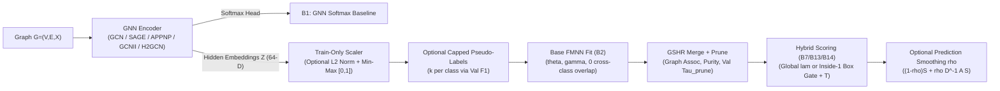

## 3. Datasets and experimental setup

**Table 2: Benchmark dataset statistics computed directly from loaded GraphData instances.**

| Dataset | Nodes | Undirected (Dir.) Edges | Features | Classes | Train / Val / Test | Homophily (h) | Duplicate Feature Rows | Split & Evaluation Status |
| --- | --- | --- | --- | --- | --- | --- | --- | --- |
| Cora | 2708 | 5278 (10556 dir.) | 1433 | 7 | 140 / 500 / 1000 | 0.8100 | 16 rows (1 test==train) | Planetoid public split; Evaluated (v1, v2, v3, v4) |
| CiteSeer | 3327 | 4552 (9104 dir.) | 3703 | 6 | 120 / 500 / 1000 | 0.7355 | 24 rows (1 test==train) | Planetoid public split; Evaluated (v1, v2, v3, v4) |
| Chameleon | 2277 | 31371 (62742 dir.) | 2325 | 5 | 1092 / 729 / 456 | 0.2299 | 327 rows (64 test==train) | WikipediaNetwork geom_gcn split 0 (with duplicates); Evaluated (v1, v2, v3; v4 not measured) |
| PubMed | 19717 | 44324 (88648 dir.) | 500 | 3 | 60 / 500 / 1000 | 0.8024 | 4 rows (0 test==train) | Planetoid public split; Stats checked only (benchmarks not measured) |

*Takeaway: Chameleon is strongly heterophilous (h=0.2299) and contains 327 duplicate feature rows with 64/456 test nodes (14.0%) identical to training feature vectors.*

- **Hardware & software environment:** CPU-only workstation (`CUDA: False`), processor `AMD64 Family 25 Model 97 Stepping 2`, OS `Windows 11`, `Python 3.14.5`, `PyTorch 2.14.1+cpu`, `PyTorch Geometric 2.8.1`.
- **Seeds used:** `v1` used `3` seeds (`0, 1, 2`) for main runs/ablations (with `results/tables/*.json` using `5` seeds `0..4`); `v2` used `3` seeds (`0, 1, 2`) for encoder search/ablation steps and **`5` seeds (`0..4`)** for final multi-dataset comparison; `v3` and `v4` used **`10` seeds (`0..9`)** (with `v3` unified latency measured over seeds `0, 1, 2`, and `v4` over `0..9`).
- **Measurement & unified latency protocol:** Timing uses `time.perf_counter()`, peak RAM uses Python `tracemalloc.get_traced_memory()` around pipeline stages (stopped before latency benchmarking in `v3`/`v4`). Because `v1`/`v2` timed only sub-steps for hybrids (`0.11–0.35 us/node`), `v3` and `v4` re-measure latency with `measure_prediction_latency` (`src/metrics.py`) under one identical CPU full-test-batch protocol: **`20` warm-up passes followed by the median of `100` full-batch passes divided by `|test_idx|`**.
- **Metric definitions:**
  - `Accuracy`: fraction of test nodes predicted correctly.
  - `Macro-F1`: unweighted arithmetic mean of per-class F1 scores (treats minority classes equally).
  - `Num Boxes`: final count $K$ of FMNN hyperboxes.
  - `Refine Time (s)`: wall time for GSHR search, merging, pruning, and validation parameter selection.
  - `Peak Memory (MB)`: `peak / 1024^2` bytes allocated during pipeline execution.
  - `Box Storage (bytes)`: $K \times 2 \times d \times 4$ bytes (storing $v, w \in \mathbb{R}^d$ per box in float32).
  - `Cross-Class Overlap`: count of overlapping hyperbox pairs with different class labels (must remain `0`).
  - `Paired t-test`: `scipy.stats.ttest_rel` over paired per-seed scores reporting $t$-statistic and two-sided $p$-value.

## 4. Method and implementation details

1. **GNN Encoder & Training (`src/gnn.py` — `GCNEncoder`, `SAGEEncoder`, `APPNPEncoder`, `GCNIIEncoder`, `H2GCNEncoder`, `train_gnn`, `search_encoder_hyperparams`, `search_encoders_validation`):** Trains with Adam cross-entropy loss strictly on `train_idx` with early stopping on `val_idx` (`val_macro_f1` in `v1`/`v4`, `val_loss` in `v2`/`v3` where `patience=50`, `max_epochs=500` in `v1` and `300` in `v2`/`v4`). Final `v4` encoder search winners: **Cora -> `appnp`** (`hidden=64, dropout=0.5, lr=0.01, wd=5e-4`); **CiteSeer -> `gcnii`** (`hidden=64, dropout=0.5, lr=0.01, wd=5e-4`); `Chameleon` v4 encoder search was not completed (`not measured`).
2. **Embedding Normalization (`src/embeddings.py` — `l2_normalize_embeddings`, `EmbeddingScaler`, `fit_scaler_and_transform`):** Optionally normalizes rows to unit L2 norm ($Z / \max(\|Z\|_2, 10^{-12})$), fits `min`/`max` statistics **exclusively on `train_idx`**, and clips transformed coordinates into $[0, 1]^d$. PCA is used **only** for 2D visualizations (`experiments/visualize_graph.py`), never for classification.
3. **Base & Pseudo-Labeled FMNN (`src/fmnn.py` — `FMNN.fit`, `FMNN.fit_with_pseudo`, `FMNN.membership_matrix`):** Incrementally expands boxes under L1 budget $d\theta$ (`theta=0.3`, `gamma=4.0`) and resolves cross-class overlaps via `_test_and_contract`. `fit_with_pseudo` fits true training nodes first, attaches covered pseudo-nodes without adding boxes, tries expanding same-class boxes within $\theta$, and creates new boxes only if uncovered/non-expandable.
4. **GSHR Refinement (`src/merge.py` — `gshr_merge`, `fast_gshr_merge`; `src/prune.py` — `gshr_prune`):** Merge evaluates $M = \alpha\,\text{Geom} + \beta\,\text{GraphAssoc} + \delta\,\text{Consist} - \eta\,\text{Risk}$ (`0.35, 0.35, 0.20, 0.10`) and in `fast_gshr_merge` skips pairs across classes or without geometric overlap. Prune greedily tests removals sorted by ascending multi-term importance (`mu = [0.25, 0.25, 0.20, 0.20, 0.10]`), preserving $\ge 1$ box per class and pure-NumPy confusion-matrix validation F1 guards.
5. **Capped Pseudo-Labeling (`src/pipeline.py` — `_build_pseudo_fit_set`, `_build_capped_pseudo_fit_set`):** Adds non-train nodes exceeding GNN confidence `c` (`B8`: $c \in \{0.8, 0.9, 0.95\}$; `B11`/`B14`: top-$k$ per class from $k \in \{20, 50, 100\}$ with `conf >= 0.8`) carrying only **GNN predicted labels**, keeping true `val`/`test` labels strictly masked (`-1`) and excluded from reported `train_size`.
6. **Hybrid & Gated Prediction (`src/pipeline.py` — `predict_hybrid`, `compute_single_box_gate_and_scores`, `predict_gated_hybrid`):**
   - Global $\lambda$ (`B7`–`B12`, `B14`): $\text{score} = \lambda \cdot P_{\text{GNN}}(y|x; T) + (1 - \lambda) \cdot \tilde{\mu}_{\text{FMNN}}(x)$, with $\lambda \in \{0, 0.25, 0.5, 0.75, 1.0\}$ chosen on `val_macro_f1`.
   - Single-box gate (`B13_gated_hybrid`): routes node $i$ to $\tilde{\mu}_{\text{FMNN}}$ only when $\sum_j \mathbf{1}[v_j \le z_i \le w_j] = 1$, else uses temperature-scaled GNN softmax $\text{softmax}(\text{logits}/T)$ with $T \in \{0.5, 1, 1.5, 2\}$ chosen on validation.
7. **Prediction-Time Smoothing (`src/pipeline.py` — `smooth_scores_graph`, `_select_smoothing_rho`):** Computes $S' = (1 - \rho) S + \rho (D^{-1} A S)$ over $\rho \in \{0.0, 0.1, 0.2, 0.3, 0.5\}$ chosen strictly on validation macro-F1 (v4 gating selected $\rho = 0.0$ / `use_smoothing = False` on both Cora and CiteSeer).

**Table 3: Complete inventory of pipeline variants across versions v1-v4.**

| Variant | Version | One-Line Definition | Encoder /Norm | Merge / Prune | Hybrid / Pseudo / Smooth |
| --- | --- | --- | --- | --- | --- |
| B1_gnn_softmax | v1-v4 | End-to-end GNN softmax baseline (no hyperboxes) | Base GCN (v1-v3); APPNP/GCNII (v4) | Off / Off | Softmax only / Off / Off |
| B2_gnn_fmnn | v1-v2 | Base Simpson FMNN fitted on train embeddings | Frozen GNN + min-max | Off / Off | Box only / Off / Off |
| B3_geo_merge_prune | v1 | Geometry-only merge and geometry-only prune | Frozen GNN + min-max | Geo / Geo | Box only / Off / Off |
| B4_graph_merge_only | v1 | Graph-aware GSHR merging without pruning | Frozen GNN + min-max | GSHR / Off | Box only / Off / Off |
| B5_graph_prune_only | v1 | Graph-aware GSHR pruning without merging | Frozen GNN + min-max | Off / GSHR | Box only / Off / Off |
| B6_gshr_full | v1-v2 | Full GSHR graph-aware merge + prune grid | Frozen GNN + min-max | GSHR / GSHR | Box only / Off / Off |
| B7_hybrid | v2-v4 | Global validation lambda blend of GNN softmax and B6/fast-GSHR box scores | v2 GCN+L2 / v4 Best+L2 | GSHR / GSHR | Global lam / Off / Off |
| B8_hybrid_pseudo | v2 | B7 trained on train + uncapped high-confidence pseudo-labels (c grid) | v2 GCN + L2 | GSHR / GSHR | Global lam / Uncapped c / Off |
| B9_gshr_fast | v2-v3 | Same-class fast merge + theta/tau_prune/safeguard val search | v2 GCN + L2 | Fast / Vectorized | Box only / Off / Off |
| B10_final | v2-v3 | Validation-gated assembly of v2 components (unconstrained pseudo c) | Val-gated enc + L2 | Val-gated fast | Global lam / Uncapped c / Off |
| B11_final_lite | v3-v4 | Best v2 encoder + hybrid + fast GSHR + class-capped k pseudo-labels | Val-gated enc + L2 | Fast / Vectorized | Global lam / Capped k / Off |
| B12_ensemble | v4 | 5-seed encoder ensemble softmax + FMNN on val-picked avg vs concat | 5x Best Enc + L2 | Fast / Vectorized | Global lam / Off / Off |
| B13_gated_hybrid | v4 | Per-node single-box gate (==1 box) + GNN temperature scaling T | Best Enc + L2 | Fast / Vectorized | Single-box gate + T / Off / Off |
| B14_final | v4 | Validation-gated combination of v4 encoder, ensemble, pseudo, hybrid, smoothing | Best Enc + L2 (+5x CiteSeer) | Fast / Vectorized | Val-gated (Cora: +pseudo; CiteSeer: +ens; rho=0) |

*Takeaway: Progressing from B1-B6 (v1) through B14 (v4) turned test-based grid tuning and slow scalar loops into leak-free validation-gated models.*

**Table 4: Asymptotic time and space complexity (N nodes, E edges, K boxes, d dims, C classes) linked to measured CiteSeer/Chameleon costs.**

| Stage | Time Complexity | Space Complexity | Measured Bottleneck Connection |
| --- | --- | --- | --- |
| GNN Training (1 epoch) | O(E d + N d F) | O(N d + F d) | 0.79s (Cora GCN) to 51s (PubMed APPNP/GCNII); CPU cache-sensitive for K=10 or 8 layers. |
| Base FMNN Fit (B2) | O(M K d + K d) | O(K d + M d) | 0.008-0.30s for train set M; grows to 0.38-2.05s with uncapped pseudo nodes (B8, M<=1557). |
| GSHR Merge | O(K^2 d + K^2 avg_deg) | O(K d) | 11.5s across c-grid on Chameleon B8 (117 boxes, 27k pair checks), near 0s in fast_gshr_merge. |
| GSHR Prune (pre-vec vs vec) | O(|grid| K^2 N_val d) | O(N_val K) | Pre-vec: 91-94% of B8 time (263s Chameleon, 75.8 MB); NumPy + zero-copy cut to 9.7-15.6s. |
| Unified Prediction (CPU) | O(E d + N_test K d) | O(K d * 8B) | Unified CPU batch median: B1 takes 3.6-31.8 us/node; B11/B14 take 10.3-33.1 us/node; storage 3.2-9.8 KB. |

*Takeaway: Naive pruning dominates refinement cost when box count K grows large (as in heterophilic or uncapped-pseudo settings), which chunked vectorization and capping k suppress.*

## 5. Version history

- **v1 Baseline & Diagnosis:** Established `B1`–`B6` across 3 seeds (`Cora`, `CiteSeer`, `Chameleon`) and ablations `A0`–`A8`. Revealed two critical findings: (1) on Cora, `B6` reduced boxes by `47.5%` (`13.3 -> 7.0`) at a small accuracy dip (`0.7973 -> 0.7720`), while **merge was completely inactive** (`B4 = B2` with `13.3` boxes, `A3 = A0`, `tau_merge` sweep completely flat at `8` boxes, and `A1 beta=0` identical to `GSHR_full`) because `size_limit` ($\sum (w-v) \le d \theta$) and `volume_inflation <= 0.5` blocked almost all merges; (2) `A6` sweeps in `experiments/run_ablations.py` evaluated test metrics across parameter grids.
- **v2 Stabilization & Expansion:** Strictly isolated test data; added validation-only encoder hyperparameter search (`encoder_config_*.json`, raising `B1` Cora `0.7973 -> 0.8034`), row-wise L2-normalization before `[0, 1]` min-max scaling, `B7_hybrid` global `lam` blending (`0.7792` -> `0.8040` Cora vs `v2 B6`'s `0.7760`), `B8_hybrid_pseudo` (`0.6844 -> 0.6914` CiteSeer), `B9_gshr_fast` (fast same-class merge + validation `theta/tau_prune/safeguards` + `>= 1` box/class guard, bringing pure-box Cora `B9` to `0.7966`), and `B10_final` validation component gating (`CiteSeer 0.6906`, `Chameleon 0.6697` after rejecting v2 `val_loss` encoder).
- **v3 Profiling & Efficiency:** Profiled `B8` and exposed `Prune` as `91.4%–94.1%` of wall time (`37.7s` Cora, `14.4s` CiteSeer, `263.1s` Chameleon) and `16.1–75.8 MB` traced RAM. Implemented chunked NumPy FMNN (`membership_matrix`), pure-NumPy pruning metrics, capped pseudo-labels (`k in {20, 50, 100}`), covered-node non-creation (`fit_with_pseudo`), unified CPU inference latency (`measure_prediction_latency`, exposing `v2` hybrid `0.11–0.35 us` artifacts vs real `9.8–53.1 us/node`), and `B11_final_lite` over 10 seeds (`B10 -> B11` refine time `-58.9%` Cora, `-22.1%` CiteSeer, `-24.5%` Chameleon; boxes `11.3 -> 8.4` Cora).
- **v4 Raising the GNN Ceiling:** Added `APPNP`, `GCNII`, and `H2GCN`-style encoders with validation search (`APPNP` raised Cora `B1` `0.8032 -> 0.8214`; `GCNII` raised CiteSeer `B1` `0.6818 -> 0.6881`), 5-encoder ensemble `B12_ensemble` (`0.8270` Cora, `0.6982` CiteSeer), single-box gate + temperature scaling `B13_gated_hybrid`, validation-tuned smoothing `rho`, and validation-gated `B14_final`. Chameleon `v4`, PubMed benchmarks, GAT, and MLP baseline remain `not measured` (`Missing data`).

## 6. Results

### 6.1 v1 main benchmark (3 seeds)

**Table 5: v1 main results on Cora (3 seeds: 0, 1, 2) from results/cora_summary.csv.**

| Variant | Seeds | Test Acc | Test Macro-F1 | Val Acc | Num Boxes | Mean Box Size | Refine (s) | Peak Mem (MB) |
| --- | --- | --- | --- | --- | --- | --- | --- | --- |
| B1_gnn_softmax | 3 | 0.7973 ± 0.0025 | 0.7917 ± 0.0047 | 0.7880 ± 0.0072 | 0.0 ± 0.0 | 0.00 ± 0.00 | 0.000 ± 0.000 | 0.43 ± 0.00 |
| B2_gnn_fmnn | 3 | 0.7763 ± 0.0083 | 0.7781 ± 0.0095 | 0.7553 ± 0.0172 | 13.3 ± 2.1 | 14.90 ± 1.35 | 0.000 ± 0.000 | 7.52 ± 1.42 |
| B3_geo_merge_prune | 3 | 0.7720 ± 0.0050 | 0.7724 ± 0.0055 | 0.7547 ± 0.0162 | 7.0 ± 0.0 | 18.35 ± 0.26 | 2.830 ± 0.576 | 17.29 ± 2.57 |
| B4_graph_merge_only | 3 | 0.7763 ± 0.0083 | 0.7781 ± 0.0095 | 0.7553 ± 0.0172 | 13.3 ± 2.1 | 14.90 ± 1.35 | 0.092 ± 0.015 | 7.55 ± 1.42 |
| B5_graph_prune_only | 3 | 0.7720 ± 0.0050 | 0.7724 ± 0.0055 | 0.7547 ± 0.0162 | 7.0 ± 0.0 | 18.35 ± 0.26 | 0.712 ± 0.149 | 17.10 ± 2.56 |
| B6_gshr_full | 3 | 0.7720 ± 0.0050 | 0.7724 ± 0.0055 | 0.7547 ± 0.0162 | 7.0 ± 0.0 | 18.35 ± 0.26 | 2.937 ± 0.632 | 17.28 ± 2.57 |

*Takeaway: On Cora v1, B6 matches B5 in accuracy and boxes while reducing boxes from 13.3 to 7.0, behind B1 softmax accuracy.*

**Table 6: v1 main results on CiteSeer (3 seeds: 0, 1, 2) from results/citeseer_summary.csv.**

| Variant | Seeds | Test Acc | Test Macro-F1 | Val Acc | Num Boxes | Mean Box Size | Refine (s) | Peak Mem (MB) |
| --- | --- | --- | --- | --- | --- | --- | --- | --- |
| B1_gnn_softmax | 3 | 0.6890 ± 0.0066 | 0.6520 ± 0.0061 | 0.7040 ± 0.0053 | 0.0 ± 0.0 | 0.00 ± 0.00 | 0.000 ± 0.000 | 0.43 ± 0.00 |
| B2_gnn_fmnn | 3 | 0.6453 ± 0.0121 | 0.6260 ± 0.0089 | 0.6507 ± 0.0175 | 11.7 ± 3.2 | 14.56 ± 0.77 | 0.000 ± 0.000 | 7.50 ± 1.41 |
| B6_gshr_full | 3 | 0.6437 ± 0.0115 | 0.6242 ± 0.0092 | 0.6500 ± 0.0178 | 6.0 ± 0.0 | 17.93 ± 1.16 | 2.443 ± 0.854 | 15.22 ± 3.97 |

*Takeaway: On CiteSeer v1, B6 reduces boxes from 11.7 to 6.0, trailing B1 softmax accuracy.*

**Table 7: v1 main results on Chameleon (3 seeds: 0, 1, 2) from results/chameleon_summary.csv.**

| Variant | Seeds | Test Acc | Test Macro-F1 | Val Acc | Num Boxes | Mean Box Size | Refine (s) | Peak Mem (MB) |
| --- | --- | --- | --- | --- | --- | --- | --- | --- |
| B1_gnn_softmax | 3 | 0.6791 ± 0.0101 | 0.6804 ± 0.0111 | 0.7133 ± 0.0083 | 0.0 ± 0.0 | 0.00 ± 0.00 | 0.000 ± 0.000 | 0.62 ± 0.00 |
| B2_gnn_fmnn | 3 | 0.6433 ± 0.0033 | 0.6418 ± 0.0025 | 0.6886 ± 0.0036 | 29.0 ± 2.6 | 17.20 ± 0.52 | 0.000 ± 0.000 | 12.80 ± 1.29 |
| B6_gshr_full | 3 | 0.6484 ± 0.0113 | 0.6465 ± 0.0085 | 0.6836 ± 0.0084 | 6.7 ± 0.6 | 18.83 ± 0.29 | 34.537 ± 4.533 | 53.36 ± 4.74 |

*Takeaway: On Chameleon v1, B6 reduces boxes from 29.0 to 6.7, trailing B1 softmax accuracy.*

### 6.2 v1 baseline and GSHR JSON results

**Table 8: 5-seed Cora CLI wrapper results from results/tables/*.json (seeds 0..4).**

| File | Variant | Seeds | Test Acc | Test Macro-F1 | Num Boxes | Refine (s) | Peak Mem (MB) |
| --- | --- | --- | --- | --- | --- | --- | --- |
| baseline_cora.json | B1_gnn_softmax | 5 | 0.8034 ± 0.0086 | 0.7969 ± 0.0078 | 0.0 ± 0.0 | 0.000 ± 0.000 | 0.43 ± 0.00 |
| baseline_cora.json | B2_gnn_fmnn | 5 | 0.7792 ± 0.0130 | 0.7780 ± 0.0102 | 13.6 ± 1.7 | 0.000 ± 0.000 | 7.85 ± 1.10 |
| gshr_cora_merge.json | B4_graph_merge_only | 5 | 0.7792 ± 0.0130 | 0.7780 ± 0.0102 | 13.6 ± 1.7 | 0.152 ± 0.021 | 7.88 ± 1.10 |
| gshr_cora_prune.json | B5_graph_prune_only | 5 | 0.7760 ± 0.0113 | 0.7738 ± 0.0077 | 7.0 ± 0.0 | 0.908 ± 0.106 | 17.43 ± 2.06 |
| gshr_cora_full.json | B6_gshr_full | 5 | 0.7760 ± 0.0113 | 0.7738 ± 0.0077 | 7.0 ± 0.0 | 3.125 ± 0.597 | 17.61 ± 2.06 |

*Takeaway: Across 5 Cora seeds, B4 merge-only remains identical to B2 (13.6 boxes, 0.7792 acc), whereas B5 prune-only produces the exact same 7.0 boxes and 0.7760 acc as B6_gshr_full in 3x less refine time.*

### 6.3 v1 ablations (A0-A8, robustness, smoothing)

**Table 9: Cora core component ablations A0-A4 (3 seeds) from results/ablations/a0_a4_core_ablations.csv.**

| Ablation | Seeds | Test Acc | Test Macro-F1 | Num Boxes | Refine (s) |
| --- | --- | --- | --- | --- | --- |
| A0_base_fmnn | 3 | 0.7763 ± 0.0083 | 0.7781 ± 0.0095 | 13.3 ± 2.1 | 0.000 ± 0.000 |
| A1_beta_zero | 3 | 0.7720 ± 0.0050 | 0.7724 ± 0.0055 | 7.0 ± 0.0 | 3.381 ± 0.460 |
| A2_no_merge_prune_only | 3 | 0.7720 ± 0.0050 | 0.7724 ± 0.0055 | 7.0 ± 0.0 | 0.757 ± 0.175 |
| A3_no_prune_merge_only | 3 | 0.7763 ± 0.0083 | 0.7781 ± 0.0095 | 13.3 ± 2.1 | 0.096 ± 0.016 |
| A4_geometry_only | 3 | 0.7720 ± 0.0050 | 0.7724 ± 0.0055 | 7.0 ± 0.0 | 2.842 ± 0.539 |
| GSHR_full | 3 | 0.7720 ± 0.0050 | 0.7724 ± 0.0055 | 7.0 ± 0.0 | 3.140 ± 0.634 |

*Takeaway: Setting beta=0 (A1), dropping merge (A2), or using geometry-only (A4) all yield identical 0.7720 accuracy and 7.0 boxes, confirming merge (A3=A0=13.3 boxes) contributed zero box reduction.*

**Table 10: A5 safeguards on/off ablation on Cora (3 seeds) from results/ablations/a5_safeguard_ablation.csv.**

| Setting | Seeds | Test Acc | Test Macro-F1 | Num Boxes | Cross-Class Overlaps |
| --- | --- | --- | --- | --- | --- |
| Safeguards_ON (Default) | 3 | 0.7720 ± 0.0050 | 0.7724 ± 0.0055 | 7.0 ± 0.0 | 0.0 |
| Safeguards_OFF (Aggressive) | 3 | 0.7760 ± 0.0082 | 0.7779 ± 0.0093 | 7.7 ± 0.6 | 0.0 |

*Takeaway: Disabling safeguards raises accuracy slightly (0.7720 -> 0.7760) with +0.7 more boxes (7.0 -> 7.7) and still keeps 0 cross-class overlaps.*

**Table 11: A6 theta sensitivity sweep on Cora seed 0 (test-evaluated; plus validation scan results/fmnn_theta_scan.csv).**

| Source | theta | Base Boxes | Refined Boxes | Val Acc / F1 | Test Acc | Test Macro-F1 |
| --- | --- | --- | --- | --- | --- | --- |
| fmnn_theta_scan.csv (val) | 0.1 | 56 | n/a (base FMNN) | 0.7560 / 0.7418 | not measured | not measured |
| fmnn_theta_scan.csv (val) | 0.2 | 26 | n/a (base FMNN) | 0.7580 / 0.7460 | not measured | not measured |
| fmnn_theta_scan.csv (val) | 0.3 | 14 | n/a (base FMNN) | 0.7740 / 0.7639 | not measured | not measured |
| fmnn_theta_scan.csv (val) | 0.4 | 8 | n/a (base FMNN) | 0.7740 / 0.7629 | not measured | not measured |
| fmnn_theta_scan.csv (val) | 0.5 | 7 | n/a (base FMNN) | 0.7740 / 0.7629 | not measured | not measured |
| fmnn_theta_scan.csv (val) | 0.6 | 7 | n/a (base FMNN) | 0.7740 / 0.7629 | not measured | not measured |
| a6_sweep_theta.csv (test) | 0.1 | 56 | 10 | not measured | 0.7740 | 0.7666 |
| a6_sweep_theta.csv (test) | 0.2 | 26 | 10 | not measured | 0.7770 | 0.7738 |
| a6_sweep_theta.csv (test) | 0.3 | 14 | 8 | not measured | 0.7830 | 0.7836 |
| a6_sweep_theta.csv (test) | 0.4 | 8 | 7 | not measured | 0.7880 | 0.7866 |
| a6_sweep_theta.csv (test) | 0.5 | 7 | 7 | not measured | 0.7870 | 0.7857 |
| a6_sweep_theta.csv (test) | 0.6 | 7 | 7 | not measured | 0.7870 | 0.7857 |

*Takeaway: Larger theta reduces base boxes monotonically (56 at theta=0.1 down to 7 at theta>=0.5), with theta=0.4 peaking on seed-0 test F1 (0.7866) in A6.*

**Table 12: A6 tau_merge, tau_prune, and merge weight sweeps on Cora seed 0 from results/ablations/a6_sweep_*.csv (test-evaluated).**

| Sweep Group | Parameter Value | Num Boxes | Test Acc | Test Macro-F1 |
| --- | --- | --- | --- | --- |
| tau_merge sweep | tau_merge=0.2 | 8 | 0.7830 | 0.7836 |
| tau_merge sweep | tau_merge=0.3 | 8 | 0.7830 | 0.7836 |
| tau_merge sweep | tau_merge=0.4 | 8 | 0.7830 | 0.7836 |
| tau_merge sweep | tau_merge=0.5 | 8 | 0.7830 | 0.7836 |
| tau_merge sweep | tau_merge=0.6 | 8 | 0.7830 | 0.7836 |
| tau_merge sweep | tau_merge=0.7 | 8 | 0.7830 | 0.7836 |
| tau_prune sweep | tau_prune=0.0 | 8 | 0.7830 | 0.7836 |
| tau_prune sweep | tau_prune=0.002 | 8 | 0.7830 | 0.7836 |
| tau_prune sweep | tau_prune=0.005 | 8 | 0.7830 | 0.7836 |
| tau_prune sweep | tau_prune=0.01 | 8 | 0.7830 | 0.7836 |
| tau_prune sweep | tau_prune=0.02 | 7 | 0.7770 | 0.7719 |
| tau_prune sweep | tau_prune=0.05 | 7 | 0.7770 | 0.7719 |
| score weights | Balanced (Default) (0.35/0.35/0.2/0.1) | 8 | 0.7830 | 0.7836 |
| score weights | Geometry-Heavy (0.55/0.15/0.2/0.1) | 8 | 0.7830 | 0.7836 |
| score weights | Graph-Heavy (0.15/0.55/0.2/0.1) | 8 | 0.7830 | 0.7836 |
| score weights | Consistency-Heavy (0.25/0.25/0.4/0.1) | 8 | 0.7830 | 0.7836 |
| score weights | High-Risk-Penalty (0.3/0.3/0.15/0.25) | 8 | 0.7830 | 0.7836 |

*Takeaway: Both the tau_merge sweep and all 5 merge weight settings produce an identically flat 8 boxes and 0.7830 accuracy, while tau_prune>=0.02 drops one box (8 -> 7) with an accuracy drop (0.7830 -> 0.7770).*

**Table 13: A7 cross-dataset comparison across homophilous and heterophilous graphs (3 seeds) from a7_cross_dataset.csv.**

| Dataset | Homophily (h) | Variant | Seeds | Test Acc | Test Macro-F1 | Num Boxes |
| --- | --- | --- | --- | --- | --- | --- |
| Cora | 0.8100 | B1_gnn_softmax | 3 | 0.7973 ± 0.0025 | 0.7917 ± 0.0047 | 0.0 ± 0.0 |
| Cora | 0.8100 | B2_gnn_fmnn | 3 | 0.7763 ± 0.0083 | 0.7781 ± 0.0095 | 13.3 ± 2.1 |
| Cora | 0.8100 | B6_gshr_full | 3 | 0.7720 ± 0.0050 | 0.7724 ± 0.0055 | 7.0 ± 0.0 |
| CiteSeer | 0.7355 | B1_gnn_softmax | 3 | 0.6890 ± 0.0066 | 0.6520 ± 0.0061 | 0.0 ± 0.0 |
| CiteSeer | 0.7355 | B2_gnn_fmnn | 3 | 0.6453 ± 0.0121 | 0.6260 ± 0.0089 | 11.7 ± 3.2 |
| CiteSeer | 0.7355 | B6_gshr_full | 3 | 0.6437 ± 0.0115 | 0.6242 ± 0.0092 | 6.0 ± 0.0 |
| Chameleon | 0.2299 | B1_gnn_softmax | 3 | 0.6791 ± 0.0101 | 0.6804 ± 0.0111 | 0.0 ± 0.0 |
| Chameleon | 0.2299 | B2_gnn_fmnn | 3 | 0.6433 ± 0.0033 | 0.6418 ± 0.0025 | 29.0 ± 2.6 |
| Chameleon | 0.2299 | B6_gshr_full | 3 | 0.6484 ± 0.0113 | 0.6465 ± 0.0085 | 6.7 ± 0.6 |

*Takeaway: On heterophilous Chameleon (h=0.2299), unrefined B2 spawns 29.0 boxes (vs 11.7-13.3 on CiteSeer/Cora), which B6 prunes by 76.9% to 6.7 boxes.*

**Table 14: A8 encoder comparison (GCN vs GraphSAGE) on Cora (3 seeds) from results/ablations/a8_encoders.csv.**

| Encoder | Variant | Seeds | Test Acc | Test Macro-F1 | Num Boxes | Refine (s) |
| --- | --- | --- | --- | --- | --- | --- |
| gcn | B1_gnn_softmax | 3 | 0.7973 ± 0.0025 | 0.7917 ± 0.0047 | 0.0 ± 0.0 | 0.000 |
| gcn | B2_gnn_fmnn | 3 | 0.7763 ± 0.0083 | 0.7781 ± 0.0095 | 13.3 ± 2.1 | 0.000 |
| gcn | B6_gshr_full | 3 | 0.7720 ± 0.0050 | 0.7724 ± 0.0055 | 7.0 ± 0.0 | 3.049 |
| sage | B1_gnn_softmax | 3 | 0.7870 ± 0.0056 | 0.7803 ± 0.0070 | 0.0 ± 0.0 | 0.000 |
| sage | B2_gnn_fmnn | 3 | 0.7747 ± 0.0225 | 0.7780 ± 0.0171 | 8.7 ± 2.1 | 0.000 |
| sage | B6_gshr_full | 3 | 0.7747 ± 0.0225 | 0.7780 ± 0.0171 | 7.0 ± 0.0 | 1.849 |

*Takeaway: Under default v1 hyperparameters (3 seeds, no paired test saved), raw Cora B1 accuracy is higher for GCN than GraphSAGE (0.7973 vs 0.7870) while GraphSAGE B2 starts with fewer boxes (8.7 vs 13.3).*

**Table 15: v1 Robustness stress tests and prediction-time smoothing on Cora seed 0 from results/ablations/.**

| Experiment | Condition / rho | B2 Acc / F1 (Boxes) | B6 Acc / F1 (Boxes) |
| --- | --- | --- | --- |
| feature_masking | 0% | 0.7830 / 0.7836 (14) | 0.7830 / 0.7836 (8) |
| feature_masking | 10% | 0.7820 / 0.7778 (14) | 0.7820 / 0.7778 (8) |
| feature_masking | 30% | 0.7740 / 0.7692 (14) | 0.7740 / 0.7692 (8) |
| reduced_labels | 50% | 0.7880 / 0.7823 (9) | 0.7880 / 0.7823 (7) |
| reduced_labels | 25% | 0.7780 / 0.7735 (7) | 0.7780 / 0.7735 (7) |
| prediction_smoothing | rho=0.0 | n/a | 0.7830 / 0.7836 (B6) |
| prediction_smoothing | rho=0.1 | n/a | 0.7820 / 0.7817 (B6) |
| prediction_smoothing | rho=0.3 | n/a | 0.7840 / 0.7848 (B6) |
| prediction_smoothing | rho=0.5 | n/a | 0.7820 / 0.7843 (B6) |

*Takeaway: Under 10-30% test feature masking or 50% label reduction, B6 retains nearly identical accuracy to B2 (0.7740 vs 0.7740 at 30% mask) with 8 vs 14 boxes; rho=0.3 raises seed-0 B6 F1 slightly to 0.7848.*

### 6.4 v2 5-seed comparison, encoder search, and validation theta sweep

**Table 16: v2 validation-only encoder hyperparameter search and B10_final component gating results (results/v2/).**

| Dataset | Search Seeds | Chosen Encoder Hyperparams | Best Val Macro-F1 | Best Val Acc | B10 Selected Components |
| --- | --- | --- | --- | --- | --- |
| Cora | [0, 1, 2] | hidden=128, drop=0.5, wd=0.0005, lr=0.01, es=val_loss | 0.7784 | 0.7880 | {'use_best_encoder': True, 'use_l2_norm': True, 'use_fast_gshr': True, 'use_hybrid': True, 'use_pseudo': True} |
| CiteSeer | [0, 1, 2] | hidden=128, drop=0.5, wd=0.0005, lr=0.005, es=val_loss | 0.6524 | 0.6880 | {'use_best_encoder': True, 'use_l2_norm': True, 'use_fast_gshr': True, 'use_hybrid': True, 'use_pseudo': True} |
| Chameleon | [0, 1, 2] | hidden=64, drop=0.6, wd=0.0005, lr=0.01, es=val_loss | 0.6520 | 0.6511 | {'use_best_encoder': False, 'use_l2_norm': False, 'use_fast_gshr': True, 'use_hybrid': True, 'use_pseudo': True} |

*Takeaway: Validation selected larger hidden=128 / val_loss early stop for Cora and CiteSeer, whereas B10 gating rejected the v2 encoder on Chameleon because val macro-F1 dropped (0.7142 -> 0.6513) and box count surged (29.0 -> 112.4).*

**Table 17: v2 step-by-step Cora development results (seeds 0, 1, 2) from results/v2/ step CSVs.**

| Development Stage | Variant / Label | Seeds | Test Acc | Test Macro-F1 | Boxes | Refine (s) | Mean lam | Mean Pseudo |
| --- | --- | --- | --- | --- | --- | --- | --- | --- |
| v2 Step 1 (encoder) | New B1 (v2 encoder) | 3 | 0.8003 ± 0.0061 | 0.7956 ± 0.0035 | 0.0 ± 0.0 | 0.000 ± 0.000 | n/a | 0 |
| v2 Step 1 (encoder) | New B2 (v2 enc + L2-minmax) | 3 | 0.7997 ± 0.0040 | 0.7941 ± 0.0039 | 12.7 ± 0.6 | 0.000 ± 0.000 | n/a | 0 |
| v2 Step 1 (encoder) | New B2 (v2 enc, no L2) | 3 | 0.7913 ± 0.0163 | 0.7861 ± 0.0139 | 12.0 ± 0.0 | 0.000 ± 0.000 | n/a | 0 |
| v2 Step 2 (B7 base enc) | B1_gnn_softmax | 3 | 0.7973 ± 0.0025 | 0.7917 ± 0.0047 | 0.0 ± 0.0 | 0.000 ± 0.000 | n/a | 0 |
| v2 Step 2 (B7 base enc) | B2_gnn_fmnn | 3 | 0.7763 ± 0.0083 | 0.7781 ± 0.0095 | 13.3 ± 2.1 | 0.000 ± 0.000 | n/a | 0 |
| v2 Step 2 (B7 base enc) | B6_gshr_full | 3 | 0.7720 ± 0.0050 | 0.7724 ± 0.0055 | 7.0 ± 0.0 | 3.185 ± 0.468 | n/a | 0 |
| v2 Step 2 (B7 base enc) | B7_hybrid | 3 | 0.7987 ± 0.0055 | 0.7937 ± 0.0083 | 7.0 ± 0.0 | 3.395 ± 0.560 | 0.50 | 0 |
| v2 Step 2 (B7 v2 enc) | B1_gnn_softmax | 3 | 0.8003 ± 0.0061 | 0.7956 ± 0.0035 | 0.0 ± 0.0 | 0.000 ± 0.000 | n/a | 0 |
| v2 Step 2 (B7 v2 enc) | B2_gnn_fmnn | 3 | 0.7997 ± 0.0040 | 0.7941 ± 0.0039 | 12.7 ± 0.6 | 0.000 ± 0.000 | n/a | 0 |
| v2 Step 2 (B7 v2 enc) | B6_gshr_full | 3 | 0.7987 ± 0.0071 | 0.7927 ± 0.0075 | 7.0 ± 0.0 | 3.185 ± 0.270 | n/a | 0 |
| v2 Step 2 (B7 v2 enc) | B7_hybrid | 3 | 0.8020 ± 0.0061 | 0.7972 ± 0.0047 | 7.0 ± 0.0 | 3.093 ± 0.427 | 0.33 | 0 |
| v2 Step 3 (B8 pseudo) | B1_gnn_softmax | 3 | 0.8003 ± 0.0061 | 0.7956 ± 0.0035 | 0.0 ± 0.0 | 0.000 ± 0.000 | n/a | 0 |
| v2 Step 3 (B8 pseudo) | B2_gnn_fmnn | 3 | 0.7997 ± 0.0040 | 0.7941 ± 0.0039 | 12.7 ± 0.6 | 0.000 ± 0.000 | n/a | 0 |
| v2 Step 3 (B8 pseudo) | B6_gshr_full | 3 | 0.7987 ± 0.0071 | 0.7927 ± 0.0075 | 7.0 ± 0.0 | 3.031 ± 0.202 | n/a | 0 |
| v2 Step 3 (B8 pseudo) | B7_hybrid | 3 | 0.8020 ± 0.0061 | 0.7972 ± 0.0047 | 7.0 ± 0.0 | 2.971 ± 0.208 | 0.33 | 0 |
| v2 Step 3 (B8 pseudo) | B8_hybrid_pseudo | 3 | 0.8013 ± 0.0051 | 0.7951 ± 0.0039 | 7.0 ± 0.0 | 188.681 ± 120.252 | 0.42 | 1146.3 |
| v2 Step 4 (B9 base enc) | B1_gnn_softmax | 3 | 0.7973 ± 0.0025 | 0.7917 ± 0.0047 | 0.0 ± 0.0 | 0.000 ± 0.000 | n/a | 0 |
| v2 Step 4 (B9 base enc) | B2_gnn_fmnn | 3 | 0.7763 ± 0.0083 | 0.7781 ± 0.0095 | 13.3 ± 2.1 | 0.000 ± 0.000 | n/a | 0 |
| v2 Step 4 (B9 base enc) | B5_graph_prune_only | 3 | 0.7720 ± 0.0050 | 0.7724 ± 0.0055 | 7.0 ± 0.0 | 0.858 ± 0.155 | n/a | 0 |
| v2 Step 4 (B9 base enc) | B6_gshr_full | 3 | 0.7720 ± 0.0050 | 0.7724 ± 0.0055 | 7.0 ± 0.0 | 3.267 ± 0.814 | n/a | 0 |
| v2 Step 4 (B9 base enc) | B9_gshr_fast | 3 | 0.7757 ± 0.0081 | 0.7766 ± 0.0085 | 7.3 ± 0.6 | 1.323 ± 0.295 | n/a | 0 |
| v2 Step 4 (B9 v2 enc) | B1_gnn_softmax | 3 | 0.8003 ± 0.0061 | 0.7956 ± 0.0035 | 0.0 ± 0.0 | 0.000 ± 0.000 | n/a | 0 |
| v2 Step 4 (B9 v2 enc) | B2_gnn_fmnn | 3 | 0.7997 ± 0.0040 | 0.7941 ± 0.0039 | 12.7 ± 0.6 | 0.000 ± 0.000 | n/a | 0 |
| v2 Step 4 (B9 v2 enc) | B5_graph_prune_only | 3 | 0.7987 ± 0.0071 | 0.7927 ± 0.0075 | 7.0 ± 0.0 | 0.873 ± 0.119 | n/a | 0 |
| v2 Step 4 (B9 v2 enc) | B6_gshr_full | 3 | 0.7987 ± 0.0071 | 0.7927 ± 0.0075 | 7.0 ± 0.0 | 3.335 ± 0.392 | n/a | 0 |
| v2 Step 4 (B9 v2 enc) | B9_gshr_fast | 3 | 0.7960 ± 0.0056 | 0.7894 ± 0.0048 | 7.3 ± 0.6 | 1.364 ± 0.022 | n/a | 0 |

*Takeaway: On Cora 3-seed development runs, v2 encoder + L2 raised B1 from 0.7973 -> 0.8003 and B2 from 0.7763 -> 0.7867, B7_hybrid hit 0.8020 with 7.0 boxes, and B9_gshr_fast lifted pure-box accuracy to 0.7960.*

**Table 18: v2 main 5-seed comparison (seeds 0..4) across Cora, CiteSeer, and Chameleon from results/v2/final_comparison_summary.csv.**

| Dataset | Variant | Seeds | Test Acc | Test Macro-F1 | Boxes | Refine (s) | Lat (us/node) | Peak Mem (MB) | Storage (B) |
| --- | --- | --- | --- | --- | --- | --- | --- | --- | --- |
| Cora | B1_gnn_softmax | 5 | 0.8034 ± 0.0086 | 0.7969 ± 0.0078 | 0.0 ± 0.0 | 0.000 ± 0.000 | 10.94 ± 1.78 (legacy) | 0.86 ± 0.00 | 0 |
| Cora | B2_gnn_fmnn | 5 | 0.7792 ± 0.0130 | 0.7780 ± 0.0102 | 13.6 ± 1.7 | 0.000 ± 0.000 | 10.49 ± 1.29 (legacy) | 2.68 ± 0.28 | 6963 |
| Cora | B6_gshr_full | 5 | 0.7760 ± 0.0113 | 0.7738 ± 0.0077 | 7.0 ± 0.0 | 1.047 ± 0.123 | 4.28 ± 0.26 (legacy) | 9.69 ± 1.07 | 3584 |
| Cora | B7_hybrid | 5 | 0.8040 ± 0.0066 | 0.7968 ± 0.0051 | 7.0 ± 0.0 | 0.949 ± 0.082 | 0.27 ± 0.13 (legacy) | 9.19 ± 0.29 | 3584 |
| Cora | B8_hybrid_pseudo | 5 | 0.7992 ± 0.0068 | 0.7923 ± 0.0058 | 7.0 ± 0.0 | 22.121 ± 8.413 | 0.13 ± 0.05 (legacy) | 51.06 ± 14.92 | 3584 |
| Cora | B9_gshr_fast | 5 | 0.7966 ± 0.0051 | 0.7900 ± 0.0039 | 7.2 ± 0.4 | 0.835 ± 0.074 | 5.00 ± 0.91 (legacy) | 9.00 ± 0.28 | 3686 |
| Cora | B10_final | 5 | 0.8026 ± 0.0071 | 0.7947 ± 0.0068 | 10.4 ± 1.5 | 16.736 ± 7.233 | 0.13 ± 0.05 (legacy) | 50.00 ± 14.79 | 5325 |
| CiteSeer | B1_gnn_softmax | 5 | 0.6754 ± 0.0192 | 0.6434 ± 0.0142 | 0.0 ± 0.0 | 0.000 ± 0.000 | 21.89 ± 6.17 (legacy) | 0.85 ± 0.00 | 0 |
| CiteSeer | B2_gnn_fmnn | 5 | 0.6510 ± 0.0154 | 0.6280 ± 0.0148 | 12.8 ± 4.2 | 0.000 ± 0.000 | 11.18 ± 3.76 (legacy) | 2.78 ± 0.45 | 6554 |
| CiteSeer | B6_gshr_full | 5 | 0.6500 ± 0.0162 | 0.6266 ± 0.0161 | 6.0 ± 0.0 | 1.091 ± 0.353 | 4.43 ± 0.78 (legacy) | 9.16 ± 2.69 | 3072 |
| CiteSeer | B7_hybrid | 5 | 0.6844 ± 0.0105 | 0.6504 ± 0.0107 | 6.4 ± 0.5 | 1.142 ± 0.152 | 0.27 ± 0.12 (legacy) | 9.56 ± 0.87 | 3277 |
| CiteSeer | B8_hybrid_pseudo | 5 | 0.6914 ± 0.0040 | 0.6521 ± 0.0055 | 6.6 ± 0.5 | 7.869 ± 2.117 | 0.11 ± 0.02 (legacy) | 21.67 ± 4.38 | 3379 |
| CiteSeer | B9_gshr_fast | 5 | 0.6814 ± 0.0098 | 0.6470 ± 0.0077 | 6.2 ± 0.4 | 0.996 ± 0.096 | 5.12 ± 0.90 (legacy) | 9.37 ± 0.85 | 3174 |
| CiteSeer | B10_final | 5 | 0.6906 ± 0.0029 | 0.6520 ± 0.0053 | 8.8 ± 2.2 | 6.805 ± 1.473 | 0.12 ± 0.03 (legacy) | 21.04 ± 4.32 | 4506 |
| Chameleon | B1_gnn_softmax | 5 | 0.6697 ± 0.0150 | 0.6704 ± 0.0158 | 0.0 ± 0.0 | 0.000 ± 0.000 | 50.73 ± 25.48 (legacy) | 1.19 ± 0.00 | 0 |
| Chameleon | B2_gnn_fmnn | 5 | 0.6447 ± 0.0056 | 0.6438 ± 0.0052 | 29.0 ± 2.3 | 0.000 ± 0.000 | 38.47 ± 25.61 (legacy) | 7.90 ± 0.56 | 14848 |
| Chameleon | B6_gshr_full | 5 | 0.6535 ± 0.0182 | 0.6528 ± 0.0172 | 6.2 ± 0.8 | 6.075 ± 1.747 | 4.44 ± 1.75 (legacy) | 20.82 ± 1.52 | 3174 |
| Chameleon | B7_hybrid | 5 | 0.6443 ± 0.0108 | 0.6471 ± 0.0096 | 25.0 ± 9.2 | 25.667 ± 8.079 | 0.35 ± 0.26 (legacy) | 75.19 ± 3.50 | 12800 |
| Chameleon | B8_hybrid_pseudo | 5 | 0.6447 ± 0.0169 | 0.6470 ± 0.0162 | 26.2 ± 8.0 | 59.439 ± 19.702 | 0.17 ± 0.09 (legacy) | 82.63 ± 2.43 | 13414 |
| Chameleon | B9_gshr_fast | 5 | 0.6636 ± 0.0188 | 0.6657 ± 0.0195 | 49.0 ± 6.9 | 12.856 ± 2.756 | 63.62 ± 25.73 (legacy) | 73.95 ± 3.47 | 25088 |
| Chameleon | B10_final | 5 | 0.6697 ± 0.0150 | 0.6704 ± 0.0158 | 10.6 ± 3.2 | 23.027 ± 5.766 | 0.17 ± 0.06 (legacy) | 29.86 ± 1.48 | 5427 |

*Takeaway: On 5 seeds, B10_final is comparable to B1 on Cora (0.8026 vs 0.8034, p=0.8912) and CiteSeer (0.6906 vs 0.6754, p=0.1658) with 23.5% and 31.2% box reductions vs B2, and matches B1 on Chameleon (0.6697, p=1.0000) with 63.4% box reduction.*

**Table 19: v2 validation-only theta sensitivity sweep (5 seeds) from results/v2/theta_sensitivity_val.csv.**

| Dataset | theta | Val Acc | Val Macro-F1 | Base Boxes | Val Best? |
| --- | --- | --- | --- | --- | --- |
| Cora | 0.1 | 0.7864 ± 0.0067 | 0.7753 ± 0.0072 | 53.2 ± 1.1 | n/a |
| Cora | 0.2 | 0.7824 ± 0.0088 | 0.7730 ± 0.0054 | 24.0 ± 1.2 | n/a |
| Cora | 0.3 | 0.7792 ± 0.0048 | 0.7713 ± 0.0015 | 12.8 ± 0.4 | n/a |
| Cora | 0.4 | 0.7848 ± 0.0078 | 0.7759 ± 0.0057 | 7.8 ± 0.4 | YES |
| Cora | 0.5 | 0.7816 ± 0.0059 | 0.7741 ± 0.0057 | 7.0 ± 0.0 | n/a |
| Cora | 0.6 | 0.7816 ± 0.0059 | 0.7741 ± 0.0057 | 7.0 ± 0.0 | n/a |
| CiteSeer | 0.1 | 0.6764 ± 0.0071 | 0.6407 ± 0.0076 | 52.6 ± 2.4 | n/a |
| CiteSeer | 0.2 | 0.6752 ± 0.0112 | 0.6431 ± 0.0123 | 23.6 ± 1.8 | YES |
| CiteSeer | 0.3 | 0.6716 ± 0.0150 | 0.6412 ± 0.0145 | 13.4 ± 1.3 | n/a |
| CiteSeer | 0.4 | 0.6644 ± 0.0156 | 0.6372 ± 0.0115 | 8.0 ± 0.7 | n/a |
| CiteSeer | 0.5 | 0.6552 ± 0.0171 | 0.6342 ± 0.0141 | 7.0 ± 0.0 | n/a |
| CiteSeer | 0.6 | 0.6400 ± 0.0237 | 0.6247 ± 0.0160 | 6.0 ± 0.0 | n/a |
| Chameleon | 0.1 | 0.6903 ± 0.0151 | 0.6917 ± 0.0147 | 298.2 ± 3.8 | YES |
| Chameleon | 0.2 | 0.6708 ± 0.0138 | 0.6714 ± 0.0135 | 173.8 ± 2.7 | n/a |
| Chameleon | 0.3 | 0.6746 ± 0.0053 | 0.6754 ± 0.0054 | 112.4 ± 5.4 | n/a |
| Chameleon | 0.4 | 0.6653 ± 0.0088 | 0.6640 ± 0.0084 | 77.2 ± 6.6 | n/a |
| Chameleon | 0.5 | 0.6475 ± 0.0136 | 0.6444 ± 0.0148 | 45.8 ± 3.8 | n/a |
| Chameleon | 0.6 | 0.6354 ± 0.0144 | 0.6300 ± 0.0145 | 27.2 ± 1.5 | n/a |

*Takeaway: Using strictly validation macro-F1, base FMNN prefers theta=0.4 on Cora (7.8 boxes), theta=0.2 on CiteSeer (23.6 boxes), and theta=0.1 on Chameleon (298.2 boxes).*

### 6.5 v3 10-seed comparison, paired tests, B8 profile, and unified latency

**Table 20: B8_hybrid_pseudo stage time and memory profiling breakdown (seed 0, summed across c in {0.8, 0.9, 0.95}) from results/v3/b8_profile.csv.**

| Dataset | Pseudo Sel (s / %) | FMNN Fit (s / %) | Merge (s / %) | Prune (s / %) | Hybrid Eval (s / %) | Total (s) | Overall Peak (MB) |
| --- | --- | --- | --- | --- | --- | --- | --- |
| Cora | 0.002 (0.0%) | 1.228 (3.0%) | 1.381 (3.4%) | 37.683 (93.1%) | 0.194 (0.5%) | 40.488 | 30.34 (prune=30.34) |
| CiteSeer | 0.002 (0.0%) | 0.595 (3.8%) | 0.569 (3.6%) | 14.353 (91.4%) | 0.187 (1.2%) | 15.706 | 16.06 (prune=16.06) |
| Chameleon | 0.002 (0.0%) | 4.492 (1.6%) | 11.533 (4.1%) | 263.104 (94.1%) | 0.385 (0.1%) | 279.516 | 75.82 (prune=75.82) |

*Takeaway: Pruning accounts for 91.4% to 94.1% of B8 wall time and 100% of peak memory before vectorization.*

**Table 21: Unified end-to-end CPU prediction latency (20 warm-up runs, median of 100 full-test-batch runs, seeds 0..2) from results/v3/unified_latency.csv.**

| Dataset | Variant | Seeds | Latency (us/node) | Test Acc |
| --- | --- | --- | --- | --- |
| Cora | B1_gnn_softmax | 3 | 3.56 ± 0.32 | 0.7973 ± 0.0025 |
| Cora | B2_gnn_fmnn | 3 | 9.61 ± 0.43 | 0.7763 ± 0.0083 |
| Cora | B6_gshr_full | 3 | 6.64 ± 0.54 | 0.7720 ± 0.0050 |
| Cora | B7_hybrid | 3 | 10.20 ± 1.40 | 0.8020 ± 0.0061 |
| Cora | B8_hybrid_pseudo | 3 | 9.80 ± 0.76 | 0.8013 ± 0.0051 |
| Cora | B9_gshr_fast | 3 | 9.51 ± 1.28 | 0.7960 ± 0.0056 |
| Cora | B10_final | 3 | 11.27 ± 1.02 | 0.8030 ± 0.0060 |
| Cora | B11_final_lite | 3 | 10.25 ± 0.39 | 0.8047 ± 0.0087 |
| CiteSeer | B1_gnn_softmax | 3 | 7.58 ± 0.35 | 0.6890 ± 0.0066 |
| CiteSeer | B2_gnn_fmnn | 3 | 12.88 ± 1.74 | 0.6453 ± 0.0121 |
| CiteSeer | B6_gshr_full | 3 | 10.74 ± 0.71 | 0.6437 ± 0.0115 |
| CiteSeer | B7_hybrid | 3 | 14.80 ± 0.86 | 0.6867 ± 0.0076 |
| CiteSeer | B8_hybrid_pseudo | 3 | 16.06 ± 1.74 | 0.6910 ± 0.0056 |
| CiteSeer | B9_gshr_fast | 3 | 14.26 ± 1.10 | 0.6830 ± 0.0062 |
| CiteSeer | B10_final | 3 | 14.08 ± 0.81 | 0.6903 ± 0.0035 |
| CiteSeer | B11_final_lite | 3 | 13.83 ± 0.45 | 0.6880 ± 0.0106 |
| Chameleon | B1_gnn_softmax | 3 | 31.78 ± 10.26 | 0.6791 ± 0.0101 |
| Chameleon | B2_gnn_fmnn | 3 | 56.00 ± 11.32 | 0.6433 ± 0.0033 |
| Chameleon | B6_gshr_full | 3 | 33.25 ± 8.13 | 0.6484 ± 0.0113 |
| Chameleon | B7_hybrid | 3 | 53.09 ± 20.23 | 0.6382 ± 0.0038 |
| Chameleon | B8_hybrid_pseudo | 3 | 53.02 ± 14.11 | 0.6382 ± 0.0079 |
| Chameleon | B9_gshr_fast | 3 | 96.33 ± 27.70 | 0.6674 ± 0.0241 |
| Chameleon | B10_final | 3 | 30.85 ± 0.46 | 0.6791 ± 0.0101 |
| Chameleon | B11_final_lite | 3 | 33.06 ± 1.71 | 0.6798 ± 0.0096 |

*Takeaway: Under identical end-to-end timing, B1 softmax (3.56-31.78 us/node) is faster than hybrid FMNN pipelines (9.80-53.09 us/node; pure-box Chameleon B9 reaches 96.33 us/node due to 50.0 boxes).*

**Table 22: v3 10-seed comparison (seeds 0..9) from results/v3/v3_comparison_summary.csv.**

| Dataset | Variant | Seeds | Test Acc | Test Macro-F1 | Boxes | Refine (s) | Unified Lat (us/node) | Peak Mem (MB) | Storage (B) | Mean Pseudo |
| --- | --- | --- | --- | --- | --- | --- | --- | --- | --- | --- |
| Cora | B1_gnn_softmax | 10 | 0.8032 ± 0.0101 | 0.7963 ± 0.0099 | 0.0 ± 0.0 | 0.000 ± 0.000 | 3.78 ± 0.51 | 0.86 ± 0.00 | 0 | 0.0 |
| Cora | B7_hybrid | 10 | 0.8056 ± 0.0111 | 0.7992 ± 0.0092 | 7.0 ± 0.0 | 0.805 ± 0.105 | 10.01 ± 1.12 | 9.12 ± 0.31 | 3584 | 0.0 |
| Cora | B9_gshr_fast | 10 | 0.7965 ± 0.0072 | 0.7914 ± 0.0063 | 7.3 ± 0.5 | 0.721 ± 0.075 | 9.57 ± 0.96 | 8.94 ± 0.31 | 3738 | 0.0 |
| Cora | B10_final | 10 | 0.8050 ± 0.0072 | 0.7976 ± 0.0067 | 11.3 ± 2.4 | 9.582 ± 2.388 | 11.64 ± 1.41 | 48.67 ± 10.54 | 5786 | 1244.0 |
| Cora | B11_final_lite | 10 | 0.8020 ± 0.0082 | 0.7950 ± 0.0070 | 8.4 ± 1.3 | 3.935 ± 0.384 | 10.78 ± 0.89 | 18.80 ± 1.35 | 4301 | 499.7 |
| CiteSeer | B1_gnn_softmax | 10 | 0.6818 ± 0.0160 | 0.6492 ± 0.0136 | 0.0 ± 0.0 | 0.000 ± 0.000 | 8.33 ± 0.71 | 0.85 ± 0.00 | 0 | 0.0 |
| CiteSeer | B7_hybrid | 10 | 0.6881 ± 0.0095 | 0.6532 ± 0.0090 | 6.4 ± 0.5 | 0.735 ± 0.106 | 14.28 ± 0.81 | 9.56 ± 0.76 | 3277 | 0.0 |
| CiteSeer | B9_gshr_fast | 10 | 0.6842 ± 0.0113 | 0.6505 ± 0.0089 | 6.3 ± 0.5 | 0.680 ± 0.102 | 13.80 ± 0.72 | 9.38 ± 0.75 | 3226 | 0.0 |
| CiteSeer | B10_final | 10 | 0.6928 ± 0.0065 | 0.6555 ± 0.0082 | 8.4 ± 2.0 | 3.924 ± 0.673 | 14.13 ± 0.87 | 22.35 ± 6.79 | 4301 | 734.1 |
| CiteSeer | B11_final_lite | 10 | 0.6912 ± 0.0079 | 0.6542 ± 0.0084 | 7.2 ± 1.1 | 3.056 ± 0.154 | 13.90 ± 0.90 | 15.04 ± 0.76 | 3686 | 414.4 |
| Chameleon | B1_gnn_softmax | 10 | 0.6706 ± 0.0167 | 0.6719 ± 0.0169 | 0.0 ± 0.0 | 0.000 ± 0.000 | 28.73 ± 5.43 | 1.19 ± 0.00 | 0 | 0.0 |
| Chameleon | B7_hybrid | 10 | 0.6318 ± 0.0223 | 0.6345 ± 0.0222 | 22.3 ± 8.0 | 15.556 ± 1.635 | 43.60 ± 12.61 | 73.14 ± 3.71 | 11418 | 0.0 |
| Chameleon | B9_gshr_fast | 10 | 0.6544 ± 0.0197 | 0.6565 ± 0.0192 | 46.4 ± 7.9 | 9.729 ± 0.877 | 85.96 ± 22.20 | 71.89 ± 3.71 | 23757 | 0.0 |
| Chameleon | B10_final | 10 | 0.6717 ± 0.0164 | 0.6730 ± 0.0168 | 10.7 ± 2.8 | 17.868 ± 1.578 | 32.24 ± 1.92 | 29.58 ± 3.09 | 5478 | 570.7 |
| Chameleon | B11_final_lite | 10 | 0.6719 ± 0.0164 | 0.6732 ± 0.0168 | 11.2 ± 2.8 | 13.484 ± 0.991 | 32.76 ± 1.94 | 27.27 ± 3.30 | 5734 | 145.0 |

*Takeaway: Over 10 seeds, B11_final_lite cuts refine time by 22-59% and peak RAM by 8-61% vs B10_final with statistically indistinguishable accuracy (p >= 0.2393).*

**Table 23: v3 10-seed paired t-tests: B11_final_lite minus comparator (n=10) from results/v3/v3_paired_tests.csv.**

| Dataset | B11 vs Comparator | dAcc (p-val) | dMacro-F1 (p-val) | dBoxes (p-val) | dRefine_s (p-val) | dPeakMem_MB (p-val) |
| --- | --- | --- | --- | --- | --- | --- |
| Cora | B1_gnn_softmax | -0.0012 (p=0.8061) | -0.0013 (p=0.7716) | +8.40 (p=0.0000) | +3.935 (p=0.0000) | +17.95 (p=0.0000) |
| Cora | B7_hybrid | -0.0036 (p=0.2266) | -0.0042 (p=0.1104) | +1.40 (p=0.0095) | +3.130 (p=0.0000) | +9.68 (p=0.0000) |
| Cora | B9_gshr_fast | +0.0055 (p=0.0918) | +0.0036 (p=0.1767) | +1.10 (p=0.0484) | +3.214 (p=0.0000) | +9.87 (p=0.0000) |
| Cora | B10_final | -0.0030 (p=0.2393) | -0.0026 (p=0.2752) | -2.90 (p=0.0048) | -5.648 (p=0.0001) | -29.87 (p=0.0000) |
| CiteSeer | B1_gnn_softmax | +0.0094 (p=0.1358) | +0.0050 (p=0.2813) | +7.20 (p=0.0000) | +3.056 (p=0.0000) | +14.18 (p=0.0000) |
| CiteSeer | B7_hybrid | +0.0031 (p=0.1436) | +0.0010 (p=0.5907) | +0.80 (p=0.0697) | +2.320 (p=0.0000) | +5.48 (p=0.0000) |
| CiteSeer | B9_gshr_fast | +0.0070 (p=0.0729) | +0.0037 (p=0.1483) | +0.90 (p=0.0414) | +2.375 (p=0.0000) | +5.66 (p=0.0000) |
| CiteSeer | B10_final | -0.0016 (p=0.5535) | -0.0012 (p=0.5246) | -1.20 (p=0.1612) | -0.869 (p=0.0032) | -7.32 (p=0.0080) |
| Chameleon | B1_gnn_softmax | +0.0013 (p=0.0811) | +0.0013 (p=0.0827) | +11.20 (p=0.0000) | +13.484 (p=0.0000) | +26.08 (p=0.0000) |
| Chameleon | B7_hybrid | +0.0401 (p=0.0048) | +0.0387 (p=0.0054) | -11.10 (p=0.0071) | -2.072 (p=0.0026) | -45.87 (p=0.0000) |
| Chameleon | B9_gshr_fast | +0.0175 (p=0.0386) | +0.0167 (p=0.0571) | -35.20 (p=0.0000) | +3.755 (p=0.0000) | -44.62 (p=0.0000) |
| Chameleon | B10_final | +0.0002 (p=0.5911) | +0.0002 (p=0.5747) | +0.50 (p=0.4127) | -4.384 (p=0.0000) | -2.32 (p=0.0025) |

*Takeaway: B11_final_lite achieves significant box reduction vs B10 on Cora (-2.90, p=0.0048) and significantly lower refine time and peak RAM vs B10 across all three datasets (all p < 0.01).*

### 6.6 v4 results (encoder search, B12 ensemble, B13 gated hybrid, B14_final)

**Table 24: v4 encoder validation search and 10-seed B1 comparison from results/v4/encoder_b1_comparison.csv (Chameleon and PubMed not measured).**

| Dataset | Encoder | Selected? | Val Acc (10 seeds) | Val Macro-F1 | Test Acc (10 seeds) | Test Macro-F1 |
| --- | --- | --- | --- | --- | --- | --- |
| Cora | gcn | no | 0.7960 ± 0.0098 | 0.7850 ± 0.0093 | 0.8080 ± 0.0060 | 0.8014 ± 0.0054 |
| Cora | sage | no | 0.7820 ± 0.0133 | 0.7775 ± 0.0119 | 0.7930 ± 0.0152 | 0.7861 ± 0.0134 |
| Cora | appnp | YES | 0.8166 ± 0.0149 | 0.8075 ± 0.0115 | 0.8214 ± 0.0130 | 0.8138 ± 0.0096 |
| Cora | gcnii | no | 0.8008 ± 0.0117 | 0.7915 ± 0.0105 | 0.8051 ± 0.0075 | 0.7997 ± 0.0063 |
| CiteSeer | gcn | no | 0.7074 ± 0.0069 | 0.6686 ± 0.0063 | 0.6877 ± 0.0087 | 0.6531 ± 0.0091 |
| CiteSeer | sage | no | 0.6966 ± 0.0111 | 0.6584 ± 0.0110 | 0.6760 ± 0.0167 | 0.6427 ± 0.0142 |
| CiteSeer | appnp | no | 0.7034 ± 0.0127 | 0.6692 ± 0.0076 | 0.6952 ± 0.0141 | 0.6610 ± 0.0118 |
| CiteSeer | gcnii | YES | 0.7052 ± 0.0119 | 0.6718 ± 0.0145 | 0.6881 ± 0.0116 | 0.6516 ± 0.0090 |
| Chameleon | gcn / sage / appnp / gcnii / h2gcn | not measured | not measured | not measured | not measured | not measured |
| PubMed | gcn / sage / appnp / gcnii | not measured | not measured | not measured | not measured | not measured |

*Takeaway: Validation search selected APPNP for Cora (+0.0134 test acc over tuned GCN) and GCNII for CiteSeer, lifting the B1 encoder ceiling before any hyperbox step.*

**Table 25: B14_final validation-selected components per dataset from results/v4/b14_components_*.json.**

| Dataset | Best Encoder | L2 Norm | 5x Ensemble (Mode) | Fast GSHR | Capped Pseudo | Hybrid Mode | Smoothing rho>0 |
| --- | --- | --- | --- | --- | --- | --- | --- |
| Cora | appnp | True | False (concat) | True | True | global_lam | False |
| CiteSeer | gcnii | True | True (avg) | True | False | global_lam | False |
| Chameleon | not measured | not measured | not measured | not measured | not measured | not measured | not measured |

*Takeaway: Validation rejected prediction-time smoothing (rho=0) on both Cora and CiteSeer, rejected capped pseudo-labels on CiteSeer (ensemble active instead), and selected global_lam over gated hybrid on both.*

**Table 26: v4 10-seed main comparison (seeds 0..9) from results/v4/v4_comparison_summary.csv (Chameleon/PubMed v4 not measured).**

| Dataset | Variant | Seeds | Test Acc | Test Macro-F1 | Boxes | Refine (s) | Unified Lat (us/node) | Peak Mem (MB) | Storage (B) |
| --- | --- | --- | --- | --- | --- | --- | --- | --- | --- |
| Cora | B1_base_gcn | 10 | 0.8032 ± 0.0101 | 0.7963 ± 0.0099 | 0.0 ± 0.0 | 0.000 ± 0.000 | 3.42 ± 0.13 | 0.86 ± 0.00 | 0 |
| Cora | B1_best_encoder | 10 | 0.8214 ± 0.0130 | 0.8138 ± 0.0096 | 0.0 ± 0.0 | 0.000 ± 0.000 | 7.45 ± 0.25 | 0.86 ± 0.00 | 0 |
| Cora | B11_final_lite | 10 | 0.8020 ± 0.0082 | 0.7950 ± 0.0070 | 8.4 ± 1.3 | 3.152 ± 0.116 | 8.57 ± 0.49 | 18.81 ± 1.35 | 4301 |
| Cora | B7_hybrid | 10 | 0.8202 ± 0.0132 | 0.8130 ± 0.0100 | 7.3 ± 0.5 | 0.696 ± 0.119 | 10.54 ± 0.28 | 9.91 ± 1.59 | 3738 |
| Cora | B13_gated_hybrid | 10 | 0.8214 ± 0.0130 | 0.8138 ± 0.0096 | 7.4 ± 0.7 | 0.679 ± 0.076 | 11.10 ± 0.38 | 9.85 ± 1.57 | 3789 |
| Cora | B12_ensemble | 10 | 0.8270 ± 0.0054 | 0.8183 ± 0.0036 | 7.2 ± 0.4 | 2.576 ± 0.139 | 48.82 ± 10.25 | 53.62 ± 3.72 | 9830 |
| Cora | B14_final | 10 | 0.8180 ± 0.0136 | 0.8104 ± 0.0116 | 7.8 ± 1.0 | 3.356 ± 0.259 | 10.06 ± 0.30 | 15.17 ± 1.14 | 3994 |
| CiteSeer | B1_base_gcn | 10 | 0.6818 ± 0.0160 | 0.6492 ± 0.0136 | 0.0 ± 0.0 | 0.000 ± 0.000 | 8.14 ± 0.47 | 0.85 ± 0.00 | 0 |
| CiteSeer | B1_best_encoder | 10 | 0.6881 ± 0.0116 | 0.6516 ± 0.0090 | 0.0 ± 0.0 | 0.000 ± 0.000 | 13.07 ± 0.72 | 0.85 ± 0.00 | 0 |
| CiteSeer | B11_final_lite | 10 | 0.6912 ± 0.0079 | 0.6542 ± 0.0084 | 7.2 ± 1.1 | 3.063 ± 0.199 | 13.57 ± 0.66 | 15.04 ± 0.76 | 3686 |
| CiteSeer | B7_hybrid | 10 | 0.6866 ± 0.0110 | 0.6506 ± 0.0077 | 7.7 ± 0.8 | 0.740 ± 0.155 | 16.61 ± 0.34 | 10.49 ± 2.18 | 3942 |
| CiteSeer | B13_gated_hybrid | 10 | 0.6880 ± 0.0115 | 0.6515 ± 0.0089 | 8.1 ± 1.8 | 0.802 ± 0.127 | 17.35 ± 0.76 | 10.42 ± 2.16 | 4147 |
| CiteSeer | B12_ensemble | 10 | 0.6982 ± 0.0100 | 0.6648 ± 0.0077 | 7.1 ± 1.3 | 2.941 ± 0.200 | 86.45 ± 17.93 | 57.07 ± 5.02 | 12237 |
| CiteSeer | B14_final | 10 | 0.6954 ± 0.0079 | 0.6625 ± 0.0068 | 6.9 ± 1.0 | 0.865 ± 0.056 | 74.17 ± 1.67 | 19.76 ± 0.00 | 3533 |

*Takeaway: On 10 seeds, B12_ensemble achieves the highest accuracy on both Cora (0.8270, p=0.0002 vs base GCN) and CiteSeer (0.6982, p=0.0165 vs base GCN), while B14_final preserves comparable accuracy vs B1_best_encoder with single-digit boxes (7.8 Cora, 6.9 CiteSeer).*

**Table 27: B13_gated_hybrid, B12_ensemble, and B14_final box decision vs GNN prediction-flip diagnostics (10 seeds, results/v4/).**

| Dataset | Variant | Box-Decided Frac | Box-Decided Acc | Rest (GNN) Acc | Preds Flipped vs GNN | B7 Global-lam Comparator Acc |
| --- | --- | --- | --- | --- | --- | --- |
| Cora | B13_gated_hybrid | 0.1630 | 0.9820 | 0.7901 | 0.0000 | 0.8204 |
| Cora | B12_ensemble | n/a (global/lam) | n/a | n/a | 0.0093 | n/a |
| Cora | B14_final | 0.2655 | 0.9806 | 0.7575 | 0.0140 | n/a |
| CiteSeer | B13_gated_hybrid | 0.1465 | 0.9229 | 0.6472 | 0.0001 | 0.6883 |
| CiteSeer | B12_ensemble | n/a (global/lam) | n/a | n/a | 0.0397 | n/a |
| CiteSeer | B14_final | 0.0729 | 0.9609 | 0.6744 | 0.0218 | n/a |

*Takeaway: In B13_gated_hybrid, boxes decide 14.65% (CiteSeer) to 16.30% (Cora) of test nodes with 0.9229 and 0.9820 accuracy on those nodes, yet flip 0.00% (Cora) and 0.01% (CiteSeer) of GNN softmax predictions.*

**Table 28: v4 10-seed paired t-tests (variant minus baseline) across accuracy, F1, boxes, refine time, memory, and unified latency.**

| Dataset | Variant vs Baseline | dAcc (p-val) | dMacro-F1 (p-val) | dBoxes (p-val) | dRefine_s (p-val) | dPeakMem_MB (p-val) | dLatency_us (p-val) |
| --- | --- | --- | --- | --- | --- | --- | --- |
| Cora | B12_ensemble vs B1_base_gcn | +0.0238 (p=0.0002) | +0.0220 (p=0.0001) | +7.20 (p=0.0000) | +2.576 (p=0.0000) | +52.76 (p=0.0000) | +45.40 (p=0.0000) |
| Cora | B12_ensemble vs B1_best_encoder | +0.0056 (p=0.1874) | +0.0046 (p=0.1712) | +7.20 (p=0.0000) | +2.576 (p=0.0000) | +52.76 (p=0.0000) | +41.38 (p=0.0000) |
| Cora | B12_ensemble vs B11_final_lite | +0.0250 (p=0.0000) | +0.0234 (p=0.0000) | -1.20 (p=0.0368) | -0.575 (p=0.0000) | +34.81 (p=0.0000) | +40.26 (p=0.0000) |
| Cora | B13_gated_hybrid vs B1_base_gcn | +0.0182 (p=0.0057) | +0.0175 (p=0.0032) | +7.40 (p=0.0000) | +0.679 (p=0.0000) | +8.99 (p=0.0000) | +7.68 (p=0.0000) |
| Cora | B13_gated_hybrid vs B1_best_encoder | +0.0000 (p=1.0000) | +0.0000 (p=1.0000) | +7.40 (p=0.0000) | +0.679 (p=0.0000) | +8.99 (p=0.0000) | +3.65 (p=0.0000) |
| Cora | B13_gated_hybrid vs B11_final_lite | +0.0194 (p=0.0089) | +0.0188 (p=0.0025) | -1.00 (p=0.0957) | -2.473 (p=0.0000) | -8.96 (p=0.0000) | +2.53 (p=0.0000) |
| Cora | B14_final vs B1_base_gcn | +0.0148 (p=0.0230) | +0.0141 (p=0.0281) | +7.80 (p=0.0000) | +3.356 (p=0.0000) | +14.32 (p=0.0000) | +6.64 (p=0.0000) |
| Cora | B14_final vs B1_best_encoder | -0.0034 (p=0.1370) | -0.0034 (p=0.1259) | +7.80 (p=0.0000) | +3.356 (p=0.0000) | +14.31 (p=0.0000) | +2.62 (p=0.0000) |
| Cora | B14_final vs B11_final_lite | +0.0160 (p=0.0228) | +0.0154 (p=0.0097) | -0.60 (p=0.4048) | +0.204 (p=0.0321) | -3.63 (p=0.0003) | +1.50 (p=0.0001) |
| CiteSeer | B12_ensemble vs B1_base_gcn | +0.0164 (p=0.0165) | +0.0156 (p=0.0127) | +7.10 (p=0.0000) | +2.941 (p=0.0000) | +56.22 (p=0.0000) | +78.31 (p=0.0000) |
| CiteSeer | B12_ensemble vs B1_best_encoder | +0.0101 (p=0.0643) | +0.0132 (p=0.0107) | +7.10 (p=0.0000) | +2.941 (p=0.0000) | +56.22 (p=0.0000) | +73.39 (p=0.0000) |
| CiteSeer | B12_ensemble vs B11_final_lite | +0.0070 (p=0.0696) | +0.0106 (p=0.0136) | -0.10 (p=0.8402) | -0.121 (p=0.2350) | +42.03 (p=0.0000) | +72.88 (p=0.0000) |
| CiteSeer | B13_gated_hybrid vs B1_base_gcn | +0.0062 (p=0.3461) | +0.0023 (p=0.6819) | +8.10 (p=0.0000) | +0.802 (p=0.0000) | +9.57 (p=0.0000) | +9.20 (p=0.0000) |
| CiteSeer | B13_gated_hybrid vs B1_best_encoder | -0.0001 (p=0.3434) | -0.0001 (p=0.3434) | +8.10 (p=0.0000) | +0.802 (p=0.0000) | +9.57 (p=0.0000) | +4.28 (p=0.0000) |
| CiteSeer | B13_gated_hybrid vs B11_final_lite | -0.0032 (p=0.5097) | -0.0027 (p=0.4815) | +0.90 (p=0.1589) | -2.261 (p=0.0000) | -4.62 (p=0.0001) | +3.78 (p=0.0000) |
| CiteSeer | B14_final vs B1_base_gcn | +0.0136 (p=0.0169) | +0.0133 (p=0.0064) | +6.90 (p=0.0000) | +0.865 (p=0.0000) | +18.91 (p=0.0000) | +66.03 (p=0.0000) |
| CiteSeer | B14_final vs B1_best_encoder | +0.0073 (p=0.2086) | +0.0109 (p=0.0429) | +6.90 (p=0.0000) | +0.865 (p=0.0000) | +18.91 (p=0.0000) | +61.10 (p=0.0000) |
| CiteSeer | B14_final vs B11_final_lite | +0.0042 (p=0.2622) | +0.0083 (p=0.0212) | -0.30 (p=0.5203) | -2.198 (p=0.0000) | +4.72 (p=0.0000) | +60.60 (p=0.0000) |

*Takeaway: Against B1_base_gcn, B12_ensemble (+0.0238 Cora p=0.0002, +0.0164 CiteSeer p=0.0165) and B14_final (+0.0148 Cora p=0.0230, +0.0136 CiteSeer p=0.0169) achieve statistically significant gains; against the upgraded B1_best_encoder, B14_final accuracy differences are not statistically significant (p=0.1370 Cora, p=0.2086 CiteSeer; CiteSeer macro-F1 p=0.0429).*

### 6.7 Per-class recall comparison and box statistics across versions

**Table 29: Mean per-class test recall across classes C0-C6 from results/v2/final_comparison.json and results/v4/v4_comparison.json.**

| Version | Dataset | Variant | C0 | C1 | C2 | C3 | C4 | C5 | C6 |
| --- | --- | --- | --- | --- | --- | --- | --- | --- | --- |
| v2 (5s) | Cora | B1_gnn_softmax | 0.7769 | 0.8615 | 0.8847 | 0.7542 | 0.8336 | 0.7534 | 0.8469 |
| v2 (5s) | Cora | B2_gnn_fmnn | 0.8246 | 0.8505 | 0.8764 | 0.6947 | 0.7987 | 0.7631 | 0.7688 |
| v2 (5s) | Cora | B10_final | 0.7523 | 0.8637 | 0.9278 | 0.7373 | 0.8336 | 0.7728 | 0.8375 |
| v2 (5s) | CiteSeer | B1_gnn_softmax | 0.3740 | 0.5670 | 0.7028 | 0.7281 | 0.7704 | 0.7362 | n/a |
| v2 (5s) | CiteSeer | B2_gnn_fmnn | 0.3896 | 0.6659 | 0.6641 | 0.6329 | 0.6970 | 0.7225 | n/a |
| v2 (5s) | CiteSeer | B10_final | 0.3013 | 0.6484 | 0.7127 | 0.7152 | 0.7645 | 0.7875 | n/a |
| v2 (5s) | Chameleon | B1_gnn_softmax | 0.8048 | 0.6474 | 0.5701 | 0.6275 | 0.7149 | n/a | n/a |
| v2 (5s) | Chameleon | B2_gnn_fmnn | 0.7349 | 0.6495 | 0.4690 | 0.6510 | 0.7218 | n/a | n/a |
| v2 (5s) | Chameleon | B10_final | 0.8048 | 0.6474 | 0.5701 | 0.6275 | 0.7149 | n/a | n/a |
| v4 (10s) | Cora | B1_base_gcn | 0.7692 | 0.8681 | 0.8986 | 0.7429 | 0.8443 | 0.7553 | 0.8469 |
| v4 (10s) | Cora | B1_best_encoder | 0.7438 | 0.8648 | 0.9396 | 0.7781 | 0.8383 | 0.8078 | 0.8500 |
| v4 (10s) | Cora | B14_final | 0.7415 | 0.8670 | 0.9292 | 0.7740 | 0.8376 | 0.8058 | 0.8469 |
| v4 (10s) | CiteSeer | B1_base_gcn | 0.3636 | 0.6044 | 0.7133 | 0.7100 | 0.7840 | 0.7388 | n/a |
| v4 (10s) | CiteSeer | B1_best_encoder | 0.3312 | 0.5929 | 0.7403 | 0.7078 | 0.7976 | 0.7650 | n/a |
| v4 (10s) | CiteSeer | B14_final | 0.3831 | 0.5956 | 0.7133 | 0.7255 | 0.7929 | 0.7925 | n/a |

*Takeaway: CiteSeer class C0 (minority/hardest class, 0.30-0.39 recall in v2) lifts to 0.4534 under v4 GCNII + B14_final while keeping class recalls balanced.*

**Table 30: Hyperbox geometry, purity, coverage, and mean pseudo-labels used across versions.**

| Version | Dataset | Variant | Num Boxes | Mean L1 Size | Max L1 Size | Max Cross Overlap | Box Coverage | Mean Pseudo |
| --- | --- | --- | --- | --- | --- | --- | --- | --- |
| v1 (3s) | Cora | B2_gnn_fmnn | 13.3 ± 2.1 | 14.90 ± 1.35 | 19.18 ± 0.02 | 0 | not measured | 0.0 |
| v1 (3s) | Cora | B6_gshr_full | 7.0 ± 0.0 | 18.35 ± 0.26 | 19.18 ± 0.02 | 0 | not measured | 0.0 |
| v1 (3s) | CiteSeer | B2_gnn_fmnn | 11.7 ± 3.2 | 14.56 ± 0.77 | 18.96 ± 0.22 | 0 | not measured | 0.0 |
| v1 (3s) | CiteSeer | B6_gshr_full | 6.0 ± 0.0 | 17.93 ± 1.16 | 18.96 ± 0.22 | 0 | not measured | 0.0 |
| v1 (3s) | Chameleon | B2_gnn_fmnn | 29.0 ± 2.6 | 17.20 ± 0.52 | 19.20 ± 0.01 | 0 | not measured | 0.0 |
| v1 (3s) | Chameleon | B6_gshr_full | 6.7 ± 0.6 | 18.83 ± 0.29 | 19.19 ± 0.01 | 0 | not measured | 0.0 |
| v2 (5s) | Cora | B2_gnn_fmnn | 13.6 ± 1.7 | 14.70 ± 1.09 | 19.18 ± 0.02 | 0 | not measured | 0.0 |
| v2 (5s) | Cora | B6_gshr_full | 7.0 ± 0.0 | 18.33 ± 0.20 | 19.18 ± 0.02 | 0 | not measured | 0.0 |
| v2 (5s) | Cora | B7_hybrid | 7.0 ± 0.0 | 17.79 ± 0.23 | 19.15 ± 0.06 | 0 | 0.074 ± 0.010 | 0.0 |
| v2 (5s) | Cora | B8_hybrid_pseudo | 7.0 ± 0.0 | 19.09 ± 0.20 | 19.20 ± 0.00 | 0 | 0.167 ± 0.046 | 1028.8 |
| v2 (5s) | Cora | B9_gshr_fast | 7.2 ± 0.4 | 18.63 ± 2.05 | 23.01 ± 3.50 | 0 | 0.103 ± 0.024 | 0.0 |
| v2 (5s) | Cora | B10_final | 10.4 ± 1.5 | 19.16 ± 0.06 | 19.20 ± 0.00 | 0 | 0.141 ± 0.052 | 1172.2 |
| v2 (5s) | CiteSeer | B2_gnn_fmnn | 12.8 ± 4.2 | 14.45 ± 0.64 | 19.04 ± 0.19 | 0 | not measured | 0.0 |
| v2 (5s) | CiteSeer | B6_gshr_full | 6.0 ± 0.0 | 18.08 ± 0.85 | 19.00 ± 0.18 | 0 | not measured | 0.0 |
| v2 (5s) | CiteSeer | B7_hybrid | 6.4 ± 0.5 | 18.23 ± 0.22 | 19.10 ± 0.12 | 0 | 0.057 ± 0.014 | 0.0 |
| v2 (5s) | CiteSeer | B8_hybrid_pseudo | 6.6 ± 0.5 | 18.97 ± 0.27 | 19.20 ± 0.00 | 0 | 0.115 ± 0.022 | 440.4 |
| v2 (5s) | CiteSeer | B9_gshr_fast | 6.2 ± 0.4 | 18.33 ± 2.26 | 20.31 ± 2.94 | 0 | 0.061 ± 0.022 | 0.0 |
| v2 (5s) | CiteSeer | B10_final | 8.8 ± 2.2 | 19.75 ± 1.76 | 20.46 ± 2.82 | 0 | 0.134 ± 0.031 | 722.2 |
| v2 (5s) | Chameleon | B2_gnn_fmnn | 29.0 ± 2.3 | 17.33 ± 0.42 | 19.19 ± 0.00 | 0 | not measured | 0.0 |
| v2 (5s) | Chameleon | B6_gshr_full | 6.2 ± 0.8 | 18.95 ± 0.26 | 19.19 ± 0.01 | 0 | not measured | 0.0 |
| v2 (5s) | Chameleon | B7_hybrid | 25.0 ± 9.2 | 18.85 ± 0.09 | 19.20 ± 0.00 | 0 | 0.104 ± 0.025 | 0.0 |
| v2 (5s) | Chameleon | B8_hybrid_pseudo | 26.2 ± 8.0 | 18.82 ± 0.17 | 19.19 ± 0.01 | 0 | 0.129 ± 0.036 | 318.8 |
| v2 (5s) | Chameleon | B9_gshr_fast | 49.0 ± 6.9 | 20.02 ± 2.78 | 20.48 ± 2.86 | 0 | 0.161 ± 0.062 | 0.0 |
| v2 (5s) | Chameleon | B10_final | 10.6 ± 3.2 | 21.16 ± 4.67 | 21.76 ± 5.72 | 0 | 0.582 ± 0.106 | 632.8 |
| v3 (10s) | Cora | B7_hybrid | 7.0 ± 0.0 | 17.98 ± 0.35 | 19.13 ± 0.08 | 0 | 0.073 ± 0.010 | 0.0 |
| v3 (10s) | Cora | B9_gshr_fast | 7.3 ± 0.5 | 18.74 ± 1.66 | 22.25 ± 3.32 | 0 | 0.098 ± 0.027 | 0.0 |
| v3 (10s) | Cora | B10_final | 11.3 ± 2.4 | 19.15 ± 0.05 | 19.20 ± 0.00 | 0 | 0.159 ± 0.050 | 1244.0 |
| v3 (10s) | Cora | B11_final_lite | 8.4 ± 1.3 | 18.99 ± 0.71 | 19.70 ± 1.58 | 0 | 0.194 ± 0.039 | 499.7 |
| v3 (10s) | CiteSeer | B7_hybrid | 6.4 ± 0.5 | 18.21 ± 0.38 | 19.14 ± 0.09 | 0 | 0.053 ± 0.012 | 0.0 |
| v3 (10s) | CiteSeer | B9_gshr_fast | 6.3 ± 0.5 | 18.51 ± 1.87 | 20.22 ± 2.48 | 0 | 0.057 ± 0.017 | 0.0 |
| v3 (10s) | CiteSeer | B10_final | 8.4 ± 2.0 | 19.97 ± 2.17 | 20.47 ± 2.68 | 0 | 0.150 ± 0.053 | 734.1 |
| v3 (10s) | CiteSeer | B11_final_lite | 7.2 ± 1.1 | 18.79 ± 0.41 | 19.19 ± 0.02 | 0 | 0.131 ± 0.029 | 414.4 |
| v3 (10s) | Chameleon | B7_hybrid | 22.3 ± 8.0 | 18.88 ± 0.10 | 19.20 ± 0.01 | 0 | 0.117 ± 0.033 | 0.0 |
| v3 (10s) | Chameleon | B9_gshr_fast | 46.4 ± 7.9 | 20.68 ± 3.09 | 21.11 ± 3.09 | 0 | 0.172 ± 0.050 | 0.0 |
| v3 (10s) | Chameleon | B10_final | 10.7 ± 2.8 | 19.85 ± 3.50 | 20.48 ± 4.04 | 0 | 0.549 ± 0.114 | 570.7 |
| v3 (10s) | Chameleon | B11_final_lite | 11.2 ± 2.8 | 20.55 ± 3.49 | 21.12 ± 4.32 | 0 | 0.550 ± 0.110 | 145.0 |
| v4 (10s) | Cora | B11_final_lite | 8.4 ± 1.3 | 18.99 ± 0.71 | 19.70 ± 1.58 | 0 | 0.194 ± 0.039 | 499.7 |
| v4 (10s) | Cora | B7_hybrid | 7.3 ± 0.5 | 17.88 ± 0.65 | 19.17 ± 0.04 | 0 | 0.116 ± 0.019 | 0.0 |
| v4 (10s) | Cora | B13_gated_hybrid | 7.4 ± 0.7 | 19.70 ± 2.00 | 23.25 ± 3.93 | 0 | 0.163 ± 0.043 | 0.0 |
| v4 (10s) | Cora | B12_ensemble | 7.2 ± 0.4 | 49.46 ± 38.99 | 56.53 ± 41.86 | 0 | 0.095 ± 0.043 | 0.0 |
| v4 (10s) | Cora | B14_final | 7.8 ± 1.0 | 20.16 ± 2.05 | 22.34 ± 3.31 | 0 | 0.262 ± 0.090 | 415.2 |
| v4 (10s) | CiteSeer | B11_final_lite | 7.2 ± 1.1 | 18.79 ± 0.41 | 19.19 ± 0.02 | 0 | 0.131 ± 0.029 | 414.4 |
| v4 (10s) | CiteSeer | B7_hybrid | 7.7 ± 0.8 | 17.00 ± 1.15 | 19.02 ± 0.32 | 0 | 0.123 ± 0.043 | 0.0 |
| v4 (10s) | CiteSeer | B13_gated_hybrid | 8.1 ± 1.8 | 18.45 ± 4.32 | 22.82 ± 4.44 | 0 | 0.146 ± 0.032 | 0.0 |
| v4 (10s) | CiteSeer | B12_ensemble | 7.1 ± 1.3 | 55.58 ± 33.86 | 65.02 ± 39.56 | 0 | 0.035 ± 0.026 | 0.0 |
| v4 (10s) | CiteSeer | B14_final | 6.9 ± 1.0 | 17.79 ± 1.86 | 19.73 ± 2.01 | 0 | 0.068 ± 0.028 | 0.0 |

*Takeaway: Across every single version and seed, cross-class overlap stayed strictly 0, while capping pseudo-labels reduced Cora pseudo counts from 1244.0 (B10) to 499.7 (B11) and CiteSeer from 734.1 to 414.4.*

**Table 31: Consolidated all-versions x all-datasets comparison summary (each version differs in encoder config, vectorization, and seed count).**

| Version (Setting) | Dataset | Variant | Test Acc | Test Macro-F1 | Boxes | Refine (s) | Peak Mem (MB) |
| --- | --- | --- | --- | --- | --- | --- | --- |
| v1 (3s, GCN) | Cora | B1_gnn_softmax | 0.7973 ± 0.0025 | 0.7917 ± 0.0047 | 0.0 ± 0.0 | 0.000 | 0.43 |
| v1 (3s, GCN) | Cora | B2_gnn_fmnn | 0.7763 ± 0.0083 | 0.7781 ± 0.0095 | 13.3 ± 2.1 | 0.000 | 7.52 |
| v1 (3s, GCN) | Cora | B3_geo_merge_prune | 0.7720 ± 0.0050 | 0.7724 ± 0.0055 | 7.0 ± 0.0 | 2.830 | 17.29 |
| v1 (3s, GCN) | Cora | B4_graph_merge_only | 0.7763 ± 0.0083 | 0.7781 ± 0.0095 | 13.3 ± 2.1 | 0.092 | 7.55 |
| v1 (3s, GCN) | Cora | B5_graph_prune_only | 0.7720 ± 0.0050 | 0.7724 ± 0.0055 | 7.0 ± 0.0 | 0.712 | 17.10 |
| v1 (3s, GCN) | Cora | B6_gshr_full | 0.7720 ± 0.0050 | 0.7724 ± 0.0055 | 7.0 ± 0.0 | 2.937 | 17.28 |
| v1 (3s, GCN) | CiteSeer | B1_gnn_softmax | 0.6890 ± 0.0066 | 0.6520 ± 0.0061 | 0.0 ± 0.0 | 0.000 | 0.43 |
| v1 (3s, GCN) | CiteSeer | B2_gnn_fmnn | 0.6453 ± 0.0121 | 0.6260 ± 0.0089 | 11.7 ± 3.2 | 0.000 | 7.50 |
| v1 (3s, GCN) | CiteSeer | B6_gshr_full | 0.6437 ± 0.0115 | 0.6242 ± 0.0092 | 6.0 ± 0.0 | 2.443 | 15.22 |
| v1 (3s, GCN) | Chameleon | B1_gnn_softmax | 0.6791 ± 0.0101 | 0.6804 ± 0.0111 | 0.0 ± 0.0 | 0.000 | 0.62 |
| v1 (3s, GCN) | Chameleon | B2_gnn_fmnn | 0.6433 ± 0.0033 | 0.6418 ± 0.0025 | 29.0 ± 2.6 | 0.000 | 12.80 |
| v1 (3s, GCN) | Chameleon | B6_gshr_full | 0.6484 ± 0.0113 | 0.6465 ± 0.0085 | 6.7 ± 0.6 | 34.537 | 53.36 |
| v2 (5s, v2-GCN/L2) | Cora | B1_gnn_softmax | 0.8034 ± 0.0086 | 0.7969 ± 0.0078 | 0.0 ± 0.0 | 0.000 | 0.86 |
| v2 (5s, v2-GCN/L2) | Cora | B2_gnn_fmnn | 0.7792 ± 0.0130 | 0.7780 ± 0.0102 | 13.6 ± 1.7 | 0.000 | 2.68 |
| v2 (5s, v2-GCN/L2) | Cora | B6_gshr_full | 0.7760 ± 0.0113 | 0.7738 ± 0.0077 | 7.0 ± 0.0 | 1.047 | 9.69 |
| v2 (5s, v2-GCN/L2) | Cora | B7_hybrid | 0.8040 ± 0.0066 | 0.7968 ± 0.0051 | 7.0 ± 0.0 | 0.949 | 9.19 |
| v2 (5s, v2-GCN/L2) | Cora | B8_hybrid_pseudo | 0.7992 ± 0.0068 | 0.7923 ± 0.0058 | 7.0 ± 0.0 | 22.121 | 51.06 |
| v2 (5s, v2-GCN/L2) | Cora | B9_gshr_fast | 0.7966 ± 0.0051 | 0.7900 ± 0.0039 | 7.2 ± 0.4 | 0.835 | 9.00 |
| v2 (5s, v2-GCN/L2) | Cora | B10_final | 0.8026 ± 0.0071 | 0.7947 ± 0.0068 | 10.4 ± 1.5 | 16.736 | 50.00 |
| v2 (5s, v2-GCN/L2) | CiteSeer | B1_gnn_softmax | 0.6754 ± 0.0192 | 0.6434 ± 0.0142 | 0.0 ± 0.0 | 0.000 | 0.85 |
| v2 (5s, v2-GCN/L2) | CiteSeer | B2_gnn_fmnn | 0.6510 ± 0.0154 | 0.6280 ± 0.0148 | 12.8 ± 4.2 | 0.000 | 2.78 |
| v2 (5s, v2-GCN/L2) | CiteSeer | B6_gshr_full | 0.6500 ± 0.0162 | 0.6266 ± 0.0161 | 6.0 ± 0.0 | 1.091 | 9.16 |
| v2 (5s, v2-GCN/L2) | CiteSeer | B7_hybrid | 0.6844 ± 0.0105 | 0.6504 ± 0.0107 | 6.4 ± 0.5 | 1.142 | 9.56 |
| v2 (5s, v2-GCN/L2) | CiteSeer | B8_hybrid_pseudo | 0.6914 ± 0.0040 | 0.6521 ± 0.0055 | 6.6 ± 0.5 | 7.869 | 21.67 |
| v2 (5s, v2-GCN/L2) | CiteSeer | B9_gshr_fast | 0.6814 ± 0.0098 | 0.6470 ± 0.0077 | 6.2 ± 0.4 | 0.996 | 9.37 |
| v2 (5s, v2-GCN/L2) | CiteSeer | B10_final | 0.6906 ± 0.0029 | 0.6520 ± 0.0053 | 8.8 ± 2.2 | 6.805 | 21.04 |
| v2 (5s, v2-GCN/L2) | Chameleon | B1_gnn_softmax | 0.6697 ± 0.0150 | 0.6704 ± 0.0158 | 0.0 ± 0.0 | 0.000 | 1.19 |
| v2 (5s, v2-GCN/L2) | Chameleon | B2_gnn_fmnn | 0.6447 ± 0.0056 | 0.6438 ± 0.0052 | 29.0 ± 2.3 | 0.000 | 7.90 |
| v2 (5s, v2-GCN/L2) | Chameleon | B6_gshr_full | 0.6535 ± 0.0182 | 0.6528 ± 0.0172 | 6.2 ± 0.8 | 6.075 | 20.82 |
| v2 (5s, v2-GCN/L2) | Chameleon | B7_hybrid | 0.6443 ± 0.0108 | 0.6471 ± 0.0096 | 25.0 ± 9.2 | 25.667 | 75.19 |
| v2 (5s, v2-GCN/L2) | Chameleon | B8_hybrid_pseudo | 0.6447 ± 0.0169 | 0.6470 ± 0.0162 | 26.2 ± 8.0 | 59.439 | 82.63 |
| v2 (5s, v2-GCN/L2) | Chameleon | B9_gshr_fast | 0.6636 ± 0.0188 | 0.6657 ± 0.0195 | 49.0 ± 6.9 | 12.856 | 73.95 |
| v2 (5s, v2-GCN/L2) | Chameleon | B10_final | 0.6697 ± 0.0150 | 0.6704 ± 0.0158 | 10.6 ± 3.2 | 23.027 | 29.86 |
| v3 (10s, vec/unified) | Cora | B1_gnn_softmax | 0.8032 ± 0.0101 | 0.7963 ± 0.0099 | 0.0 ± 0.0 | 0.000 | 0.86 |
| v3 (10s, vec/unified) | Cora | B7_hybrid | 0.8056 ± 0.0111 | 0.7992 ± 0.0092 | 7.0 ± 0.0 | 0.805 | 9.12 |
| v3 (10s, vec/unified) | Cora | B9_gshr_fast | 0.7965 ± 0.0072 | 0.7914 ± 0.0063 | 7.3 ± 0.5 | 0.721 | 8.94 |
| v3 (10s, vec/unified) | Cora | B10_final | 0.8050 ± 0.0072 | 0.7976 ± 0.0067 | 11.3 ± 2.4 | 9.582 | 48.67 |
| v3 (10s, vec/unified) | Cora | B11_final_lite | 0.8020 ± 0.0082 | 0.7950 ± 0.0070 | 8.4 ± 1.3 | 3.935 | 18.80 |
| v3 (10s, vec/unified) | CiteSeer | B1_gnn_softmax | 0.6818 ± 0.0160 | 0.6492 ± 0.0136 | 0.0 ± 0.0 | 0.000 | 0.85 |
| v3 (10s, vec/unified) | CiteSeer | B7_hybrid | 0.6881 ± 0.0095 | 0.6532 ± 0.0090 | 6.4 ± 0.5 | 0.735 | 9.56 |
| v3 (10s, vec/unified) | CiteSeer | B9_gshr_fast | 0.6842 ± 0.0113 | 0.6505 ± 0.0089 | 6.3 ± 0.5 | 0.680 | 9.38 |
| v3 (10s, vec/unified) | CiteSeer | B10_final | 0.6928 ± 0.0065 | 0.6555 ± 0.0082 | 8.4 ± 2.0 | 3.924 | 22.35 |
| v3 (10s, vec/unified) | CiteSeer | B11_final_lite | 0.6912 ± 0.0079 | 0.6542 ± 0.0084 | 7.2 ± 1.1 | 3.056 | 15.04 |
| v3 (10s, vec/unified) | Chameleon | B1_gnn_softmax | 0.6706 ± 0.0167 | 0.6719 ± 0.0169 | 0.0 ± 0.0 | 0.000 | 1.19 |
| v3 (10s, vec/unified) | Chameleon | B7_hybrid | 0.6318 ± 0.0223 | 0.6345 ± 0.0222 | 22.3 ± 8.0 | 15.556 | 73.14 |
| v3 (10s, vec/unified) | Chameleon | B9_gshr_fast | 0.6544 ± 0.0197 | 0.6565 ± 0.0192 | 46.4 ± 7.9 | 9.729 | 71.89 |
| v3 (10s, vec/unified) | Chameleon | B10_final | 0.6717 ± 0.0164 | 0.6730 ± 0.0168 | 10.7 ± 2.8 | 17.868 | 29.58 |
| v3 (10s, vec/unified) | Chameleon | B11_final_lite | 0.6719 ± 0.0164 | 0.6732 ± 0.0168 | 11.2 ± 2.8 | 13.484 | 27.27 |
| v4 (10s, APPNP/GCNII) | Cora | B1_base_gcn | 0.8032 ± 0.0101 | 0.7963 ± 0.0099 | 0.0 ± 0.0 | 0.000 | 0.86 |
| v4 (10s, APPNP/GCNII) | Cora | B1_best_encoder | 0.8214 ± 0.0130 | 0.8138 ± 0.0096 | 0.0 ± 0.0 | 0.000 | 0.86 |
| v4 (10s, APPNP/GCNII) | Cora | B11_final_lite | 0.8020 ± 0.0082 | 0.7950 ± 0.0070 | 8.4 ± 1.3 | 3.152 | 18.81 |
| v4 (10s, APPNP/GCNII) | Cora | B7_hybrid | 0.8202 ± 0.0132 | 0.8130 ± 0.0100 | 7.3 ± 0.5 | 0.696 | 9.91 |
| v4 (10s, APPNP/GCNII) | Cora | B13_gated_hybrid | 0.8214 ± 0.0130 | 0.8138 ± 0.0096 | 7.4 ± 0.7 | 0.679 | 9.85 |
| v4 (10s, APPNP/GCNII) | Cora | B12_ensemble | 0.8270 ± 0.0054 | 0.8183 ± 0.0036 | 7.2 ± 0.4 | 2.576 | 53.62 |
| v4 (10s, APPNP/GCNII) | Cora | B14_final | 0.8180 ± 0.0136 | 0.8104 ± 0.0116 | 7.8 ± 1.0 | 3.356 | 15.17 |
| v4 (10s, APPNP/GCNII) | CiteSeer | B1_base_gcn | 0.6818 ± 0.0160 | 0.6492 ± 0.0136 | 0.0 ± 0.0 | 0.000 | 0.85 |
| v4 (10s, APPNP/GCNII) | CiteSeer | B1_best_encoder | 0.6881 ± 0.0116 | 0.6516 ± 0.0090 | 0.0 ± 0.0 | 0.000 | 0.85 |
| v4 (10s, APPNP/GCNII) | CiteSeer | B11_final_lite | 0.6912 ± 0.0079 | 0.6542 ± 0.0084 | 7.2 ± 1.1 | 3.063 | 15.04 |
| v4 (10s, APPNP/GCNII) | CiteSeer | B7_hybrid | 0.6866 ± 0.0110 | 0.6506 ± 0.0077 | 7.7 ± 0.8 | 0.740 | 10.49 |
| v4 (10s, APPNP/GCNII) | CiteSeer | B13_gated_hybrid | 0.6880 ± 0.0115 | 0.6515 ± 0.0089 | 8.1 ± 1.8 | 0.802 | 10.42 |
| v4 (10s, APPNP/GCNII) | CiteSeer | B12_ensemble | 0.6982 ± 0.0100 | 0.6648 ± 0.0077 | 7.1 ± 1.3 | 2.941 | 57.07 |
| v4 (10s, APPNP/GCNII) | CiteSeer | B14_final | 0.6954 ± 0.0079 | 0.6625 ± 0.0068 | 6.9 ± 1.0 | 0.865 | 19.76 |

*Takeaway: Across v1->v4, accuracy climbs primarily via validation-tuned encoders and ensemble softmax (v4 APPNP/GCNII), while GSHR + capped pseudo-labels preserve 7-11 boxes cleanly.*

## 7. Figures

Every project image is stored cleanly inside `report_assets/` (prefixing by version avoids filename collisions). Outdated, duplicated, and test-evaluated plots are flagged explicitly alongside their replacements.

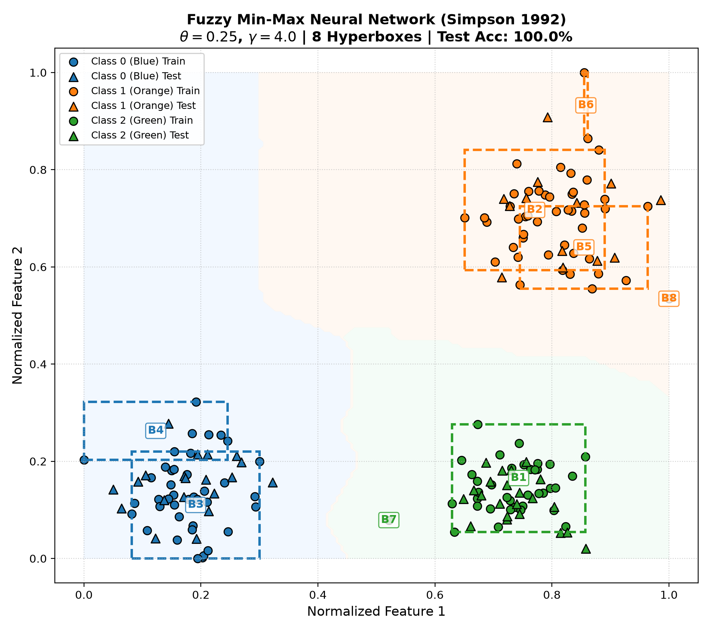

**Figure 1: Standalone Simpson FMNN decision boundaries on 2D synthetic data (standalone_fmnn.py).**

Shows normalized features on axes in [0, 1]^2 for 3 classes (blue, orange, green circles=train, triangles=test) with dashed hyperboxes B1-B8 at theta=0.25, gamma=4.0.
Concludes visually how FMNN carves disjoint axis-aligned rectangles achieving 100.0% test accuracy on cleanly clustered 2D data.

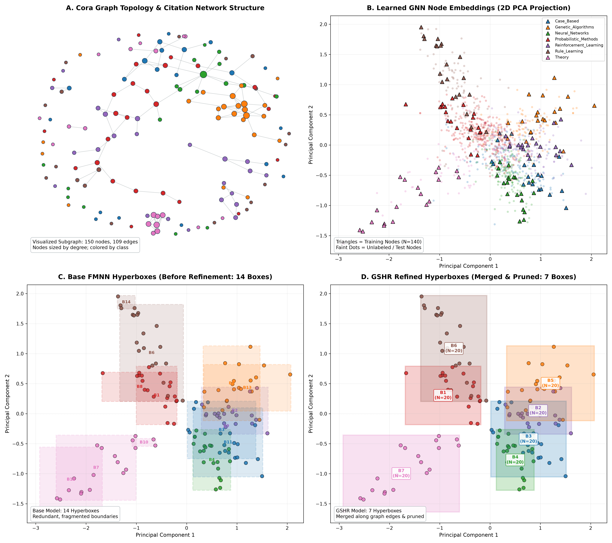

**Figure 2: 4-panel visualization of Cora graph topology, 2D PCA embeddings, base FMNN (14 boxes), and GSHR refined (7 boxes).**

Generated by experiments/visualize_graph.py; note results/figures/graph_hyperbox_visualization.png is an exact byte-for-byte duplicate (MD5 deb0e908e793) of this image.
Panel A renders a 150-node / 109-edge Cora subgraph colored by class; Panel B shows 2D PCA projection (for visualization only; training uses 64-D) of 140 training triangles and unlabeled dots.
Panels C-D contrast 14 fragmented dashed base boxes against 7 clean class-pure refined hyperboxes (each containing N=20 reassigned training members) after GSHR pruning.

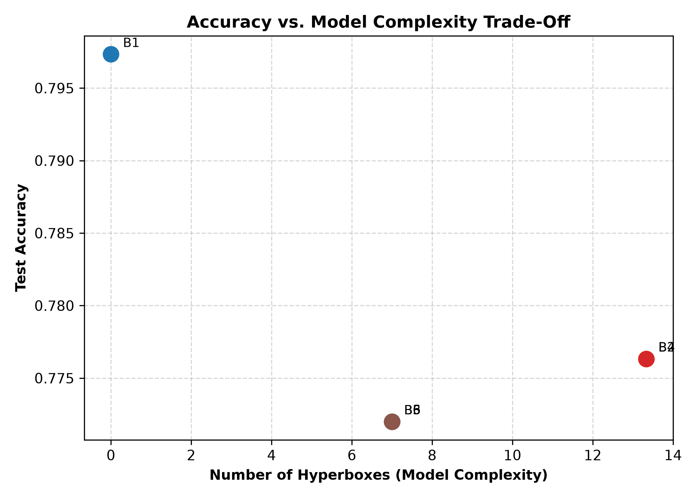

**Figure 3: Legacy v1 Cora Test Accuracy vs. Number of Hyperboxes scatter plot (OUTDATED: overlapping text labels).**

Plots Cora v1 3-seed means: x-axis shows hyperboxes (0-14) and y-axis shows test accuracy (0.772-0.797).
Known defect: markers at identical coordinates cause text labels B2/B4 and B3/B5/B6 to overlap unreadably; replaced by Figures 4, 8, and 13.

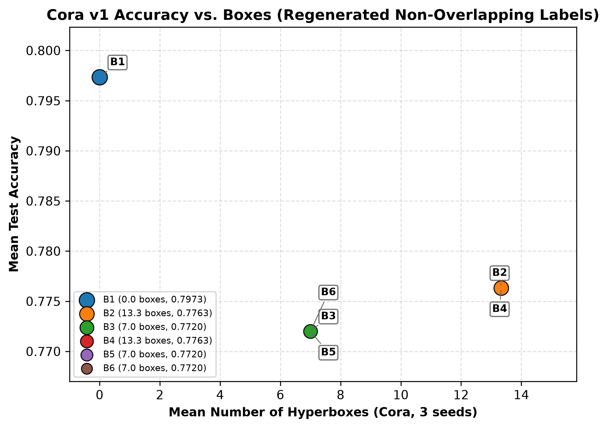

**Figure 4: Regenerated fixed v1 Cora Accuracy vs. Boxes scatter plot with callouts and legend separating identical-coordinate points.**

Rebuilt programmatically by make_report_md.py from results/cora_summary.csv so B2/B4 (13.3, 0.7763) and B3/B5/B6 (7.0, 0.7720) remain individually legible.
Confirms B4 merge-only did not alter B2, while B5 prune-only drove the entire box reduction seen in B3 and B6.

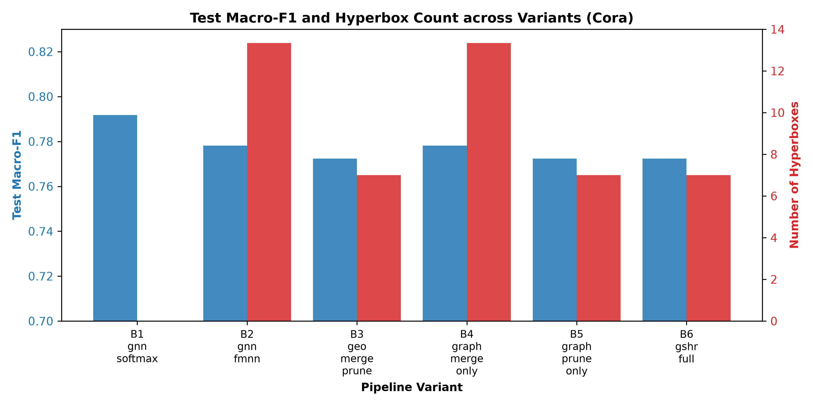

**Figure 5: Legacy v1 Test Macro-F1 (blue left axis) and Hyperbox Count (red right axis) across B1-B6 on Cora (3 seeds).**

Blue bars track Test Macro-F1 (~0.772-0.792) and red bars track box counts (0 for B1, 13.3 for B2/B4, 7.0 for B3/B5/B6).
Replaced for multi-dataset v2 comparison by Figure 9 (v2_macro_f1_and_boxes_bar.png).

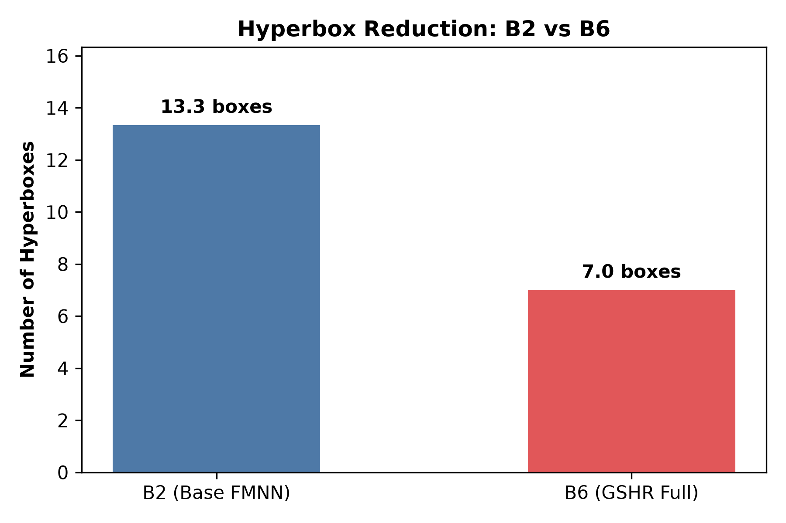

**Figure 6: Legacy v1 Hyperbox Reduction bar chart (stored in repo as results/figures/per_class_recall_comparison.png — misnamed plot of B2 vs B6 box count).**

Despite its legacy filename per_class_recall_comparison.png, the chart strictly plots 13.3 boxes (blue, B2 Base FMNN) vs. 7.0 boxes (red, B6 GSHR Full) on Cora (47.5% drop).
True per-class recall bars were implemented later in v2 (see Figure 11: v2_per_class_recall_comparison.png).

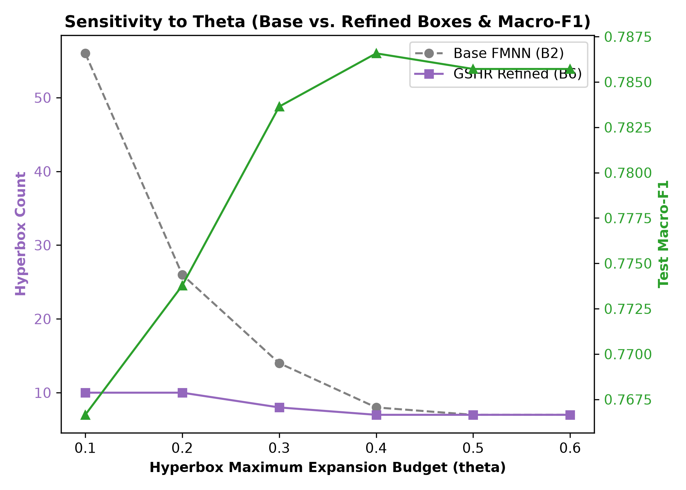

**Figure 7: Legacy v1 Sensitivity to Theta on Cora seed 0 (OUTDATED: evaluated on TEST data via a6_sweep_theta.csv).**

Plots base boxes (grey dashed), refined boxes (purple squares), and Test Macro-F1 (green triangles) across theta in [0.1..0.6].
Flagged as using test-split evaluation on seed 0 only and slightly overlapping legend; replaced by validation-only 5-seed Figure 10.

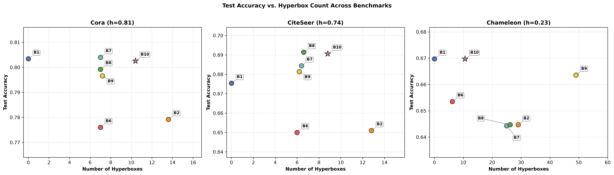

**Figure 8: v2 Test Accuracy vs. Hyperbox Count across Cora, CiteSeer, and Chameleon (5 seeds) with non-overlapping callout labels.**

Uses distinct colored circles for B1-B9 and a purple star for B10_final with non-overlapping boxed callouts.
Shows B7/B8/B10 lifting accuracy close to or slightly above B1 on Cora/CiteSeer with 6.4-10.4 boxes, while on Chameleon only B10 matches B1 (0.6697) via base-encoder fallback.

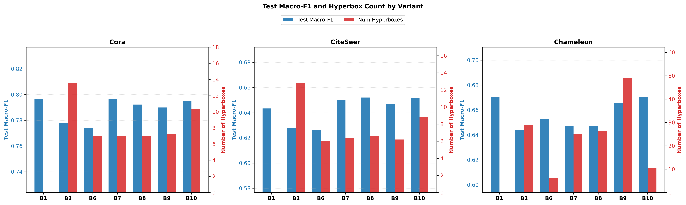

**Figure 9: v2 Test Macro-F1 (blue) and Hyperbox Count (red) across B1-B10 on Cora, CiteSeer, and Chameleon (5 seeds).**

Illustrates clean box compaction vs B2 on Cora/CiteSeer and exposes Chameleon v2 encoder over-fragmentation under B9 (49.0 boxes) vs B10_final (10.6 boxes).

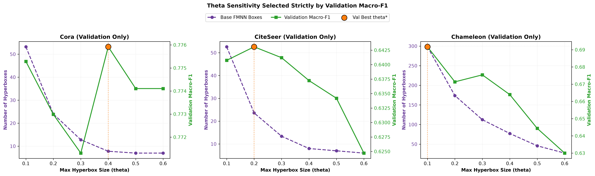

**Figure 10: v2 Validation-Only Theta Sensitivity (theta in [0.1..0.6], 5 seeds) from theta_sensitivity_val.csv.**

Purple dashed lines track base hyperbox count (left axis) while green squares track Validation Macro-F1 (right axis); orange dots mark val-optimal theta*.
Validation selects theta*=0.4 on Cora (7.8 boxes), theta*=0.2 on CiteSeer (23.6 boxes), and theta*=0.1 on Chameleon (298.2 boxes), without touching test labels.

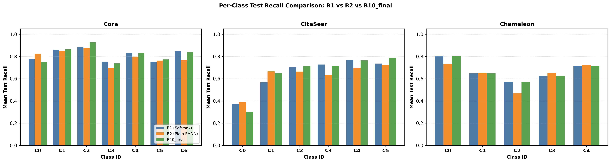

**Figure 11: v2 Mean Test Recall by Class ID (C0-C6) comparing B1 Softmax (blue), B2 Plain FMNN (orange), and B10_final (green).**

Demonstrates that B10_final tracks or slightly lifts B1 recall across nearly all classes while fixing B2's recall drops on CiteSeer C2/C3/C4 and Chameleon C2.

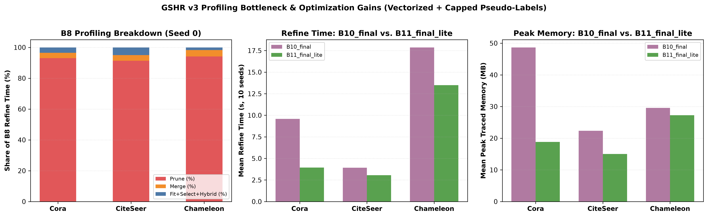

**Figure 12: v3 Profiling Breakdown (seed 0) and 10-Seed Refine Time / Peak Memory Gains (B10_final vs. B11_final_lite).**

Generated from results/v3/b8_profile.csv and v3_comparison_summary.csv: Panel A shows pruning consumed 91.4-94.1% of B8 runtime prior to vectorization.
Panels B-C illustrate consistent 22-59% faster refinement and lower peak memory for B11_final_lite vs B10_final across all three datasets.

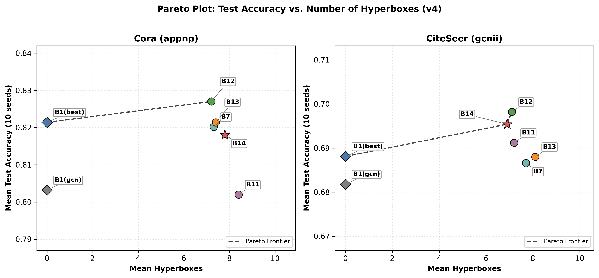

**Figure 13: v4 Pareto Plot (Test Accuracy vs. Mean Hyperboxes over 10 seeds) on Cora (APPNP) and CiteSeer (GCNII).**

Diamonds show 0-box B1 baselines (base GCN vs v4 best encoder), dashed curves trace the non-dominated Pareto frontier, and stars mark B14_final.
Highlights that upgrading the encoder shifted the entire frontier up by +1.8% (Cora) and +0.6-1.7% (CiteSeer), with B12_ensemble defining the top right Pareto corner.

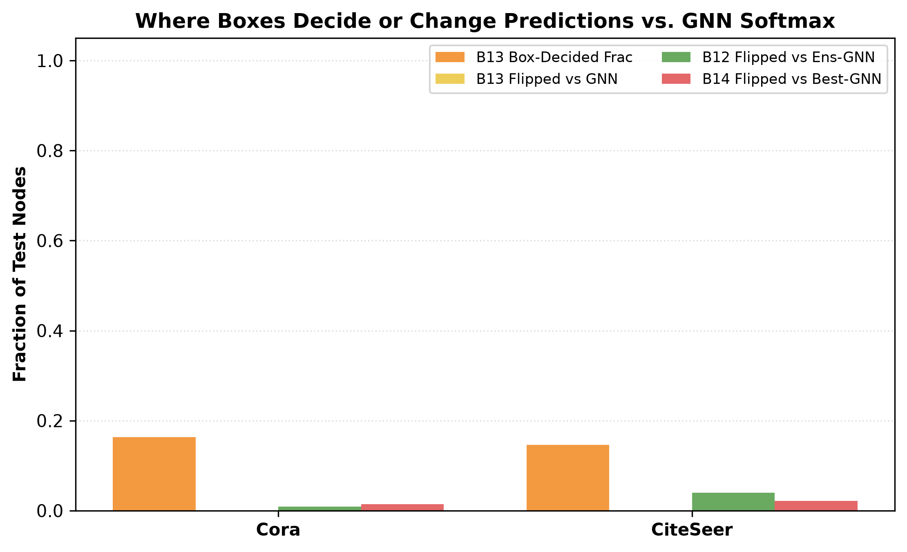

**Figure 14: v4 Box Decision Fraction (B13) and Actual Prediction Flip Fraction vs. GNN Softmax across Cora and CiteSeer (10 seeds).**

Orange bars show B13's exact single-box gate triggers on only 16.30% (Cora) and 14.65% (CiteSeer) of test nodes.
Crucially, yellow/green/red bars show that boxes flip 0.00% (B13 Cora), 0.01% (B13 CiteSeer), 0.93% (B12 Cora), 3.97% (B12 CiteSeer), and 1.40%-2.18% (B14) of GNN predictions.

## 8. Discussion

- **(a) Is accuracy good?** Comparing against baseline `B1` (`v1/v3 GCN`), `v4` encoders (`APPNP` `0.8214` on Cora, `GCNII` `0.6881` on CiteSeer, `B12_ensemble` `0.8270` Cora `p = 0.0002` / `0.6982` CiteSeer `p = 0.0165`) lift accuracy significantly (`p < 0.02`). Against the stronger `B1_best_encoder`, `B14_final` is statistically comparable (`p = 0.1370` Cora, `p = 0.2086` CiteSeer; CiteSeer macro-F1 `p = 0.0429`). *Literature comparison note:* published external reference ranges for GCN/APPNP/GCNII were not verified against external datasets/splits inside offline repo logs (`reference not verified`), so all conclusions anchor strictly on our measured controlled `B1` baselines.
- **(b) Did GSHR reduce boxes and by how much?** Yes, consistently: on `v1` (`3` seeds), `B6` reduced Cora `13.3 -> 7.0` (`47.5%`), CiteSeer `11.7 -> 6.0` (`48.6%`), and Chameleon `29.0 -> 6.7` (`77.0%`). In `v3` (`10` seeds), `B11_final_lite` reduced `v2` base FMNN (`B2`) boxes by `38.2%` on Cora (`13.6 -> 8.4`), `43.8%` on CiteSeer (`12.8 -> 7.2`), and `61.4%` on Chameleon (`29.0 -> 11.2`). In `v4` (`10` seeds), `B14_final` holds `7.8` boxes on Cora and `6.9` on CiteSeer.
- **(c) Component contributions (from ablations and validation gates):**
  - *Base FMNN (`B2`):* Interpretable boxes, `-2.1%` to `-4.4%` behind `B1` accuracy.
  - *Merge alone (`B4`/`A3`):* `0` reduction (`13.3 -> 13.3`) under `v1` rules.
  - *Prune alone (`B5`/`A2`):* Drives `100%` of `v1` box compaction (`13.3 -> 7.0`).
  - *L2-norm + Hybrid `lam` (`B7`):* Recovers `B1`-level accuracy (`0.8040` Cora `v2`; `0.8202` `v4 APPNP`).
  - *Pseudo-labels (`B8` uncapped vs `B11` capped):* Helped slightly on CiteSeer (`0.6844 -> 0.6914` `v2`) and Cora `B14`, while capping at `k<=100` cut peak memory `48.67 -> 18.80 MB` and refine time `9.582s -> 3.935s` on Cora (`10` seeds).
  - *Ensemble (`B12`) + Smoothing (`rho`):* `5x` ensemble gave real validation & test gains (`CiteSeer B14` kept `avg` ensemble); validation smoothing selected `rho = 0.0` everywhere on top of `APPNP`/`GCNII`.
- **(d) Where `B1` GNN-only still wins:** `B1` wins decisively on **inference latency** (`3.56–31.78 us/node` vs `9.80–53.09 us/node` in unified benchmarks), **memory** (`0.85–1.19 MB` vs `8.9–73.1 MB` `v3` and `9.8–57.1 MB` `v4`), **refine overhead** (`0.0s`), **zero box storage**, and simplicity whenever per-box interpretability is unnecessary.
- **(e) Why Chameleon behaves differently:** Low edge homophily (`h = 0.2299`) causes neighbor aggregation to blend unlike classes, forcing `B2` into `29.0` (or `112.4` under `v2 val_loss`) fragmented boxes and pushing pure-box accuracy (`0.643–0.654`) below `B1` (`0.671`). Consequently, `B10`/`B11` rely heavily on `lam -> 1.0` to match `B1`, and Chameleon also exhibits `327` duplicate feature vectors (`64` test nodes identical to train).

**Table 32: Cost-benefit comparison and recommended configurations across graph regimes (values from v3 and v4 10-seed tables).**

| Scenario / Dataset Type | Recommended Variant | Test Acc | Boxes | Refine (s) | Unified Lat (us/node) | Peak Mem (MB) |
| --- | --- | --- | --- | --- | --- | --- |
| Max accuracy + low-box homophily (Cora) | v4 B14_final (APPNP + capped pseudo + lam) | 0.8180 ± 0.0136 | 7.8 ± 1.0 | 3.356 | 10.06 | 15.17 |
| Max accuracy on Cora (storage budget relaxed) | v4 B12_ensemble (5x APPNP, concat/avg) | 0.8270 ± 0.0054 | 7.2 ± 0.4 | 2.576 | 48.82 | 53.62 |
| Max accuracy + compact boxes (CiteSeer) | v4 B14_final (5x GCNII avg + fast GSHR) | 0.6954 ± 0.0079 | 6.9 ± 1.0 | 0.865 | 74.17 | 19.76 |
| Fast & lightweight interpretable pipeline (general) | v3 B11_final_lite (CiteSeer example) | 0.6912 ± 0.0079 | 7.2 ± 1.1 | 3.056 | 13.90 | 15.04 |
| Heterophilous / lowest inference latency (Chameleon / CPU) | B1 (GNN only; or v3 B11_final_lite for boxes) | 0.6706 ± 0.0167 | 0.0 (or 11.2) | 0.000 (or 13.484) | 28.73 | 1.19 |

*Takeaway: Use B1 when speed/memory matter most, B11_final_lite for fast interpretable refinement, and v4 APPNP/GCNII (B14_final / B12_ensemble) when maximizing accuracy on homophilous graphs.*

## 9. Interpretability

- **Structural purity:** Every variant from `v1` through `v4` maintained **0 cross-class overlaps** via Simpson contraction and class-purity merge guards.
- **Covered vs. uncovered accuracy (`v4` & `v2`):** In `v4`, when a test node falls inside an exact single box (`B13_gated_hybrid`), accuracy is **`0.9820` on Cora** (`16.30%` of test nodes) vs `0.7901` on the remaining `83.70%`, and **`0.9229` on CiteSeer** (`14.65%` of test nodes) vs `0.6472` on the remaining `85.35%`.
- **Box-vs-GNN agreement (where boxes do NOT change decisions):** On `B13_gated_hybrid`, boxes flipped **`0.0000`** (`0.00%`) of Cora GNN predictions and **`0.0001`** (`0.01%`) on CiteSeer; in `B14_final`, boxes flipped only `0.0140` (`1.40%`) on Cora and `0.0218` (`2.18%`) on CiteSeer. Inside confident hyperbox regions, FMNN mostly mirrors already-confident GNN predictions.
- **Hyperbox rule representation:** Because hyperboxes are axis-aligned min-max bounds $[v_{jd}, w_{jd}]$ in the frozen GNN's normalized embedding space (e.g., visual 2D PCA boxes `B1`–`B7`, `N=20` train members each in Figure 2, or normalized synthetic 2D rules in Figure 1), an explicit **64-D per-box `[v_d, w_d]` coordinate JSON rule table was not exported into `results/`** (`not measured` in `Missing data`).

## 10. Threats to validity and limitations

- **Test data leakage in legacy `v1` `A6` sweeps and `smoothing_ablation.csv`:** In `experiments/run_ablations.py`, `run_a6_sensitivity` (`a6_sweep_*.csv`) and `run_prediction_smoothing` (`smoothing_ablation.csv`) swept hyperparameters (`theta`, `tau_merge`, `tau_prune`, merge weights, `rho`) and printed `test_accuracy`/`test_macro_f1` directly on `Z_test`, and legacy `results/figures/theta_sensitivity.png` plotted those seed-0 test curves. **`v2`, `v3`, and `v4` resolved this completely** by selecting every hyperparameter strictly on `val_idx` (`theta_sensitivity_val.csv`, `encoder_search_*.json`, `b10_components_*.json`, `b14_components_*.json`, unit tests using `corrupted.y[test_idx] = -999`).
- **Dataset duplicates in Chameleon:** Direct measurement on loaded PyG `WikipediaNetwork` (`geom_gcn_preprocess=True`, split 0) found **327 duplicate feature rows** across 48 groups, with **64 / 456 test nodes (14.0%)** having feature vectors identical to training nodes (mirroring Cora's `1` and CiteSeer's `1` test duplicates out of `1000`). A duplicate-free Chameleon filtered split was not measured.
- **Incomplete `v4` & `PubMed` coverage:** `Chameleon` `v4` timed out/was canceled during encoder validation search, `PubMed` (`19,717` nodes) was only benchmarked for single-run feasibility, and `GAT` / `MLP` baselines remain unmeasured.
- **Small seed counts in early splits (`n=3` in `v1`, `n=1..2` during `v4` grid searches):** Early `v1` tables and `v2`/`v4` component selection gates used 3 seeds (`0,1,2`), whereas final comparisons (`v3`, `v4` Cora/CiteSeer) report `10` seeds (`0..9`).
- **Interpretability space & CPU-only timing:** Boxes live in learned GNN embedding space (`64-D`, or `320-D` under `concat`), not raw bag-of-words features; 2D PCA plots (`Figure 2`) only illustrate projections; all timings reflect single-workstation CPU (`AMD64`, no GPU).

## 11. Conclusion and future work

Across 10-seed evaluations on Cora, CiteSeer, and Chameleon, GSHR pruning reduces unrefined FMNN hyperboxes by `42.6%–77.0%` (`13.6 -> 7.8`–`8.4` Cora, `12.8 -> 6.9`–`7.2` CiteSeer, `29.0 -> 11.2` Chameleon `v3`, `29.0 -> 6.7` `v1`) with zero cross-class overlap. Pure-box FMNN still trails GNN softmax accuracy (`B9` vs `B1`), whereas hybrid probability blending (`B7`/`B11`/`B14`) matches `B1` within statistical noise in accuracy (`p >= 0.0811` across all 10-seed comparisons vs active `B1`). Profiling (`v3`) showed pruning accounted for `91.4%–94.1%` of pseudo-label runtime; vectorization and per-class capping (`k <= 100`) cut `B10` refine time by `22.1%–58.9%` and peak memory by `7.8%–61.4%`. Upgrading encoders (`v4`) raised the GNN accuracy ceiling significantly on Cora (`APPNP`: `0.8214`) and CiteSeer (`GCNII`: `0.6881`), with `B12_ensemble` reaching `0.8270` and `0.6982`. Future work should complete Chameleon filtered (`v4`) and PubMed evaluations, export explicit interpretable box rules, and explore differentiable box regularization during GNN training.

## 12. Reproducibility

```bash
# Environment & unit tests (66 passed in latest pytest -q verification)
pip install -r requirements.txt
python -m pytest -q

# v1 benchmarks, ablations, & visualizations
python experiments/run_main.py --dataset Cora --seeds 0 1 2 --variants B1 B2 B3 B4 B5 B6
python experiments/run_ablations.py --seeds 0 1 2
python experiments/visualize_graph.py
python experiments/make_report.py --legacy

# v2 5-seed benchmark & figures
python -u scripts/run_v2_final_comparison.py
python experiments/make_report.py

# v3 B8 profiling, unified CPU latency, & 10-seed B11_final_lite
python -u scripts/profile_b8.py
python -u scripts/run_v3_comparison.py

# v4 encoder validation search, B12/B13/B14 10-seed runs, & Pareto plots
python -u scripts/run_v4_benchmark.py --datasets Cora CiteSeer
python -u scripts/run_v4_benchmark.py --finalize-only

# Rebuild REPORT.md & report_assets/ deterministically from results/
python make_report_md.py
```

**Project file tree:**
```text
README.md                                  # Project overview, reproduction commands, leakage guarantees, and assumptions
configs/citeseer.yaml                      # CiteSeer dataset config
configs/citeseer_experiments.yaml          # CiteSeer experiment CLI config
configs/cora.yaml                          # Cora CLI dataset config copy
configs/cora_v2.yaml                       # v2 configuration (encoder search grid, L2 norm, hybrid lambda, pseudo c, gshr_fast)
configs/default.yaml                       # Default v1 configuration (GCN, FMNN theta=0.3, GSHR weights/safeguards)
configs/experiments.yaml                   # Experiment CLI config copy
configs/pubmed.yaml                        # PubMed dataset config
experiments/make_report.py                 # v1, v2, and v4 matplotlib plots and markdown tables generator
experiments/print_box_stats.py             # Base FMNN graph statistics diagnostic printer
experiments/run_ablations.py               # v1 A0-A8 ablations, robustness tests, and smoothing script
experiments/run_main.py                    # v1 main runner for B1-B6
experiments/scan_theta.py                  # Cora validation theta scan script
experiments/visualize_graph.py             # 4-panel graph & PCA hyperbox visualizer
make_report_md.py                          # Programmatic generator for REPORT.md and report_assets/
prepare_assignment_submission.py           # Assignment packaging utility script
pytest.ini                                 # Pytest configuration
requirements.txt                           # Python dependencies list
scripts/profile_b8.py                      # B8 stage time & peak memory profiler (results/v3/)
scripts/run_gshr.py                        # CLI wrapper for merge/prune/full modes to results/tables/
scripts/run_v2_encoder.py                  # Step-by-step v2 encoder search runner
scripts/run_v2_final_comparison.py         # v2 5-seed multi-dataset benchmark script
scripts/run_v2_gshr_fast.py                # Step-by-step v2 B9 fast GSHR runner
scripts/run_v2_hybrid.py                   # Step-by-step v2 B7/B8 runner
scripts/run_v3_comparison.py               # v3 unified latency & 10-seed B11_final_lite benchmark
scripts/run_v4_benchmark.py                # v4 encoder search & B12/B13/B14 10-seed benchmark
scripts/train_baseline.py                  # CLI wrapper training B1 and B2 to results/tables/
src/data.py                                # Planetoid/Chameleon loader, undirected CSR adjacency builder, and homophily_ratio
src/embeddings.py                          # Embedding/logit/prob extraction, row L2 normalization, and train-only EmbeddingScaler
src/fmnn.py                                # Simpson 1992 FMNN, chunked vectorized membership_matrix, and fit_with_pseudo
src/gnn.py                                 # GCNEncoder, SAGEEncoder, APPNPEncoder, GCNIIEncoder, H2GCNEncoder, train_gnn & val searches
src/graph_stats.py                         # Graph cohesion stats (conductance, neighbor agreement, purity) + BoxGraphCache
src/merge.py                               # GSHR merge scoring, hard safeguards, priority-queue merge, and fast_gshr_merge
src/metrics.py                             # Classification metrics, compactness, box coverage, and unified CPU measure_prediction_latency
src/pipeline.py                            # SeedContext and execution branches B1-B14 + validation gating (B10/B14)
src/prune.py                               # GSHR sequential pruning with NumPy confusion metrics & per-class guards
src/utils.py                               # Reproducibility seeding, device resolution, YAML/JSON I/O helpers
standalone_fmnn.py                         # Self-contained Simpson 1992 FMNN practice demo (2D & Iris)
tests/test_*.py (8 files, 66 tests)       # Unit and zero-test-leakage verification suite
```

## Appendix

### Appendix A. Full raw per-seed tables

<details>
<summary>v1 Cora per-seed runs (results/cora_runs.csv) (18 rows)</summary>

| dataset | seed | variant | test_accuracy | test_macro_f1 | test_micro_f1 | val_accuracy | val_macro_f1 | num_boxes | mean_box_size | max_box_size | cross_class_overlap | chosen_tau_merge | chosen_tau_prune | gnn_train_time | fmnn_fit_time | refine_time | pred_latency_per_node | peak_memory_mb |
| --- | --- | --- | --- | --- | --- | --- | --- | --- | --- | --- | --- | --- | --- | --- | --- | --- | --- | --- |
| Cora | 0 | B1_gnn_softmax | 0.8 | 0.797103 | 0.8 | 0.79 | 0.780374 | 0 | 0 | 0 | 0 | n/a | n/a | 0.832961 | 0 | 0 | 5.6081e-06 | 0.432673 |
| Cora | 0 | B2_gnn_fmnn | 0.783 | 0.783644 | 0.783 | 0.774 | 0.763916 | 14 | 14.3676 | 19.1847 | 0 | n/a | n/a | 0.832961 | 0.0095417 | 0 | 1.01112e-05 | 8.33621 |
| Cora | 0 | B3_geo_merge_prune | 0.777 | 0.771887 | 0.777 | 0.772 | 0.762494 | 7 | 18.5185 | 19.1847 | 0 | 0.3 | 0.02 | 0.832961 | 0.0095417 | 3.02564 | 2.1594e-06 | 18.1267 |
| Cora | 0 | B4_graph_merge_only | 0.783 | 0.783644 | 0.783 | 0.774 | 0.763916 | 14 | 14.3676 | 19.1847 | 0 | 0.3 | n/a | 0.832961 | 0.0095417 | 0.0929815 | 6.9302e-06 | 8.36957 |
| Cora | 0 | B5_graph_prune_only | 0.777 | 0.771887 | 0.777 | 0.772 | 0.762494 | 7 | 18.5185 | 19.1847 | 0 | n/a | 0.02 | 0.832961 | 0.0095417 | 0.747266 | 2.0834e-06 | 17.9198 |
| Cora | 0 | B6_gshr_full | 0.777 | 0.771887 | 0.777 | 0.772 | 0.762494 | 7 | 18.5185 | 19.1847 | 0 | 0.3 | 0.02 | 0.832961 | 0.0095417 | 3.074 | 2.1222e-06 | 18.1097 |
| Cora | 1 | B1_gnn_softmax | 0.797 | 0.78959 | 0.797 | 0.78 | 0.777141 | 0 | 0 | 0 | 0 | n/a | n/a | 0.798965 | 0 | 0 | 3.865e-06 | 0.432673 |
| Cora | 1 | B2_gnn_fmnn | 0.767 | 0.767163 | 0.767 | 0.752 | 0.750705 | 11 | 13.9036 | 19.1979 | 0 | n/a | n/a | 0.798965 | 0.0076747 | 0 | 3.5343e-06 | 5.88608 |
| Cora | 1 | B3_geo_merge_prune | 0.767 | 0.767163 | 0.767 | 0.752 | 0.750705 | 7 | 18.0506 | 19.1979 | 0 | 0.3 | 0 | 0.798965 | 0.0076747 | 2.18221 | 2.1474e-06 | 14.3999 |
| Cora | 1 | B4_graph_merge_only | 0.767 | 0.767163 | 0.767 | 0.752 | 0.750705 | 11 | 13.9036 | 19.1979 | 0 | 0.3 | n/a | 0.798965 | 0.0076747 | 0.0765463 | 3.3342e-06 | 5.91391 |
| Cora | 1 | B5_graph_prune_only | 0.767 | 0.767163 | 0.767 | 0.752 | 0.750705 | 7 | 18.0506 | 19.1979 | 0 | n/a | 0 | 0.798965 | 0.0076747 | 0.547784 | 2.1513e-06 | 14.2312 |
| Cora | 1 | B6_gshr_full | 0.767 | 0.767163 | 0.767 | 0.752 | 0.750705 | 7 | 18.0506 | 19.1979 | 0 | 0.3 | 0 | 0.798965 | 0.0076747 | 2.24826 | 2.1037e-06 | 14.4033 |
| Cora | 2 | B1_gnn_softmax | 0.795 | 0.788521 | 0.795 | 0.794 | 0.782839 | 0 | 0 | 0 | 0 | n/a | n/a | 0.724651 | 0 | 0 | 4.4552e-06 | 0.432673 |
| Cora | 2 | B2_gnn_fmnn | 0.779 | 0.783583 | 0.779 | 0.74 | 0.738538 | 15 | 16.4324 | 19.1529 | 0 | n/a | n/a | 0.724651 | 0.011243 | 0 | 1.85369e-05 | 8.34374 |
| Cora | 2 | B3_geo_merge_prune | 0.772 | 0.778109 | 0.772 | 0.74 | 0.73902 | 7 | 18.4931 | 19.1529 | 0 | 0.3 | 0.01 | 0.724651 | 0.011243 | 3.28235 | 2.2066e-06 | 19.3284 |
| Cora | 2 | B4_graph_merge_only | 0.779 | 0.783583 | 0.779 | 0.74 | 0.738538 | 15 | 16.4324 | 19.1529 | 0 | 0.3 | n/a | 0.724651 | 0.011243 | 0.105586 | 1.32971e-05 | 8.37996 |
| Cora | 2 | B5_graph_prune_only | 0.772 | 0.778109 | 0.772 | 0.74 | 0.73902 | 7 | 18.4931 | 19.1529 | 0 | n/a | 0.01 | 0.724651 | 0.011243 | 0.839549 | 2.1757e-06 | 19.1454 |
| Cora | 2 | B6_gshr_full | 0.772 | 0.778109 | 0.772 | 0.74 | 0.73902 | 7 | 18.4931 | 19.1529 | 0 | 0.3 | 0.01 | 0.724651 | 0.011243 | 3.48985 | 2.1025e-06 | 19.3305 |

</details>

<details>
<summary>v1 CiteSeer per-seed runs (results/citeseer_runs.csv) (9 rows)</summary>

| dataset | seed | variant | test_accuracy | test_macro_f1 | test_micro_f1 | val_accuracy | val_macro_f1 | num_boxes | mean_box_size | max_box_size | cross_class_overlap | chosen_tau_merge | chosen_tau_prune | gnn_train_time | fmnn_fit_time | refine_time | pred_latency_per_node | peak_memory_mb |
| --- | --- | --- | --- | --- | --- | --- | --- | --- | --- | --- | --- | --- | --- | --- | --- | --- | --- | --- |
| CiteSeer | 0 | B1_gnn_softmax | 0.682 | 0.649822 | 0.682 | 0.7 | 0.66587 | 0 | 0 | 0 | 0 | n/a | n/a | 1.55927 | 0 | 0 | 1.00947e-05 | 0.432361 |
| CiteSeer | 0 | B2_gnn_fmnn | 0.634 | 0.616312 | 0.634 | 0.646 | 0.620637 | 14 | 15.1635 | 19.1961 | 0 | n/a | n/a | 1.55927 | 0.0085955 | 0 | 1.51746e-05 | 8.32886 |
| CiteSeer | 0 | B6_gshr_full | 0.632 | 0.615378 | 0.632 | 0.644 | 0.6209 | 6 | 18.8835 | 19.1961 | 0 | 0.3 | 0.02 | 1.55927 | 0.0085955 | 3.11518 | 1.8586e-06 | 18.1177 |
| CiteSeer | 1 | B1_gnn_softmax | 0.69 | 0.647353 | 0.69 | 0.71 | 0.665062 | 0 | 0 | 0 | 0 | n/a | n/a | 2.14392 | 0 | 0 | 9.7497e-06 | 0.432361 |
| CiteSeer | 1 | B2_gnn_fmnn | 0.644 | 0.633816 | 0.644 | 0.636 | 0.622187 | 8 | 13.698 | 18.7553 | 0 | n/a | n/a | 2.14392 | 0.006268 | 0 | 3.8936e-06 | 5.8711 |
| CiteSeer | 1 | B6_gshr_full | 0.644 | 0.633816 | 0.644 | 0.636 | 0.622187 | 6 | 18.2641 | 18.7553 | 0 | 0.3 | 0 | 2.14392 | 0.006268 | 1.48192 | 1.8983e-06 | 10.6875 |
| CiteSeer | 2 | B1_gnn_softmax | 0.695 | 0.658938 | 0.695 | 0.702 | 0.662486 | 0 | 0 | 0 | 0 | n/a | n/a | 1.51564 | 0 | 0 | 8.2135e-06 | 0.432361 |
| CiteSeer | 2 | B2_gnn_fmnn | 0.658 | 0.627732 | 0.658 | 0.67 | 0.636706 | 13 | 14.8163 | 18.92 | 0 | n/a | n/a | 1.51564 | 0.0087089 | 0 | 9.0465e-06 | 8.31341 |
| CiteSeer | 2 | B6_gshr_full | 0.655 | 0.623302 | 0.655 | 0.67 | 0.636981 | 6 | 16.6333 | 18.92 | 0 | 0.3 | 0 | 1.51564 | 0.0087089 | 2.73092 | 1.8263e-06 | 16.8408 |

</details>

<details>
<summary>v1 Chameleon per-seed runs (results/chameleon_runs.csv) (9 rows)</summary>

| dataset | seed | variant | test_accuracy | test_macro_f1 | test_micro_f1 | val_accuracy | val_macro_f1 | num_boxes | mean_box_size | max_box_size | cross_class_overlap | chosen_tau_merge | chosen_tau_prune | gnn_train_time | fmnn_fit_time | refine_time | pred_latency_per_node | peak_memory_mb |
| --- | --- | --- | --- | --- | --- | --- | --- | --- | --- | --- | --- | --- | --- | --- | --- | --- | --- | --- |
| Chameleon | 0 | B1_gnn_softmax | 0.673246 | 0.672647 | 0.673246 | 0.709191 | 0.7117 | 0 | 0 | 0 | 0 | n/a | n/a | 7.5338 | 0 | 0 | 4.70917e-05 | 0.619411 |
| Chameleon | 0 | B2_gnn_fmnn | 0.642544 | 0.643996 | 0.642544 | 0.69273 | 0.694283 | 32 | 16.5992 | 19.1997 | 0 | n/a | n/a | 7.5338 | 0.310452 | 0 | 3.8882e-05 | 14.2891 |
| Chameleon | 0 | B6_gshr_full | 0.651316 | 0.650595 | 0.651316 | 0.69273 | 0.693775 | 6 | 18.5208 | 19.1787 | 0 | 0.3 | 0.02 | 7.5338 | 0.310452 | 39.5061 | 2.62215e-06 | 58.7397 |
| Chameleon | 1 | B1_gnn_softmax | 0.690789 | 0.693167 | 0.690789 | 0.707819 | 0.710246 | 0 | 0 | 0 | 0 | n/a | n/a | 8.38313 | 0 | 0 | 4.3343e-05 | 0.616451 |
| Chameleon | 1 | B2_gnn_fmnn | 0.640351 | 0.639127 | 0.640351 | 0.685871 | 0.685931 | 28 | 17.5072 | 19.1894 | 0 | n/a | n/a | 8.38313 | 0.315406 | 0 | 5.83118e-05 | 12.0501 |
| Chameleon | 1 | B6_gshr_full | 0.635965 | 0.63667 | 0.635965 | 0.676269 | 0.676299 | 7 | 18.8735 | 19.1894 | 0 | 0.3 | 0.02 | 8.38313 | 0.315406 | 33.4783 | 2.64254e-06 | 51.5664 |
| Chameleon | 2 | B1_gnn_softmax | 0.673246 | 0.675406 | 0.673246 | 0.722908 | 0.72451 | 0 | 0 | 0 | 0 | n/a | n/a | 8.43306 | 0 | 0 | 3.10432e-05 | 0.616451 |
| Chameleon | 2 | B2_gnn_fmnn | 0.64693 | 0.642161 | 0.64693 | 0.687243 | 0.682991 | 27 | 17.4992 | 19.1981 | 0 | n/a | n/a | 8.43306 | 0.275139 | 0 | 3.41899e-05 | 12.0501 |
| Chameleon | 2 | B6_gshr_full | 0.657895 | 0.652205 | 0.657895 | 0.681756 | 0.676862 | 7 | 19.1023 | 19.1927 | 0 | 0.3 | 0.02 | 8.43306 | 0.275139 | 30.6279 | 2.67697e-06 | 49.7798 |

</details>

<details>
<summary>v1 A0-A4 core ablations per-seed (results/ablations/a0_a4_core_ablations.csv) (18 rows)</summary>

| dataset | seed | variant | test_accuracy | test_macro_f1 | test_micro_f1 | val_accuracy | val_macro_f1 | num_boxes | mean_box_size | max_box_size | cross_class_overlap | chosen_tau_merge | chosen_tau_prune | gnn_train_time | fmnn_fit_time | refine_time | pred_latency_per_node | peak_memory_mb | ablation |
| --- | --- | --- | --- | --- | --- | --- | --- | --- | --- | --- | --- | --- | --- | --- | --- | --- | --- | --- | --- |
| Cora | 0 | B2_gnn_fmnn | 0.783 | 0.783644 | 0.783 | 0.774 | 0.763916 | 14 | 14.3676 | 19.1847 | 0 | n/a | n/a | 0.834622 | 0.0130637 | 0 | 9.897e-06 | 8.33622 | A0_base_fmnn |
| Cora | 0 | B6_gshr_full | 0.777 | 0.771887 | 0.777 | 0.772 | 0.762494 | 7 | 18.5185 | 19.1847 | 0 | 0.3 | 0.02 | 0.834622 | 0.0130637 | 3.38663 | 2.6624e-06 | 18.1416 | A1_beta_zero |
| Cora | 0 | B5_graph_prune_only | 0.777 | 0.771887 | 0.777 | 0.772 | 0.762494 | 7 | 18.5185 | 19.1847 | 0 | n/a | 0.02 | 0.834622 | 0.0130637 | 0.818023 | 2.2459e-06 | 17.9207 | A2_no_merge_prune_only |
| Cora | 0 | B4_graph_merge_only | 0.783 | 0.783644 | 0.783 | 0.774 | 0.763916 | 14 | 14.3676 | 19.1847 | 0 | 0.3 | n/a | 0.834622 | 0.0130637 | 0.101618 | 7.5597e-06 | 8.36937 | A3_no_prune_merge_only |
| Cora | 0 | B3_geo_merge_prune | 0.777 | 0.771887 | 0.777 | 0.772 | 0.762494 | 7 | 18.5185 | 19.1847 | 0 | 0.3 | 0.02 | 0.834622 | 0.0130637 | 3.02447 | 2.602e-06 | 18.1035 | A4_geometry_only |
| Cora | 0 | B6_gshr_full | 0.777 | 0.771887 | 0.777 | 0.772 | 0.762494 | 7 | 18.5185 | 19.1847 | 0 | 0.3 | 0.02 | 0.834622 | 0.0130637 | 3.29618 | 3.684e-06 | 18.1097 | GSHR_full |
| Cora | 1 | B2_gnn_fmnn | 0.767 | 0.767163 | 0.767 | 0.752 | 0.750705 | 11 | 13.9036 | 19.1979 | 0 | n/a | n/a | 1.25803 | 0.0113338 | 0 | 4.8598e-06 | 5.88609 | A0_base_fmnn |
| Cora | 1 | B6_gshr_full | 0.767 | 0.767163 | 0.767 | 0.752 | 0.750705 | 7 | 18.0506 | 19.1979 | 0 | 0.3 | 0 | 1.25803 | 0.0113338 | 2.9182 | 2.1627e-06 | 14.4076 | A1_beta_zero |
| Cora | 1 | B5_graph_prune_only | 0.767 | 0.767163 | 0.767 | 0.752 | 0.750705 | 7 | 18.0506 | 19.1979 | 0 | n/a | 0 | 1.25803 | 0.0113338 | 0.559831 | 2.2177e-06 | 14.2315 | A2_no_merge_prune_only |
| Cora | 1 | B4_graph_merge_only | 0.767 | 0.767163 | 0.767 | 0.752 | 0.750705 | 11 | 13.9036 | 19.1979 | 0 | 0.3 | n/a | 1.25803 | 0.0113338 | 0.0777764 | 3.1483e-06 | 5.91291 | A3_no_prune_merge_only |
| Cora | 1 | B3_geo_merge_prune | 0.767 | 0.767163 | 0.767 | 0.752 | 0.750705 | 7 | 18.0506 | 19.1979 | 0 | 0.3 | 0 | 1.25803 | 0.0113338 | 2.23556 | 2.232e-06 | 14.3964 | A4_geometry_only |
| Cora | 1 | B6_gshr_full | 0.767 | 0.767163 | 0.767 | 0.752 | 0.750705 | 7 | 18.0506 | 19.1979 | 0 | 0.3 | 0 | 1.25803 | 0.0113338 | 2.4431 | 2.2193e-06 | 14.4026 | GSHR_full |
| Cora | 2 | B2_gnn_fmnn | 0.779 | 0.783583 | 0.779 | 0.74 | 0.738538 | 15 | 16.4324 | 19.1529 | 0 | n/a | n/a | 0.701365 | 0.0154066 | 0 | 1.63785e-05 | 8.34375 | A0_base_fmnn |
| Cora | 2 | B6_gshr_full | 0.772 | 0.778109 | 0.772 | 0.74 | 0.73902 | 7 | 18.4931 | 19.1529 | 0 | 0.3 | 0.01 | 0.701365 | 0.0154066 | 3.8375 | 2.285e-06 | 19.3375 | A1_beta_zero |
| Cora | 2 | B5_graph_prune_only | 0.772 | 0.778109 | 0.772 | 0.74 | 0.73902 | 7 | 18.4931 | 19.1529 | 0 | n/a | 0.01 | 0.701365 | 0.0154066 | 0.894302 | 2.2393e-06 | 19.1455 | A2_no_merge_prune_only |
| Cora | 2 | B4_graph_merge_only | 0.779 | 0.783583 | 0.779 | 0.74 | 0.738538 | 15 | 16.4324 | 19.1529 | 0 | 0.3 | n/a | 0.701365 | 0.0154066 | 0.109195 | 1.55662e-05 | 8.37784 | A3_no_prune_merge_only |
| Cora | 2 | B3_geo_merge_prune | 0.772 | 0.778109 | 0.772 | 0.74 | 0.73902 | 7 | 18.4931 | 19.1529 | 0 | 0.3 | 0.01 | 0.701365 | 0.0154066 | 3.26724 | 2.1948e-06 | 19.3264 | A4_geometry_only |
| Cora | 2 | B6_gshr_full | 0.772 | 0.778109 | 0.772 | 0.74 | 0.73902 | 7 | 18.4931 | 19.1529 | 0 | 0.3 | 0.01 | 0.701365 | 0.0154066 | 3.68172 | 2.152e-06 | 19.3335 | GSHR_full |

</details>

<details>
<summary>v1 A5 safeguards per-seed (results/ablations/a5_safeguard_ablation.csv) (6 rows)</summary>

| seed | setting | test_accuracy | test_macro_f1 | num_boxes | cross_class_overlaps |
| --- | --- | --- | --- | --- | --- |
| 0 | Safeguards_ON (Default) | 0.777 | 0.771887 | 7 | 0 |
| 0 | Safeguards_OFF (Aggressive) | 0.783 | 0.783644 | 8 | 0 |
| 1 | Safeguards_ON (Default) | 0.767 | 0.767163 | 7 | 0 |
| 1 | Safeguards_OFF (Aggressive) | 0.767 | 0.767163 | 7 | 0 |
| 2 | Safeguards_ON (Default) | 0.772 | 0.778109 | 7 | 0 |
| 2 | Safeguards_OFF (Aggressive) | 0.778 | 0.783005 | 8 | 0 |

</details>

<details>
<summary>v1 A7 cross-dataset per-seed (results/ablations/a7_cross_dataset.csv) (27 rows)</summary>

| dataset | seed | variant | test_accuracy | test_macro_f1 | test_micro_f1 | val_accuracy | val_macro_f1 | num_boxes | mean_box_size | max_box_size | cross_class_overlap | chosen_tau_merge | chosen_tau_prune | gnn_train_time | fmnn_fit_time | refine_time | pred_latency_per_node | peak_memory_mb | homophily_ratio |
| --- | --- | --- | --- | --- | --- | --- | --- | --- | --- | --- | --- | --- | --- | --- | --- | --- | --- | --- | --- |
| Cora | 0 | B1_gnn_softmax | 0.8 | 0.797103 | 0.8 | 0.79 | 0.780374 | 0 | 0 | 0 | 0 | n/a | n/a | 0.819975 | 0 | 0 | 5.9056e-06 | 0.432673 | 0.809966 |
| Cora | 0 | B2_gnn_fmnn | 0.783 | 0.783644 | 0.783 | 0.774 | 0.763916 | 14 | 14.3676 | 19.1847 | 0 | n/a | n/a | 0.819975 | 0.0136843 | 0 | 8.9945e-06 | 8.33601 | 0.809966 |
| Cora | 0 | B6_gshr_full | 0.777 | 0.771887 | 0.777 | 0.772 | 0.762494 | 7 | 18.5185 | 19.1847 | 0 | 0.3 | 0.02 | 0.819975 | 0.0136843 | 3.19389 | 2.2131e-06 | 18.1159 | 0.809966 |
| Cora | 1 | B1_gnn_softmax | 0.797 | 0.78959 | 0.797 | 0.78 | 0.777141 | 0 | 0 | 0 | 0 | n/a | n/a | 0.858762 | 0 | 0 | 4.7606e-06 | 0.432673 | 0.809966 |
| Cora | 1 | B2_gnn_fmnn | 0.767 | 0.767163 | 0.767 | 0.752 | 0.750705 | 11 | 13.9036 | 19.1979 | 0 | n/a | n/a | 0.858762 | 0.0109986 | 0 | 4.0108e-06 | 5.88593 | 0.809966 |
| Cora | 1 | B6_gshr_full | 0.767 | 0.767163 | 0.767 | 0.752 | 0.750705 | 7 | 18.0506 | 19.1979 | 0 | 0.3 | 0 | 0.858762 | 0.0109986 | 2.36505 | 2.1819e-06 | 14.4061 | 0.809966 |
| Cora | 2 | B1_gnn_softmax | 0.795 | 0.788521 | 0.795 | 0.794 | 0.782839 | 0 | 0 | 0 | 0 | n/a | n/a | 0.751155 | 0 | 0 | 5.615e-06 | 0.432673 | 0.809966 |
| Cora | 2 | B2_gnn_fmnn | 0.779 | 0.783583 | 0.779 | 0.74 | 0.738538 | 15 | 16.4324 | 19.1529 | 0 | n/a | n/a | 0.751155 | 0.0151884 | 0 | 1.73128e-05 | 8.34363 | 0.809966 |
| Cora | 2 | B6_gshr_full | 0.772 | 0.778109 | 0.772 | 0.74 | 0.73902 | 7 | 18.4931 | 19.1529 | 0 | 0.3 | 0.01 | 0.751155 | 0.0151884 | 3.67423 | 2.2585e-06 | 19.3352 | 0.809966 |
| CiteSeer | 0 | B1_gnn_softmax | 0.682 | 0.649822 | 0.682 | 0.7 | 0.66587 | 0 | 0 | 0 | 0 | n/a | n/a | 1.60538 | 0 | 0 | 1.50669e-05 | 0.432361 | 0.735501 |
| CiteSeer | 0 | B2_gnn_fmnn | 0.634 | 0.616312 | 0.634 | 0.646 | 0.620637 | 14 | 15.1635 | 19.1961 | 0 | n/a | n/a | 1.60538 | 0.0112323 | 0 | 1.39602e-05 | 8.32865 | 0.735501 |
| CiteSeer | 0 | B6_gshr_full | 0.632 | 0.615378 | 0.632 | 0.644 | 0.6209 | 6 | 18.8835 | 19.1961 | 0 | 0.3 | 0.02 | 1.60538 | 0.0112323 | 3.25022 | 2.2895e-06 | 18.1027 | 0.735501 |
| CiteSeer | 1 | B1_gnn_softmax | 0.69 | 0.647353 | 0.69 | 0.71 | 0.665062 | 0 | 0 | 0 | 0 | n/a | n/a | 2.35443 | 0 | 0 | 9.7148e-06 | 0.432361 | 0.735501 |
| CiteSeer | 1 | B2_gnn_fmnn | 0.644 | 0.633816 | 0.644 | 0.636 | 0.622187 | 8 | 13.698 | 18.7553 | 0 | n/a | n/a | 2.35443 | 0.0060009 | 0 | 4.1853e-06 | 5.87092 | 0.735501 |
| CiteSeer | 1 | B6_gshr_full | 0.644 | 0.633816 | 0.644 | 0.636 | 0.622187 | 6 | 18.2641 | 18.7553 | 0 | 0.3 | 0 | 2.35443 | 0.0060009 | 1.52097 | 2.1311e-06 | 10.6886 | 0.735501 |
| CiteSeer | 2 | B1_gnn_softmax | 0.695 | 0.658938 | 0.695 | 0.702 | 0.662486 | 0 | 0 | 0 | 0 | n/a | n/a | 1.56444 | 0 | 0 | 1.06289e-05 | 0.432361 | 0.735501 |
| CiteSeer | 2 | B2_gnn_fmnn | 0.658 | 0.627732 | 0.658 | 0.67 | 0.636706 | 13 | 14.8163 | 18.92 | 0 | n/a | n/a | 1.56444 | 0.012133 | 0 | 9.1327e-06 | 8.31326 | 0.735501 |
| CiteSeer | 2 | B6_gshr_full | 0.655 | 0.623302 | 0.655 | 0.67 | 0.636981 | 6 | 16.6333 | 18.92 | 0 | 0.3 | 0 | 1.56444 | 0.012133 | 2.83451 | 2.1827e-06 | 16.8417 | 0.735501 |
| Chameleon | 0 | B1_gnn_softmax | 0.673246 | 0.672647 | 0.673246 | 0.709191 | 0.7117 | 0 | 0 | 0 | 0 | n/a | n/a | 6.96187 | 0 | 0 | 3.12592e-05 | 0.619381 | 0.229926 |
| Chameleon | 0 | B2_gnn_fmnn | 0.642544 | 0.643996 | 0.642544 | 0.69273 | 0.694283 | 32 | 16.5992 | 19.1997 | 0 | n/a | n/a | 6.96187 | 0.400428 | 0 | 4.753e-05 | 14.2889 | 0.229926 |
| Chameleon | 0 | B6_gshr_full | 0.651316 | 0.650595 | 0.651316 | 0.69273 | 0.693775 | 6 | 18.5208 | 19.1787 | 0 | 0.3 | 0.02 | 6.96187 | 0.400428 | 38.7361 | 2.45175e-06 | 58.7166 | 0.229926 |
| Chameleon | 1 | B1_gnn_softmax | 0.690789 | 0.693167 | 0.690789 | 0.707819 | 0.710246 | 0 | 0 | 0 | 0 | n/a | n/a | 8.66531 | 0 | 0 | 3.29833e-05 | 0.616451 | 0.229926 |
| Chameleon | 1 | B2_gnn_fmnn | 0.640351 | 0.639127 | 0.640351 | 0.685871 | 0.685931 | 28 | 17.5072 | 19.1894 | 0 | n/a | n/a | 8.66531 | 0.317249 | 0 | 4.00325e-05 | 12.0499 | 0.229926 |
| Chameleon | 1 | B6_gshr_full | 0.635965 | 0.63667 | 0.635965 | 0.676269 | 0.676299 | 7 | 18.8735 | 19.1894 | 0 | 0.3 | 0.02 | 8.66531 | 0.317249 | 33.1239 | 2.97895e-06 | 51.5703 | 0.229926 |
| Chameleon | 2 | B1_gnn_softmax | 0.673246 | 0.675406 | 0.673246 | 0.722908 | 0.72451 | 0 | 0 | 0 | 0 | n/a | n/a | 11.8126 | 0 | 0 | 3.44871e-05 | 0.616451 | 0.229926 |
| Chameleon | 2 | B2_gnn_fmnn | 0.64693 | 0.642161 | 0.64693 | 0.687243 | 0.682991 | 27 | 17.4992 | 19.1981 | 0 | n/a | n/a | 11.8126 | 0.31214 | 0 | 3.997e-05 | 12.0499 | 0.229926 |
| Chameleon | 2 | B6_gshr_full | 0.657895 | 0.652205 | 0.657895 | 0.681756 | 0.676862 | 7 | 19.1023 | 19.1927 | 0 | 0.3 | 0.02 | 11.8126 | 0.31214 | 33.405 | 3.29846e-06 | 49.7839 | 0.229926 |

</details>

<details>
<summary>v1 A8 encoder per-seed (results/ablations/a8_encoders.csv) (18 rows)</summary>

| dataset | seed | variant | test_accuracy | test_macro_f1 | test_micro_f1 | val_accuracy | val_macro_f1 | num_boxes | mean_box_size | max_box_size | cross_class_overlap | chosen_tau_merge | chosen_tau_prune | gnn_train_time | fmnn_fit_time | refine_time | pred_latency_per_node | peak_memory_mb | encoder |
| --- | --- | --- | --- | --- | --- | --- | --- | --- | --- | --- | --- | --- | --- | --- | --- | --- | --- | --- | --- |
| Cora | 0 | B1_gnn_softmax | 0.8 | 0.797103 | 0.8 | 0.79 | 0.780374 | 0 | 0 | 0 | 0 | n/a | n/a | 0.829419 | 0 | 0 | 5.1783e-06 | 0.432673 | gcn |
| Cora | 0 | B2_gnn_fmnn | 0.783 | 0.783644 | 0.783 | 0.774 | 0.763916 | 14 | 14.3676 | 19.1847 | 0 | n/a | n/a | 0.829419 | 0.0130929 | 0 | 9.2272e-06 | 8.33601 | gcn |
| Cora | 0 | B6_gshr_full | 0.777 | 0.771887 | 0.777 | 0.772 | 0.762494 | 7 | 18.5185 | 19.1847 | 0 | 0.3 | 0.02 | 0.829419 | 0.0130929 | 3.17383 | 2.1837e-06 | 18.1159 | gcn |
| Cora | 1 | B1_gnn_softmax | 0.797 | 0.78959 | 0.797 | 0.78 | 0.777141 | 0 | 0 | 0 | 0 | n/a | n/a | 0.877259 | 0 | 0 | 4.9127e-06 | 0.432673 | gcn |
| Cora | 1 | B2_gnn_fmnn | 0.767 | 0.767163 | 0.767 | 0.752 | 0.750705 | 11 | 13.9036 | 19.1979 | 0 | n/a | n/a | 0.877259 | 0.0107406 | 0 | 4.7307e-06 | 5.88593 | gcn |
| Cora | 1 | B6_gshr_full | 0.767 | 0.767163 | 0.767 | 0.752 | 0.750705 | 7 | 18.0506 | 19.1979 | 0 | 0.3 | 0 | 0.877259 | 0.0107406 | 2.4042 | 2.3329e-06 | 14.4068 | gcn |
| Cora | 2 | B1_gnn_softmax | 0.795 | 0.788521 | 0.795 | 0.794 | 0.782839 | 0 | 0 | 0 | 0 | n/a | n/a | 0.765494 | 0 | 0 | 6.1675e-06 | 0.432673 | gcn |
| Cora | 2 | B2_gnn_fmnn | 0.779 | 0.783583 | 0.779 | 0.74 | 0.738538 | 15 | 16.4324 | 19.1529 | 0 | n/a | n/a | 0.765494 | 0.0152051 | 0 | 1.67238e-05 | 8.34363 | gcn |
| Cora | 2 | B6_gshr_full | 0.772 | 0.778109 | 0.772 | 0.74 | 0.73902 | 7 | 18.4931 | 19.1529 | 0 | 0.3 | 0.01 | 0.765494 | 0.0152051 | 3.57005 | 2.2632e-06 | 19.3367 | gcn |
| Cora | 0 | B1_gnn_softmax | 0.792 | 0.785597 | 0.792 | 0.784 | 0.777283 | 0 | 0 | 0 | 0 | n/a | n/a | 2.85002 | 0 | 0 | 1.88175e-05 | 0.432673 | sage |
| Cora | 0 | B2_gnn_fmnn | 0.8 | 0.796619 | 0.8 | 0.758 | 0.753769 | 8 | 14.2502 | 18.5712 | 0 | n/a | n/a | 2.85002 | 0.0091444 | 0 | 3.912e-06 | 5.87827 | sage |
| Cora | 0 | B6_gshr_full | 0.8 | 0.796619 | 0.8 | 0.758 | 0.753769 | 7 | 16.2859 | 18.5712 | 0 | 0.3 | 0 | 2.85002 | 0.0091444 | 1.6077 | 2.2084e-06 | 10.7218 | sage |
| Cora | 1 | B1_gnn_softmax | 0.788 | 0.782907 | 0.788 | 0.782 | 0.779928 | 0 | 0 | 0 | 0 | n/a | n/a | 4.55228 | 0 | 0 | 2.7462e-05 | 0.432673 | sage |
| Cora | 1 | B2_gnn_fmnn | 0.767 | 0.774263 | 0.767 | 0.73 | 0.731544 | 7 | 17.1994 | 18.2748 | 0 | n/a | n/a | 4.55228 | 0.0086786 | 0 | 3.4005e-06 | 3.42823 | sage |
| Cora | 1 | B6_gshr_full | 0.767 | 0.774263 | 0.767 | 0.73 | 0.731544 | 7 | 17.1994 | 18.2748 | 0 | 0.3 | 0 | 4.55228 | 0.0086786 | 1.42063 | 2.1744e-06 | 9.48035 | sage |
| Cora | 2 | B1_gnn_softmax | 0.781 | 0.772295 | 0.781 | 0.77 | 0.767145 | 0 | 0 | 0 | 0 | n/a | n/a | 2.91202 | 0 | 0 | 2.09815e-05 | 0.432673 | sage |
| Cora | 2 | B2_gnn_fmnn | 0.757 | 0.763022 | 0.757 | 0.724 | 0.731415 | 11 | 16.0272 | 19.1938 | 0 | n/a | n/a | 2.91202 | 0.0082178 | 0 | 7.2164e-06 | 8.32835 | sage |
| Cora | 2 | B6_gshr_full | 0.757 | 0.763022 | 0.757 | 0.724 | 0.731415 | 7 | 18.2073 | 19.1938 | 0 | 0.3 | 0 | 2.91202 | 0.0082178 | 2.51994 | 2.2799e-06 | 14.4086 | sage |

</details>

<details>
<summary>v2 5-seed runs (results/v2/final_comparison_runs.csv) (105 rows)</summary>

| dataset | seed | variant | test_accuracy | test_macro_f1 | test_micro_f1 | val_accuracy | val_macro_f1 | num_boxes | box_storage_bytes | mean_box_size | max_box_size | cross_class_overlap | chosen_tau_merge | chosen_tau_prune | gnn_train_time | fmnn_fit_time | refine_time | pred_latency_per_node | peak_memory_mb | chosen_lam | box_coverage | covered_count | uncovered_count | covered_accuracy | uncovered_accuracy | sanity_lam0_matches_b6 | sanity_lam1_matches_b1 | chosen_c | train_size | pseudo_count | pseudo_base_num_boxes | pseudo_base_mean_box_size | pseudo_base_cross_class_overlap | delta_num_boxes_vs_b2 | delta_mean_box_size_vs_b2 | delta_cross_class_overlap_vs_b2 | delta_num_boxes_vs_pseudo_base | delta_mean_box_size_vs_pseudo_base | delta_cross_class_overlap_vs_pseudo_base | chosen_theta | chosen_safeguards | best_setting | best_setting_refine_time | b10_components |
| --- | --- | --- | --- | --- | --- | --- | --- | --- | --- | --- | --- | --- | --- | --- | --- | --- | --- | --- | --- | --- | --- | --- | --- | --- | --- | --- | --- | --- | --- | --- | --- | --- | --- | --- | --- | --- | --- | --- | --- | --- | --- | --- | --- | --- |
| Cora | 0 | B1_gnn_softmax | 0.8 | 0.797103 | 0.8 | 0.79 | 0.780374 | 0 | 0 | 0 | 0 | 0 | n/a | n/a | 2.10791 | 0 | 0 | 1.38107e-05 | 0.858408 | n/a | n/a | n/a | n/a | n/a | n/a | n/a | n/a | n/a | n/a | n/a | n/a | n/a | n/a | n/a | n/a | n/a | n/a | n/a | n/a | n/a | n/a | n/a | n/a | n/a |
| Cora | 0 | B2_gnn_fmnn | 0.783 | 0.783644 | 0.783 | 0.774 | 0.763916 | 14 | 7168 | 14.3676 | 19.1847 | 0 | n/a | n/a | 2.10791 | 0.0092156 | 0 | 1.27667e-05 | 2.80521 | n/a | n/a | n/a | n/a | n/a | n/a | n/a | n/a | n/a | n/a | n/a | n/a | n/a | n/a | n/a | n/a | n/a | n/a | n/a | n/a | n/a | n/a | n/a | n/a | n/a |
| Cora | 0 | B6_gshr_full | 0.777 | 0.771887 | 0.777 | 0.772 | 0.762494 | 7 | 3584 | 18.5185 | 19.1847 | 0 | 0.3 | 0.02 | 2.10791 | 0.0092156 | 1.13235 | 4.0299e-06 | 9.96881 | n/a | n/a | n/a | n/a | n/a | n/a | n/a | n/a | n/a | n/a | n/a | n/a | n/a | n/a | n/a | n/a | n/a | n/a | n/a | n/a | n/a | n/a | n/a | n/a | n/a |
| Cora | 0 | B7_hybrid | 0.806 | 0.798959 | 0.806 | 0.8 | 0.790197 | 7 | 3584 | 18.0822 | 19.1892 | 0 | 0.3 | 0.01 | 2.69344 | 0.008401 | 0.957359 | 3.197e-07 | 9.31673 | 0.75 | 0.084 | 84 | 916 | 0.988095 | 0.789301 | True | True | n/a | n/a | n/a | n/a | n/a | n/a | n/a | n/a | n/a | n/a | n/a | n/a | n/a | n/a | n/a | n/a | n/a |
| Cora | 0 | B8_hybrid_pseudo | 0.807 | 0.79963 | 0.807 | 0.8 | 0.790197 | 7 | 3584 | 18.7334 | 19.1995 | 0 | 0.3 | 0.02 | 2.69344 | 0.2039 | 12.5558 | 1.239e-07 | 33.2468 | 1 | 0.237 | 237 | 763 | 0.987342 | 0.750983 | n/a | n/a | 0.95 | 140 | 467 | 16 | 16.679 | 0 | -6 | 2.90437 | 0 | -9 | 2.0544 | 0 | n/a | n/a | n/a | n/a | n/a |
| Cora | 0 | B9_gshr_fast | 0.791 | 0.784051 | 0.791 | 0.786 | 0.77872 | 7 | 3584 | 18.0736 | 19.1892 | 0 | n/a | 0.02 | 2.69344 | 0.008401 | 0.81592 | 4.1325e-06 | 9.12691 | n/a | 0.086 | 86 | 914 | 0.988372 | 0.772429 | n/a | n/a | n/a | n/a | n/a | n/a | n/a | n/a | n/a | n/a | n/a | n/a | n/a | n/a | 0.3 | off | th=0.3_tp=0.02_sg=off | 0.0238942 | n/a |
| Cora | 0 | B10_final | 0.803 | 0.79421 | 0.803 | 0.8 | 0.792985 | 11 | 5632 | 19.1836 | 19.1999 | 0 | n/a | 0 | 2.69344 | 0.451333 | 9.08843 | 9.36e-08 | 32.3221 | 0 | 0.136 | 136 | 864 | 0.977941 | 0.775463 | n/a | n/a | 0.8 | 140 | 1217 | n/a | n/a | n/a | n/a | n/a | n/a | n/a | n/a | n/a | 0.3 | off | n/a | n/a | {'use_best_encoder': True, 'use_l2_norm': True, 'use_fast_gshr': True, 'use_hybrid': True, 'use_pseudo': True} |
| Cora | 1 | B1_gnn_softmax | 0.797 | 0.78959 | 0.797 | 0.78 | 0.777141 | 0 | 0 | 0 | 0 | 0 | n/a | n/a | 1.98641 | 0 | 0 | 1.12685e-05 | 0.857983 | n/a | n/a | n/a | n/a | n/a | n/a | n/a | n/a | n/a | n/a | n/a | n/a | n/a | n/a | n/a | n/a | n/a | n/a | n/a | n/a | n/a | n/a | n/a | n/a | n/a |
| Cora | 1 | B2_gnn_fmnn | 0.767 | 0.767163 | 0.767 | 0.752 | 0.750705 | 11 | 5632 | 13.9036 | 19.1979 | 0 | n/a | n/a | 1.98641 | 0.0066924 | 0 | 9.8036e-06 | 2.1695 | n/a | n/a | n/a | n/a | n/a | n/a | n/a | n/a | n/a | n/a | n/a | n/a | n/a | n/a | n/a | n/a | n/a | n/a | n/a | n/a | n/a | n/a | n/a | n/a | n/a |
| Cora | 1 | B6_gshr_full | 0.767 | 0.767163 | 0.767 | 0.752 | 0.750705 | 7 | 3584 | 18.0506 | 19.1979 | 0 | 0.3 | 0 | 1.98641 | 0.0066924 | 0.863729 | 4.3314e-06 | 8.03236 | n/a | n/a | n/a | n/a | n/a | n/a | n/a | n/a | n/a | n/a | n/a | n/a | n/a | n/a | n/a | n/a | n/a | n/a | n/a | n/a | n/a | n/a | n/a | n/a | n/a |
| Cora | 1 | B7_hybrid | 0.795 | 0.791903 | 0.795 | 0.802 | 0.794232 | 7 | 3584 | 17.5252 | 19.1589 | 0 | 0.3 | 0.005 | 2.53437 | 0.00707 | 0.991871 | 4.593e-07 | 9.30703 | 0.25 | 0.077 | 77 | 923 | 1 | 0.777898 | True | True | n/a | n/a | n/a | n/a | n/a | n/a | n/a | n/a | n/a | n/a | n/a | n/a | n/a | n/a | n/a | n/a | n/a |
| Cora | 1 | B8_hybrid_pseudo | 0.797 | 0.793158 | 0.797 | 0.804 | 0.799565 | 7 | 3584 | 19.1978 | 19.1998 | 0 | 0.3 | 0.02 | 2.53437 | 0.515722 | 15.6654 | 9.68e-08 | 40.5384 | 0.25 | 0.176 | 176 | 824 | 0.954545 | 0.76335 | n/a | n/a | 0.8 | 140 | 1298 | 58 | 17.978 | 0 | -6 | 4.60588 | 0 | -51 | 1.21981 | 0 | n/a | n/a | n/a | n/a | n/a |
| Cora | 1 | B9_gshr_fast | 0.802 | 0.793135 | 0.802 | 0.794 | 0.784188 | 8 | 4096 | 15.3346 | 19.1589 | 0 | n/a | 0 | 2.53437 | 0.00707 | 0.874895 | 4.4744e-06 | 9.12749 | n/a | 0.077 | 77 | 923 | 1 | 0.785482 | n/a | n/a | n/a | n/a | n/a | n/a | n/a | n/a | n/a | n/a | n/a | n/a | n/a | n/a | 0.3 | off | th=0.3_tp=0.0_sg=off | 0.0275234 | n/a |
| Cora | 1 | B10_final | 0.797 | 0.793733 | 0.797 | 0.802 | 0.795389 | 8 | 4096 | 19.0572 | 19.1998 | 0 | n/a | 0 | 2.53437 | 0.144049 | 10.1666 | 9.07e-08 | 39.569 | 0.25 | 0.163 | 163 | 837 | 0.981595 | 0.761051 | n/a | n/a | 0.95 | 140 | 585 | n/a | n/a | n/a | n/a | n/a | n/a | n/a | n/a | n/a | 0.3 | off | n/a | n/a | {'use_best_encoder': True, 'use_l2_norm': True, 'use_fast_gshr': True, 'use_hybrid': True, 'use_pseudo': True} |
| Cora | 2 | B1_gnn_softmax | 0.795 | 0.788521 | 0.795 | 0.794 | 0.782839 | 0 | 0 | 0 | 0 | 0 | n/a | n/a | 1.85498 | 0 | 0 | 9.8054e-06 | 0.858036 | n/a | n/a | n/a | n/a | n/a | n/a | n/a | n/a | n/a | n/a | n/a | n/a | n/a | n/a | n/a | n/a | n/a | n/a | n/a | n/a | n/a | n/a | n/a | n/a | n/a |
| Cora | 2 | B2_gnn_fmnn | 0.779 | 0.783583 | 0.779 | 0.74 | 0.738538 | 15 | 7680 | 16.4324 | 19.1529 | 0 | n/a | n/a | 1.85498 | 0.0084594 | 0 | 1.01125e-05 | 2.81263 | n/a | n/a | n/a | n/a | n/a | n/a | n/a | n/a | n/a | n/a | n/a | n/a | n/a | n/a | n/a | n/a | n/a | n/a | n/a | n/a | n/a | n/a | n/a | n/a | n/a |
| Cora | 2 | B6_gshr_full | 0.772 | 0.778109 | 0.772 | 0.74 | 0.73902 | 7 | 3584 | 18.4931 | 19.1529 | 0 | 0.3 | 0.01 | 1.85498 | 0.0084594 | 1.06235 | 4.4728e-06 | 10.5889 | n/a | n/a | n/a | n/a | n/a | n/a | n/a | n/a | n/a | n/a | n/a | n/a | n/a | n/a | n/a | n/a | n/a | n/a | n/a | n/a | n/a | n/a | n/a | n/a | n/a |
| Cora | 2 | B7_hybrid | 0.805 | 0.800771 | 0.805 | 0.78 | 0.77582 | 7 | 3584 | 17.8935 | 19.1499 | 0 | 0.3 | 0.02 | 2.48793 | 0.0074674 | 0.806067 | 2.232e-07 | 8.67127 | 0 | 0.083 | 83 | 917 | 1 | 0.78735 | True | True | n/a | n/a | n/a | n/a | n/a | n/a | n/a | n/a | n/a | n/a | n/a | n/a | n/a | n/a | n/a | n/a | n/a |
| Cora | 2 | B8_hybrid_pseudo | 0.8 | 0.792506 | 0.8 | 0.788 | 0.779114 | 7 | 3584 | 19.195 | 19.1995 | 0 | 0.3 | 0.01 | 2.48793 | 0.796828 | 30.7789 | 9.65e-08 | 66.6028 | 0 | 0.111 | 111 | 889 | 0.981982 | 0.777278 | n/a | n/a | 0.8 | 140 | 1674 | 97 | 18.1671 | 0 | -5 | 5.20911 | 0 | -90 | 1.02784 | 0 | n/a | n/a | n/a | n/a | n/a |
| Cora | 2 | B9_gshr_fast | 0.795 | 0.791044 | 0.795 | 0.784 | 0.777232 | 7 | 3584 | 19.4774 | 25.5723 | 0 | n/a | 0 | 2.48793 | 0.0074674 | 0.739085 | 5.9145e-06 | 8.49194 | n/a | 0.136 | 136 | 864 | 1 | 0.762731 | n/a | n/a | n/a | n/a | n/a | n/a | n/a | n/a | n/a | n/a | n/a | n/a | n/a | n/a | 0.6 | off | th=0.6_tp=0.0_sg=off | 0.0026227 | n/a |
| Cora | 2 | B10_final | 0.809 | 0.802085 | 0.809 | 0.8 | 0.790252 | 10 | 5120 | 19.1957 | 19.2 | 0 | n/a | 0 | 2.48793 | 0.324917 | 23.1773 | 1.584e-07 | 65.3737 | 0 | 0.217 | 217 | 783 | 0.976959 | 0.762452 | n/a | n/a | 0.95 | 140 | 1044 | n/a | n/a | n/a | n/a | n/a | n/a | n/a | n/a | n/a | 0.3 | off | n/a | n/a | {'use_best_encoder': True, 'use_l2_norm': True, 'use_fast_gshr': True, 'use_hybrid': True, 'use_pseudo': True} |
| Cora | 3 | B1_gnn_softmax | 0.814 | 0.804159 | 0.814 | 0.798 | 0.781904 | 0 | 0 | 0 | 0 | 0 | n/a | n/a | 2.02262 | 0 | 0 | 1.05381e-05 | 0.858144 | n/a | n/a | n/a | n/a | n/a | n/a | n/a | n/a | n/a | n/a | n/a | n/a | n/a | n/a | n/a | n/a | n/a | n/a | n/a | n/a | n/a | n/a | n/a | n/a | n/a |
| Cora | 3 | B2_gnn_fmnn | 0.799 | 0.788619 | 0.799 | 0.794 | 0.781348 | 13 | 6656 | 15.0355 | 19.189 | 0 | n/a | n/a | 2.02262 | 0.0070326 | 0 | 9.6188e-06 | 2.7896 | n/a | n/a | n/a | n/a | n/a | n/a | n/a | n/a | n/a | n/a | n/a | n/a | n/a | n/a | n/a | n/a | n/a | n/a | n/a | n/a | n/a | n/a | n/a | n/a | n/a |
| Cora | 3 | B6_gshr_full | 0.795 | 0.785014 | 0.795 | 0.794 | 0.781348 | 7 | 3584 | 18.3917 | 19.189 | 0 | 0.3 | 0 | 2.02262 | 0.0070326 | 0.99818 | 4.5783e-06 | 9.30324 | n/a | n/a | n/a | n/a | n/a | n/a | n/a | n/a | n/a | n/a | n/a | n/a | n/a | n/a | n/a | n/a | n/a | n/a | n/a | n/a | n/a | n/a | n/a | n/a | n/a |
| Cora | 3 | B7_hybrid | 0.801 | 0.790844 | 0.801 | 0.798 | 0.782465 | 7 | 3584 | 17.6083 | 19.1913 | 0 | 0.3 | 0.01 | 2.51954 | 0.0066924 | 1.00451 | 2.121e-07 | 9.31396 | 0.25 | 0.062 | 62 | 938 | 1 | 0.787846 | True | True | n/a | n/a | n/a | n/a | n/a | n/a | n/a | n/a | n/a | n/a | n/a | n/a | n/a | n/a | n/a | n/a | n/a |
| Cora | 3 | B8_hybrid_pseudo | 0.803 | 0.792586 | 0.803 | 0.802 | 0.784628 | 7 | 3584 | 19.1368 | 19.1996 | 0 | 0.3 | 0.02 | 2.51954 | 0.284598 | 30.694 | 2.163e-07 | 65.7811 | 0.25 | 0.167 | 167 | 833 | 0.97006 | 0.769508 | n/a | n/a | 0.95 | 140 | 1003 | 38 | 17.8784 | 0 | -6 | 4.70601 | 0 | -31 | 1.25839 | 0 | n/a | n/a | n/a | n/a | n/a |
| Cora | 3 | B9_gshr_fast | 0.793 | 0.788254 | 0.793 | 0.792 | 0.781116 | 7 | 3584 | 19.6516 | 25.5962 | 0 | n/a | 0.02 | 2.51954 | 0.0066924 | 0.80861 | 4.4032e-06 | 9.12656 | n/a | 0.1 | 100 | 900 | 0.99 | 0.771111 | n/a | n/a | n/a | n/a | n/a | n/a | n/a | n/a | n/a | n/a | n/a | n/a | n/a | n/a | 0.4 | off | th=0.4_tp=0.02_sg=off | 0.0118524 | n/a |
| Cora | 3 | B10_final | 0.794 | 0.784336 | 0.794 | 0.814 | 0.800527 | 12 | 6144 | 19.1721 | 19.1996 | 0 | n/a | 0 | 2.51954 | 0.782439 | 24.862 | 2.006e-07 | 64.6249 | 0 | 0.089 | 89 | 911 | 0.955056 | 0.778266 | n/a | n/a | 0.8 | 140 | 1605 | n/a | n/a | n/a | n/a | n/a | n/a | n/a | n/a | n/a | 0.3 | off | n/a | n/a | {'use_best_encoder': True, 'use_l2_norm': True, 'use_fast_gshr': True, 'use_hybrid': True, 'use_pseudo': True} |
| Cora | 4 | B1_gnn_softmax | 0.811 | 0.805006 | 0.811 | 0.798 | 0.78835 | 0 | 0 | 0 | 0 | 0 | n/a | n/a | 1.83257 | 0 | 0 | 9.2525e-06 | 0.858414 | n/a | n/a | n/a | n/a | n/a | n/a | n/a | n/a | n/a | n/a | n/a | n/a | n/a | n/a | n/a | n/a | n/a | n/a | n/a | n/a | n/a | n/a | n/a | n/a | n/a |
| Cora | 4 | B2_gnn_fmnn | 0.768 | 0.767018 | 0.768 | 0.756 | 0.743892 | 15 | 7680 | 13.7741 | 19.1828 | 0 | n/a | n/a | 1.83257 | 0.0094215 | 0 | 1.0128e-05 | 2.81263 | n/a | n/a | n/a | n/a | n/a | n/a | n/a | n/a | n/a | n/a | n/a | n/a | n/a | n/a | n/a | n/a | n/a | n/a | n/a | n/a | n/a | n/a | n/a | n/a | n/a |
| Cora | 4 | B6_gshr_full | 0.769 | 0.767045 | 0.769 | 0.756 | 0.744202 | 7 | 3584 | 18.1846 | 19.1828 | 0 | 0.3 | 0 | 1.83257 | 0.0094215 | 1.17758 | 3.9819e-06 | 10.5737 | n/a | n/a | n/a | n/a | n/a | n/a | n/a | n/a | n/a | n/a | n/a | n/a | n/a | n/a | n/a | n/a | n/a | n/a | n/a | n/a | n/a | n/a | n/a | n/a | n/a |
| Cora | 4 | B7_hybrid | 0.813 | 0.801712 | 0.813 | 0.798 | 0.782167 | 7 | 3584 | 17.8539 | 19.0543 | 0 | 0.3 | 0.01 | 2.49487 | 0.0088948 | 0.983331 | 1.329e-07 | 9.31807 | 0.5 | 0.065 | 65 | 935 | 1 | 0.8 | True | True | n/a | n/a | n/a | n/a | n/a | n/a | n/a | n/a | n/a | n/a | n/a | n/a | n/a | n/a | n/a | n/a | n/a |
| Cora | 4 | B8_hybrid_pseudo | 0.789 | 0.783475 | 0.789 | 0.794 | 0.783124 | 7 | 3584 | 19.1779 | 19.1999 | 0 | 0.3 | 0.01 | 2.49487 | 0.221987 | 20.9092 | 1.371e-07 | 49.1161 | 0 | 0.146 | 146 | 854 | 0.979452 | 0.75644 | n/a | n/a | 0.95 | 140 | 702 | 23 | 18.2208 | 0 | -6 | 5.20665 | 0 | -16 | 0.957104 | 0 | n/a | n/a | n/a | n/a | n/a |
| Cora | 4 | B9_gshr_fast | 0.802 | 0.793305 | 0.802 | 0.79 | 0.77868 | 7 | 3584 | 20.5998 | 25.5151 | 0 | n/a | 0.01 | 2.49487 | 0.0088948 | 0.936701 | 6.0524e-06 | 9.12671 | n/a | 0.117 | 117 | 883 | 0.991453 | 0.776897 | n/a | n/a | n/a | n/a | n/a | n/a | n/a | n/a | n/a | n/a | n/a | n/a | n/a | n/a | 0.4 | off | th=0.4_tp=0.01_sg=off | 0.0135281 | n/a |
| Cora | 4 | B10_final | 0.81 | 0.799234 | 0.81 | 0.804 | 0.795874 | 11 | 5632 | 19.1736 | 19.1998 | 0 | n/a | 0 | 2.49487 | 0.732259 | 16.3848 | 1.186e-07 | 48.1191 | 0 | 0.098 | 98 | 902 | 0.928571 | 0.797118 | n/a | n/a | 0.8 | 140 | 1410 | n/a | n/a | n/a | n/a | n/a | n/a | n/a | n/a | n/a | 0.3 | off | n/a | n/a | {'use_best_encoder': True, 'use_l2_norm': True, 'use_fast_gshr': True, 'use_hybrid': True, 'use_pseudo': True} |
| CiteSeer | 0 | B1_gnn_softmax | 0.682 | 0.649822 | 0.682 | 0.7 | 0.66587 | 0 | 0 | 0 | 0 | 0 | n/a | n/a | 3.33395 | 0 | 0 | 1.59798e-05 | 0.852468 | n/a | n/a | n/a | n/a | n/a | n/a | n/a | n/a | n/a | n/a | n/a | n/a | n/a | n/a | n/a | n/a | n/a | n/a | n/a | n/a | n/a | n/a | n/a | n/a | n/a |
| CiteSeer | 0 | B2_gnn_fmnn | 0.634 | 0.616312 | 0.634 | 0.646 | 0.620637 | 14 | 7168 | 15.1635 | 19.1961 | 0 | n/a | n/a | 3.33395 | 0.0082333 | 0 | 1.24093e-05 | 2.79276 | n/a | n/a | n/a | n/a | n/a | n/a | n/a | n/a | n/a | n/a | n/a | n/a | n/a | n/a | n/a | n/a | n/a | n/a | n/a | n/a | n/a | n/a | n/a | n/a | n/a |
| CiteSeer | 0 | B6_gshr_full | 0.632 | 0.615378 | 0.632 | 0.644 | 0.6209 | 6 | 3072 | 18.8835 | 19.1961 | 0 | 0.3 | 0.02 | 3.33395 | 0.0082333 | 1.16889 | 4.1005e-06 | 9.94133 | n/a | n/a | n/a | n/a | n/a | n/a | n/a | n/a | n/a | n/a | n/a | n/a | n/a | n/a | n/a | n/a | n/a | n/a | n/a | n/a | n/a | n/a | n/a | n/a | n/a |
| CiteSeer | 0 | B7_hybrid | 0.695 | 0.658283 | 0.695 | 0.7 | 0.660115 | 6 | 3072 | 18.2205 | 19.1573 | 0 | 0.3 | 0.02 | 4.46905 | 0.009482 | 1.09382 | 3.078e-07 | 9.96103 | 0.25 | 0.059 | 59 | 941 | 0.932203 | 0.680128 | True | True | n/a | n/a | n/a | n/a | n/a | n/a | n/a | n/a | n/a | n/a | n/a | n/a | n/a | n/a | n/a | n/a | n/a |
| CiteSeer | 0 | B8_hybrid_pseudo | 0.696 | 0.655223 | 0.696 | 0.708 | 0.666728 | 7 | 3584 | 19.1413 | 19.1993 | 0 | 0.3 | 0.02 | 4.46905 | 0.088436 | 5.83518 | 8.55e-08 | 18.2291 | 0 | 0.135 | 135 | 865 | 0.933333 | 0.65896 | n/a | n/a | 0.9 | 120 | 367 | 18 | 16.2305 | 0 | -7 | 7.99475 | 0 | -11 | 2.91081 | 0 | n/a | n/a | n/a | n/a | n/a |
| CiteSeer | 0 | B9_gshr_fast | 0.678 | 0.647337 | 0.678 | 0.698 | 0.664311 | 7 | 3584 | 15.6114 | 19.1142 | 0 | n/a | 0 | 4.46905 | 0.009482 | 0.863025 | 5.1126e-06 | 9.75611 | n/a | 0.058 | 58 | 942 | 0.931034 | 0.66242 | n/a | n/a | n/a | n/a | n/a | n/a | n/a | n/a | n/a | n/a | n/a | n/a | n/a | n/a | 0.3 | off | th=0.3_tp=0.0_sg=off | 0.028966 | n/a |
| CiteSeer | 0 | B10_final | 0.69 | 0.65807 | 0.69 | 0.704 | 0.669836 | 6 | 3072 | 22.8889 | 25.5138 | 0 | n/a | 0 | 4.46905 | 0.0937833 | 5.26856 | 1.636e-07 | 17.6212 | 0 | 0.182 | 182 | 818 | 0.901099 | 0.643032 | n/a | n/a | 0.9 | 120 | 367 | n/a | n/a | n/a | n/a | n/a | n/a | n/a | n/a | n/a | 0.4 | off | n/a | n/a | {'use_best_encoder': True, 'use_l2_norm': True, 'use_fast_gshr': True, 'use_hybrid': True, 'use_pseudo': True} |
| CiteSeer | 1 | B1_gnn_softmax | 0.69 | 0.647353 | 0.69 | 0.71 | 0.665062 | 0 | 0 | 0 | 0 | 0 | n/a | n/a | 4.88061 | 0 | 0 | 2.72762e-05 | 0.852384 | n/a | n/a | n/a | n/a | n/a | n/a | n/a | n/a | n/a | n/a | n/a | n/a | n/a | n/a | n/a | n/a | n/a | n/a | n/a | n/a | n/a | n/a | n/a | n/a | n/a |
| CiteSeer | 1 | B2_gnn_fmnn | 0.644 | 0.633816 | 0.644 | 0.636 | 0.622187 | 8 | 4096 | 13.698 | 18.7553 | 0 | n/a | n/a | 4.88061 | 0.0057356 | 0 | 7.4413e-06 | 2.14952 | n/a | n/a | n/a | n/a | n/a | n/a | n/a | n/a | n/a | n/a | n/a | n/a | n/a | n/a | n/a | n/a | n/a | n/a | n/a | n/a | n/a | n/a | n/a | n/a | n/a |
| CiteSeer | 1 | B6_gshr_full | 0.644 | 0.633816 | 0.644 | 0.636 | 0.622187 | 6 | 3072 | 18.2641 | 18.7553 | 0 | 0.3 | 0 | 4.88061 | 0.0057356 | 0.597594 | 3.5619e-06 | 6.09165 | n/a | n/a | n/a | n/a | n/a | n/a | n/a | n/a | n/a | n/a | n/a | n/a | n/a | n/a | n/a | n/a | n/a | n/a | n/a | n/a | n/a | n/a | n/a | n/a | n/a |
| CiteSeer | 1 | B7_hybrid | 0.68 | 0.646663 | 0.68 | 0.682 | 0.652184 | 6 | 3072 | 18.0853 | 19.1942 | 0 | 0.3 | 0.02 | 4.87132 | 0.0065868 | 1.17353 | 2.209e-07 | 9.93292 | 0 | 0.036 | 36 | 964 | 0.944444 | 0.670124 | True | True | n/a | n/a | n/a | n/a | n/a | n/a | n/a | n/a | n/a | n/a | n/a | n/a | n/a | n/a | n/a | n/a | n/a |
| CiteSeer | 1 | B8_hybrid_pseudo | 0.685 | 0.644042 | 0.685 | 0.692 | 0.657972 | 7 | 3584 | 18.5992 | 19.1971 | 0 | 0.3 | 0.02 | 4.87132 | 0.0684793 | 6.82087 | 1.082e-07 | 20.1379 | 0 | 0.103 | 103 | 897 | 0.92233 | 0.657748 | n/a | n/a | 0.95 | 120 | 184 | 14 | 14.0908 | 0 | -7 | 7.0841 | 0 | -7 | 4.50832 | 0 | n/a | n/a | n/a | n/a | n/a |
| CiteSeer | 1 | B9_gshr_fast | 0.69 | 0.651099 | 0.69 | 0.688 | 0.653522 | 6 | 3072 | 17.9613 | 18.9591 | 0 | n/a | 0.02 | 4.87132 | 0.0065868 | 1.07581 | 5.743e-06 | 9.75429 | n/a | 0.035 | 35 | 965 | 0.971429 | 0.679793 | n/a | n/a | n/a | n/a | n/a | n/a | n/a | n/a | n/a | n/a | n/a | n/a | n/a | n/a | 0.3 | off | th=0.3_tp=0.02_sg=off | 0.0287632 | n/a |
| CiteSeer | 1 | B10_final | 0.694 | 0.650249 | 0.694 | 0.706 | 0.668664 | 7 | 3584 | 19.1835 | 19.2 | 0 | n/a | 0 | 4.87132 | 0.294611 | 6.5142 | 1.278e-07 | 19.5428 | 0 | 0.101 | 101 | 899 | 0.930693 | 0.667408 | n/a | n/a | 0.8 | 120 | 714 | n/a | n/a | n/a | n/a | n/a | n/a | n/a | n/a | n/a | 0.3 | off | n/a | n/a | {'use_best_encoder': True, 'use_l2_norm': True, 'use_fast_gshr': True, 'use_hybrid': True, 'use_pseudo': True} |
| CiteSeer | 2 | B1_gnn_softmax | 0.695 | 0.658938 | 0.695 | 0.702 | 0.662486 | 0 | 0 | 0 | 0 | 0 | n/a | n/a | 3.91878 | 0 | 0 | 1.90157e-05 | 0.852715 | n/a | n/a | n/a | n/a | n/a | n/a | n/a | n/a | n/a | n/a | n/a | n/a | n/a | n/a | n/a | n/a | n/a | n/a | n/a | n/a | n/a | n/a | n/a | n/a | n/a |
| CiteSeer | 2 | B2_gnn_fmnn | 0.658 | 0.627732 | 0.658 | 0.67 | 0.636706 | 13 | 6656 | 14.8163 | 18.92 | 0 | n/a | n/a | 3.91878 | 0.0089212 | 0 | 1.00524e-05 | 2.77737 | n/a | n/a | n/a | n/a | n/a | n/a | n/a | n/a | n/a | n/a | n/a | n/a | n/a | n/a | n/a | n/a | n/a | n/a | n/a | n/a | n/a | n/a | n/a | n/a | n/a |
| CiteSeer | 2 | B6_gshr_full | 0.655 | 0.623302 | 0.655 | 0.67 | 0.636981 | 6 | 3072 | 16.6333 | 18.92 | 0 | 0.3 | 0 | 3.91878 | 0.0089212 | 1.17858 | 4.4173e-06 | 9.27531 | n/a | n/a | n/a | n/a | n/a | n/a | n/a | n/a | n/a | n/a | n/a | n/a | n/a | n/a | n/a | n/a | n/a | n/a | n/a | n/a | n/a | n/a | n/a | n/a | n/a |
| CiteSeer | 2 | B7_hybrid | 0.685 | 0.655177 | 0.685 | 0.682 | 0.652182 | 6 | 3072 | 17.9662 | 18.959 | 0 | 0.3 | 0 | 5.13146 | 0.0079395 | 0.978786 | 2.315e-07 | 8.00098 | 0.75 | 0.056 | 56 | 944 | 0.946429 | 0.669492 | True | True | n/a | n/a | n/a | n/a | n/a | n/a | n/a | n/a | n/a | n/a | n/a | n/a | n/a | n/a | n/a | n/a | n/a |
| CiteSeer | 2 | B8_hybrid_pseudo | 0.692 | 0.654863 | 0.692 | 0.698 | 0.660034 | 6 | 3072 | 19.1669 | 19.1999 | 0 | 0.3 | 0.01 | 5.13146 | 0.162751 | 10.6318 | 1.058e-07 | 27.5788 | 0 | 0.12 | 120 | 880 | 0.908333 | 0.6625 | n/a | n/a | 0.9 | 120 | 592 | 19 | 17.3063 | 0 | -5 | 4.57726 | 0 | -13 | 1.86057 | 0 | n/a | n/a | n/a | n/a | n/a |
| CiteSeer | 2 | B9_gshr_fast | 0.681 | 0.645934 | 0.681 | 0.684 | 0.650404 | 6 | 3072 | 17.9662 | 18.959 | 0 | n/a | 0 | 5.13146 | 0.0079395 | 0.929155 | 4.5292e-06 | 7.84771 | n/a | 0.056 | 56 | 944 | 0.946429 | 0.665254 | n/a | n/a | n/a | n/a | n/a | n/a | n/a | n/a | n/a | n/a | n/a | n/a | n/a | n/a | 0.3 | off | th=0.3_tp=0.0_sg=off | 0.0287227 | n/a |
| CiteSeer | 2 | B10_final | 0.687 | 0.64896 | 0.687 | 0.7 | 0.661698 | 11 | 5632 | 18.7272 | 19.1998 | 0 | n/a | 0 | 5.13146 | 0.397378 | 8.08706 | 1.07e-07 | 26.8625 | 0 | 0.128 | 128 | 872 | 0.828125 | 0.666284 | n/a | n/a | 0.8 | 120 | 964 | n/a | n/a | n/a | n/a | n/a | n/a | n/a | n/a | n/a | 0.3 | off | n/a | n/a | {'use_best_encoder': True, 'use_l2_norm': True, 'use_fast_gshr': True, 'use_hybrid': True, 'use_pseudo': True} |
| CiteSeer | 3 | B1_gnn_softmax | 0.653 | 0.639928 | 0.653 | 0.682 | 0.659461 | 0 | 0 | 0 | 0 | 0 | n/a | n/a | 6.53768 | 0 | 0 | 1.75054e-05 | 0.852273 | n/a | n/a | n/a | n/a | n/a | n/a | n/a | n/a | n/a | n/a | n/a | n/a | n/a | n/a | n/a | n/a | n/a | n/a | n/a | n/a | n/a | n/a | n/a | n/a | n/a |
| CiteSeer | 3 | B2_gnn_fmnn | 0.674 | 0.649618 | 0.674 | 0.666 | 0.642396 | 10 | 5120 | 13.8593 | 19.1555 | 0 | n/a | n/a | 6.53768 | 0.0051068 | 0 | 8.929e-06 | 2.77734 | n/a | n/a | n/a | n/a | n/a | n/a | n/a | n/a | n/a | n/a | n/a | n/a | n/a | n/a | n/a | n/a | n/a | n/a | n/a | n/a | n/a | n/a | n/a | n/a | n/a |
| CiteSeer | 3 | B6_gshr_full | 0.675 | 0.650533 | 0.675 | 0.666 | 0.642418 | 6 | 3072 | 18.3431 | 19.1555 | 0 | 0.3 | 0 | 6.53768 | 0.0051068 | 0.947895 | 5.6868e-06 | 7.36131 | n/a | n/a | n/a | n/a | n/a | n/a | n/a | n/a | n/a | n/a | n/a | n/a | n/a | n/a | n/a | n/a | n/a | n/a | n/a | n/a | n/a | n/a | n/a | n/a | n/a |
| CiteSeer | 3 | B7_hybrid | 0.693 | 0.658632 | 0.693 | 0.684 | 0.655536 | 7 | 3584 | 18.4005 | 18.9688 | 0 | 0.3 | 0.01 | 5.03022 | 0.008608 | 1.38319 | 4.649e-07 | 9.94621 | 0 | 0.059 | 59 | 941 | 0.932203 | 0.678002 | True | True | n/a | n/a | n/a | n/a | n/a | n/a | n/a | n/a | n/a | n/a | n/a | n/a | n/a | n/a | n/a | n/a | n/a |
| CiteSeer | 3 | B8_hybrid_pseudo | 0.692 | 0.657568 | 0.692 | 0.688 | 0.659064 | 7 | 3584 | 18.7813 | 19.1964 | 0 | 0.3 | 0.01 | 5.03022 | 0.0610852 | 6.44666 | 9.09e-08 | 17.5233 | 0 | 0.083 | 83 | 917 | 0.927711 | 0.670665 | n/a | n/a | 0.95 | 120 | 163 | 14 | 13.5359 | 0 | -7 | 7.32382 | 0 | -7 | 5.24537 | 0 | n/a | n/a | n/a | n/a | n/a |
| CiteSeer | 3 | B9_gshr_fast | 0.691 | 0.655566 | 0.691 | 0.696 | 0.662393 | 6 | 3072 | 18.1954 | 18.9688 | 0 | n/a | 0 | 5.03022 | 0.008608 | 1.07469 | 3.9957e-06 | 9.75547 | n/a | 0.059 | 59 | 941 | 0.932203 | 0.675877 | n/a | n/a | n/a | n/a | n/a | n/a | n/a | n/a | n/a | n/a | n/a | n/a | n/a | n/a | 0.3 | off | th=0.3_tp=0.0_sg=off | 0.0329798 | n/a |
| CiteSeer | 3 | B10_final | 0.693 | 0.65716 | 0.693 | 0.706 | 0.670381 | 10 | 5120 | 19.0311 | 19.1996 | 0 | n/a | 0.005 | 5.03022 | 0.283647 | 5.58709 | 8.78e-08 | 16.9363 | 0 | 0.142 | 142 | 858 | 0.901408 | 0.658508 | n/a | n/a | 0.8 | 120 | 670 | n/a | n/a | n/a | n/a | n/a | n/a | n/a | n/a | n/a | 0.3 | on | n/a | n/a | {'use_best_encoder': True, 'use_l2_norm': True, 'use_fast_gshr': True, 'use_hybrid': True, 'use_pseudo': True} |
| CiteSeer | 4 | B1_gnn_softmax | 0.657 | 0.620999 | 0.657 | 0.686 | 0.653723 | 0 | 0 | 0 | 0 | 0 | n/a | n/a | 3.33381 | 0 | 0 | 2.96848e-05 | 0.851956 | n/a | n/a | n/a | n/a | n/a | n/a | n/a | n/a | n/a | n/a | n/a | n/a | n/a | n/a | n/a | n/a | n/a | n/a | n/a | n/a | n/a | n/a | n/a | n/a | n/a |
| CiteSeer | 4 | B2_gnn_fmnn | 0.645 | 0.612516 | 0.645 | 0.662 | 0.630856 | 19 | 9728 | 14.7051 | 19.1726 | 0 | n/a | n/a | 3.33381 | 0.0079326 | 0 | 1.70631e-05 | 3.41299 | n/a | n/a | n/a | n/a | n/a | n/a | n/a | n/a | n/a | n/a | n/a | n/a | n/a | n/a | n/a | n/a | n/a | n/a | n/a | n/a | n/a | n/a | n/a | n/a | n/a |
| CiteSeer | 4 | B6_gshr_full | 0.644 | 0.609963 | 0.644 | 0.662 | 0.627731 | 6 | 3072 | 18.2922 | 18.972 | 0 | 0.3 | 0.02 | 3.33381 | 0.0079326 | 1.56169 | 4.3842e-06 | 13.1251 | n/a | n/a | n/a | n/a | n/a | n/a | n/a | n/a | n/a | n/a | n/a | n/a | n/a | n/a | n/a | n/a | n/a | n/a | n/a | n/a | n/a | n/a | n/a | n/a | n/a |
| CiteSeer | 4 | B7_hybrid | 0.669 | 0.633432 | 0.669 | 0.68 | 0.640442 | 7 | 3584 | 18.4959 | 19.1974 | 0 | 0.3 | 0.005 | 4.62999 | 0.0071775 | 1.08039 | 1.487e-07 | 9.94295 | 0.5 | 0.074 | 74 | 926 | 0.959459 | 0.645788 | True | True | n/a | n/a | n/a | n/a | n/a | n/a | n/a | n/a | n/a | n/a | n/a | n/a | n/a | n/a | n/a | n/a | n/a |
| CiteSeer | 4 | B8_hybrid_pseudo | 0.692 | 0.648816 | 0.692 | 0.68 | 0.64101 | 6 | 3072 | 19.1835 | 19.1988 | 0 | 0.3 | 0.02 | 4.62999 | 0.38718 | 9.60891 | 1.349e-07 | 24.892 | 0 | 0.134 | 134 | 866 | 0.895522 | 0.660508 | n/a | n/a | 0.8 | 120 | 896 | 35 | 18.2209 | 0 | -8 | 5.73344 | 0 | -29 | 0.96262 | 0 | n/a | n/a | n/a | n/a | n/a |
| CiteSeer | 4 | B9_gshr_fast | 0.667 | 0.635009 | 0.667 | 0.678 | 0.637759 | 6 | 3072 | 21.9 | 25.5617 | 0 | n/a | 0.005 | 4.62999 | 0.0071775 | 1.03947 | 6.2385e-06 | 9.75731 | n/a | 0.097 | 97 | 903 | 0.948454 | 0.636766 | n/a | n/a | n/a | n/a | n/a | n/a | n/a | n/a | n/a | n/a | n/a | n/a | n/a | n/a | 0.4 | off | th=0.4_tp=0.005_sg=off | 0.0105516 | n/a |
| CiteSeer | 4 | B10_final | 0.689 | 0.645792 | 0.689 | 0.692 | 0.650766 | 10 | 5120 | 18.9031 | 19.1995 | 0 | n/a | 0 | 4.62999 | 0.428351 | 8.5672 | 1.333e-07 | 24.2186 | 0 | 0.118 | 118 | 882 | 0.881356 | 0.663265 | n/a | n/a | 0.8 | 120 | 896 | n/a | n/a | n/a | n/a | n/a | n/a | n/a | n/a | n/a | 0.3 | off | n/a | n/a | {'use_best_encoder': True, 'use_l2_norm': True, 'use_fast_gshr': True, 'use_hybrid': True, 'use_pseudo': True} |
| Chameleon | 0 | B1_gnn_softmax | 0.673246 | 0.672647 | 0.673246 | 0.709191 | 0.7117 | 0 | 0 | 0 | 0 | 0 | n/a | n/a | 19.0079 | 0 | 0 | 7.98849e-05 | 1.18733 | n/a | n/a | n/a | n/a | n/a | n/a | n/a | n/a | n/a | n/a | n/a | n/a | n/a | n/a | n/a | n/a | n/a | n/a | n/a | n/a | n/a | n/a | n/a | n/a | n/a |
| Chameleon | 0 | B2_gnn_fmnn | 0.642544 | 0.643996 | 0.642544 | 0.69273 | 0.694283 | 32 | 16384 | 16.5992 | 19.1997 | 0 | n/a | n/a | 19.0079 | 0.278479 | 0 | 8.28075e-05 | 8.78653 | n/a | n/a | n/a | n/a | n/a | n/a | n/a | n/a | n/a | n/a | n/a | n/a | n/a | n/a | n/a | n/a | n/a | n/a | n/a | n/a | n/a | n/a | n/a | n/a | n/a |
| Chameleon | 0 | B6_gshr_full | 0.651316 | 0.650595 | 0.651316 | 0.69273 | 0.693775 | 6 | 3072 | 18.5208 | 19.1787 | 0 | 0.3 | 0.02 | 19.0079 | 0.278479 | 8.12911 | 6.04189e-06 | 22.7399 | n/a | n/a | n/a | n/a | n/a | n/a | n/a | n/a | n/a | n/a | n/a | n/a | n/a | n/a | n/a | n/a | n/a | n/a | n/a | n/a | n/a | n/a | n/a | n/a | n/a |
| Chameleon | 0 | B7_hybrid | 0.642544 | 0.645344 | 0.642544 | 0.66118 | 0.662794 | 14 | 7168 | 18.7944 | 19.1993 | 0 | 0.3 | 0.02 | 7.11409 | 0.348186 | 35.7543 | 8.12719e-07 | 73.0155 | 0.25 | 0.122807 | 56 | 400 | 0.75 | 0.6275 | True | True | n/a | n/a | n/a | n/a | n/a | n/a | n/a | n/a | n/a | n/a | n/a | n/a | n/a | n/a | n/a | n/a | n/a |
| Chameleon | 0 | B8_hybrid_pseudo | 0.640351 | 0.643608 | 0.640351 | 0.680384 | 0.67818 | 21 | 10752 | 18.9172 | 19.1988 | 0 | 0.3 | 0.01 | 7.11409 | 2.1594 | 88.4133 | 3.23684e-07 | 80.0172 | 0 | 0.184211 | 84 | 372 | 0.845238 | 0.594086 | n/a | n/a | 0.8 | 1092 | 465 | 117 | 18.7586 | 0 | -88 | 0.755512 | 0 | -96 | 0.158671 | 0 | n/a | n/a | n/a | n/a | n/a |
| Chameleon | 0 | B9_gshr_fast | 0.695175 | 0.698109 | 0.695175 | 0.705075 | 0.704876 | 52 | 26624 | 18.812 | 19.1979 | 0 | n/a | 0 | 7.11409 | 0.348186 | 17.253 | 9.85206e-05 | 71.7571 | n/a | 0.232456 | 106 | 350 | 0.886792 | 0.637143 | n/a | n/a | n/a | n/a | n/a | n/a | n/a | n/a | n/a | n/a | n/a | n/a | n/a | n/a | 0.3 | off | th=0.3_tp=0.0_sg=off | 0.84994 | n/a |
| Chameleon | 0 | B10_final | 0.673246 | 0.672647 | 0.673246 | 0.709191 | 0.7117 | 14 | 7168 | 18.9502 | 19.1984 | 0 | n/a | 0 | 19.0079 | 1.46396 | 33.0223 | 2.31798e-07 | 31.2902 | 0.25 | 0.58114 | 265 | 191 | 0.732075 | 0.591623 | n/a | n/a | 0.95 | 1092 | 530 | n/a | n/a | n/a | n/a | n/a | n/a | n/a | n/a | n/a | 0.3 | off | n/a | n/a | {'use_best_encoder': False, 'use_l2_norm': False, 'use_fast_gshr': True, 'use_hybrid': True, 'use_pseudo': True} |
| Chameleon | 1 | B1_gnn_softmax | 0.690789 | 0.693167 | 0.690789 | 0.707819 | 0.710246 | 0 | 0 | 0 | 0 | 0 | n/a | n/a | 21.6353 | 0 | 0 | 7.70461e-05 | 1.18695 | n/a | n/a | n/a | n/a | n/a | n/a | n/a | n/a | n/a | n/a | n/a | n/a | n/a | n/a | n/a | n/a | n/a | n/a | n/a | n/a | n/a | n/a | n/a | n/a | n/a |
| Chameleon | 1 | B2_gnn_fmnn | 0.640351 | 0.639127 | 0.640351 | 0.685871 | 0.685931 | 28 | 14336 | 17.5072 | 19.1894 | 0 | n/a | n/a | 21.6353 | 0.255953 | 0 | 3.73325e-05 | 7.5202 | n/a | n/a | n/a | n/a | n/a | n/a | n/a | n/a | n/a | n/a | n/a | n/a | n/a | n/a | n/a | n/a | n/a | n/a | n/a | n/a | n/a | n/a | n/a | n/a | n/a |
| Chameleon | 1 | B6_gshr_full | 0.635965 | 0.63667 | 0.635965 | 0.676269 | 0.676299 | 7 | 3584 | 18.8735 | 19.1894 | 0 | 0.3 | 0.02 | 21.6353 | 0.255953 | 7.82265 | 6.62741e-06 | 20.1775 | n/a | n/a | n/a | n/a | n/a | n/a | n/a | n/a | n/a | n/a | n/a | n/a | n/a | n/a | n/a | n/a | n/a | n/a | n/a | n/a | n/a | n/a | n/a | n/a | n/a |
| Chameleon | 1 | B7_hybrid | 0.635965 | 0.64223 | 0.635965 | 0.683128 | 0.68402 | 31 | 15872 | 18.9173 | 19.1979 | 0 | 0.3 | 0.005 | 8.3325 | 0.3264 | 32.9787 | 3.0307e-07 | 74.9201 | 0 | 0.135965 | 62 | 394 | 0.854839 | 0.601523 | True | True | n/a | n/a | n/a | n/a | n/a | n/a | n/a | n/a | n/a | n/a | n/a | n/a | n/a | n/a | n/a | n/a | n/a |
| Chameleon | 1 | B8_hybrid_pseudo | 0.629386 | 0.63291 | 0.629386 | 0.689986 | 0.69158 | 31 | 15872 | 18.5571 | 19.1965 | 0 | 0.3 | 0.005 | 8.3325 | 1.26335 | 70.8366 | 1.23465e-07 | 81.2294 | 0 | 0.131579 | 60 | 396 | 0.833333 | 0.598485 | n/a | n/a | 0.95 | 1092 | 174 | 116 | 18.2955 | 0 | -81 | 0.37263 | 0 | -85 | 0.261606 | 0 | n/a | n/a | n/a | n/a | n/a |
| Chameleon | 1 | B9_gshr_fast | 0.653509 | 0.653749 | 0.653509 | 0.703704 | 0.706028 | 40 | 20480 | 24.9881 | 25.5947 | 0 | n/a | 0 | 8.3325 | 0.3264 | 10.1317 | 3.13724e-05 | 73.6978 | n/a | 0.221491 | 101 | 355 | 0.861386 | 0.594366 | n/a | n/a | n/a | n/a | n/a | n/a | n/a | n/a | n/a | n/a | n/a | n/a | n/a | n/a | 0.4 | off | th=0.4_tp=0.0_sg=off | 0.260128 | n/a |
| Chameleon | 1 | B10_final | 0.690789 | 0.693167 | 0.690789 | 0.707819 | 0.710246 | 6 | 3072 | 29.5158 | 31.9826 | 0 | n/a | 0 | 21.6353 | 0.740983 | 19.8784 | 2.37061e-07 | 30.6634 | 0.25 | 0.690789 | 315 | 141 | 0.746032 | 0.567376 | n/a | n/a | 0.8 | 1092 | 782 | n/a | n/a | n/a | n/a | n/a | n/a | n/a | n/a | n/a | 0.5 | off | n/a | n/a | {'use_best_encoder': False, 'use_l2_norm': False, 'use_fast_gshr': True, 'use_hybrid': True, 'use_pseudo': True} |
| Chameleon | 2 | B1_gnn_softmax | 0.673246 | 0.675406 | 0.673246 | 0.722908 | 0.72451 | 0 | 0 | 0 | 0 | 0 | n/a | n/a | 13.9165 | 0 | 0 | 3.65643e-05 | 1.18693 | n/a | n/a | n/a | n/a | n/a | n/a | n/a | n/a | n/a | n/a | n/a | n/a | n/a | n/a | n/a | n/a | n/a | n/a | n/a | n/a | n/a | n/a | n/a | n/a | n/a |
| Chameleon | 2 | B2_gnn_fmnn | 0.64693 | 0.642161 | 0.64693 | 0.687243 | 0.682991 | 27 | 13824 | 17.4992 | 19.1981 | 0 | n/a | n/a | 13.9165 | 0.180942 | 0 | 2.29513e-05 | 7.5202 | n/a | n/a | n/a | n/a | n/a | n/a | n/a | n/a | n/a | n/a | n/a | n/a | n/a | n/a | n/a | n/a | n/a | n/a | n/a | n/a | n/a | n/a | n/a | n/a | n/a |
| Chameleon | 2 | B6_gshr_full | 0.657895 | 0.652205 | 0.657895 | 0.681756 | 0.676862 | 7 | 3584 | 19.1023 | 19.1927 | 0 | 0.3 | 0.02 | 13.9165 | 0.180942 | 4.70426 | 3.39803e-06 | 19.5369 | n/a | n/a | n/a | n/a | n/a | n/a | n/a | n/a | n/a | n/a | n/a | n/a | n/a | n/a | n/a | n/a | n/a | n/a | n/a | n/a | n/a | n/a | n/a | n/a | n/a |
| Chameleon | 2 | B7_hybrid | 0.635965 | 0.638102 | 0.635965 | 0.681756 | 0.682984 | 37 | 18944 | 18.9725 | 19.1993 | 0 | 0.3 | 0.005 | 3.44533 | 0.278297 | 20.8836 | 1.97368e-07 | 80.8103 | 0 | 0.0745614 | 34 | 422 | 0.794118 | 0.623223 | True | True | n/a | n/a | n/a | n/a | n/a | n/a | n/a | n/a | n/a | n/a | n/a | n/a | n/a | n/a | n/a | n/a | n/a |
| Chameleon | 2 | B8_hybrid_pseudo | 0.644737 | 0.64671 | 0.644737 | 0.687243 | 0.687628 | 38 | 19456 | 18.9919 | 19.1988 | 0 | 0.3 | 0.005 | 3.44533 | 1.11113 | 50.6011 | 1.94956e-07 | 86.2215 | 0 | 0.127193 | 58 | 398 | 0.827586 | 0.61809 | n/a | n/a | 0.9 | 1092 | 195 | 124 | 18.5156 | 0 | -83 | 0.715725 | 0 | -86 | 0.476239 | 0 | n/a | n/a | n/a | n/a | n/a |
| Chameleon | 2 | B9_gshr_fast | 0.653509 | 0.65568 | 0.653509 | 0.707819 | 0.708235 | 58 | 29696 | 18.876 | 19.1993 | 0 | n/a | 0 | 3.44533 | 0.278297 | 13.2419 | 7.67726e-05 | 79.5139 | n/a | 0.105263 | 48 | 408 | 0.6875 | 0.64951 | n/a | n/a | n/a | n/a | n/a | n/a | n/a | n/a | n/a | n/a | n/a | n/a | n/a | n/a | 0.3 | off | th=0.3_tp=0.0_sg=off | 0.546027 | n/a |
| Chameleon | 2 | B10_final | 0.673246 | 0.675406 | 0.673246 | 0.722908 | 0.72451 | 11 | 5632 | 19.157 | 19.1998 | 0 | n/a | 0 | 13.9165 | 0.939798 | 22.9715 | 1.17544e-07 | 27.4067 | 0.25 | 0.644737 | 294 | 162 | 0.772109 | 0.493827 | n/a | n/a | 0.9 | 1092 | 671 | n/a | n/a | n/a | n/a | n/a | n/a | n/a | n/a | n/a | 0.3 | off | n/a | n/a | {'use_best_encoder': False, 'use_l2_norm': False, 'use_fast_gshr': True, 'use_hybrid': True, 'use_pseudo': True} |
| Chameleon | 3 | B1_gnn_softmax | 0.660088 | 0.656561 | 0.660088 | 0.710562 | 0.709271 | 0 | 0 | 0 | 0 | 0 | n/a | n/a | 7.29945 | 0 | 0 | 3.00107e-05 | 1.1868 | n/a | n/a | n/a | n/a | n/a | n/a | n/a | n/a | n/a | n/a | n/a | n/a | n/a | n/a | n/a | n/a | n/a | n/a | n/a | n/a | n/a | n/a | n/a | n/a | n/a |
| Chameleon | 3 | B2_gnn_fmnn | 0.640351 | 0.641121 | 0.640351 | 0.672154 | 0.67084 | 31 | 15872 | 17.4146 | 19.191 | 0 | n/a | n/a | 7.29945 | 0.150183 | 0 | 2.06355e-05 | 7.52716 | n/a | n/a | n/a | n/a | n/a | n/a | n/a | n/a | n/a | n/a | n/a | n/a | n/a | n/a | n/a | n/a | n/a | n/a | n/a | n/a | n/a | n/a | n/a | n/a | n/a |
| Chameleon | 3 | B6_gshr_full | 0.640351 | 0.64315 | 0.640351 | 0.696845 | 0.696184 | 6 | 3072 | 19.1322 | 19.1739 | 0 | 0.3 | 0.02 | 7.29945 | 0.150183 | 5.09076 | 3.23333e-06 | 22.1615 | n/a | n/a | n/a | n/a | n/a | n/a | n/a | n/a | n/a | n/a | n/a | n/a | n/a | n/a | n/a | n/a | n/a | n/a | n/a | n/a | n/a | n/a | n/a | n/a | n/a |
| Chameleon | 3 | B7_hybrid | 0.644737 | 0.646544 | 0.644737 | 0.670782 | 0.674553 | 24 | 12288 | 18.7726 | 19.1944 | 0 | 0.3 | 0.01 | 3.5336 | 0.238709 | 20.6599 | 2.43202e-07 | 75.578 | 0 | 0.0899123 | 41 | 415 | 0.95122 | 0.614458 | True | True | n/a | n/a | n/a | n/a | n/a | n/a | n/a | n/a | n/a | n/a | n/a | n/a | n/a | n/a | n/a | n/a | n/a |
| Chameleon | 3 | B8_hybrid_pseudo | 0.635965 | 0.637567 | 0.635965 | 0.676269 | 0.679508 | 22 | 11264 | 18.7569 | 19.1794 | 0 | 0.3 | 0.01 | 3.5336 | 1.0951 | 45.6766 | 1.19737e-07 | 83.7774 | 0 | 0.0855263 | 39 | 417 | 0.974359 | 0.604317 | n/a | n/a | 0.9 | 1092 | 271 | 119 | 18.0747 | 0 | -91 | 0.715551 | 0 | -97 | 0.682215 | 0 | n/a | n/a | n/a | n/a | n/a |
| Chameleon | 3 | B9_gshr_fast | 0.649123 | 0.650978 | 0.649123 | 0.709191 | 0.711345 | 50 | 25600 | 18.6176 | 19.1917 | 0 | n/a | 0 | 3.5336 | 0.238709 | 12.6516 | 6.24871e-05 | 74.3402 | n/a | 0.10307 | 47 | 409 | 0.893617 | 0.621027 | n/a | n/a | n/a | n/a | n/a | n/a | n/a | n/a | n/a | n/a | n/a | n/a | n/a | n/a | 0.3 | off | th=0.3_tp=0.0_sg=off | 0.432622 | n/a |
| Chameleon | 3 | B10_final | 0.660088 | 0.656635 | 0.660088 | 0.710562 | 0.709271 | 13 | 6656 | 19.0745 | 19.1966 | 0 | n/a | 0 | 7.29945 | 0.692953 | 19.3888 | 1.22807e-07 | 29.9358 | 0.25 | 0.410088 | 187 | 269 | 0.764706 | 0.587361 | n/a | n/a | 0.95 | 1092 | 407 | n/a | n/a | n/a | n/a | n/a | n/a | n/a | n/a | n/a | 0.3 | off | n/a | n/a | {'use_best_encoder': False, 'use_l2_norm': False, 'use_fast_gshr': True, 'use_hybrid': True, 'use_pseudo': True} |
| Chameleon | 4 | B1_gnn_softmax | 0.651316 | 0.654256 | 0.651316 | 0.714678 | 0.715183 | 0 | 0 | 0 | 0 | 0 | n/a | n/a | 13.2586 | 0 | 0 | 3.01371e-05 | 1.18665 | n/a | n/a | n/a | n/a | n/a | n/a | n/a | n/a | n/a | n/a | n/a | n/a | n/a | n/a | n/a | n/a | n/a | n/a | n/a | n/a | n/a | n/a | n/a | n/a | n/a |
| Chameleon | 4 | B2_gnn_fmnn | 0.653509 | 0.652646 | 0.653509 | 0.680384 | 0.681132 | 27 | 13824 | 17.6455 | 19.1952 | 0 | n/a | n/a | 13.2586 | 0.141878 | 0 | 2.86298e-05 | 8.14813 | n/a | n/a | n/a | n/a | n/a | n/a | n/a | n/a | n/a | n/a | n/a | n/a | n/a | n/a | n/a | n/a | n/a | n/a | n/a | n/a | n/a | n/a | n/a | n/a | n/a |
| Chameleon | 4 | B6_gshr_full | 0.682018 | 0.681583 | 0.682018 | 0.69273 | 0.693387 | 5 | 2560 | 19.1018 | 19.1908 | 0 | 0.3 | 0.02 | 13.2586 | 0.141878 | 4.63015 | 2.89386e-06 | 19.5059 | n/a | n/a | n/a | n/a | n/a | n/a | n/a | n/a | n/a | n/a | n/a | n/a | n/a | n/a | n/a | n/a | n/a | n/a | n/a | n/a | n/a | n/a | n/a | n/a | n/a |
| Chameleon | 4 | B7_hybrid | 0.662281 | 0.663191 | 0.662281 | 0.676269 | 0.67935 | 19 | 9728 | 18.8178 | 19.1958 | 0 | 0.3 | 0.01 | 4.03092 | 0.219647 | 18.0577 | 1.91447e-07 | 71.643 | 0 | 0.0942982 | 43 | 413 | 0.906977 | 0.636804 | True | True | n/a | n/a | n/a | n/a | n/a | n/a | n/a | n/a | n/a | n/a | n/a | n/a | n/a | n/a | n/a | n/a | n/a |
| Chameleon | 4 | B8_hybrid_pseudo | 0.673246 | 0.674429 | 0.673246 | 0.681756 | 0.683229 | 19 | 9728 | 18.8541 | 19.1963 | 0 | 0.3 | 0.01 | 4.03092 | 1.10852 | 41.6688 | 1.04167e-07 | 81.9034 | 0 | 0.116228 | 53 | 403 | 0.962264 | 0.635236 | n/a | n/a | 0.8 | 1092 | 489 | 120 | 18.2353 | 0 | -88 | 0.546926 | 0 | -101 | 0.618804 | 0 | n/a | n/a | n/a | n/a | n/a |
| Chameleon | 4 | B9_gshr_fast | 0.666667 | 0.669886 | 0.666667 | 0.713306 | 0.714859 | 45 | 23040 | 18.8045 | 19.1984 | 0 | n/a | 0 | 4.03092 | 0.219647 | 11.003 | 4.89511e-05 | 70.4635 | n/a | 0.142544 | 65 | 391 | 0.953846 | 0.618926 | n/a | n/a | n/a | n/a | n/a | n/a | n/a | n/a | n/a | n/a | n/a | n/a | n/a | n/a | 0.3 | off | th=0.3_tp=0.0_sg=off | 0.360094 | n/a |
| Chameleon | 4 | B10_final | 0.651316 | 0.654256 | 0.651316 | 0.714678 | 0.715183 | 9 | 4608 | 19.1158 | 19.1977 | 0 | n/a | 0 | 13.2586 | 1.06576 | 19.8764 | 1.46711e-07 | 29.9974 | 0.25 | 0.585526 | 267 | 189 | 0.7603 | 0.497354 | n/a | n/a | 0.8 | 1092 | 774 | n/a | n/a | n/a | n/a | n/a | n/a | n/a | n/a | n/a | 0.3 | off | n/a | n/a | {'use_best_encoder': False, 'use_l2_norm': False, 'use_fast_gshr': True, 'use_hybrid': True, 'use_pseudo': True} |

</details>

<details>
<summary>v3 B8 per-threshold profile (results/v3/b8_profile_per_c.csv) (9 rows)</summary>

| dataset | seed | c | pseudo_count | fit_nodes | base_boxes | pairwise_checks | pseudo_sel_time_s | fmnn_fit_time_s | merge_time_s | prune_time_s | hybrid_eval_time_s | total_time_s | pseudo_sel_peak_mb | fmnn_fit_peak_mb | merge_peak_mb | prune_peak_mb | hybrid_peak_mb | max_phase_peak_mb |
| --- | --- | --- | --- | --- | --- | --- | --- | --- | --- | --- | --- | --- | --- | --- | --- | --- | --- | --- |
| Cora | 0 | 0.8 | 1217 | 1357 | 47 | 4324 | 0.0008251 | 0.733923 | 0.948156 | 26.3444 | 0.0465841 | 28.0738 | 0.108803 | 5.31464 | 0.304933 | 30.3425 | 1.93196 | 30.3425 |
| Cora | 0 | 0.9 | 765 | 905 | 24 | 1104 | 0.000674 | 0.313943 | 0.278204 | 6.99294 | 0.0754614 | 7.66122 | 0.0949707 | 1.73883 | 0.102515 | 15.4327 | 1.30019 | 15.4327 |
| Cora | 0 | 0.95 | 467 | 607 | 16 | 480 | 0.0007344 | 0.18009 | 0.154875 | 4.34616 | 0.0715169 | 4.75338 | 0.0858688 | 0.775551 | 0.0802116 | 10.2436 | 0.664597 | 10.2436 |
| CiteSeer | 0 | 0.8 | 719 | 839 | 25 | 1200 | 0.0007864 | 0.383839 | 0.320528 | 7.92481 | 0.043359 | 8.67332 | 0.108625 | 1.90306 | 0.102244 | 16.0606 | 0.660812 | 16.0606 |
| CiteSeer | 0 | 0.9 | 367 | 487 | 18 | 612 | 0.0004451 | 0.136976 | 0.141624 | 3.8056 | 0.0937261 | 4.17837 | 0.0978451 | 0.943169 | 0.0830107 | 11.4973 | 1.2925 | 11.4973 |
| CiteSeer | 0 | 0.95 | 199 | 319 | 15 | 420 | 0.000828 | 0.0743471 | 0.106943 | 2.62222 | 0.0498934 | 2.85424 | 0.0927105 | 0.483521 | 0.0736055 | 9.55187 | 0.660812 | 9.55187 |
| Chameleon | 0 | 0.8 | 465 | 1557 | 117 | 27144 | 0.0007318 | 2.04671 | 5.2864 | 91.9728 | 0.112015 | 99.4187 | 0.0896397 | 19.2793 | 0.552023 | 75.8194 | 7.02138 | 75.8194 |
| Chameleon | 0 | 0.9 | 259 | 1351 | 113 | 25312 | 0.000739 | 1.54638 | 3.10084 | 89.6008 | 0.121742 | 94.3705 | 0.0833149 | 17.1095 | 0.44677 | 73.0091 | 10.2112 | 73.0091 |
| Chameleon | 0 | 0.95 | 179 | 1271 | 112 | 24864 | 0.0004175 | 0.899254 | 3.14609 | 81.5301 | 0.150996 | 85.7268 | 0.0808659 | 16.8896 | 0.445371 | 72.2922 | 10.2112 | 72.2922 |

</details>

<details>
<summary>v3 10-seed runs (results/v3/v3_comparison_runs.csv) (150 rows)</summary>

| dataset | seed | variant | test_accuracy | test_macro_f1 | test_micro_f1 | val_accuracy | val_macro_f1 | num_boxes | box_storage_bytes | mean_box_size | max_box_size | cross_class_overlap | chosen_tau_merge | chosen_tau_prune | gnn_train_time | fmnn_fit_time | refine_time | pred_latency_per_node | peak_memory_mb | chosen_lam | box_coverage | covered_count | uncovered_count | covered_accuracy | uncovered_accuracy | sanity_lam0_matches_b6 | sanity_lam1_matches_b1 | chosen_theta | chosen_safeguards | best_setting | best_setting_refine_time | chosen_c | train_size | pseudo_count | b10_components | chosen_k | b11_lite_config |
| --- | --- | --- | --- | --- | --- | --- | --- | --- | --- | --- | --- | --- | --- | --- | --- | --- | --- | --- | --- | --- | --- | --- | --- | --- | --- | --- | --- | --- | --- | --- | --- | --- | --- | --- | --- | --- | --- |
| Cora | 0 | B1_gnn_softmax | 0.8 | 0.797103 | 0.8 | 0.79 | 0.780374 | 0 | 0 | 0 | 0 | 0 | n/a | n/a | 1.0643 | 0 | 0 | 3.5406e-06 | 0.859132 | n/a | n/a | n/a | n/a | n/a | n/a | n/a | n/a | n/a | n/a | n/a | n/a | n/a | n/a | n/a | n/a | n/a | n/a |
| Cora | 0 | B7_hybrid | 0.806 | 0.798959 | 0.806 | 0.8 | 0.790197 | 7 | 3584 | 18.0822 | 19.1892 | 0 | 0.3 | 0.01 | 1.58924 | 0.0060268 | 0.891282 | 9.8255e-06 | 9.318 | 0.75 | 0.084 | 84 | 916 | 0.988095 | 0.789301 | True | True | n/a | n/a | n/a | n/a | n/a | n/a | n/a | n/a | n/a | n/a |
| Cora | 0 | B9_gshr_fast | 0.791 | 0.784051 | 0.791 | 0.786 | 0.77872 | 7 | 3584 | 18.0736 | 19.1892 | 0 | n/a | 0.02 | 1.58924 | 0.0060268 | 0.658609 | 8.41655e-06 | 9.13036 | n/a | 0.086 | 86 | 914 | 0.988372 | 0.772429 | n/a | n/a | 0.3 | off | th=0.3_tp=0.02_sg=off | 0.0161264 | n/a | n/a | n/a | n/a | n/a | n/a |
| Cora | 0 | B10_final | 0.803 | 0.79421 | 0.803 | 0.8 | 0.792985 | 11 | 5632 | 19.1836 | 19.1999 | 0 | n/a | 0 | 1.58924 | 0.38155 | 5.74336 | 1.1962e-05 | 32.323 | 0 | 0.136 | 136 | 864 | 0.977941 | 0.775463 | n/a | n/a | 0.3 | off | n/a | n/a | 0.8 | 140 | 1217 | {'use_best_encoder': True, 'use_l2_norm': True, 'use_fast_gshr': True, 'use_hybrid': True, 'use_pseudo': True} | n/a | n/a |
| Cora | 0 | B11_final_lite | 0.807 | 0.79963 | 0.807 | 0.8 | 0.790197 | 7 | 3584 | 18.4366 | 19.1976 | 0 | n/a | 0.005 | 1.58924 | 0.0759126 | 4.27406 | 1.06844e-05 | 17.4054 | 1 | 0.183 | 183 | 817 | 0.989071 | 0.766218 | n/a | n/a | 0.3 | off | n/a | n/a | n/a | 140 | 350 | n/a | 50 | {'use_capped_pseudo': True, 'use_fast_gshr': True, 'use_hybrid': True, 'allow_new_boxes': True, 'min_conf': 0.8} |
| Cora | 1 | B1_gnn_softmax | 0.797 | 0.78959 | 0.797 | 0.78 | 0.777141 | 0 | 0 | 0 | 0 | 0 | n/a | n/a | 1.1116 | 0 | 0 | 3.88775e-06 | 0.85821 | n/a | n/a | n/a | n/a | n/a | n/a | n/a | n/a | n/a | n/a | n/a | n/a | n/a | n/a | n/a | n/a | n/a | n/a |
| Cora | 1 | B7_hybrid | 0.795 | 0.791903 | 0.795 | 0.802 | 0.794232 | 7 | 3584 | 17.5252 | 19.1589 | 0 | 0.3 | 0.005 | 1.50348 | 0.0059739 | 0.891286 | 1.17578e-05 | 9.30855 | 0.25 | 0.077 | 77 | 923 | 1 | 0.777898 | True | True | n/a | n/a | n/a | n/a | n/a | n/a | n/a | n/a | n/a | n/a |
| Cora | 1 | B9_gshr_fast | 0.802 | 0.793135 | 0.802 | 0.794 | 0.784188 | 8 | 4096 | 15.3346 | 19.1589 | 0 | n/a | 0 | 1.50348 | 0.0059739 | 0.693845 | 1.09266e-05 | 9.12982 | n/a | 0.077 | 77 | 923 | 1 | 0.785482 | n/a | n/a | 0.3 | off | th=0.3_tp=0.0_sg=off | 0.0223132 | n/a | n/a | n/a | n/a | n/a | n/a |
| Cora | 1 | B10_final | 0.797 | 0.793733 | 0.797 | 0.802 | 0.795389 | 8 | 4096 | 19.0572 | 19.1998 | 0 | n/a | 0 | 1.50348 | 0.15737 | 8.29394 | 1.1744e-05 | 39.5691 | 0.25 | 0.163 | 163 | 837 | 0.981595 | 0.761051 | n/a | n/a | 0.3 | off | n/a | n/a | 0.95 | 140 | 585 | {'use_best_encoder': True, 'use_l2_norm': True, 'use_fast_gshr': True, 'use_hybrid': True, 'use_pseudo': True} | n/a | n/a |
| Cora | 1 | B11_final_lite | 0.795 | 0.791903 | 0.795 | 0.802 | 0.795317 | 7 | 3584 | 18.1501 | 19.1943 | 0 | n/a | 0 | 1.50348 | 0.0566204 | 4.37908 | 9.94e-06 | 19.3176 | 0.25 | 0.125 | 125 | 875 | 0.984 | 0.768 | n/a | n/a | 0.3 | off | n/a | n/a | n/a | 140 | 140 | n/a | 20 | {'use_capped_pseudo': True, 'use_fast_gshr': True, 'use_hybrid': True, 'allow_new_boxes': True, 'min_conf': 0.8} |
| Cora | 2 | B1_gnn_softmax | 0.795 | 0.788521 | 0.795 | 0.794 | 0.782839 | 0 | 0 | 0 | 0 | 0 | n/a | n/a | 1.24013 | 0 | 0 | 3.2521e-06 | 0.858058 | n/a | n/a | n/a | n/a | n/a | n/a | n/a | n/a | n/a | n/a | n/a | n/a | n/a | n/a | n/a | n/a | n/a | n/a |
| Cora | 2 | B7_hybrid | 0.805 | 0.800771 | 0.805 | 0.78 | 0.77582 | 7 | 3584 | 17.8935 | 19.1499 | 0 | 0.3 | 0.02 | 1.39882 | 0.0052943 | 0.695821 | 9.02875e-06 | 8.67276 | 0 | 0.083 | 83 | 917 | 1 | 0.78735 | True | True | n/a | n/a | n/a | n/a | n/a | n/a | n/a | n/a | n/a | n/a |
| Cora | 2 | B9_gshr_fast | 0.795 | 0.791044 | 0.795 | 0.784 | 0.777232 | 7 | 3584 | 19.4774 | 25.5723 | 0 | n/a | 0.005 | 1.39882 | 0.0052943 | 0.678703 | 9.2002e-06 | 8.49331 | n/a | 0.136 | 136 | 864 | 1 | 0.762731 | n/a | n/a | 0.6 | off | th=0.6_tp=0.005_sg=off | 0.0020766 | n/a | n/a | n/a | n/a | n/a | n/a |
| Cora | 2 | B10_final | 0.809 | 0.802085 | 0.809 | 0.8 | 0.790252 | 10 | 5120 | 19.1957 | 19.2 | 0 | n/a | 0 | 1.39882 | 0.274637 | 13.1778 | 1.00922e-05 | 65.3713 | 0 | 0.217 | 217 | 783 | 0.976959 | 0.762452 | n/a | n/a | 0.3 | off | n/a | n/a | 0.95 | 140 | 1044 | {'use_best_encoder': True, 'use_l2_norm': True, 'use_fast_gshr': True, 'use_hybrid': True, 'use_pseudo': True} | n/a | n/a |
| Cora | 2 | B11_final_lite | 0.812 | 0.806156 | 0.812 | 0.79 | 0.778052 | 8 | 4096 | 19.1472 | 19.1989 | 0 | n/a | 0 | 1.39882 | 0.120225 | 3.80391 | 1.0137e-05 | 17.3951 | 0 | 0.239 | 239 | 761 | 0.979079 | 0.759527 | n/a | n/a | 0.3 | off | n/a | n/a | n/a | 140 | 700 | n/a | 100 | {'use_capped_pseudo': True, 'use_fast_gshr': True, 'use_hybrid': True, 'allow_new_boxes': True, 'min_conf': 0.8} |
| Cora | 3 | B1_gnn_softmax | 0.814 | 0.804159 | 0.814 | 0.798 | 0.781904 | 0 | 0 | 0 | 0 | 0 | n/a | n/a | 1.05705 | 0 | 0 | 3.59995e-06 | 0.858123 | n/a | n/a | n/a | n/a | n/a | n/a | n/a | n/a | n/a | n/a | n/a | n/a | n/a | n/a | n/a | n/a | n/a | n/a |
| Cora | 3 | B7_hybrid | 0.801 | 0.790844 | 0.801 | 0.798 | 0.782465 | 7 | 3584 | 17.6083 | 19.1913 | 0 | 0.3 | 0.01 | 1.43653 | 0.0064477 | 0.856824 | 9.2626e-06 | 9.31487 | 0.25 | 0.062 | 62 | 938 | 1 | 0.787846 | True | True | n/a | n/a | n/a | n/a | n/a | n/a | n/a | n/a | n/a | n/a |
| Cora | 3 | B9_gshr_fast | 0.793 | 0.788254 | 0.793 | 0.792 | 0.781116 | 7 | 3584 | 19.6516 | 25.5962 | 0 | n/a | 0 | 1.43653 | 0.0064477 | 0.778635 | 9.0654e-06 | 9.12837 | n/a | 0.1 | 100 | 900 | 0.99 | 0.771111 | n/a | n/a | 0.4 | off | th=0.4_tp=0.0_sg=off | 0.0095106 | n/a | n/a | n/a | n/a | n/a | n/a |
| Cora | 3 | B10_final | 0.794 | 0.784336 | 0.794 | 0.814 | 0.800527 | 12 | 6144 | 19.1721 | 19.1996 | 0 | n/a | 0 | 1.43653 | 0.729376 | 13.4606 | 1.14465e-05 | 64.6257 | 0 | 0.089 | 89 | 911 | 0.955056 | 0.778266 | n/a | n/a | 0.3 | off | n/a | n/a | 0.8 | 140 | 1605 | {'use_best_encoder': True, 'use_l2_norm': True, 'use_fast_gshr': True, 'use_hybrid': True, 'use_pseudo': True} | n/a | n/a |
| Cora | 3 | B11_final_lite | 0.801 | 0.79077 | 0.801 | 0.802 | 0.784966 | 7 | 3584 | 20.7523 | 24.1821 | 0 | n/a | 0.005 | 1.43653 | 0.0881946 | 3.75107 | 9.7155e-06 | 17.4022 | 0.25 | 0.256 | 256 | 744 | 0.984375 | 0.737903 | n/a | n/a | 0.4 | off | n/a | n/a | n/a | 140 | 350 | n/a | 50 | {'use_capped_pseudo': True, 'use_fast_gshr': True, 'use_hybrid': True, 'allow_new_boxes': True, 'min_conf': 0.8} |
| Cora | 4 | B1_gnn_softmax | 0.811 | 0.805006 | 0.811 | 0.798 | 0.78835 | 0 | 0 | 0 | 0 | 0 | n/a | n/a | 1.00968 | 0 | 0 | 3.6614e-06 | 0.858254 | n/a | n/a | n/a | n/a | n/a | n/a | n/a | n/a | n/a | n/a | n/a | n/a | n/a | n/a | n/a | n/a | n/a | n/a |
| Cora | 4 | B7_hybrid | 0.813 | 0.801712 | 0.813 | 0.798 | 0.782167 | 7 | 3584 | 17.8539 | 19.0543 | 0 | 0.3 | 0.01 | 1.5795 | 0.0061283 | 0.871628 | 1.07694e-05 | 9.32293 | 0.5 | 0.065 | 65 | 935 | 1 | 0.8 | True | True | n/a | n/a | n/a | n/a | n/a | n/a | n/a | n/a | n/a | n/a |
| Cora | 4 | B9_gshr_fast | 0.802 | 0.793305 | 0.802 | 0.79 | 0.77868 | 7 | 3584 | 20.5998 | 25.5151 | 0 | n/a | 0 | 1.5795 | 0.0061283 | 0.785823 | 1.1036e-05 | 9.12902 | n/a | 0.117 | 117 | 883 | 0.991453 | 0.776897 | n/a | n/a | 0.4 | off | th=0.4_tp=0.0_sg=off | 0.0075308 | n/a | n/a | n/a | n/a | n/a | n/a |
| Cora | 4 | B10_final | 0.81 | 0.799234 | 0.81 | 0.804 | 0.795874 | 11 | 5632 | 19.1736 | 19.1998 | 0 | n/a | 0 | 1.5795 | 0.558502 | 8.98237 | 1.39328e-05 | 48.1229 | 0 | 0.098 | 98 | 902 | 0.928571 | 0.797118 | n/a | n/a | 0.3 | off | n/a | n/a | 0.8 | 140 | 1410 | {'use_best_encoder': True, 'use_l2_norm': True, 'use_fast_gshr': True, 'use_hybrid': True, 'use_pseudo': True} | n/a | n/a |
| Cora | 4 | B11_final_lite | 0.792 | 0.78475 | 0.792 | 0.796 | 0.785158 | 11 | 5632 | 19.1417 | 19.1999 | 0 | n/a | 0 | 1.5795 | 0.141466 | 3.81182 | 1.19516e-05 | 19.3005 | 0 | 0.22 | 220 | 780 | 0.972727 | 0.741026 | n/a | n/a | 0.3 | off | n/a | n/a | n/a | 140 | 685 | n/a | 100 | {'use_capped_pseudo': True, 'use_fast_gshr': True, 'use_hybrid': True, 'allow_new_boxes': True, 'min_conf': 0.8} |
| Cora | 5 | B1_gnn_softmax | 0.795 | 0.789891 | 0.795 | 0.788 | 0.776581 | 0 | 0 | 0 | 0 | 0 | n/a | n/a | 0.975955 | 0 | 0 | 3.6666e-06 | 0.858104 | n/a | n/a | n/a | n/a | n/a | n/a | n/a | n/a | n/a | n/a | n/a | n/a | n/a | n/a | n/a | n/a | n/a | n/a |
| Cora | 5 | B7_hybrid | 0.82 | 0.80978 | 0.82 | 0.79 | 0.773496 | 7 | 3584 | 18.0223 | 19.0163 | 0 | 0.3 | 0.005 | 1.33928 | 0.005807 | 0.706185 | 9.3218e-06 | 8.67392 | 0.25 | 0.072 | 72 | 928 | 1 | 0.806034 | True | True | n/a | n/a | n/a | n/a | n/a | n/a | n/a | n/a | n/a | n/a |
| Cora | 5 | B9_gshr_fast | 0.797 | 0.791108 | 0.797 | 0.786 | 0.773556 | 8 | 4096 | 17.5349 | 19.0163 | 0 | n/a | 0 | 1.33928 | 0.005807 | 0.751806 | 1.03776e-05 | 8.49196 | n/a | 0.072 | 72 | 928 | 1 | 0.78125 | n/a | n/a | 0.3 | off | th=0.3_tp=0.0_sg=off | 0.0200187 | n/a | n/a | n/a | n/a | n/a | n/a |
| Cora | 5 | B10_final | 0.813 | 0.806641 | 0.813 | 0.8 | 0.789143 | 16 | 8192 | 19.1701 | 19.1996 | 0 | n/a | 0 | 1.33928 | 0.586234 | 11.1925 | 1.29975e-05 | 52.7252 | 0 | 0.143 | 143 | 857 | 0.972028 | 0.786464 | n/a | n/a | 0.3 | off | n/a | n/a | 0.8 | 140 | 1455 | {'use_best_encoder': True, 'use_l2_norm': True, 'use_fast_gshr': True, 'use_hybrid': True, 'use_pseudo': True} | n/a | n/a |
| Cora | 5 | B11_final_lite | 0.809 | 0.798866 | 0.809 | 0.794 | 0.776932 | 8 | 4096 | 18.7376 | 19.1988 | 0 | n/a | 0 | 1.33928 | 0.0685357 | 3.61563 | 1.1659e-05 | 19.9559 | 0 | 0.178 | 178 | 822 | 0.988764 | 0.770073 | n/a | n/a | 0.3 | off | n/a | n/a | n/a | 140 | 350 | n/a | 50 | {'use_capped_pseudo': True, 'use_fast_gshr': True, 'use_hybrid': True, 'allow_new_boxes': True, 'min_conf': 0.8} |
| Cora | 6 | B1_gnn_softmax | 0.805 | 0.79613 | 0.805 | 0.79 | 0.779593 | 0 | 0 | 0 | 0 | 0 | n/a | n/a | 1.21034 | 0 | 0 | 3.6325e-06 | 0.85811 | n/a | n/a | n/a | n/a | n/a | n/a | n/a | n/a | n/a | n/a | n/a | n/a | n/a | n/a | n/a | n/a | n/a | n/a |
| Cora | 6 | B7_hybrid | 0.782 | 0.780746 | 0.782 | 0.778 | 0.773642 | 7 | 3584 | 18.2889 | 19.1814 | 0 | 0.3 | 0 | 1.66042 | 0.0063398 | 0.706278 | 9.54825e-06 | 9.30653 | 0 | 0.056 | 56 | 944 | 1 | 0.769068 | True | True | n/a | n/a | n/a | n/a | n/a | n/a | n/a | n/a | n/a | n/a |
| Cora | 6 | B9_gshr_fast | 0.782 | 0.780746 | 0.782 | 0.778 | 0.773642 | 7 | 3584 | 18.2889 | 19.1814 | 0 | n/a | 0 | 1.66042 | 0.0063398 | 0.712295 | 8.7269e-06 | 9.12741 | n/a | 0.056 | 56 | 944 | 1 | 0.769068 | n/a | n/a | 0.3 | off | th=0.3_tp=0.0_sg=off | 0.0157279 | n/a | n/a | n/a | n/a | n/a | n/a |
| Cora | 6 | B10_final | 0.796 | 0.792953 | 0.796 | 0.796 | 0.787457 | 13 | 6656 | 19.0782 | 19.2 | 0 | n/a | 0 | 1.66042 | 0.30904 | 9.39292 | 1.29945e-05 | 51.3902 | 0 | 0.242 | 242 | 758 | 0.975207 | 0.738786 | n/a | n/a | 0.3 | on | n/a | n/a | 0.9 | 140 | 983 | {'use_best_encoder': True, 'use_l2_norm': True, 'use_fast_gshr': True, 'use_hybrid': True, 'use_pseudo': True} | n/a | n/a |
| Cora | 6 | B11_final_lite | 0.787 | 0.783947 | 0.787 | 0.788 | 0.786584 | 9 | 4608 | 19.0002 | 19.199 | 0 | n/a | 0 | 1.66042 | 0.125017 | 3.65162 | 1.12305e-05 | 19.3016 | 0 | 0.196 | 196 | 804 | 0.984694 | 0.738806 | n/a | n/a | 0.3 | off | n/a | n/a | n/a | 140 | 680 | n/a | 100 | {'use_capped_pseudo': True, 'use_fast_gshr': True, 'use_hybrid': True, 'allow_new_boxes': True, 'min_conf': 0.8} |
| Cora | 7 | B1_gnn_softmax | 0.822 | 0.81683 | 0.822 | 0.794 | 0.788553 | 0 | 0 | 0 | 0 | 0 | n/a | n/a | 0.941979 | 0 | 0 | 3.2932e-06 | 0.858226 | n/a | n/a | n/a | n/a | n/a | n/a | n/a | n/a | n/a | n/a | n/a | n/a | n/a | n/a | n/a | n/a | n/a | n/a |
| Cora | 7 | B7_hybrid | 0.818 | 0.811673 | 0.818 | 0.778 | 0.767524 | 7 | 3584 | 18.2711 | 19.196 | 0 | 0.3 | 0.02 | 1.457 | 0.0056823 | 0.634398 | 8.29635e-06 | 9.32278 | 1 | 0.082 | 82 | 918 | 1 | 0.801743 | True | True | n/a | n/a | n/a | n/a | n/a | n/a | n/a | n/a | n/a | n/a |
| Cora | 7 | B9_gshr_fast | 0.807 | 0.802748 | 0.807 | 0.768 | 0.758634 | 7 | 3584 | 20.0336 | 25.4518 | 0 | n/a | 0.005 | 1.457 | 0.0056823 | 0.601592 | 8.84735e-06 | 9.12865 | n/a | 0.124 | 124 | 876 | 1 | 0.77968 | n/a | n/a | 0.4 | off | th=0.4_tp=0.005_sg=off | 0.0074773 | n/a | n/a | n/a | n/a | n/a | n/a |
| Cora | 7 | B10_final | 0.805 | 0.798228 | 0.805 | 0.8 | 0.787849 | 13 | 6656 | 19.1545 | 19.1992 | 0 | n/a | 0 | 1.457 | 0.514354 | 8.81654 | 1.08468e-05 | 48.8225 | 0 | 0.206 | 206 | 794 | 0.970874 | 0.761965 | n/a | n/a | 0.3 | off | n/a | n/a | 0.8 | 140 | 1450 | {'use_best_encoder': True, 'use_l2_norm': True, 'use_fast_gshr': True, 'use_hybrid': True, 'use_pseudo': True} | n/a | n/a |
| Cora | 7 | B11_final_lite | 0.805 | 0.798049 | 0.805 | 0.786 | 0.778591 | 10 | 5120 | 19.0883 | 19.1989 | 0 | n/a | 0 | 1.457 | 0.198519 | 4.65875 | 1.19858e-05 | 19.3331 | 0 | 0.196 | 196 | 804 | 0.964286 | 0.766169 | n/a | n/a | 0.3 | off | n/a | n/a | n/a | 140 | 700 | n/a | 100 | {'use_capped_pseudo': True, 'use_fast_gshr': True, 'use_hybrid': True, 'allow_new_boxes': True, 'min_conf': 0.8} |
| Cora | 8 | B1_gnn_softmax | 0.804 | 0.792153 | 0.804 | 0.782 | 0.76841 | 0 | 0 | 0 | 0 | 0 | n/a | n/a | 1.28258 | 0 | 0 | 4.3038e-06 | 0.858137 | n/a | n/a | n/a | n/a | n/a | n/a | n/a | n/a | n/a | n/a | n/a | n/a | n/a | n/a | n/a | n/a | n/a | n/a |
| Cora | 8 | B7_hybrid | 0.808 | 0.802982 | 0.808 | 0.802 | 0.786491 | 7 | 3584 | 17.6614 | 18.9907 | 0 | 0.3 | 0.02 | 1.55935 | 0.0059768 | 0.89623 | 1.12035e-05 | 8.6868 | 0.75 | 0.076 | 76 | 924 | 0.973684 | 0.794372 | True | True | n/a | n/a | n/a | n/a | n/a | n/a | n/a | n/a | n/a | n/a |
| Cora | 8 | B9_gshr_fast | 0.794 | 0.790917 | 0.794 | 0.792 | 0.785802 | 8 | 4096 | 17.7864 | 18.9907 | 0 | n/a | 0 | 1.55935 | 0.0059768 | 0.864117 | 1.01225e-05 | 8.4932 | n/a | 0.08 | 80 | 920 | 0.975 | 0.778261 | n/a | n/a | 0.3 | off | th=0.3_tp=0.0_sg=off | 0.0315116 | n/a | n/a | n/a | n/a | n/a | n/a |
| Cora | 8 | B10_final | 0.814 | 0.805872 | 0.814 | 0.812 | 0.802427 | 11 | 5632 | 19.1583 | 19.1989 | 0 | n/a | 0 | 1.55935 | 0.552349 | 7.89222 | 1.10707e-05 | 42.1949 | 0 | 0.133 | 133 | 867 | 0.93985 | 0.794694 | n/a | n/a | 0.3 | off | n/a | n/a | 0.8 | 140 | 1335 | {'use_best_encoder': True, 'use_l2_norm': True, 'use_fast_gshr': True, 'use_hybrid': True, 'use_pseudo': True} | n/a | n/a |
| Cora | 8 | B11_final_lite | 0.804 | 0.796102 | 0.804 | 0.798 | 0.789587 | 9 | 4608 | 19.051 | 19.1936 | 0 | n/a | 0 | 1.55935 | 0.1597 | 3.95965 | 1.06975e-05 | 17.3785 | 0 | 0.193 | 193 | 807 | 0.984456 | 0.760843 | n/a | n/a | 0.3 | off | n/a | n/a | n/a | 140 | 692 | n/a | 100 | {'use_capped_pseudo': True, 'use_fast_gshr': True, 'use_hybrid': True, 'allow_new_boxes': True, 'min_conf': 0.8} |
| Cora | 9 | B1_gnn_softmax | 0.789 | 0.783447 | 0.789 | 0.79 | 0.780424 | 0 | 0 | 0 | 0 | 0 | n/a | n/a | 1.07166 | 0 | 0 | 4.9711e-06 | 0.857946 | n/a | n/a | n/a | n/a | n/a | n/a | n/a | n/a | n/a | n/a | n/a | n/a | n/a | n/a | n/a | n/a | n/a | n/a |
| Cora | 9 | B7_hybrid | 0.808 | 0.802438 | 0.808 | 0.786 | 0.779707 | 7 | 3584 | 18.6209 | 19.177 | 0 | 0.3 | 0.01 | 1.55908 | 0.0073909 | 0.898419 | 1.10475e-05 | 9.32127 | 0.75 | 0.068 | 68 | 932 | 1 | 0.793991 | True | True | n/a | n/a | n/a | n/a | n/a | n/a | n/a | n/a | n/a | n/a |
| Cora | 9 | B9_gshr_fast | 0.802 | 0.798315 | 0.802 | 0.79 | 0.781747 | 7 | 3584 | 20.6579 | 24.7997 | 0 | n/a | 0 | 1.55908 | 0.0073909 | 0.681587 | 8.9873e-06 | 9.12948 | n/a | 0.128 | 128 | 872 | 0.984375 | 0.775229 | n/a | n/a | 0.6 | on | th=0.6_tp=0.0_sg=on | 0.0020865 | n/a | n/a | n/a | n/a | n/a | n/a |
| Cora | 9 | B10_final | 0.809 | 0.798831 | 0.809 | 0.81 | 0.802288 | 8 | 4096 | 19.1936 | 19.1998 | 0 | n/a | 0.01 | 1.55908 | 0.582507 | 8.86918 | 9.2782e-06 | 41.5672 | 0 | 0.167 | 167 | 833 | 0.982036 | 0.77431 | n/a | n/a | 0.3 | on | n/a | n/a | 0.8 | 140 | 1356 | {'use_best_encoder': True, 'use_l2_norm': True, 'use_fast_gshr': True, 'use_hybrid': True, 'use_pseudo': True} | n/a | n/a |
| Cora | 9 | B11_final_lite | 0.808 | 0.799465 | 0.808 | 0.804 | 0.791301 | 8 | 4096 | 18.4415 | 19.198 | 0 | n/a | 0 | 1.55908 | 0.074703 | 3.43985 | 9.76425e-06 | 21.2572 | 0 | 0.152 | 152 | 848 | 0.993421 | 0.774764 | n/a | n/a | 0.3 | off | n/a | n/a | n/a | 140 | 350 | n/a | 50 | {'use_capped_pseudo': True, 'use_fast_gshr': True, 'use_hybrid': True, 'allow_new_boxes': True, 'min_conf': 0.8} |
| CiteSeer | 0 | B1_gnn_softmax | 0.682 | 0.649822 | 0.682 | 0.7 | 0.66587 | 0 | 0 | 0 | 0 | 0 | n/a | n/a | 1.72084 | 0 | 0 | 7.86495e-06 | 0.852722 | n/a | n/a | n/a | n/a | n/a | n/a | n/a | n/a | n/a | n/a | n/a | n/a | n/a | n/a | n/a | n/a | n/a | n/a |
| CiteSeer | 0 | B7_hybrid | 0.695 | 0.658283 | 0.695 | 0.7 | 0.660115 | 6 | 3072 | 18.2205 | 19.1573 | 0 | 0.3 | 0.02 | 2.52829 | 0.0067963 | 0.858131 | 1.45199e-05 | 9.96321 | 0.25 | 0.059 | 59 | 941 | 0.932203 | 0.680128 | True | True | n/a | n/a | n/a | n/a | n/a | n/a | n/a | n/a | n/a | n/a |
| CiteSeer | 0 | B9_gshr_fast | 0.678 | 0.647337 | 0.678 | 0.698 | 0.664311 | 7 | 3584 | 15.6114 | 19.1142 | 0 | n/a | 0 | 2.52829 | 0.0067963 | 0.835873 | 1.54603e-05 | 9.75842 | n/a | 0.058 | 58 | 942 | 0.931034 | 0.66242 | n/a | n/a | 0.3 | off | th=0.3_tp=0.0_sg=off | 0.0212778 | n/a | n/a | n/a | n/a | n/a | n/a |
| CiteSeer | 0 | B10_final | 0.69 | 0.65807 | 0.69 | 0.704 | 0.669836 | 6 | 3072 | 22.8889 | 25.5138 | 0 | n/a | 0 | 2.52829 | 0.0762682 | 3.78841 | 1.32122e-05 | 17.6226 | 0 | 0.182 | 182 | 818 | 0.901099 | 0.643032 | n/a | n/a | 0.4 | off | n/a | n/a | 0.9 | 120 | 367 | {'use_best_encoder': True, 'use_l2_norm': True, 'use_fast_gshr': True, 'use_hybrid': True, 'use_pseudo': True} | n/a | n/a |
| CiteSeer | 0 | B11_final_lite | 0.696 | 0.653342 | 0.696 | 0.72 | 0.678876 | 8 | 4096 | 19.1167 | 19.2 | 0 | n/a | 0 | 2.52829 | 0.0932557 | 3.02947 | 1.41863e-05 | 14.5784 | 0 | 0.153 | 153 | 847 | 0.928105 | 0.654073 | n/a | n/a | 0.3 | off | n/a | n/a | n/a | 120 | 552 | n/a | 100 | {'use_capped_pseudo': True, 'use_fast_gshr': True, 'use_hybrid': True, 'allow_new_boxes': True, 'min_conf': 0.8} |
| CiteSeer | 1 | B1_gnn_softmax | 0.69 | 0.647353 | 0.69 | 0.71 | 0.665062 | 0 | 0 | 0 | 0 | 0 | n/a | n/a | 2.64432 | 0 | 0 | 7.1838e-06 | 0.853182 | n/a | n/a | n/a | n/a | n/a | n/a | n/a | n/a | n/a | n/a | n/a | n/a | n/a | n/a | n/a | n/a | n/a | n/a |
| CiteSeer | 1 | B7_hybrid | 0.68 | 0.646663 | 0.68 | 0.682 | 0.652184 | 6 | 3072 | 18.0853 | 19.1942 | 0 | 0.3 | 0.02 | 2.42144 | 0.0065714 | 0.905714 | 1.41041e-05 | 9.93489 | 0 | 0.036 | 36 | 964 | 0.944444 | 0.670124 | True | True | n/a | n/a | n/a | n/a | n/a | n/a | n/a | n/a | n/a | n/a |
| CiteSeer | 1 | B9_gshr_fast | 0.69 | 0.651099 | 0.69 | 0.688 | 0.653522 | 6 | 3072 | 17.9613 | 18.9591 | 0 | n/a | 0.01 | 2.42144 | 0.0065714 | 0.902459 | 1.33117e-05 | 9.75617 | n/a | 0.035 | 35 | 965 | 0.971429 | 0.679793 | n/a | n/a | 0.3 | off | th=0.3_tp=0.01_sg=off | 0.0216172 | n/a | n/a | n/a | n/a | n/a | n/a |
| CiteSeer | 1 | B10_final | 0.694 | 0.650249 | 0.694 | 0.706 | 0.668664 | 7 | 3584 | 19.1835 | 19.2 | 0 | n/a | 0 | 2.42144 | 0.238519 | 3.9012 | 1.42044e-05 | 19.544 | 0 | 0.101 | 101 | 899 | 0.930693 | 0.667408 | n/a | n/a | 0.3 | off | n/a | n/a | 0.8 | 120 | 714 | {'use_best_encoder': True, 'use_l2_norm': True, 'use_fast_gshr': True, 'use_hybrid': True, 'use_pseudo': True} | n/a | n/a |
| CiteSeer | 1 | B11_final_lite | 0.676 | 0.638145 | 0.676 | 0.7 | 0.665694 | 7 | 3584 | 19.1781 | 19.1972 | 0 | n/a | 0.005 | 2.42144 | 0.138445 | 3.43985 | 1.39789e-05 | 15.234 | 0 | 0.151 | 151 | 849 | 0.860927 | 0.64311 | n/a | n/a | 0.3 | off | n/a | n/a | n/a | 120 | 558 | n/a | 100 | {'use_capped_pseudo': True, 'use_fast_gshr': True, 'use_hybrid': True, 'allow_new_boxes': True, 'min_conf': 0.8} |
| CiteSeer | 2 | B1_gnn_softmax | 0.695 | 0.658938 | 0.695 | 0.702 | 0.662486 | 0 | 0 | 0 | 0 | 0 | n/a | n/a | 1.69878 | 0 | 0 | 7.68035e-06 | 0.85248 | n/a | n/a | n/a | n/a | n/a | n/a | n/a | n/a | n/a | n/a | n/a | n/a | n/a | n/a | n/a | n/a | n/a | n/a |
| CiteSeer | 2 | B7_hybrid | 0.685 | 0.655177 | 0.685 | 0.682 | 0.652182 | 6 | 3072 | 17.9662 | 18.959 | 0 | 0.3 | 0 | 2.5589 | 0.005015 | 0.885457 | 1.57662e-05 | 8.00187 | 0.75 | 0.056 | 56 | 944 | 0.946429 | 0.669492 | True | True | n/a | n/a | n/a | n/a | n/a | n/a | n/a | n/a | n/a | n/a |
| CiteSeer | 2 | B9_gshr_fast | 0.681 | 0.645934 | 0.681 | 0.684 | 0.650404 | 6 | 3072 | 17.9662 | 18.959 | 0 | n/a | 0.005 | 2.5589 | 0.005015 | 0.653497 | 1.4014e-05 | 7.84985 | n/a | 0.056 | 56 | 944 | 0.946429 | 0.665254 | n/a | n/a | 0.3 | off | th=0.3_tp=0.005_sg=off | 0.0184215 | n/a | n/a | n/a | n/a | n/a | n/a |
| CiteSeer | 2 | B10_final | 0.687 | 0.64896 | 0.687 | 0.7 | 0.661698 | 11 | 5632 | 18.7272 | 19.1998 | 0 | n/a | 0 | 2.5589 | 0.25 | 4.19453 | 1.48093e-05 | 26.8632 | 0 | 0.128 | 128 | 872 | 0.828125 | 0.666284 | n/a | n/a | 0.3 | off | n/a | n/a | 0.8 | 120 | 964 | {'use_best_encoder': True, 'use_l2_norm': True, 'use_fast_gshr': True, 'use_hybrid': True, 'use_pseudo': True} | n/a | n/a |
| CiteSeer | 2 | B11_final_lite | 0.692 | 0.653415 | 0.692 | 0.7 | 0.66473 | 7 | 3584 | 19.159 | 19.1999 | 0 | n/a | 0 | 2.5589 | 0.098515 | 2.84268 | 1.33289e-05 | 14.6237 | 0 | 0.149 | 149 | 851 | 0.90604 | 0.654524 | n/a | n/a | 0.3 | off | n/a | n/a | n/a | 120 | 575 | n/a | 100 | {'use_capped_pseudo': True, 'use_fast_gshr': True, 'use_hybrid': True, 'allow_new_boxes': True, 'min_conf': 0.8} |
| CiteSeer | 3 | B1_gnn_softmax | 0.653 | 0.639928 | 0.653 | 0.682 | 0.659461 | 0 | 0 | 0 | 0 | 0 | n/a | n/a | 2.94251 | 0 | 0 | 9.2492e-06 | 0.852196 | n/a | n/a | n/a | n/a | n/a | n/a | n/a | n/a | n/a | n/a | n/a | n/a | n/a | n/a | n/a | n/a | n/a | n/a |
| CiteSeer | 3 | B7_hybrid | 0.693 | 0.658632 | 0.693 | 0.684 | 0.655536 | 7 | 3584 | 18.4005 | 18.9688 | 0 | 0.3 | 0.01 | 2.38039 | 0.004456 | 0.703605 | 1.56648e-05 | 9.95109 | 0 | 0.059 | 59 | 941 | 0.932203 | 0.678002 | True | True | n/a | n/a | n/a | n/a | n/a | n/a | n/a | n/a | n/a | n/a |
| CiteSeer | 3 | B9_gshr_fast | 0.691 | 0.655566 | 0.691 | 0.696 | 0.662393 | 6 | 3072 | 18.1954 | 18.9688 | 0 | n/a | 0.01 | 2.38039 | 0.004456 | 0.646494 | 1.38351e-05 | 9.75688 | n/a | 0.059 | 59 | 941 | 0.932203 | 0.675877 | n/a | n/a | 0.3 | off | th=0.3_tp=0.01_sg=off | 0.0176257 | n/a | n/a | n/a | n/a | n/a | n/a |
| CiteSeer | 3 | B10_final | 0.693 | 0.65716 | 0.693 | 0.706 | 0.670381 | 10 | 5120 | 19.0311 | 19.1996 | 0 | n/a | 0.005 | 2.38039 | 0.184433 | 3.25348 | 1.54865e-05 | 16.9381 | 0 | 0.142 | 142 | 858 | 0.901408 | 0.658508 | n/a | n/a | 0.3 | on | n/a | n/a | 0.8 | 120 | 670 | {'use_best_encoder': True, 'use_l2_norm': True, 'use_fast_gshr': True, 'use_hybrid': True, 'use_pseudo': True} | n/a | n/a |
| CiteSeer | 3 | B11_final_lite | 0.694 | 0.657489 | 0.694 | 0.7 | 0.664987 | 6 | 3072 | 19.1494 | 19.198 | 0 | n/a | 0.005 | 2.38039 | 0.0574129 | 3.05278 | 1.28537e-05 | 14.5595 | 0 | 0.116 | 116 | 884 | 0.931034 | 0.662896 | n/a | n/a | 0.3 | off | n/a | n/a | n/a | 120 | 300 | n/a | 50 | {'use_capped_pseudo': True, 'use_fast_gshr': True, 'use_hybrid': True, 'allow_new_boxes': True, 'min_conf': 0.8} |
| CiteSeer | 4 | B1_gnn_softmax | 0.657 | 0.620999 | 0.657 | 0.686 | 0.653723 | 0 | 0 | 0 | 0 | 0 | n/a | n/a | 1.7026 | 0 | 0 | 7.9183e-06 | 0.852198 | n/a | n/a | n/a | n/a | n/a | n/a | n/a | n/a | n/a | n/a | n/a | n/a | n/a | n/a | n/a | n/a | n/a | n/a |
| CiteSeer | 4 | B7_hybrid | 0.669 | 0.633432 | 0.669 | 0.68 | 0.640442 | 7 | 3584 | 18.4959 | 19.1974 | 0 | 0.3 | 0.005 | 2.31451 | 0.0048527 | 0.6918 | 1.3693e-05 | 9.94277 | 0.5 | 0.074 | 74 | 926 | 0.959459 | 0.645788 | True | True | n/a | n/a | n/a | n/a | n/a | n/a | n/a | n/a | n/a | n/a |
| CiteSeer | 4 | B9_gshr_fast | 0.667 | 0.635009 | 0.667 | 0.678 | 0.637759 | 6 | 3072 | 21.9 | 25.5617 | 0 | n/a | 0.01 | 2.31451 | 0.0048527 | 0.613421 | 1.27265e-05 | 9.759 | n/a | 0.097 | 97 | 903 | 0.948454 | 0.636766 | n/a | n/a | 0.4 | off | th=0.4_tp=0.01_sg=off | 0.0072833 | n/a | n/a | n/a | n/a | n/a | n/a |
| CiteSeer | 4 | B10_final | 0.689 | 0.645792 | 0.689 | 0.692 | 0.650766 | 10 | 5120 | 18.9031 | 19.1995 | 0 | n/a | 0 | 2.31451 | 0.230227 | 4.27709 | 1.49073e-05 | 24.2203 | 0 | 0.118 | 118 | 882 | 0.881356 | 0.663265 | n/a | n/a | 0.3 | off | n/a | n/a | 0.8 | 120 | 896 | {'use_best_encoder': True, 'use_l2_norm': True, 'use_fast_gshr': True, 'use_hybrid': True, 'use_pseudo': True} | n/a | n/a |
| CiteSeer | 4 | B11_final_lite | 0.685 | 0.644747 | 0.685 | 0.684 | 0.644209 | 9 | 4608 | 19.0755 | 19.1996 | 0 | n/a | 0 | 2.31451 | 0.0941077 | 3.08542 | 1.58233e-05 | 15.2572 | 0 | 0.143 | 143 | 857 | 0.916084 | 0.646441 | n/a | n/a | 0.3 | on | n/a | n/a | n/a | 120 | 566 | n/a | 100 | {'use_capped_pseudo': True, 'use_fast_gshr': True, 'use_hybrid': True, 'allow_new_boxes': True, 'min_conf': 0.8} |
| CiteSeer | 5 | B1_gnn_softmax | 0.678 | 0.648312 | 0.678 | 0.68 | 0.654866 | 0 | 0 | 0 | 0 | 0 | n/a | n/a | 1.72122 | 0 | 0 | 9.3315e-06 | 0.852358 | n/a | n/a | n/a | n/a | n/a | n/a | n/a | n/a | n/a | n/a | n/a | n/a | n/a | n/a | n/a | n/a | n/a | n/a |
| CiteSeer | 5 | B7_hybrid | 0.692 | 0.657435 | 0.692 | 0.698 | 0.659186 | 6 | 3072 | 18.2713 | 19.1604 | 0 | 0.3 | 0 | 2.41258 | 0.0063776 | 0.640333 | 1.34549e-05 | 9.27497 | 0.5 | 0.041 | 41 | 959 | 0.829268 | 0.686131 | True | True | n/a | n/a | n/a | n/a | n/a | n/a | n/a | n/a | n/a | n/a |
| CiteSeer | 5 | B9_gshr_fast | 0.676 | 0.646224 | 0.676 | 0.686 | 0.655186 | 6 | 3072 | 21.5108 | 24.186 | 0 | n/a | 0.02 | 2.41258 | 0.0063776 | 0.635749 | 1.32272e-05 | 9.12133 | n/a | 0.061 | 61 | 939 | 0.868852 | 0.663472 | n/a | n/a | 0.4 | off | th=0.4_tp=0.02_sg=off | 0.0101533 | n/a | n/a | n/a | n/a | n/a | n/a |
| CiteSeer | 5 | B10_final | 0.692 | 0.657414 | 0.692 | 0.72 | 0.682505 | 11 | 5632 | 18.4579 | 19.1993 | 0 | n/a | 0 | 2.41258 | 0.181047 | 3.30709 | 1.4514e-05 | 17.5893 | 0 | 0.15 | 150 | 850 | 0.9 | 0.655294 | n/a | n/a | 0.3 | off | n/a | n/a | 0.8 | 120 | 680 | {'use_best_encoder': True, 'use_l2_norm': True, 'use_fast_gshr': True, 'use_hybrid': True, 'use_pseudo': True} | n/a | n/a |
| CiteSeer | 5 | B11_final_lite | 0.695 | 0.660951 | 0.695 | 0.716 | 0.677973 | 6 | 3072 | 18.8459 | 19.197 | 0 | n/a | 0.02 | 2.41258 | 0.0586927 | 3.08791 | 1.36953e-05 | 16.5051 | 0 | 0.115 | 115 | 885 | 0.921739 | 0.665537 | n/a | n/a | 0.3 | off | n/a | n/a | n/a | 120 | 300 | n/a | 50 | {'use_capped_pseudo': True, 'use_fast_gshr': True, 'use_hybrid': True, 'allow_new_boxes': True, 'min_conf': 0.8} |
| CiteSeer | 6 | B1_gnn_softmax | 0.703 | 0.672062 | 0.703 | 0.71 | 0.667929 | 0 | 0 | 0 | 0 | 0 | n/a | n/a | 1.7127 | 0 | 0 | 8.9051e-06 | 0.852657 | n/a | n/a | n/a | n/a | n/a | n/a | n/a | n/a | n/a | n/a | n/a | n/a | n/a | n/a | n/a | n/a | n/a | n/a |
| CiteSeer | 6 | B7_hybrid | 0.698 | 0.661247 | 0.698 | 0.702 | 0.665295 | 6 | 3072 | 18.7002 | 19.1893 | 0 | 0.3 | 0.02 | 2.53726 | 0.0051462 | 0.625303 | 1.37278e-05 | 8.65803 | 0 | 0.067 | 67 | 933 | 0.940299 | 0.6806 | True | True | n/a | n/a | n/a | n/a | n/a | n/a | n/a | n/a | n/a | n/a |
| CiteSeer | 6 | B9_gshr_fast | 0.698 | 0.661247 | 0.698 | 0.702 | 0.665295 | 6 | 3072 | 18.7002 | 19.1893 | 0 | n/a | 0.02 | 2.53726 | 0.0051462 | 0.633281 | 1.37884e-05 | 8.4859 | n/a | 0.067 | 67 | 933 | 0.940299 | 0.6806 | n/a | n/a | 0.3 | off | th=0.3_tp=0.02_sg=off | 0.0138394 | n/a | n/a | n/a | n/a | n/a | n/a |
| CiteSeer | 6 | B10_final | 0.685 | 0.652655 | 0.685 | 0.712 | 0.674205 | 7 | 3584 | 25.0251 | 25.6 | 0 | n/a | 0.01 | 2.53726 | 0.271756 | 4.46097 | 1.35418e-05 | 26.232 | 0 | 0.283 | 283 | 717 | 0.876325 | 0.609484 | n/a | n/a | 0.4 | on | n/a | n/a | 0.8 | 120 | 978 | {'use_best_encoder': True, 'use_l2_norm': True, 'use_fast_gshr': True, 'use_hybrid': True, 'use_pseudo': True} | n/a | n/a |
| CiteSeer | 6 | B11_final_lite | 0.692 | 0.66031 | 0.692 | 0.712 | 0.674183 | 9 | 4608 | 18.4583 | 19.1997 | 0 | n/a | 0 | 2.53726 | 0.0544224 | 3.01499 | 1.4133e-05 | 15.9068 | 0 | 0.155 | 155 | 845 | 0.903226 | 0.653254 | n/a | n/a | 0.3 | off | n/a | n/a | n/a | 120 | 300 | n/a | 50 | {'use_capped_pseudo': True, 'use_fast_gshr': True, 'use_hybrid': True, 'allow_new_boxes': True, 'min_conf': 0.8} |
| CiteSeer | 7 | B1_gnn_softmax | 0.683 | 0.644031 | 0.683 | 0.706 | 0.667854 | 0 | 0 | 0 | 0 | 0 | n/a | n/a | 1.86274 | 0 | 0 | 8.4886e-06 | 0.852446 | n/a | n/a | n/a | n/a | n/a | n/a | n/a | n/a | n/a | n/a | n/a | n/a | n/a | n/a | n/a | n/a | n/a | n/a |
| CiteSeer | 7 | B7_hybrid | 0.682 | 0.657282 | 0.682 | 0.69 | 0.657289 | 7 | 3584 | 17.9519 | 19.1823 | 0 | 0.3 | 0.02 | 2.38739 | 0.0047303 | 0.694663 | 1.40396e-05 | 10.5908 | 0.25 | 0.048 | 48 | 952 | 0.9375 | 0.669118 | True | True | n/a | n/a | n/a | n/a | n/a | n/a | n/a | n/a | n/a | n/a |
| CiteSeer | 7 | B9_gshr_fast | 0.679 | 0.656227 | 0.679 | 0.694 | 0.660242 | 7 | 3584 | 17.9487 | 19.1823 | 0 | n/a | 0 | 2.38739 | 0.0047303 | 0.618735 | 1.40797e-05 | 10.3944 | n/a | 0.047 | 47 | 953 | 0.93617 | 0.666317 | n/a | n/a | 0.3 | off | th=0.3_tp=0.0_sg=off | 0.0177756 | n/a | n/a | n/a | n/a | n/a | n/a |
| CiteSeer | 7 | B10_final | 0.7 | 0.668692 | 0.7 | 0.72 | 0.681708 | 9 | 4608 | 19.1428 | 19.1989 | 0 | n/a | 0 | 2.38739 | 0.1598 | 3.10956 | 1.45338e-05 | 15.582 | 0 | 0.117 | 117 | 883 | 0.880342 | 0.676104 | n/a | n/a | 0.3 | off | n/a | n/a | 0.8 | 120 | 586 | {'use_best_encoder': True, 'use_l2_norm': True, 'use_fast_gshr': True, 'use_hybrid': True, 'use_pseudo': True} | n/a | n/a |
| CiteSeer | 7 | B11_final_lite | 0.687 | 0.662092 | 0.687 | 0.712 | 0.684369 | 7 | 3584 | 18.0987 | 19.1286 | 0 | n/a | 0 | 2.38739 | 0.0405617 | 2.99892 | 1.43613e-05 | 13.8373 | 0 | 0.078 | 78 | 922 | 0.897436 | 0.669197 | n/a | n/a | 0.3 | off | n/a | n/a | n/a | 120 | 120 | n/a | 20 | {'use_capped_pseudo': True, 'use_fast_gshr': True, 'use_hybrid': True, 'allow_new_boxes': True, 'min_conf': 0.8} |
| CiteSeer | 8 | B1_gnn_softmax | 0.694 | 0.660625 | 0.694 | 0.702 | 0.66692 | 0 | 0 | 0 | 0 | 0 | n/a | n/a | 1.78432 | 0 | 0 | 8.0512e-06 | 0.852438 | n/a | n/a | n/a | n/a | n/a | n/a | n/a | n/a | n/a | n/a | n/a | n/a | n/a | n/a | n/a | n/a | n/a | n/a |
| CiteSeer | 8 | B7_hybrid | 0.687 | 0.644114 | 0.687 | 0.71 | 0.668497 | 7 | 3584 | 17.3939 | 19.1915 | 0 | 0.3 | 0.02 | 2.62347 | 0.0047728 | 0.680967 | 1.38055e-05 | 9.96756 | 0.5 | 0.05 | 50 | 950 | 0.84 | 0.678947 | True | True | n/a | n/a | n/a | n/a | n/a | n/a | n/a | n/a | n/a | n/a |
| CiteSeer | 8 | B9_gshr_fast | 0.678 | 0.642163 | 0.678 | 0.696 | 0.657993 | 7 | 3584 | 17.3029 | 18.8393 | 0 | n/a | 0 | 2.62347 | 0.0047728 | 0.624413 | 1.39126e-05 | 9.75817 | n/a | 0.05 | 50 | 950 | 0.86 | 0.668421 | n/a | n/a | 0.3 | off | th=0.3_tp=0.0_sg=off | 0.0172916 | n/a | n/a | n/a | n/a | n/a | n/a |
| CiteSeer | 8 | B10_final | 0.691 | 0.647036 | 0.691 | 0.716 | 0.677225 | 7 | 3584 | 19.1937 | 19.1997 | 0 | n/a | 0 | 2.62347 | 0.142989 | 5.33105 | 1.30089e-05 | 38.0223 | 0 | 0.159 | 159 | 841 | 0.867925 | 0.657551 | n/a | n/a | 0.3 | off | n/a | n/a | 0.9 | 120 | 702 | {'use_best_encoder': True, 'use_l2_norm': True, 'use_fast_gshr': True, 'use_hybrid': True, 'use_pseudo': True} | n/a | n/a |
| CiteSeer | 8 | B11_final_lite | 0.689 | 0.648075 | 0.689 | 0.712 | 0.673825 | 7 | 3584 | 18.5381 | 19.1964 | 0 | n/a | 0 | 2.62347 | 0.0999136 | 3.05819 | 1.40124e-05 | 14.6236 | 0 | 0.16 | 160 | 840 | 0.90625 | 0.647619 | n/a | n/a | 0.3 | off | n/a | n/a | n/a | 120 | 573 | n/a | 100 | {'use_capped_pseudo': True, 'use_fast_gshr': True, 'use_hybrid': True, 'allow_new_boxes': True, 'min_conf': 0.8} |
| CiteSeer | 9 | B1_gnn_softmax | 0.683 | 0.650125 | 0.683 | 0.698 | 0.662414 | 0 | 0 | 0 | 0 | 0 | n/a | n/a | 2.10415 | 0 | 0 | 8.6664e-06 | 0.85248 | n/a | n/a | n/a | n/a | n/a | n/a | n/a | n/a | n/a | n/a | n/a | n/a | n/a | n/a | n/a | n/a | n/a | n/a |
| CiteSeer | 9 | B7_hybrid | 0.7 | 0.660029 | 0.7 | 0.698 | 0.656317 | 6 | 3072 | 18.5728 | 19.1908 | 0 | 0.3 | 0.02 | 2.34529 | 0.004014 | 0.665226 | 1.40206e-05 | 9.3004 | 0 | 0.042 | 42 | 958 | 0.928571 | 0.689979 | True | True | n/a | n/a | n/a | n/a | n/a | n/a | n/a | n/a | n/a | n/a |
| CiteSeer | 9 | B9_gshr_fast | 0.704 | 0.663942 | 0.704 | 0.702 | 0.657888 | 6 | 3072 | 18.0472 | 19.1908 | 0 | n/a | 0 | 2.34529 | 0.004014 | 0.637021 | 1.36008e-05 | 9.12154 | n/a | 0.04 | 40 | 960 | 0.925 | 0.694792 | n/a | n/a | 0.3 | off | th=0.3_tp=0.0_sg=off | 0.017307 | n/a | n/a | n/a | n/a | n/a | n/a |
| CiteSeer | 9 | B10_final | 0.707 | 0.668556 | 0.707 | 0.71 | 0.66808 | 6 | 3072 | 19.1952 | 19.1996 | 0 | n/a | 0 | 2.34529 | 0.238638 | 3.61856 | 1.30499e-05 | 20.8911 | 0 | 0.115 | 115 | 885 | 0.86087 | 0.687006 | n/a | n/a | 0.3 | off | n/a | n/a | 0.8 | 120 | 784 | {'use_best_encoder': True, 'use_l2_norm': True, 'use_fast_gshr': True, 'use_hybrid': True, 'use_pseudo': True} | n/a | n/a |
| CiteSeer | 9 | B11_final_lite | 0.706 | 0.663644 | 0.706 | 0.704 | 0.663097 | 6 | 3072 | 18.3051 | 19.197 | 0 | n/a | 0 | 2.34529 | 0.0619859 | 2.94494 | 1.25803e-05 | 15.2251 | 0 | 0.09 | 90 | 910 | 0.866667 | 0.69011 | n/a | n/a | 0.3 | off | n/a | n/a | n/a | 120 | 300 | n/a | 50 | {'use_capped_pseudo': True, 'use_fast_gshr': True, 'use_hybrid': True, 'allow_new_boxes': True, 'min_conf': 0.8} |
| Chameleon | 0 | B1_gnn_softmax | 0.673246 | 0.672647 | 0.673246 | 0.709191 | 0.7117 | 0 | 0 | 0 | 0 | 0 | n/a | n/a | 7.32482 | 0 | 0 | 2.78471e-05 | 1.18739 | n/a | n/a | n/a | n/a | n/a | n/a | n/a | n/a | n/a | n/a | n/a | n/a | n/a | n/a | n/a | n/a | n/a | n/a |
| Chameleon | 0 | B7_hybrid | 0.642544 | 0.645344 | 0.642544 | 0.66118 | 0.662794 | 14 | 7168 | 18.7944 | 19.1993 | 0 | 0.3 | 0.02 | 3.39996 | 0.191119 | 14.5727 | 3.32697e-05 | 73.0169 | 0.25 | 0.122807 | 56 | 400 | 0.75 | 0.6275 | True | True | n/a | n/a | n/a | n/a | n/a | n/a | n/a | n/a | n/a | n/a |
| Chameleon | 0 | B9_gshr_fast | 0.695175 | 0.698109 | 0.695175 | 0.705075 | 0.704876 | 52 | 26624 | 18.812 | 19.1979 | 0 | n/a | 0 | 3.39996 | 0.191119 | 9.02496 | 9.24489e-05 | 71.7568 | n/a | 0.232456 | 106 | 350 | 0.886792 | 0.637143 | n/a | n/a | 0.3 | off | th=0.3_tp=0.0_sg=off | 0.376192 | n/a | n/a | n/a | n/a | n/a | n/a |
| Chameleon | 0 | B10_final | 0.673246 | 0.672647 | 0.673246 | 0.709191 | 0.7117 | 14 | 7168 | 18.9502 | 19.1984 | 0 | n/a | 0 | 7.32482 | 0.877738 | 17.8051 | 3.06607e-05 | 31.2898 | 0.25 | 0.58114 | 265 | 191 | 0.732075 | 0.591623 | n/a | n/a | 0.3 | off | n/a | n/a | 0.95 | 1092 | 530 | {'use_best_encoder': False, 'use_l2_norm': False, 'use_fast_gshr': True, 'use_hybrid': True, 'use_pseudo': True} | n/a | n/a |
| Chameleon | 0 | B11_final_lite | 0.675439 | 0.674971 | 0.675439 | 0.709191 | 0.7117 | 15 | 7680 | 18.7493 | 19.1991 | 0 | n/a | 0 | 7.32482 | 0.631039 | 13.2494 | 3.23015e-05 | 29.4241 | 0.25 | 0.567982 | 259 | 197 | 0.764479 | 0.558376 | n/a | n/a | 0.3 | off | n/a | n/a | n/a | 1092 | 100 | n/a | 20 | {'use_capped_pseudo': True, 'use_fast_gshr': True, 'use_hybrid': True, 'allow_new_boxes': True, 'min_conf': 0.8} |
| Chameleon | 1 | B1_gnn_softmax | 0.690789 | 0.693167 | 0.690789 | 0.707819 | 0.710246 | 0 | 0 | 0 | 0 | 0 | n/a | n/a | 7.57499 | 0 | 0 | 2.40711e-05 | 1.1873 | n/a | n/a | n/a | n/a | n/a | n/a | n/a | n/a | n/a | n/a | n/a | n/a | n/a | n/a | n/a | n/a | n/a | n/a |
| Chameleon | 1 | B7_hybrid | 0.635965 | 0.64223 | 0.635965 | 0.683128 | 0.68402 | 31 | 15872 | 18.9173 | 19.1979 | 0 | 0.3 | 0.005 | 3.03571 | 0.198035 | 15.2565 | 5.22995e-05 | 74.9223 | 0 | 0.135965 | 62 | 394 | 0.854839 | 0.601523 | True | True | n/a | n/a | n/a | n/a | n/a | n/a | n/a | n/a | n/a | n/a |
| Chameleon | 1 | B9_gshr_fast | 0.653509 | 0.653749 | 0.653509 | 0.703704 | 0.706028 | 40 | 20480 | 24.9881 | 25.5947 | 0 | n/a | 0 | 3.03571 | 0.198035 | 11.4649 | 7.07831e-05 | 73.7019 | n/a | 0.221491 | 101 | 355 | 0.861386 | 0.594366 | n/a | n/a | 0.4 | off | th=0.4_tp=0.0_sg=off | 0.356756 | n/a | n/a | n/a | n/a | n/a | n/a |
| Chameleon | 1 | B10_final | 0.690789 | 0.693167 | 0.690789 | 0.707819 | 0.710246 | 6 | 3072 | 29.5158 | 31.9826 | 0 | n/a | 0 | 7.57499 | 0.808357 | 20.2298 | 3.05213e-05 | 30.6644 | 0.25 | 0.690789 | 315 | 141 | 0.746032 | 0.567376 | n/a | n/a | 0.5 | off | n/a | n/a | 0.8 | 1092 | 782 | {'use_best_encoder': False, 'use_l2_norm': False, 'use_fast_gshr': True, 'use_hybrid': True, 'use_pseudo': True} | n/a | n/a |
| Chameleon | 1 | B11_final_lite | 0.690789 | 0.693167 | 0.690789 | 0.707819 | 0.710246 | 6 | 3072 | 28.977 | 31.9872 | 0 | n/a | 0.01 | 7.57499 | 0.44968 | 14.0698 | 3.18544e-05 | 27.4591 | 0.5 | 0.675439 | 308 | 148 | 0.717532 | 0.635135 | n/a | n/a | 0.5 | off | n/a | n/a | n/a | 1092 | 250 | n/a | 50 | {'use_capped_pseudo': True, 'use_fast_gshr': True, 'use_hybrid': True, 'allow_new_boxes': True, 'min_conf': 0.8} |
| Chameleon | 2 | B1_gnn_softmax | 0.673246 | 0.675406 | 0.673246 | 0.722908 | 0.72451 | 0 | 0 | 0 | 0 | 0 | n/a | n/a | 10.9613 | 0 | 0 | 4.34348e-05 | 1.18711 | n/a | n/a | n/a | n/a | n/a | n/a | n/a | n/a | n/a | n/a | n/a | n/a | n/a | n/a | n/a | n/a | n/a | n/a |
| Chameleon | 2 | B7_hybrid | 0.635965 | 0.638102 | 0.635965 | 0.681756 | 0.682984 | 37 | 18944 | 18.9725 | 19.1993 | 0 | 0.3 | 0.005 | 2.82033 | 0.218508 | 19.3433 | 7.37137e-05 | 80.8114 | 0 | 0.0745614 | 34 | 422 | 0.794118 | 0.623223 | True | True | n/a | n/a | n/a | n/a | n/a | n/a | n/a | n/a | n/a | n/a |
| Chameleon | 2 | B9_gshr_fast | 0.653509 | 0.65568 | 0.653509 | 0.707819 | 0.708235 | 58 | 29696 | 18.876 | 19.1993 | 0 | n/a | 0 | 2.82033 | 0.218508 | 9.78176 | 0.000125768 | 79.5172 | n/a | 0.105263 | 48 | 408 | 0.6875 | 0.64951 | n/a | n/a | 0.3 | off | th=0.3_tp=0.0_sg=off | 0.416379 | n/a | n/a | n/a | n/a | n/a | n/a |
| Chameleon | 2 | B10_final | 0.673246 | 0.675406 | 0.673246 | 0.722908 | 0.72451 | 11 | 5632 | 19.157 | 19.1998 | 0 | n/a | 0 | 10.9613 | 0.899863 | 20.4085 | 3.138e-05 | 27.4077 | 0.25 | 0.644737 | 294 | 162 | 0.772109 | 0.493827 | n/a | n/a | 0.3 | off | n/a | n/a | 0.9 | 1092 | 671 | {'use_best_encoder': False, 'use_l2_norm': False, 'use_fast_gshr': True, 'use_hybrid': True, 'use_pseudo': True} | n/a | n/a |
| Chameleon | 2 | B11_final_lite | 0.673246 | 0.675406 | 0.673246 | 0.722908 | 0.72451 | 8 | 4096 | 24.8083 | 25.5979 | 0 | n/a | 0 | 10.9613 | 0.540785 | 15.3501 | 3.5011e-05 | 28.1126 | 0.25 | 0.723684 | 330 | 126 | 0.754545 | 0.460317 | n/a | n/a | 0.4 | off | n/a | n/a | n/a | 1092 | 250 | n/a | 50 | {'use_capped_pseudo': True, 'use_fast_gshr': True, 'use_hybrid': True, 'allow_new_boxes': True, 'min_conf': 0.8} |
| Chameleon | 3 | B1_gnn_softmax | 0.660088 | 0.656561 | 0.660088 | 0.710562 | 0.709271 | 0 | 0 | 0 | 0 | 0 | n/a | n/a | 6.65006 | 0 | 0 | 2.83908e-05 | 1.18721 | n/a | n/a | n/a | n/a | n/a | n/a | n/a | n/a | n/a | n/a | n/a | n/a | n/a | n/a | n/a | n/a | n/a | n/a |
| Chameleon | 3 | B7_hybrid | 0.644737 | 0.646544 | 0.644737 | 0.670782 | 0.674553 | 24 | 12288 | 18.7726 | 19.1944 | 0 | 0.3 | 0.01 | 3.25825 | 0.209977 | 16.2507 | 4.80397e-05 | 75.5783 | 0 | 0.0899123 | 41 | 415 | 0.95122 | 0.614458 | True | True | n/a | n/a | n/a | n/a | n/a | n/a | n/a | n/a | n/a | n/a |
| Chameleon | 3 | B9_gshr_fast | 0.649123 | 0.650978 | 0.649123 | 0.709191 | 0.711345 | 50 | 25600 | 18.6176 | 19.1917 | 0 | n/a | 0 | 3.25825 | 0.209977 | 10.9012 | 0.000108432 | 74.3439 | n/a | 0.10307 | 47 | 409 | 0.893617 | 0.621027 | n/a | n/a | 0.3 | off | th=0.3_tp=0.0_sg=off | 0.427001 | n/a | n/a | n/a | n/a | n/a | n/a |
| Chameleon | 3 | B10_final | 0.660088 | 0.656635 | 0.660088 | 0.710562 | 0.709271 | 13 | 6656 | 19.0745 | 19.1966 | 0 | n/a | 0 | 6.65006 | 0.611675 | 18.2543 | 3.39899e-05 | 29.9386 | 0.25 | 0.410088 | 187 | 269 | 0.764706 | 0.587361 | n/a | n/a | 0.3 | off | n/a | n/a | 0.95 | 1092 | 407 | {'use_best_encoder': False, 'use_l2_norm': False, 'use_fast_gshr': True, 'use_hybrid': True, 'use_pseudo': True} | n/a | n/a |
| Chameleon | 3 | B11_final_lite | 0.660088 | 0.656561 | 0.660088 | 0.710562 | 0.709271 | 12 | 6144 | 18.7182 | 19.1997 | 0 | n/a | 0 | 6.65006 | 0.519303 | 12.9202 | 3.10776e-05 | 29.4101 | 0.5 | 0.414474 | 189 | 267 | 0.761905 | 0.588015 | n/a | n/a | 0.3 | off | n/a | n/a | n/a | 1092 | 250 | n/a | 50 | {'use_capped_pseudo': True, 'use_fast_gshr': True, 'use_hybrid': True, 'allow_new_boxes': True, 'min_conf': 0.8} |
| Chameleon | 4 | B1_gnn_softmax | 0.651316 | 0.654256 | 0.651316 | 0.714678 | 0.715183 | 0 | 0 | 0 | 0 | 0 | n/a | n/a | 9.95172 | 0 | 0 | 2.67021e-05 | 1.18684 | n/a | n/a | n/a | n/a | n/a | n/a | n/a | n/a | n/a | n/a | n/a | n/a | n/a | n/a | n/a | n/a | n/a | n/a |
| Chameleon | 4 | B7_hybrid | 0.662281 | 0.663191 | 0.662281 | 0.676269 | 0.67935 | 19 | 9728 | 18.8178 | 19.1958 | 0 | 0.3 | 0.01 | 3.6685 | 0.191473 | 14.5167 | 3.69034e-05 | 71.6488 | 0 | 0.0942982 | 43 | 413 | 0.906977 | 0.636804 | True | True | n/a | n/a | n/a | n/a | n/a | n/a | n/a | n/a | n/a | n/a |
| Chameleon | 4 | B9_gshr_fast | 0.666667 | 0.669886 | 0.666667 | 0.713306 | 0.714859 | 45 | 23040 | 18.8045 | 19.1984 | 0 | n/a | 0 | 3.6685 | 0.191473 | 9.30113 | 7.32014e-05 | 70.4657 | n/a | 0.142544 | 65 | 391 | 0.953846 | 0.618926 | n/a | n/a | 0.3 | off | th=0.3_tp=0.0_sg=off | 0.356103 | n/a | n/a | n/a | n/a | n/a | n/a |
| Chameleon | 4 | B10_final | 0.651316 | 0.654256 | 0.651316 | 0.714678 | 0.715183 | 9 | 4608 | 19.1158 | 19.1977 | 0 | n/a | 0 | 9.95172 | 0.789305 | 16.6566 | 3.16281e-05 | 29.9983 | 0.25 | 0.585526 | 267 | 189 | 0.7603 | 0.497354 | n/a | n/a | 0.3 | off | n/a | n/a | 0.8 | 1092 | 774 | {'use_best_encoder': False, 'use_l2_norm': False, 'use_fast_gshr': True, 'use_hybrid': True, 'use_pseudo': True} | n/a | n/a |
| Chameleon | 4 | B11_final_lite | 0.651316 | 0.654256 | 0.651316 | 0.714678 | 0.715183 | 10 | 5120 | 19.1472 | 19.1948 | 0 | n/a | 0 | 9.95172 | 0.549434 | 13.5681 | 3.08749e-05 | 27.4614 | 0.25 | 0.563596 | 257 | 199 | 0.743191 | 0.532663 | n/a | n/a | 0.3 | off | n/a | n/a | n/a | 1092 | 100 | n/a | 20 | {'use_capped_pseudo': True, 'use_fast_gshr': True, 'use_hybrid': True, 'allow_new_boxes': True, 'min_conf': 0.8} |
| Chameleon | 5 | B1_gnn_softmax | 0.679825 | 0.683659 | 0.679825 | 0.709191 | 0.714118 | 0 | 0 | 0 | 0 | 0 | n/a | n/a | 6.51822 | 0 | 0 | 2.9413e-05 | 1.18694 | n/a | n/a | n/a | n/a | n/a | n/a | n/a | n/a | n/a | n/a | n/a | n/a | n/a | n/a | n/a | n/a | n/a | n/a |
| Chameleon | 5 | B7_hybrid | 0.625 | 0.624735 | 0.625 | 0.663923 | 0.666043 | 14 | 7168 | 18.9276 | 19.1996 | 0 | 0.3 | 0.02 | 3.41084 | 0.199593 | 16.4042 | 3.185e-05 | 67.2368 | 0 | 0.107456 | 49 | 407 | 0.857143 | 0.597052 | True | True | n/a | n/a | n/a | n/a | n/a | n/a | n/a | n/a | n/a | n/a |
| Chameleon | 5 | B9_gshr_fast | 0.666667 | 0.666903 | 0.666667 | 0.698217 | 0.700772 | 45 | 23040 | 18.7609 | 19.1996 | 0 | n/a | 0 | 3.41084 | 0.199593 | 10.2736 | 7.54747e-05 | 65.9363 | n/a | 0.160088 | 73 | 383 | 0.849315 | 0.631854 | n/a | n/a | 0.3 | off | th=0.3_tp=0.0_sg=off | 0.409995 | n/a | n/a | n/a | n/a | n/a | n/a |
| Chameleon | 5 | B10_final | 0.679825 | 0.683659 | 0.679825 | 0.709191 | 0.714118 | 12 | 6144 | 18.8607 | 19.1969 | 0 | n/a | 0 | 6.51822 | 0.593021 | 15.7144 | 2.99106e-05 | 31.9032 | 1 | 0.491228 | 224 | 232 | 0.754464 | 0.607759 | n/a | n/a | 0.3 | off | n/a | n/a | 0.95 | 1092 | 434 | {'use_best_encoder': False, 'use_l2_norm': False, 'use_fast_gshr': True, 'use_hybrid': True, 'use_pseudo': True} | n/a | n/a |
| Chameleon | 5 | B11_final_lite | 0.682018 | 0.68563 | 0.682018 | 0.709191 | 0.714118 | 14 | 7168 | 18.7229 | 19.1969 | 0 | n/a | 0 | 6.51822 | 0.478276 | 12.1617 | 3.50979e-05 | 26.1692 | 0.25 | 0.539474 | 246 | 210 | 0.731707 | 0.62381 | n/a | n/a | 0.3 | off | n/a | n/a | n/a | 1092 | 100 | n/a | 20 | {'use_capped_pseudo': True, 'use_fast_gshr': True, 'use_hybrid': True, 'allow_new_boxes': True, 'min_conf': 0.8} |
| Chameleon | 6 | B1_gnn_softmax | 0.682018 | 0.683334 | 0.682018 | 0.716049 | 0.718693 | 0 | 0 | 0 | 0 | 0 | n/a | n/a | 12.8334 | 0 | 0 | 2.53792e-05 | 1.18719 | n/a | n/a | n/a | n/a | n/a | n/a | n/a | n/a | n/a | n/a | n/a | n/a | n/a | n/a | n/a | n/a | n/a | n/a |
| Chameleon | 6 | B7_hybrid | 0.607456 | 0.611794 | 0.607456 | 0.621399 | 0.624535 | 13 | 6656 | 19.0992 | 19.1976 | 0 | 0.3 | 0.02 | 2.80733 | 0.223094 | 14.848 | 3.49137e-05 | 72.3264 | 0.25 | 0.0833333 | 38 | 418 | 0.789474 | 0.590909 | True | True | n/a | n/a | n/a | n/a | n/a | n/a | n/a | n/a | n/a | n/a |
| Chameleon | 6 | B9_gshr_fast | 0.627193 | 0.628316 | 0.627193 | 0.685871 | 0.684724 | 31 | 15872 | 25.2508 | 25.5889 | 0 | n/a | 0 | 2.80733 | 0.223094 | 8.97297 | 4.96349e-05 | 71.093 | n/a | 0.133772 | 61 | 395 | 0.786885 | 0.602532 | n/a | n/a | 0.4 | off | th=0.4_tp=0.0_sg=off | 0.202021 | n/a | n/a | n/a | n/a | n/a | n/a |
| Chameleon | 6 | B10_final | 0.684211 | 0.685353 | 0.684211 | 0.716049 | 0.718693 | 7 | 3584 | 16.4351 | 19.1998 | 0 | n/a | 0 | 12.8334 | 0.778247 | 16.4515 | 3.55367e-05 | 26.7644 | 0.25 | 0.532895 | 243 | 213 | 0.790123 | 0.56338 | n/a | n/a | 0.3 | off | n/a | n/a | 0.9 | 1092 | 676 | {'use_best_encoder': False, 'use_l2_norm': False, 'use_fast_gshr': True, 'use_hybrid': True, 'use_pseudo': True} | n/a | n/a |
| Chameleon | 6 | B11_final_lite | 0.682018 | 0.683334 | 0.682018 | 0.716049 | 0.718693 | 11 | 5632 | 19.117 | 19.1983 | 0 | n/a | 0 | 12.8334 | 0.529616 | 12.3181 | 3.12611e-05 | 23.5561 | 0.25 | 0.565789 | 258 | 198 | 0.782946 | 0.550505 | n/a | n/a | 0.3 | off | n/a | n/a | n/a | 1092 | 100 | n/a | 20 | {'use_capped_pseudo': True, 'use_fast_gshr': True, 'use_hybrid': True, 'allow_new_boxes': True, 'min_conf': 0.8} |
| Chameleon | 7 | B1_gnn_softmax | 0.688596 | 0.687785 | 0.688596 | 0.716049 | 0.717938 | 0 | 0 | 0 | 0 | 0 | n/a | n/a | 9.04162 | 0 | 0 | 2.84056e-05 | 1.18711 | n/a | n/a | n/a | n/a | n/a | n/a | n/a | n/a | n/a | n/a | n/a | n/a | n/a | n/a | n/a | n/a | n/a | n/a |
| Chameleon | 7 | B7_hybrid | 0.583333 | 0.585443 | 0.583333 | 0.631001 | 0.630086 | 27 | 13824 | 18.8394 | 19.1824 | 0 | 0.3 | 0.01 | 2.8144 | 0.235532 | 14.5348 | 4.29227e-05 | 72.4513 | 0 | 0.173246 | 79 | 377 | 0.772152 | 0.543767 | True | True | n/a | n/a | n/a | n/a | n/a | n/a | n/a | n/a | n/a | n/a |
| Chameleon | 7 | B9_gshr_fast | 0.651316 | 0.652565 | 0.651316 | 0.677641 | 0.678593 | 53 | 27136 | 18.6504 | 19.1998 | 0 | n/a | 0 | 2.8144 | 0.235532 | 9.26362 | 0.000100493 | 71.114 | n/a | 0.208333 | 95 | 361 | 0.884211 | 0.590028 | n/a | n/a | 0.3 | off | th=0.3_tp=0.0_sg=off | 0.340893 | n/a | n/a | n/a | n/a | n/a | n/a |
| Chameleon | 7 | B10_final | 0.688596 | 0.687785 | 0.688596 | 0.716049 | 0.717938 | 10 | 5120 | 19.1537 | 19.1991 | 0 | n/a | 0 | 9.04162 | 0.687155 | 16.649 | 3.46723e-05 | 22.8147 | 0.25 | 0.653509 | 298 | 158 | 0.755034 | 0.563291 | n/a | n/a | 0.3 | off | n/a | n/a | 0.95 | 1092 | 574 | {'use_best_encoder': False, 'use_l2_norm': False, 'use_fast_gshr': True, 'use_hybrid': True, 'use_pseudo': True} | n/a | n/a |
| Chameleon | 7 | B11_final_lite | 0.688596 | 0.687785 | 0.688596 | 0.716049 | 0.717938 | 10 | 5120 | 19.0218 | 19.1991 | 0 | n/a | 0 | 9.04162 | 0.520908 | 12.8887 | 3.49836e-05 | 20.3033 | 0.25 | 0.561404 | 256 | 200 | 0.730469 | 0.635 | n/a | n/a | 0.3 | off | n/a | n/a | n/a | 1092 | 100 | n/a | 20 | {'use_capped_pseudo': True, 'use_fast_gshr': True, 'use_hybrid': True, 'allow_new_boxes': True, 'min_conf': 0.8} |
| Chameleon | 8 | B1_gnn_softmax | 0.66886 | 0.672805 | 0.66886 | 0.713306 | 0.716511 | 0 | 0 | 0 | 0 | 0 | n/a | n/a | 9.37681 | 0 | 0 | 2.81679e-05 | 1.1871 | n/a | n/a | n/a | n/a | n/a | n/a | n/a | n/a | n/a | n/a | n/a | n/a | n/a | n/a | n/a | n/a | n/a | n/a |
| Chameleon | 8 | B7_hybrid | 0.64693 | 0.650794 | 0.64693 | 0.679012 | 0.679438 | 25 | 12800 | 18.7985 | 19.197 | 0 | 0.3 | 0.01 | 3.28354 | 0.229358 | 16.3386 | 4.60146e-05 | 74.2725 | 0 | 0.153509 | 70 | 386 | 0.928571 | 0.595855 | True | True | n/a | n/a | n/a | n/a | n/a | n/a | n/a | n/a | n/a | n/a |
| Chameleon | 8 | B9_gshr_fast | 0.653509 | 0.653862 | 0.653509 | 0.703704 | 0.705623 | 40 | 20480 | 25.2146 | 25.5802 | 0 | n/a | 0 | 3.28354 | 0.229358 | 9.3751 | 7.08618e-05 | 73.0471 | n/a | 0.225877 | 103 | 353 | 0.84466 | 0.597734 | n/a | n/a | 0.4 | off | th=0.4_tp=0.0_sg=off | 0.21767 | n/a | n/a | n/a | n/a | n/a | n/a |
| Chameleon | 8 | B10_final | 0.675439 | 0.679129 | 0.675439 | 0.713306 | 0.716511 | 14 | 7168 | 19.1395 | 19.1991 | 0 | n/a | 0 | 9.37681 | 0.752787 | 18.668 | 3.12352e-05 | 31.9503 | 0.25 | 0.574561 | 262 | 194 | 0.79771 | 0.510309 | n/a | n/a | 0.3 | off | n/a | n/a | 0.95 | 1092 | 541 | {'use_best_encoder': False, 'use_l2_norm': False, 'use_fast_gshr': True, 'use_hybrid': True, 'use_pseudo': True} | n/a | n/a |
| Chameleon | 8 | B11_final_lite | 0.675439 | 0.679129 | 0.675439 | 0.713306 | 0.716511 | 14 | 7168 | 19.1546 | 19.1991 | 0 | n/a | 0 | 9.37681 | 0.569217 | 13.7891 | 3.46433e-05 | 28.7725 | 0.25 | 0.546053 | 249 | 207 | 0.799197 | 0.52657 | n/a | n/a | 0.3 | off | n/a | n/a | n/a | 1092 | 100 | n/a | 20 | {'use_capped_pseudo': True, 'use_fast_gshr': True, 'use_hybrid': True, 'allow_new_boxes': True, 'min_conf': 0.8} |
| Chameleon | 9 | B1_gnn_softmax | 0.638158 | 0.639772 | 0.638158 | 0.688615 | 0.688455 | 0 | 0 | 0 | 0 | 0 | n/a | n/a | 4.41313 | 0 | 0 | 2.54637e-05 | 1.18694 | n/a | n/a | n/a | n/a | n/a | n/a | n/a | n/a | n/a | n/a | n/a | n/a | n/a | n/a | n/a | n/a | n/a | n/a |
| Chameleon | 9 | B7_hybrid | 0.633772 | 0.636452 | 0.633772 | 0.676269 | 0.681517 | 19 | 9728 | 18.8576 | 19.1944 | 0 | 0.3 | 0.01 | 3.12342 | 0.204469 | 13.4994 | 3.60793e-05 | 69.1012 | 0 | 0.138158 | 63 | 393 | 0.952381 | 0.582697 | True | True | n/a | n/a | n/a | n/a | n/a | n/a | n/a | n/a | n/a | n/a |
| Chameleon | 9 | B9_gshr_fast | 0.627193 | 0.635043 | 0.627193 | 0.703704 | 0.708709 | 50 | 25600 | 18.8459 | 19.1971 | 0 | n/a | 0 | 3.12342 | 0.204469 | 8.92734 | 9.25326e-05 | 67.8877 | n/a | 0.186404 | 85 | 371 | 0.941176 | 0.555256 | n/a | n/a | 0.3 | off | th=0.3_tp=0.0_sg=off | 0.346055 | n/a | n/a | n/a | n/a | n/a | n/a |
| Chameleon | 9 | B10_final | 0.640351 | 0.641714 | 0.640351 | 0.688615 | 0.688455 | 11 | 5632 | 19.0895 | 19.1889 | 0 | n/a | 0 | 4.41313 | 0.745337 | 17.84 | 3.28259e-05 | 33.0882 | 0.25 | 0.322368 | 147 | 309 | 0.77551 | 0.576052 | n/a | n/a | 0.3 | off | n/a | n/a | 0.95 | 1092 | 318 | {'use_best_encoder': False, 'use_l2_norm': False, 'use_fast_gshr': True, 'use_hybrid': True, 'use_pseudo': True} | n/a | n/a |
| Chameleon | 9 | B11_final_lite | 0.640351 | 0.641714 | 0.640351 | 0.688615 | 0.688455 | 12 | 6144 | 19.0696 | 19.1889 | 0 | n/a | 0 | 4.41313 | 0.627493 | 14.5254 | 3.05122e-05 | 31.9886 | 0.25 | 0.342105 | 156 | 300 | 0.737179 | 0.59 | n/a | n/a | 0.3 | off | n/a | n/a | n/a | 1092 | 100 | n/a | 20 | {'use_capped_pseudo': True, 'use_fast_gshr': True, 'use_hybrid': True, 'allow_new_boxes': True, 'min_conf': 0.8} |

</details>

<details>
<summary>v4 10-seed runs on Cora & CiteSeer (results/v4/v4_comparison_runs.csv) (140 rows)</summary>

| dataset | seed | variant | test_accuracy | test_macro_f1 | test_micro_f1 | val_accuracy | val_macro_f1 | num_boxes | box_storage_bytes | mean_box_size | max_box_size | cross_class_overlap | chosen_tau_merge | chosen_tau_prune | gnn_train_time | fmnn_fit_time | refine_time | pred_latency_per_node | peak_memory_mb | chosen_theta | chosen_safeguards | chosen_lam | chosen_k | train_size | pseudo_count | b11_lite_config | box_coverage | covered_count | uncovered_count | covered_accuracy | uncovered_accuracy | sanity_lam0_matches_b6 | sanity_lam1_matches_b1 | chosen_T | box_decided_fraction | box_decided_count | gnn_decided_count | box_decided_accuracy | gnn_decided_accuracy | fraction_changed_by_boxes | b7_chosen_lam | b7_test_accuracy | b7_test_macro_f1 | b7_fraction_changed_by_boxes | chosen_embed_mode | ens_softmax_test_accuracy | ens_softmax_test_macro_f1 | chosen_rho |
| --- | --- | --- | --- | --- | --- | --- | --- | --- | --- | --- | --- | --- | --- | --- | --- | --- | --- | --- | --- | --- | --- | --- | --- | --- | --- | --- | --- | --- | --- | --- | --- | --- | --- | --- | --- | --- | --- | --- | --- | --- | --- | --- | --- | --- | --- | --- | --- | --- |
| Cora | 0 | B1_base_gcn | 0.8 | 0.797103 | 0.8 | 0.79 | 0.780374 | 0 | 0 | 0 | 0 | 0 | n/a | n/a | 0.842617 | 0 | 0 | 3.3654e-06 | 0.857725 | n/a | n/a | n/a | n/a | n/a | n/a | n/a | n/a | n/a | n/a | n/a | n/a | n/a | n/a | n/a | n/a | n/a | n/a | n/a | n/a | n/a | n/a | n/a | n/a | n/a | n/a | n/a | n/a | n/a |
| Cora | 0 | B1_best_encoder | 0.831 | 0.818543 | 0.831 | 0.84 | 0.824058 | 0 | 0 | 0 | 0 | 0 | n/a | n/a | 4.2081 | 0 | 0 | 7.4546e-06 | 0.858498 | n/a | n/a | n/a | n/a | n/a | n/a | n/a | n/a | n/a | n/a | n/a | n/a | n/a | n/a | n/a | n/a | n/a | n/a | n/a | n/a | n/a | n/a | n/a | n/a | n/a | n/a | n/a | n/a | n/a |
| Cora | 0 | B11_final_lite | 0.807 | 0.79963 | 0.807 | 0.8 | 0.790197 | 7 | 3584 | 18.4366 | 19.1976 | 0 | n/a | 0.005 | 1.26509 | 0.0658751 | 3.12251 | 8.01615e-06 | 17.3861 | 0.3 | off | 1 | 50 | 140 | 350 | {'use_capped_pseudo': True, 'use_fast_gshr': True, 'use_hybrid': True, 'allow_new_boxes': True, 'min_conf': 0.8} | 0.183 | 183 | 817 | 0.989071 | 0.766218 | n/a | n/a | n/a | n/a | n/a | n/a | n/a | n/a | n/a | n/a | n/a | n/a | n/a | n/a | n/a | n/a | n/a |
| Cora | 0 | B7_hybrid | 0.828 | 0.817175 | 0.828 | 0.84 | 0.824058 | 8 | 4096 | 18.1097 | 19.1794 | 0 | 0.3 | 0.01 | 4.2081 | 0.0055448 | 0.74089 | 1.07047e-05 | 10.611 | n/a | n/a | 0.5 | n/a | n/a | n/a | n/a | 0.102 | 102 | 898 | 1 | 0.808463 | True | True | n/a | n/a | n/a | n/a | n/a | n/a | n/a | n/a | n/a | n/a | n/a | n/a | n/a | n/a | n/a |
| Cora | 0 | B13_gated_hybrid | 0.831 | 0.818543 | 0.831 | 0.84 | 0.824058 | 7 | 3584 | 20.8356 | 25.1178 | 0 | n/a | 0 | 4.2081 | 0.0055448 | 0.724476 | 1.09468e-05 | 10.5487 | 0.4 | off | n/a | n/a | n/a | n/a | n/a | 0.167 | 167 | 833 | 0.982036 | 0.80072 | n/a | n/a | 1 | 0.167 | 167 | 833 | 0.982036 | 0.80072 | 0 | 0.5 | 0.83 | 0.818441 | 0.003 | n/a | n/a | n/a | n/a |
| Cora | 0 | B12_ensemble | 0.833 | 0.822962 | 0.833 | 0.818 | 0.805742 | 8 | 20480 | 89.9056 | 95.9803 | 0 | n/a | 0 | 21.6114 | 0.0215399 | 2.54676 | 6.51299e-05 | 55.1748 | 0.3 | off | 0.25 | n/a | n/a | n/a | n/a | 0.031 | 31 | 969 | 1 | 0.827657 | n/a | n/a | n/a | n/a | n/a | n/a | n/a | n/a | 0.006 | n/a | n/a | n/a | n/a | concat | 0.835 | 0.824421 | n/a |
| Cora | 0 | B14_final | 0.813 | 0.804946 | 0.813 | 0.836 | 0.827265 | 10 | 5120 | 18.4492 | 19.1991 | 0 | n/a | 0 | 4.2081 | 0.117625 | 3.85993 | 1.07213e-05 | 16.5467 | 0.3 | off | 0 | 100 | 140 | 700 | n/a | 0.212 | 212 | 788 | 0.985849 | 0.766497 | n/a | n/a | 1 | 0.212 | 212 | 788 | 0.985849 | 0.766497 | 0.059 | n/a | n/a | n/a | n/a | n/a | n/a | n/a | 0 |
| Cora | 1 | B1_base_gcn | 0.797 | 0.78959 | 0.797 | 0.78 | 0.777141 | 0 | 0 | 0 | 0 | 0 | n/a | n/a | 0.899163 | 0 | 0 | 3.50065e-06 | 0.857966 | n/a | n/a | n/a | n/a | n/a | n/a | n/a | n/a | n/a | n/a | n/a | n/a | n/a | n/a | n/a | n/a | n/a | n/a | n/a | n/a | n/a | n/a | n/a | n/a | n/a | n/a | n/a | n/a | n/a |
| Cora | 1 | B1_best_encoder | 0.834 | 0.822383 | 0.834 | 0.828 | 0.816292 | 0 | 0 | 0 | 0 | 0 | n/a | n/a | 4.50729 | 0 | 0 | 7.7944e-06 | 0.858598 | n/a | n/a | n/a | n/a | n/a | n/a | n/a | n/a | n/a | n/a | n/a | n/a | n/a | n/a | n/a | n/a | n/a | n/a | n/a | n/a | n/a | n/a | n/a | n/a | n/a | n/a | n/a | n/a | n/a |
| Cora | 1 | B11_final_lite | 0.795 | 0.791903 | 0.795 | 0.802 | 0.795317 | 7 | 3584 | 18.1501 | 19.1943 | 0 | n/a | 0 | 1.27617 | 0.0381091 | 3.21176 | 7.867e-06 | 19.3204 | 0.3 | off | 0.25 | 20 | 140 | 140 | {'use_capped_pseudo': True, 'use_fast_gshr': True, 'use_hybrid': True, 'allow_new_boxes': True, 'min_conf': 0.8} | 0.125 | 125 | 875 | 0.984 | 0.768 | n/a | n/a | n/a | n/a | n/a | n/a | n/a | n/a | n/a | n/a | n/a | n/a | n/a | n/a | n/a | n/a | n/a |
| Cora | 1 | B7_hybrid | 0.835 | 0.82364 | 0.835 | 0.828 | 0.816292 | 8 | 4096 | 18.101 | 19.1962 | 0 | 0.3 | 0.02 | 4.50729 | 0.0049863 | 0.695122 | 1.04142e-05 | 9.99245 | n/a | n/a | 0.75 | n/a | n/a | n/a | n/a | 0.13 | 130 | 870 | 0.992308 | 0.811494 | True | True | n/a | n/a | n/a | n/a | n/a | n/a | n/a | n/a | n/a | n/a | n/a | n/a | n/a | n/a | n/a |
| Cora | 1 | B13_gated_hybrid | 0.834 | 0.822383 | 0.834 | 0.828 | 0.816292 | 7 | 3584 | 22.335 | 29.8337 | 0 | n/a | 0 | 4.50729 | 0.0049863 | 0.665936 | 1.10664e-05 | 9.91233 | 0.5 | off | n/a | n/a | n/a | n/a | n/a | 0.229 | 229 | 771 | 0.9869 | 0.788586 | n/a | n/a | 1 | 0.229 | 229 | 771 | 0.9869 | 0.788586 | 0 | 0.75 | 0.835 | 0.823851 | 0.002 | n/a | n/a | n/a | n/a |
| Cora | 1 | B12_ensemble | 0.823 | 0.814676 | 0.823 | 0.802 | 0.792572 | 7 | 3584 | 17.9278 | 19.1991 | 0 | n/a | 0.02 | 25.1479 | 0.0185081 | 2.49512 | 4.24187e-05 | 48.8865 | 0.3 | on | 0.25 | n/a | n/a | n/a | n/a | 0.112 | 112 | 888 | 1 | 0.800676 | n/a | n/a | n/a | n/a | n/a | n/a | n/a | n/a | 0.005 | n/a | n/a | n/a | n/a | avg | 0.824 | 0.815234 | n/a |
| Cora | 1 | B14_final | 0.835 | 0.824816 | 0.835 | 0.828 | 0.817091 | 8 | 4096 | 22.7552 | 25.5726 | 0 | n/a | 0.005 | 4.50729 | 0.109158 | 3.46667 | 1.01891e-05 | 15.2515 | 0.4 | on | 0.25 | 100 | 140 | 700 | n/a | 0.423 | 423 | 577 | 0.973995 | 0.733102 | n/a | n/a | 2 | 0.425 | 425 | 575 | 0.974118 | 0.732174 | 0.013 | n/a | n/a | n/a | n/a | n/a | n/a | n/a | 0 |
| Cora | 2 | B1_base_gcn | 0.795 | 0.788521 | 0.795 | 0.794 | 0.782839 | 0 | 0 | 0 | 0 | 0 | n/a | n/a | 0.782527 | 0 | 0 | 3.54675e-06 | 0.857249 | n/a | n/a | n/a | n/a | n/a | n/a | n/a | n/a | n/a | n/a | n/a | n/a | n/a | n/a | n/a | n/a | n/a | n/a | n/a | n/a | n/a | n/a | n/a | n/a | n/a | n/a | n/a | n/a | n/a |
| Cora | 2 | B1_best_encoder | 0.814 | 0.803081 | 0.814 | 0.812 | 0.796998 | 0 | 0 | 0 | 0 | 0 | n/a | n/a | 7.93693 | 0 | 0 | 7.54695e-06 | 0.858058 | n/a | n/a | n/a | n/a | n/a | n/a | n/a | n/a | n/a | n/a | n/a | n/a | n/a | n/a | n/a | n/a | n/a | n/a | n/a | n/a | n/a | n/a | n/a | n/a | n/a | n/a | n/a | n/a | n/a |
| Cora | 2 | B11_final_lite | 0.812 | 0.806156 | 0.812 | 0.79 | 0.778052 | 8 | 4096 | 19.1472 | 19.1989 | 0 | n/a | 0 | 1.32434 | 0.117651 | 3.06106 | 8.48895e-06 | 17.3963 | 0.3 | off | 0 | 100 | 140 | 700 | {'use_capped_pseudo': True, 'use_fast_gshr': True, 'use_hybrid': True, 'allow_new_boxes': True, 'min_conf': 0.8} | 0.239 | 239 | 761 | 0.979079 | 0.759527 | n/a | n/a | n/a | n/a | n/a | n/a | n/a | n/a | n/a | n/a | n/a | n/a | n/a | n/a | n/a | n/a | n/a |
| Cora | 2 | B7_hybrid | 0.811 | 0.80489 | 0.811 | 0.808 | 0.797794 | 7 | 3584 | 16.2644 | 19.0762 | 0 | 0.3 | 0 | 7.93693 | 0.0030502 | 0.427753 | 1.07604e-05 | 6.1183 | n/a | n/a | 0 | n/a | n/a | n/a | n/a | 0.117 | 117 | 883 | 1 | 0.785957 | True | True | n/a | n/a | n/a | n/a | n/a | n/a | n/a | n/a | n/a | n/a | n/a | n/a | n/a | n/a | n/a |
| Cora | 2 | B13_gated_hybrid | 0.814 | 0.803081 | 0.814 | 0.812 | 0.796998 | 7 | 3584 | 16.2644 | 19.0762 | 0 | n/a | 0.02 | 7.93693 | 0.0030502 | 0.51409 | 1.11895e-05 | 6.09267 | 0.3 | off | n/a | n/a | n/a | n/a | n/a | 0.117 | 117 | 883 | 1 | 0.789354 | n/a | n/a | 2 | 0.117 | 117 | 883 | 1 | 0.789354 | 0 | 0 | 0.811 | 0.80489 | 0.047 | n/a | n/a | n/a | n/a |
| Cora | 2 | B12_ensemble | 0.829 | 0.819188 | 0.829 | 0.808 | 0.800857 | 8 | 20480 | 87.5165 | 95.7458 | 0 | n/a | 0 | 22.486 | 0.0197194 | 2.72617 | 6.80845e-05 | 58.353 | 0.3 | off | 0.25 | n/a | n/a | n/a | n/a | 0.048 | 48 | 952 | 1 | 0.820378 | n/a | n/a | n/a | n/a | n/a | n/a | n/a | n/a | 0.005 | n/a | n/a | n/a | n/a | concat | 0.828 | 0.819032 | n/a |
| Cora | 2 | B14_final | 0.815 | 0.804336 | 0.815 | 0.812 | 0.79862 | 7 | 3584 | 16.988 | 19.1981 | 0 | n/a | 0.02 | 7.93693 | 0.0294192 | 2.80619 | 1.01813e-05 | 13.9604 | 0.3 | off | 0.25 | 20 | 140 | 140 | n/a | 0.189 | 189 | 811 | 1 | 0.771887 | n/a | n/a | 1.5 | 0.19 | 190 | 810 | 1 | 0.771605 | 0.002 | n/a | n/a | n/a | n/a | n/a | n/a | n/a | 0 |
| Cora | 3 | B1_base_gcn | 0.814 | 0.804159 | 0.814 | 0.798 | 0.781904 | 0 | 0 | 0 | 0 | 0 | n/a | n/a | 0.892865 | 0 | 0 | 3.61975e-06 | 0.857675 | n/a | n/a | n/a | n/a | n/a | n/a | n/a | n/a | n/a | n/a | n/a | n/a | n/a | n/a | n/a | n/a | n/a | n/a | n/a | n/a | n/a | n/a | n/a | n/a | n/a | n/a | n/a | n/a | n/a |
| Cora | 3 | B1_best_encoder | 0.819 | 0.812732 | 0.819 | 0.802 | 0.795131 | 0 | 0 | 0 | 0 | 0 | n/a | n/a | 4.46582 | 0 | 0 | 7.4894e-06 | 0.857587 | n/a | n/a | n/a | n/a | n/a | n/a | n/a | n/a | n/a | n/a | n/a | n/a | n/a | n/a | n/a | n/a | n/a | n/a | n/a | n/a | n/a | n/a | n/a | n/a | n/a | n/a | n/a | n/a | n/a |
| Cora | 3 | B11_final_lite | 0.801 | 0.79077 | 0.801 | 0.802 | 0.784966 | 7 | 3584 | 20.7523 | 24.1821 | 0 | n/a | 0 | 1.33721 | 0.0649803 | 3.18678 | 8.25735e-06 | 17.4068 | 0.4 | off | 0.25 | 50 | 140 | 350 | {'use_capped_pseudo': True, 'use_fast_gshr': True, 'use_hybrid': True, 'allow_new_boxes': True, 'min_conf': 0.8} | 0.256 | 256 | 744 | 0.984375 | 0.737903 | n/a | n/a | n/a | n/a | n/a | n/a | n/a | n/a | n/a | n/a | n/a | n/a | n/a | n/a | n/a | n/a | n/a |
| Cora | 3 | B7_hybrid | 0.819 | 0.812581 | 0.819 | 0.806 | 0.798352 | 7 | 3584 | 18.3573 | 19.197 | 0 | 0.3 | 0.02 | 4.46582 | 0.0051913 | 0.689705 | 1.01864e-05 | 9.96867 | n/a | n/a | 0.25 | n/a | n/a | n/a | n/a | 0.109 | 109 | 891 | 0.972477 | 0.800224 | True | True | n/a | n/a | n/a | n/a | n/a | n/a | n/a | n/a | n/a | n/a | n/a | n/a | n/a | n/a | n/a |
| Cora | 3 | B13_gated_hybrid | 0.819 | 0.812732 | 0.819 | 0.802 | 0.795131 | 8 | 4096 | 18.4593 | 19.197 | 0 | n/a | 0 | 4.46582 | 0.0051913 | 0.687625 | 1.10116e-05 | 9.91068 | 0.3 | off | n/a | n/a | n/a | n/a | n/a | 0.115 | 115 | 885 | 0.973913 | 0.79887 | n/a | n/a | 1 | 0.114 | 114 | 886 | 0.973684 | 0.799097 | 0 | 0.25 | 0.817 | 0.810318 | 0.007 | n/a | n/a | n/a | n/a |
| Cora | 3 | B12_ensemble | 0.824 | 0.816553 | 0.824 | 0.822 | 0.81157 | 7 | 3584 | 19.4237 | 23.6494 | 0 | n/a | 0 | 27.3594 | 0.0136465 | 2.36546 | 4.19441e-05 | 52.0403 | 0.6 | off | 0.5 | n/a | n/a | n/a | n/a | 0.128 | 128 | 872 | 0.992188 | 0.799312 | n/a | n/a | n/a | n/a | n/a | n/a | n/a | n/a | 0 | n/a | n/a | n/a | n/a | avg | 0.824 | 0.816553 | n/a |
| Cora | 3 | B14_final | 0.818 | 0.811802 | 0.818 | 0.806 | 0.799243 | 9 | 4608 | 19.0518 | 19.1988 | 0 | n/a | 0 | 4.46582 | 0.112183 | 3.42893 | 1.02808e-05 | 15.8994 | 0.3 | off | 0.25 | 100 | 140 | 700 | n/a | 0.228 | 228 | 772 | 0.97807 | 0.770725 | n/a | n/a | 1 | 0.228 | 228 | 772 | 0.97807 | 0.770725 | 0.006 | n/a | n/a | n/a | n/a | n/a | n/a | n/a | 0 |
| Cora | 4 | B1_base_gcn | 0.811 | 0.805006 | 0.811 | 0.798 | 0.78835 | 0 | 0 | 0 | 0 | 0 | n/a | n/a | 0.913733 | 0 | 0 | 3.4683e-06 | 0.857632 | n/a | n/a | n/a | n/a | n/a | n/a | n/a | n/a | n/a | n/a | n/a | n/a | n/a | n/a | n/a | n/a | n/a | n/a | n/a | n/a | n/a | n/a | n/a | n/a | n/a | n/a | n/a | n/a | n/a |
| Cora | 4 | B1_best_encoder | 0.816 | 0.811058 | 0.816 | 0.802 | 0.794916 | 0 | 0 | 0 | 0 | 0 | n/a | n/a | 4.35409 | 0 | 0 | 6.97925e-06 | 0.857534 | n/a | n/a | n/a | n/a | n/a | n/a | n/a | n/a | n/a | n/a | n/a | n/a | n/a | n/a | n/a | n/a | n/a | n/a | n/a | n/a | n/a | n/a | n/a | n/a | n/a | n/a | n/a | n/a | n/a |
| Cora | 4 | B11_final_lite | 0.792 | 0.78475 | 0.792 | 0.796 | 0.785158 | 11 | 5632 | 19.1417 | 19.1999 | 0 | n/a | 0 | 1.21908 | 0.121658 | 3.26233 | 9.35795e-06 | 19.3064 | 0.3 | off | 0 | 100 | 140 | 685 | {'use_capped_pseudo': True, 'use_fast_gshr': True, 'use_hybrid': True, 'allow_new_boxes': True, 'min_conf': 0.8} | 0.22 | 220 | 780 | 0.972727 | 0.741026 | n/a | n/a | n/a | n/a | n/a | n/a | n/a | n/a | n/a | n/a | n/a | n/a | n/a | n/a | n/a | n/a | n/a |
| Cora | 4 | B7_hybrid | 0.814 | 0.809469 | 0.814 | 0.802 | 0.794916 | 7 | 3584 | 17.5368 | 19.1402 | 0 | 0.3 | 0.01 | 4.35409 | 0.0066342 | 0.704695 | 1.00807e-05 | 9.96961 | n/a | n/a | 0.5 | n/a | n/a | n/a | n/a | 0.122 | 122 | 878 | 0.983607 | 0.790433 | True | True | n/a | n/a | n/a | n/a | n/a | n/a | n/a | n/a | n/a | n/a | n/a | n/a | n/a | n/a | n/a |
| Cora | 4 | B13_gated_hybrid | 0.816 | 0.811058 | 0.816 | 0.802 | 0.794916 | 7 | 3584 | 20.9648 | 27.0605 | 0 | n/a | 0.02 | 4.35409 | 0.0066342 | 0.692983 | 1.07358e-05 | 9.9122 | 0.5 | on | n/a | n/a | n/a | n/a | n/a | 0.219 | 219 | 781 | 0.972603 | 0.772087 | n/a | n/a | 1.5 | 0.219 | 219 | 781 | 0.972603 | 0.772087 | 0 | 0.25 | 0.815 | 0.810552 | 0.002 | n/a | n/a | n/a | n/a |
| Cora | 4 | B12_ensemble | 0.834 | 0.823586 | 0.834 | 0.822 | 0.808039 | 7 | 3584 | 19.0909 | 24.6409 | 0 | n/a | 0 | 29.312 | 0.0146105 | 2.4065 | 4.1638e-05 | 48.8839 | 0.4 | off | 0.25 | n/a | n/a | n/a | n/a | 0.115 | 115 | 885 | 1 | 0.812429 | n/a | n/a | n/a | n/a | n/a | n/a | n/a | n/a | 0.007 | n/a | n/a | n/a | n/a | avg | 0.835 | 0.824206 | n/a |
| Cora | 4 | B14_final | 0.803 | 0.794769 | 0.803 | 0.81 | 0.804391 | 7 | 3584 | 22.3486 | 25.5993 | 0 | n/a | 0 | 4.35409 | 0.105947 | 3.38551 | 9.8111e-06 | 15.2627 | 0.4 | off | 0 | 100 | 140 | 700 | n/a | 0.412 | 412 | 588 | 0.970874 | 0.685374 | n/a | n/a | 1 | 0.413 | 413 | 587 | 0.970944 | 0.684838 | 0.042 | n/a | n/a | n/a | n/a | n/a | n/a | n/a | 0 |
| Cora | 5 | B1_base_gcn | 0.795 | 0.789891 | 0.795 | 0.788 | 0.776581 | 0 | 0 | 0 | 0 | 0 | n/a | n/a | 0.892358 | 0 | 0 | 3.2196e-06 | 0.857501 | n/a | n/a | n/a | n/a | n/a | n/a | n/a | n/a | n/a | n/a | n/a | n/a | n/a | n/a | n/a | n/a | n/a | n/a | n/a | n/a | n/a | n/a | n/a | n/a | n/a | n/a | n/a | n/a | n/a |
| Cora | 5 | B1_best_encoder | 0.797 | 0.7994 | 0.797 | 0.802 | 0.80172 | 0 | 0 | 0 | 0 | 0 | n/a | n/a | 3.99967 | 0 | 0 | 7.5003e-06 | 0.857659 | n/a | n/a | n/a | n/a | n/a | n/a | n/a | n/a | n/a | n/a | n/a | n/a | n/a | n/a | n/a | n/a | n/a | n/a | n/a | n/a | n/a | n/a | n/a | n/a | n/a | n/a | n/a | n/a | n/a |
| Cora | 5 | B11_final_lite | 0.809 | 0.798866 | 0.809 | 0.794 | 0.776932 | 8 | 4096 | 18.7376 | 19.1988 | 0 | n/a | 0 | 1.34991 | 0.0599591 | 3.15376 | 8.3641e-06 | 19.9625 | 0.3 | off | 0 | 50 | 140 | 350 | {'use_capped_pseudo': True, 'use_fast_gshr': True, 'use_hybrid': True, 'allow_new_boxes': True, 'min_conf': 0.8} | 0.178 | 178 | 822 | 0.988764 | 0.770073 | n/a | n/a | n/a | n/a | n/a | n/a | n/a | n/a | n/a | n/a | n/a | n/a | n/a | n/a | n/a | n/a | n/a |
| Cora | 5 | B7_hybrid | 0.798 | 0.799373 | 0.798 | 0.804 | 0.802501 | 7 | 3584 | 18.0444 | 19.1464 | 0 | 0.3 | 0.02 | 3.99967 | 0.0053389 | 0.890988 | 1.06226e-05 | 12.551 | n/a | n/a | 0.75 | n/a | n/a | n/a | n/a | 0.099 | 99 | 901 | 0.979798 | 0.778024 | True | True | n/a | n/a | n/a | n/a | n/a | n/a | n/a | n/a | n/a | n/a | n/a | n/a | n/a | n/a | n/a |
| Cora | 5 | B13_gated_hybrid | 0.797 | 0.7994 | 0.797 | 0.802 | 0.80172 | 9 | 4608 | 17.878 | 19.1464 | 0 | n/a | 0 | 3.99967 | 0.0053389 | 0.82072 | 1.11896e-05 | 12.4547 | 0.3 | off | n/a | n/a | n/a | n/a | n/a | 0.101 | 101 | 899 | 0.980198 | 0.776418 | n/a | n/a | 0.5 | 0.101 | 101 | 899 | 0.980198 | 0.776418 | 0 | 0.75 | 0.798 | 0.799373 | 0.004 | n/a | n/a | n/a | n/a |
| Cora | 5 | B12_ensemble | 0.82 | 0.814024 | 0.82 | 0.812 | 0.805272 | 7 | 17920 | 108.559 | 127.762 | 0 | n/a | 0 | 21.929 | 0.0201511 | 2.80323 | 5.21684e-05 | 58.3562 | 0.4 | off | 0 | n/a | n/a | n/a | n/a | 0.065 | 65 | 935 | 1 | 0.807487 | n/a | n/a | n/a | n/a | n/a | n/a | n/a | n/a | 0.059 | n/a | n/a | n/a | n/a | concat | 0.836 | 0.825311 | n/a |
| Cora | 5 | B14_final | 0.798 | 0.798808 | 0.798 | 0.804 | 0.80266 | 8 | 4096 | 18.3561 | 19.1998 | 0 | n/a | 0 | 3.99967 | 0.036403 | 3.21464 | 1.01396e-05 | 13.2968 | 0.3 | off | 0.75 | 20 | 140 | 92 | n/a | 0.147 | 147 | 853 | 0.986395 | 0.765533 | n/a | n/a | 1.5 | 0.148 | 148 | 852 | 0.986486 | 0.765258 | 0.006 | n/a | n/a | n/a | n/a | n/a | n/a | n/a | 0 |
| Cora | 6 | B1_base_gcn | 0.805 | 0.79613 | 0.805 | 0.79 | 0.779593 | 0 | 0 | 0 | 0 | 0 | n/a | n/a | 0.85938 | 0 | 0 | 3.41385e-06 | 0.85811 | n/a | n/a | n/a | n/a | n/a | n/a | n/a | n/a | n/a | n/a | n/a | n/a | n/a | n/a | n/a | n/a | n/a | n/a | n/a | n/a | n/a | n/a | n/a | n/a | n/a | n/a | n/a | n/a | n/a |
| Cora | 6 | B1_best_encoder | 0.836 | 0.824353 | 0.836 | 0.828 | 0.816809 | 0 | 0 | 0 | 0 | 0 | n/a | n/a | 4.65999 | 0 | 0 | 7.06505e-06 | 0.858134 | n/a | n/a | n/a | n/a | n/a | n/a | n/a | n/a | n/a | n/a | n/a | n/a | n/a | n/a | n/a | n/a | n/a | n/a | n/a | n/a | n/a | n/a | n/a | n/a | n/a | n/a | n/a | n/a | n/a |
| Cora | 6 | B11_final_lite | 0.787 | 0.783947 | 0.787 | 0.788 | 0.786584 | 9 | 4608 | 19.0002 | 19.199 | 0 | n/a | 0 | 1.41361 | 0.127899 | 3.27169 | 8.814e-06 | 19.3069 | 0.3 | off | 0 | 100 | 140 | 680 | {'use_capped_pseudo': True, 'use_fast_gshr': True, 'use_hybrid': True, 'allow_new_boxes': True, 'min_conf': 0.8} | 0.196 | 196 | 804 | 0.984694 | 0.738806 | n/a | n/a | n/a | n/a | n/a | n/a | n/a | n/a | n/a | n/a | n/a | n/a | n/a | n/a | n/a | n/a | n/a |
| Cora | 6 | B7_hybrid | 0.835 | 0.823705 | 0.835 | 0.828 | 0.816809 | 7 | 3584 | 17.7373 | 19.1711 | 0 | 0.3 | 0.01 | 4.65999 | 0.0046446 | 0.661568 | 1.02327e-05 | 9.95835 | n/a | n/a | 0.75 | n/a | n/a | n/a | n/a | 0.1 | 100 | 900 | 0.96 | 0.821111 | True | True | n/a | n/a | n/a | n/a | n/a | n/a | n/a | n/a | n/a | n/a | n/a | n/a | n/a | n/a | n/a |
| Cora | 6 | B13_gated_hybrid | 0.836 | 0.824353 | 0.836 | 0.828 | 0.816809 | 7 | 3584 | 20.6314 | 25.5698 | 0 | n/a | 0 | 4.65999 | 0.0046446 | 0.666182 | 1.05919e-05 | 9.90872 | 0.4 | off | n/a | n/a | n/a | n/a | n/a | 0.181 | 181 | 819 | 0.977901 | 0.80464 | n/a | n/a | 1 | 0.181 | 181 | 819 | 0.977901 | 0.80464 | 0 | 0.5 | 0.834 | 0.822963 | 0.002 | n/a | n/a | n/a | n/a |
| Cora | 6 | B12_ensemble | 0.824 | 0.818076 | 0.824 | 0.822 | 0.816657 | 7 | 3584 | 21.1418 | 30.9454 | 0 | n/a | 0.02 | 25.3655 | 0.0170543 | 2.70202 | 4.19044e-05 | 58.3482 | 0.5 | on | 0.25 | n/a | n/a | n/a | n/a | 0.122 | 122 | 878 | 1 | 0.799544 | n/a | n/a | n/a | n/a | n/a | n/a | n/a | n/a | 0.001 | n/a | n/a | n/a | n/a | avg | 0.824 | 0.818033 | n/a |
| Cora | 6 | B14_final | 0.834 | 0.822963 | 0.834 | 0.828 | 0.816809 | 7 | 3584 | 21.1903 | 25.0094 | 0 | n/a | 0 | 4.65999 | 0.0401129 | 3.38583 | 9.782e-06 | 16.544 | 0.4 | off | 0.5 | 20 | 140 | 140 | n/a | 0.275 | 275 | 725 | 0.974545 | 0.78069 | n/a | n/a | 1 | 0.289 | 289 | 711 | 0.975779 | 0.776371 | 0.002 | n/a | n/a | n/a | n/a | n/a | n/a | n/a | 0 |
| Cora | 7 | B1_base_gcn | 0.822 | 0.81683 | 0.822 | 0.794 | 0.788553 | 0 | 0 | 0 | 0 | 0 | n/a | n/a | 0.876764 | 0 | 0 | 3.21495e-06 | 0.85773 | n/a | n/a | n/a | n/a | n/a | n/a | n/a | n/a | n/a | n/a | n/a | n/a | n/a | n/a | n/a | n/a | n/a | n/a | n/a | n/a | n/a | n/a | n/a | n/a | n/a | n/a | n/a | n/a | n/a |
| Cora | 7 | B1_best_encoder | 0.814 | 0.808736 | 0.814 | 0.81 | 0.805308 | 0 | 0 | 0 | 0 | 0 | n/a | n/a | 4.22384 | 0 | 0 | 7.57345e-06 | 0.85797 | n/a | n/a | n/a | n/a | n/a | n/a | n/a | n/a | n/a | n/a | n/a | n/a | n/a | n/a | n/a | n/a | n/a | n/a | n/a | n/a | n/a | n/a | n/a | n/a | n/a | n/a | n/a | n/a | n/a |
| Cora | 7 | B11_final_lite | 0.805 | 0.798049 | 0.805 | 0.786 | 0.778591 | 10 | 5120 | 19.0883 | 19.1989 | 0 | n/a | 0 | 1.2929 | 0.129759 | 3.24442 | 9.27335e-06 | 19.338 | 0.3 | off | 0 | 100 | 140 | 700 | {'use_capped_pseudo': True, 'use_fast_gshr': True, 'use_hybrid': True, 'allow_new_boxes': True, 'min_conf': 0.8} | 0.196 | 196 | 804 | 0.964286 | 0.766169 | n/a | n/a | n/a | n/a | n/a | n/a | n/a | n/a | n/a | n/a | n/a | n/a | n/a | n/a | n/a | n/a | n/a |
| Cora | 7 | B7_hybrid | 0.81 | 0.802667 | 0.81 | 0.812 | 0.806581 | 8 | 4096 | 18.2642 | 19.1766 | 0 | 0.3 | 0.02 | 4.22384 | 0.0047742 | 0.788903 | 1.07027e-05 | 10.6327 | n/a | n/a | 0.5 | n/a | n/a | n/a | n/a | 0.135 | 135 | 865 | 0.985185 | 0.782659 | True | True | n/a | n/a | n/a | n/a | n/a | n/a | n/a | n/a | n/a | n/a | n/a | n/a | n/a | n/a | n/a |
| Cora | 7 | B13_gated_hybrid | 0.814 | 0.808736 | 0.814 | 0.81 | 0.805308 | 7 | 3584 | 22.1093 | 25.5145 | 0 | n/a | 0.02 | 4.22384 | 0.0047742 | 0.708291 | 1.20009e-05 | 10.5481 | 0.4 | off | n/a | n/a | n/a | n/a | n/a | 0.184 | 184 | 816 | 0.978261 | 0.776961 | n/a | n/a | 0.5 | 0.184 | 184 | 816 | 0.978261 | 0.776961 | 0 | 0.5 | 0.812 | 0.804792 | 0.006 | n/a | n/a | n/a | n/a |
| Cora | 7 | B12_ensemble | 0.82 | 0.81378 | 0.82 | 0.806 | 0.798627 | 7 | 3584 | 18.9899 | 23.6751 | 0 | n/a | 0 | 24.3004 | 0.0167094 | 2.53176 | 4.19683e-05 | 52.0433 | 0.4 | off | 0.25 | n/a | n/a | n/a | n/a | 0.119 | 119 | 881 | 0.991597 | 0.796822 | n/a | n/a | n/a | n/a | n/a | n/a | n/a | n/a | 0.009 | n/a | n/a | n/a | n/a | avg | 0.819 | 0.811852 | n/a |
| Cora | 7 | B14_final | 0.812 | 0.804792 | 0.812 | 0.812 | 0.807625 | 7 | 3584 | 22.5046 | 25.5969 | 0 | n/a | 0.005 | 4.22384 | 0.0400439 | 3.40796 | 9.7814e-06 | 13.8118 | 0.4 | off | 0.5 | 20 | 140 | 140 | n/a | 0.239 | 239 | 761 | 0.979079 | 0.759527 | n/a | n/a | 1 | 0.25 | 250 | 750 | 0.98 | 0.756 | 0.006 | n/a | n/a | n/a | n/a | n/a | n/a | n/a | 0 |
| Cora | 8 | B1_base_gcn | 0.804 | 0.792153 | 0.804 | 0.782 | 0.76841 | 0 | 0 | 0 | 0 | 0 | n/a | n/a | 1.09014 | 0 | 0 | 3.471e-06 | 0.857524 | n/a | n/a | n/a | n/a | n/a | n/a | n/a | n/a | n/a | n/a | n/a | n/a | n/a | n/a | n/a | n/a | n/a | n/a | n/a | n/a | n/a | n/a | n/a | n/a | n/a | n/a | n/a | n/a | n/a |
| Cora | 8 | B1_best_encoder | 0.838 | 0.829122 | 0.838 | 0.836 | 0.823405 | 0 | 0 | 0 | 0 | 0 | n/a | n/a | 4.58227 | 0 | 0 | 7.62355e-06 | 0.857738 | n/a | n/a | n/a | n/a | n/a | n/a | n/a | n/a | n/a | n/a | n/a | n/a | n/a | n/a | n/a | n/a | n/a | n/a | n/a | n/a | n/a | n/a | n/a | n/a | n/a | n/a | n/a | n/a | n/a |
| Cora | 8 | B11_final_lite | 0.804 | 0.796102 | 0.804 | 0.798 | 0.789587 | 9 | 4608 | 19.051 | 19.1936 | 0 | n/a | 0 | 1.28934 | 0.116823 | 2.88689 | 8.70635e-06 | 17.3859 | 0.3 | off | 0 | 100 | 140 | 692 | {'use_capped_pseudo': True, 'use_fast_gshr': True, 'use_hybrid': True, 'allow_new_boxes': True, 'min_conf': 0.8} | 0.193 | 193 | 807 | 0.984456 | 0.760843 | n/a | n/a | n/a | n/a | n/a | n/a | n/a | n/a | n/a | n/a | n/a | n/a | n/a | n/a | n/a | n/a | n/a |
| Cora | 8 | B7_hybrid | 0.838 | 0.829122 | 0.838 | 0.836 | 0.823405 | 7 | 3584 | 18.6254 | 19.1866 | 0 | 0.3 | 0.01 | 4.58227 | 0.0046848 | 0.727949 | 1.08612e-05 | 9.95194 | n/a | n/a | 1 | n/a | n/a | n/a | n/a | 0.095 | 95 | 905 | 0.978947 | 0.823204 | True | True | n/a | n/a | n/a | n/a | n/a | n/a | n/a | n/a | n/a | n/a | n/a | n/a | n/a | n/a | n/a |
| Cora | 8 | B13_gated_hybrid | 0.838 | 0.829122 | 0.838 | 0.836 | 0.823405 | 7 | 3584 | 19.4988 | 22.805 | 0 | n/a | 0 | 4.58227 | 0.0046848 | 0.658879 | 1.10239e-05 | 9.91034 | 0.4 | off | n/a | n/a | n/a | n/a | n/a | 0.161 | 161 | 839 | 0.987578 | 0.809297 | n/a | n/a | 1.5 | 0.161 | 161 | 839 | 0.987578 | 0.809297 | 0 | 1 | 0.838 | 0.829122 | 0 | n/a | n/a | n/a | n/a |
| Cora | 8 | B12_ensemble | 0.832 | 0.819183 | 0.832 | 0.824 | 0.81448 | 7 | 17920 | 91.175 | 95.9107 | 0 | n/a | 0.005 | 25.012 | 0.020297 | 2.57809 | 5.16151e-05 | 52.0503 | 0.3 | off | 0.5 | n/a | n/a | n/a | n/a | 0.048 | 48 | 952 | 1 | 0.823529 | n/a | n/a | n/a | n/a | n/a | n/a | n/a | n/a | 0.001 | n/a | n/a | n/a | n/a | concat | 0.831 | 0.818024 | n/a |
| Cora | 8 | B14_final | 0.838 | 0.829122 | 0.838 | 0.836 | 0.823405 | 8 | 4096 | 20.9995 | 25.5956 | 0 | n/a | 0 | 4.58227 | 0.0467387 | 3.31279 | 9.94315e-06 | 15.8959 | 0.4 | off | 1 | 20 | 140 | 140 | n/a | 0.261 | 261 | 739 | 0.984674 | 0.786198 | n/a | n/a | 1 | 0.264 | 264 | 736 | 0.984848 | 0.785326 | 0 | n/a | n/a | n/a | n/a | n/a | n/a | n/a | 0 |
| Cora | 9 | B1_base_gcn | 0.789 | 0.783447 | 0.789 | 0.79 | 0.780424 | 0 | 0 | 0 | 0 | 0 | n/a | n/a | 0.939871 | 0 | 0 | 3.42035e-06 | 0.857318 | n/a | n/a | n/a | n/a | n/a | n/a | n/a | n/a | n/a | n/a | n/a | n/a | n/a | n/a | n/a | n/a | n/a | n/a | n/a | n/a | n/a | n/a | n/a | n/a | n/a | n/a | n/a | n/a | n/a |
| Cora | 9 | B1_best_encoder | 0.815 | 0.808186 | 0.815 | 0.806 | 0.800497 | 0 | 0 | 0 | 0 | 0 | n/a | n/a | 4.43972 | 0 | 0 | 7.4291e-06 | 0.857469 | n/a | n/a | n/a | n/a | n/a | n/a | n/a | n/a | n/a | n/a | n/a | n/a | n/a | n/a | n/a | n/a | n/a | n/a | n/a | n/a | n/a | n/a | n/a | n/a | n/a | n/a | n/a | n/a | n/a |
| Cora | 9 | B11_final_lite | 0.808 | 0.799465 | 0.808 | 0.804 | 0.791301 | 8 | 4096 | 18.4415 | 19.198 | 0 | n/a | 0 | 1.25059 | 0.068134 | 3.11642 | 8.52235e-06 | 21.2625 | 0.3 | off | 0 | 50 | 140 | 350 | {'use_capped_pseudo': True, 'use_fast_gshr': True, 'use_hybrid': True, 'allow_new_boxes': True, 'min_conf': 0.8} | 0.152 | 152 | 848 | 0.993421 | 0.774764 | n/a | n/a | n/a | n/a | n/a | n/a | n/a | n/a | n/a | n/a | n/a | n/a | n/a | n/a | n/a | n/a | n/a |
| Cora | 9 | B7_hybrid | 0.814 | 0.807409 | 0.814 | 0.808 | 0.805244 | 7 | 3584 | 17.8059 | 19.1991 | 0 | 0.3 | 0.01 | 4.43972 | 0.0041835 | 0.633304 | 1.08013e-05 | 9.31597 | n/a | n/a | 0.25 | n/a | n/a | n/a | n/a | 0.153 | 153 | 847 | 0.980392 | 0.783943 | True | True | n/a | n/a | n/a | n/a | n/a | n/a | n/a | n/a | n/a | n/a | n/a | n/a | n/a | n/a | n/a |
| Cora | 9 | B13_gated_hybrid | 0.815 | 0.808186 | 0.815 | 0.806 | 0.800497 | 8 | 4096 | 17.9769 | 19.1991 | 0 | n/a | 0 | 4.43972 | 0.0041835 | 0.647406 | 1.1248e-05 | 9.27266 | 0.3 | off | n/a | n/a | n/a | n/a | n/a | 0.157 | 157 | 843 | 0.980892 | 0.784104 | n/a | n/a | 1.5 | 0.157 | 157 | 843 | 0.980892 | 0.784104 | 0 | 0.25 | 0.814 | 0.807409 | 0.003 | n/a | n/a | n/a | n/a |
| Cora | 9 | B12_ensemble | 0.831 | 0.821239 | 0.831 | 0.816 | 0.802994 | 7 | 3584 | 20.8416 | 27.8357 | 0 | n/a | 0.01 | 23.5465 | 0.0167616 | 2.60874 | 4.13722e-05 | 52.0397 | 0.6 | off | 0.5 | n/a | n/a | n/a | n/a | 0.162 | 162 | 838 | 1 | 0.798329 | n/a | n/a | n/a | n/a | n/a | n/a | n/a | n/a | 0 | n/a | n/a | n/a | n/a | avg | 0.831 | 0.821239 | n/a |
| Cora | 9 | B14_final | 0.814 | 0.807383 | 0.814 | 0.808 | 0.805244 | 7 | 3584 | 18.9091 | 19.1999 | 0 | n/a | 0 | 4.43972 | 0.109581 | 3.29265 | 9.814e-06 | 15.2588 | 0.3 | off | 0.25 | 100 | 140 | 700 | n/a | 0.23 | 230 | 770 | 0.969565 | 0.767532 | n/a | n/a | 1 | 0.236 | 236 | 764 | 0.970339 | 0.765707 | 0.004 | n/a | n/a | n/a | n/a | n/a | n/a | n/a | 0 |
| CiteSeer | 0 | B1_base_gcn | 0.682 | 0.649822 | 0.682 | 0.7 | 0.66587 | 0 | 0 | 0 | 0 | 0 | n/a | n/a | 1.65531 | 0 | 0 | 8.3945e-06 | 0.851762 | n/a | n/a | n/a | n/a | n/a | n/a | n/a | n/a | n/a | n/a | n/a | n/a | n/a | n/a | n/a | n/a | n/a | n/a | n/a | n/a | n/a | n/a | n/a | n/a | n/a | n/a | n/a | n/a | n/a |
| CiteSeer | 0 | B1_best_encoder | 0.675 | 0.639909 | 0.675 | 0.724 | 0.693059 | 0 | 0 | 0 | 0 | 0 | n/a | n/a | 14.4025 | 0 | 0 | 1.29533e-05 | 0.852101 | n/a | n/a | n/a | n/a | n/a | n/a | n/a | n/a | n/a | n/a | n/a | n/a | n/a | n/a | n/a | n/a | n/a | n/a | n/a | n/a | n/a | n/a | n/a | n/a | n/a | n/a | n/a | n/a | n/a |
| CiteSeer | 0 | B11_final_lite | 0.696 | 0.653342 | 0.696 | 0.72 | 0.678876 | 8 | 4096 | 19.1167 | 19.2 | 0 | n/a | 0 | 2.23295 | 0.0935133 | 3.05712 | 1.392e-05 | 14.5885 | 0.3 | off | 0 | 100 | 120 | 552 | {'use_capped_pseudo': True, 'use_fast_gshr': True, 'use_hybrid': True, 'allow_new_boxes': True, 'min_conf': 0.8} | 0.153 | 153 | 847 | 0.928105 | 0.654073 | n/a | n/a | n/a | n/a | n/a | n/a | n/a | n/a | n/a | n/a | n/a | n/a | n/a | n/a | n/a | n/a | n/a |
| CiteSeer | 0 | B7_hybrid | 0.673 | 0.638194 | 0.673 | 0.724 | 0.693059 | 6 | 3072 | 15.8094 | 18.128 | 0 | 0.3 | 0 | 14.4025 | 0.0025544 | 0.397817 | 1.6341e-05 | 6.08998 | n/a | n/a | 0.75 | n/a | n/a | n/a | n/a | 0.102 | 102 | 898 | 0.931373 | 0.643653 | True | True | n/a | n/a | n/a | n/a | n/a | n/a | n/a | n/a | n/a | n/a | n/a | n/a | n/a | n/a | n/a |
| CiteSeer | 0 | B13_gated_hybrid | 0.675 | 0.639909 | 0.675 | 0.724 | 0.693059 | 6 | 3072 | 17.4092 | 24.5109 | 0 | n/a | 0.01 | 14.4025 | 0.0025544 | 0.52807 | 1.68478e-05 | 6.094 | 0.4 | off | n/a | n/a | n/a | n/a | n/a | 0.119 | 119 | 881 | 0.907563 | 0.643587 | n/a | n/a | 2 | 0.119 | 119 | 881 | 0.907563 | 0.643587 | 0 | 0.75 | 0.673 | 0.638194 | 0.003 | n/a | n/a | n/a | n/a |
| CiteSeer | 0 | B12_ensemble | 0.704 | 0.671017 | 0.704 | 0.73 | 0.693818 | 8 | 4096 | 16.2458 | 19.1485 | 0 | n/a | 0 | 45.5296 | 0.0176992 | 3.0861 | 7.52168e-05 | 60.4359 | 0.3 | off | 0.75 | n/a | n/a | n/a | n/a | 0.079 | 79 | 921 | 0.974684 | 0.680782 | n/a | n/a | n/a | n/a | n/a | n/a | n/a | n/a | 0.002 | n/a | n/a | n/a | n/a | avg | 0.702 | 0.669117 | n/a |
| CiteSeer | 0 | B14_final | 0.704 | 0.671017 | 0.704 | 0.73 | 0.693818 | 8 | 4096 | 16.2458 | 19.1485 | 0 | n/a | 0 | 45.5296 | 0.0148489 | 0.851425 | 7.65988e-05 | 19.7643 | 0.3 | off | 0.75 | n/a | 120 | 0 | n/a | 0.079 | 79 | 921 | 0.974684 | 0.680782 | n/a | n/a | 1 | 0.079 | 79 | 921 | 0.974684 | 0.680782 | 0.002 | n/a | n/a | n/a | n/a | n/a | n/a | n/a | 0 |
| CiteSeer | 1 | B1_base_gcn | 0.69 | 0.647353 | 0.69 | 0.71 | 0.665062 | 0 | 0 | 0 | 0 | 0 | n/a | n/a | 2.38856 | 0 | 0 | 8.6153e-06 | 0.852201 | n/a | n/a | n/a | n/a | n/a | n/a | n/a | n/a | n/a | n/a | n/a | n/a | n/a | n/a | n/a | n/a | n/a | n/a | n/a | n/a | n/a | n/a | n/a | n/a | n/a | n/a | n/a | n/a | n/a |
| CiteSeer | 1 | B1_best_encoder | 0.702 | 0.6636 | 0.702 | 0.706 | 0.674789 | 0 | 0 | 0 | 0 | 0 | n/a | n/a | 10.8132 | 0 | 0 | 1.30297e-05 | 0.851951 | n/a | n/a | n/a | n/a | n/a | n/a | n/a | n/a | n/a | n/a | n/a | n/a | n/a | n/a | n/a | n/a | n/a | n/a | n/a | n/a | n/a | n/a | n/a | n/a | n/a | n/a | n/a | n/a | n/a |
| CiteSeer | 1 | B11_final_lite | 0.676 | 0.638145 | 0.676 | 0.7 | 0.665694 | 7 | 3584 | 19.1781 | 19.1972 | 0 | n/a | 0.005 | 2.26352 | 0.0988913 | 3.0512 | 1.32601e-05 | 15.2416 | 0.3 | off | 0 | 100 | 120 | 558 | {'use_capped_pseudo': True, 'use_fast_gshr': True, 'use_hybrid': True, 'allow_new_boxes': True, 'min_conf': 0.8} | 0.151 | 151 | 849 | 0.860927 | 0.64311 | n/a | n/a | n/a | n/a | n/a | n/a | n/a | n/a | n/a | n/a | n/a | n/a | n/a | n/a | n/a | n/a | n/a |
| CiteSeer | 1 | B7_hybrid | 0.703 | 0.663522 | 0.703 | 0.722 | 0.686727 | 8 | 4096 | 18.2202 | 19.1389 | 0 | 0.3 | 0.02 | 10.8132 | 0.0065851 | 0.928664 | 1.67068e-05 | 13.1898 | n/a | n/a | 0.25 | n/a | n/a | n/a | n/a | 0.056 | 56 | 944 | 0.946429 | 0.688559 | True | True | n/a | n/a | n/a | n/a | n/a | n/a | n/a | n/a | n/a | n/a | n/a | n/a | n/a | n/a | n/a |
| CiteSeer | 1 | B13_gated_hybrid | 0.702 | 0.6636 | 0.702 | 0.706 | 0.674789 | 6 | 3072 | 28.2238 | 31.9426 | 0 | n/a | 0.02 | 10.8132 | 0.0065851 | 0.899792 | 1.64369e-05 | 13.0927 | 0.5 | off | n/a | n/a | n/a | n/a | n/a | 0.166 | 166 | 834 | 0.915663 | 0.659472 | n/a | n/a | 0.5 | 0.166 | 166 | 834 | 0.915663 | 0.659472 | 0 | 0.25 | 0.706 | 0.67063 | 0.051 | n/a | n/a | n/a | n/a |
| CiteSeer | 1 | B12_ensemble | 0.695 | 0.66043 | 0.695 | 0.704 | 0.674859 | 6 | 15360 | 82.6156 | 95.8672 | 0 | n/a | 0 | 58.7676 | 0.0246935 | 3.17368 | 8.31253e-05 | 54.2466 | 0.3 | off | 0.25 | n/a | n/a | n/a | n/a | 0.026 | 26 | 974 | 1 | 0.686858 | n/a | n/a | n/a | n/a | n/a | n/a | n/a | n/a | 0.017 | n/a | n/a | n/a | n/a | concat | 0.69 | 0.655979 | n/a |
| CiteSeer | 1 | B14_final | 0.689 | 0.655073 | 0.689 | 0.7 | 0.671396 | 9 | 4608 | 17.3572 | 19.0345 | 0 | n/a | 0 | 58.7676 | 0.0159237 | 0.987138 | 7.51802e-05 | 19.7641 | 0.3 | off | 0.75 | n/a | 120 | 0 | n/a | 0.071 | 71 | 929 | 0.929577 | 0.670614 | n/a | n/a | 1.5 | 0.075 | 75 | 925 | 0.933333 | 0.669189 | 0.001 | n/a | n/a | n/a | n/a | n/a | n/a | n/a | 0 |
| CiteSeer | 2 | B1_base_gcn | 0.695 | 0.658938 | 0.695 | 0.702 | 0.662486 | 0 | 0 | 0 | 0 | 0 | n/a | n/a | 1.66874 | 0 | 0 | 8.53325e-06 | 0.85186 | n/a | n/a | n/a | n/a | n/a | n/a | n/a | n/a | n/a | n/a | n/a | n/a | n/a | n/a | n/a | n/a | n/a | n/a | n/a | n/a | n/a | n/a | n/a | n/a | n/a | n/a | n/a | n/a | n/a |
| CiteSeer | 2 | B1_best_encoder | 0.696 | 0.651153 | 0.696 | 0.71 | 0.675426 | 0 | 0 | 0 | 0 | 0 | n/a | n/a | 11.1481 | 0 | 0 | 1.36061e-05 | 0.851921 | n/a | n/a | n/a | n/a | n/a | n/a | n/a | n/a | n/a | n/a | n/a | n/a | n/a | n/a | n/a | n/a | n/a | n/a | n/a | n/a | n/a | n/a | n/a | n/a | n/a | n/a | n/a | n/a | n/a |
| CiteSeer | 2 | B11_final_lite | 0.692 | 0.653415 | 0.692 | 0.7 | 0.66473 | 7 | 3584 | 19.159 | 19.1999 | 0 | n/a | 0 | 2.26837 | 0.0960201 | 2.84501 | 1.31945e-05 | 14.6285 | 0.3 | off | 0 | 100 | 120 | 575 | {'use_capped_pseudo': True, 'use_fast_gshr': True, 'use_hybrid': True, 'allow_new_boxes': True, 'min_conf': 0.8} | 0.149 | 149 | 851 | 0.90604 | 0.654524 | n/a | n/a | n/a | n/a | n/a | n/a | n/a | n/a | n/a | n/a | n/a | n/a | n/a | n/a | n/a | n/a | n/a |
| CiteSeer | 2 | B7_hybrid | 0.696 | 0.651153 | 0.696 | 0.71 | 0.675426 | 7 | 3584 | 17.5664 | 19.1883 | 0 | 0.3 | 0.02 | 11.1481 | 0.0046802 | 0.891804 | 1.59723e-05 | 13.1417 | n/a | n/a | 1 | n/a | n/a | n/a | n/a | 0.105 | 105 | 895 | 0.92381 | 0.669274 | True | True | n/a | n/a | n/a | n/a | n/a | n/a | n/a | n/a | n/a | n/a | n/a | n/a | n/a | n/a | n/a |
| CiteSeer | 2 | B13_gated_hybrid | 0.696 | 0.651153 | 0.696 | 0.71 | 0.675426 | 9 | 4608 | 19.8615 | 25.5481 | 0 | n/a | 0 | 11.1481 | 0.0046802 | 0.91546 | 1.85964e-05 | 13.0906 | 0.4 | off | n/a | n/a | n/a | n/a | n/a | 0.147 | 147 | 853 | 0.891156 | 0.662368 | n/a | n/a | 0.5 | 0.147 | 147 | 853 | 0.891156 | 0.662368 | 0 | 1 | 0.696 | 0.651153 | 0 | n/a | n/a | n/a | n/a |
| CiteSeer | 2 | B12_ensemble | 0.693 | 0.663452 | 0.693 | 0.698 | 0.669228 | 7 | 3584 | 16.4837 | 19.1393 | 0 | n/a | 0 | 71.7242 | 0.0159627 | 2.78096 | 7.38542e-05 | 47.9529 | 0.3 | off | 0.75 | n/a | n/a | n/a | n/a | 0.053 | 53 | 947 | 0.962264 | 0.67793 | n/a | n/a | n/a | n/a | n/a | n/a | n/a | n/a | 0.002 | n/a | n/a | n/a | n/a | avg | 0.693 | 0.663307 | n/a |
| CiteSeer | 2 | B14_final | 0.688 | 0.660284 | 0.688 | 0.7 | 0.671731 | 7 | 3584 | 16.4837 | 19.1393 | 0 | n/a | 0 | 71.7242 | 0.0140005 | 0.889311 | 7.73038e-05 | 19.7642 | 0.3 | off | 0.25 | n/a | 120 | 0 | n/a | 0.053 | 53 | 947 | 0.962264 | 0.67265 | n/a | n/a | 2 | 0.061 | 61 | 939 | 0.967213 | 0.669862 | 0.022 | n/a | n/a | n/a | n/a | n/a | n/a | n/a | 0 |
| CiteSeer | 3 | B1_base_gcn | 0.653 | 0.639928 | 0.653 | 0.682 | 0.659461 | 0 | 0 | 0 | 0 | 0 | n/a | n/a | 2.74913 | 0 | 0 | 6.9714e-06 | 0.852401 | n/a | n/a | n/a | n/a | n/a | n/a | n/a | n/a | n/a | n/a | n/a | n/a | n/a | n/a | n/a | n/a | n/a | n/a | n/a | n/a | n/a | n/a | n/a | n/a | n/a | n/a | n/a | n/a | n/a |
| CiteSeer | 3 | B1_best_encoder | 0.7 | 0.664338 | 0.7 | 0.708 | 0.664889 | 0 | 0 | 0 | 0 | 0 | n/a | n/a | 15.3476 | 0 | 0 | 1.11373e-05 | 0.852929 | n/a | n/a | n/a | n/a | n/a | n/a | n/a | n/a | n/a | n/a | n/a | n/a | n/a | n/a | n/a | n/a | n/a | n/a | n/a | n/a | n/a | n/a | n/a | n/a | n/a | n/a | n/a | n/a | n/a |
| CiteSeer | 3 | B11_final_lite | 0.694 | 0.657489 | 0.694 | 0.7 | 0.664987 | 6 | 3072 | 19.1494 | 19.198 | 0 | n/a | 0.005 | 2.46834 | 0.083226 | 3.58407 | 1.32222e-05 | 14.5689 | 0.3 | off | 0 | 50 | 120 | 300 | {'use_capped_pseudo': True, 'use_fast_gshr': True, 'use_hybrid': True, 'allow_new_boxes': True, 'min_conf': 0.8} | 0.116 | 116 | 884 | 0.931034 | 0.662896 | n/a | n/a | n/a | n/a | n/a | n/a | n/a | n/a | n/a | n/a | n/a | n/a | n/a | n/a | n/a | n/a | n/a |
| CiteSeer | 3 | B7_hybrid | 0.696 | 0.661005 | 0.696 | 0.714 | 0.671382 | 8 | 4096 | 16.4191 | 19.1148 | 0 | 0.3 | 0.01 | 15.3476 | 0.0042301 | 0.784192 | 1.69179e-05 | 9.96656 | n/a | n/a | 0.5 | n/a | n/a | n/a | n/a | 0.163 | 163 | 837 | 0.932515 | 0.64994 | True | True | n/a | n/a | n/a | n/a | n/a | n/a | n/a | n/a | n/a | n/a | n/a | n/a | n/a | n/a | n/a |
| CiteSeer | 3 | B13_gated_hybrid | 0.699 | 0.6635 | 0.699 | 0.708 | 0.664889 | 9 | 4608 | 14.5947 | 19.1148 | 0 | n/a | 0 | 15.3476 | 0.0042301 | 0.987671 | 1.77657e-05 | 9.91353 | 0.3 | off | n/a | n/a | n/a | n/a | n/a | 0.163 | 163 | 837 | 0.92638 | 0.654719 | n/a | n/a | 0.5 | 0.163 | 163 | 837 | 0.92638 | 0.654719 | 0.001 | 0.5 | 0.696 | 0.661005 | 0.017 | n/a | n/a | n/a | n/a |
| CiteSeer | 3 | B12_ensemble | 0.687 | 0.654166 | 0.687 | 0.72 | 0.688782 | 7 | 3584 | 17.348 | 18.8133 | 0 | n/a | 0 | 68.0921 | 0.014862 | 2.89461 | 7.2463e-05 | 60.5553 | 0.3 | off | 0 | n/a | n/a | n/a | n/a | 0.07 | 70 | 930 | 0.957143 | 0.666667 | n/a | n/a | n/a | n/a | n/a | n/a | n/a | n/a | 0.058 | n/a | n/a | n/a | n/a | avg | 0.707 | 0.674045 | n/a |
| CiteSeer | 3 | B14_final | 0.687 | 0.654166 | 0.687 | 0.72 | 0.688782 | 7 | 3584 | 17.348 | 18.8133 | 0 | n/a | 0 | 68.0921 | 0.0156735 | 0.770065 | 7.38861e-05 | 19.7639 | 0.3 | off | 0 | n/a | 120 | 0 | n/a | 0.07 | 70 | 930 | 0.957143 | 0.666667 | n/a | n/a | 1 | 0.079 | 79 | 921 | 0.962025 | 0.663409 | 0.058 | n/a | n/a | n/a | n/a | n/a | n/a | n/a | 0 |
| CiteSeer | 4 | B1_base_gcn | 0.657 | 0.620999 | 0.657 | 0.686 | 0.653723 | 0 | 0 | 0 | 0 | 0 | n/a | n/a | 1.68531 | 0 | 0 | 8.33525e-06 | 0.852316 | n/a | n/a | n/a | n/a | n/a | n/a | n/a | n/a | n/a | n/a | n/a | n/a | n/a | n/a | n/a | n/a | n/a | n/a | n/a | n/a | n/a | n/a | n/a | n/a | n/a | n/a | n/a | n/a | n/a |
| CiteSeer | 4 | B1_best_encoder | 0.682 | 0.645086 | 0.682 | 0.7 | 0.674481 | 0 | 0 | 0 | 0 | 0 | n/a | n/a | 11.3831 | 0 | 0 | 1.33692e-05 | 0.852549 | n/a | n/a | n/a | n/a | n/a | n/a | n/a | n/a | n/a | n/a | n/a | n/a | n/a | n/a | n/a | n/a | n/a | n/a | n/a | n/a | n/a | n/a | n/a | n/a | n/a | n/a | n/a | n/a | n/a |
| CiteSeer | 4 | B11_final_lite | 0.685 | 0.644747 | 0.685 | 0.684 | 0.644209 | 9 | 4608 | 19.0755 | 19.1996 | 0 | n/a | 0 | 2.35492 | 0.0954111 | 3.05696 | 1.44402e-05 | 15.2646 | 0.3 | on | 0 | 100 | 120 | 566 | {'use_capped_pseudo': True, 'use_fast_gshr': True, 'use_hybrid': True, 'allow_new_boxes': True, 'min_conf': 0.8} | 0.143 | 143 | 857 | 0.916084 | 0.646441 | n/a | n/a | n/a | n/a | n/a | n/a | n/a | n/a | n/a | n/a | n/a | n/a | n/a | n/a | n/a | n/a | n/a |
| CiteSeer | 4 | B7_hybrid | 0.682 | 0.64628 | 0.682 | 0.7 | 0.67496 | 8 | 4096 | 18.5503 | 19.1096 | 0 | 0.3 | 0.02 | 11.3831 | 0.0043903 | 0.83281 | 1.65424e-05 | 11.9549 | n/a | n/a | 0.75 | n/a | n/a | n/a | n/a | 0.103 | 103 | 897 | 0.902913 | 0.656633 | True | True | n/a | n/a | n/a | n/a | n/a | n/a | n/a | n/a | n/a | n/a | n/a | n/a | n/a | n/a | n/a |
| CiteSeer | 4 | B13_gated_hybrid | 0.682 | 0.645086 | 0.682 | 0.7 | 0.674481 | 12 | 6144 | 15.5807 | 19.1096 | 0 | n/a | 0 | 11.3831 | 0.0043903 | 0.858375 | 1.86335e-05 | 11.8245 | 0.3 | off | n/a | n/a | n/a | n/a | n/a | 0.103 | 103 | 897 | 0.902913 | 0.656633 | n/a | n/a | 0.5 | 0.103 | 103 | 897 | 0.902913 | 0.656633 | 0 | 0 | 0.679 | 0.648206 | 0.078 | n/a | n/a | n/a | n/a |
| CiteSeer | 4 | B12_ensemble | 0.699 | 0.667691 | 0.699 | 0.7 | 0.672669 | 8 | 20480 | 71.7023 | 94.8074 | 0 | n/a | 0 | 67.5527 | 0.0144482 | 2.68012 | 0.00010894 | 51.0934 | 0.3 | off | 0 | n/a | n/a | n/a | n/a | 0.018 | 18 | 982 | 0.944444 | 0.694501 | n/a | n/a | n/a | n/a | n/a | n/a | n/a | n/a | 0.049 | n/a | n/a | n/a | n/a | concat | 0.694 | 0.658591 | n/a |
| CiteSeer | 4 | B14_final | 0.689 | 0.656792 | 0.689 | 0.702 | 0.669554 | 7 | 3584 | 17.8147 | 19.1522 | 0 | n/a | 0 | 67.5527 | 0.0110064 | 0.832744 | 7.28949e-05 | 19.7644 | 0.3 | off | 0.25 | n/a | 120 | 0 | n/a | 0.079 | 79 | 921 | 0.949367 | 0.666667 | n/a | n/a | 2 | 0.091 | 91 | 909 | 0.956044 | 0.662266 | 0.029 | n/a | n/a | n/a | n/a | n/a | n/a | n/a | 0 |
| CiteSeer | 5 | B1_base_gcn | 0.678 | 0.648312 | 0.678 | 0.68 | 0.654866 | 0 | 0 | 0 | 0 | 0 | n/a | n/a | 1.67934 | 0 | 0 | 7.9163e-06 | 0.852494 | n/a | n/a | n/a | n/a | n/a | n/a | n/a | n/a | n/a | n/a | n/a | n/a | n/a | n/a | n/a | n/a | n/a | n/a | n/a | n/a | n/a | n/a | n/a | n/a | n/a | n/a | n/a | n/a | n/a |
| CiteSeer | 5 | B1_best_encoder | 0.673 | 0.647567 | 0.673 | 0.692 | 0.666025 | 0 | 0 | 0 | 0 | 0 | n/a | n/a | 11.7283 | 0 | 0 | 1.35373e-05 | 0.852595 | n/a | n/a | n/a | n/a | n/a | n/a | n/a | n/a | n/a | n/a | n/a | n/a | n/a | n/a | n/a | n/a | n/a | n/a | n/a | n/a | n/a | n/a | n/a | n/a | n/a | n/a | n/a | n/a | n/a |
| CiteSeer | 5 | B11_final_lite | 0.695 | 0.660951 | 0.695 | 0.716 | 0.677973 | 6 | 3072 | 18.8459 | 19.197 | 0 | n/a | 0.02 | 2.22277 | 0.0592135 | 3.11112 | 1.2705e-05 | 16.5122 | 0.3 | off | 0 | 50 | 120 | 300 | {'use_capped_pseudo': True, 'use_fast_gshr': True, 'use_hybrid': True, 'allow_new_boxes': True, 'min_conf': 0.8} | 0.115 | 115 | 885 | 0.921739 | 0.665537 | n/a | n/a | n/a | n/a | n/a | n/a | n/a | n/a | n/a | n/a | n/a | n/a | n/a | n/a | n/a | n/a | n/a |
| CiteSeer | 5 | B7_hybrid | 0.673 | 0.647567 | 0.673 | 0.692 | 0.666025 | 7 | 3584 | 16.325 | 19.1185 | 0 | 0.3 | 0.02 | 11.7283 | 0.0033009 | 0.626237 | 1.62173e-05 | 8.67715 | n/a | n/a | 1 | n/a | n/a | n/a | n/a | 0.175 | 175 | 825 | 0.914286 | 0.621818 | True | True | n/a | n/a | n/a | n/a | n/a | n/a | n/a | n/a | n/a | n/a | n/a | n/a | n/a | n/a | n/a |
| CiteSeer | 5 | B13_gated_hybrid | 0.673 | 0.647567 | 0.673 | 0.692 | 0.666025 | 7 | 3584 | 15.8499 | 19.1185 | 0 | n/a | 0 | 11.7283 | 0.0033009 | 0.715624 | 1.70252e-05 | 8.63875 | 0.3 | off | n/a | n/a | n/a | n/a | n/a | 0.172 | 172 | 828 | 0.918605 | 0.621981 | n/a | n/a | 1 | 0.172 | 172 | 828 | 0.918605 | 0.621981 | 0 | 0.25 | 0.687 | 0.659212 | 0.039 | n/a | n/a | n/a | n/a |
| CiteSeer | 5 | B12_ensemble | 0.685 | 0.654205 | 0.685 | 0.716 | 0.686646 | 6 | 15360 | 75.9025 | 95.3934 | 0 | n/a | 0 | 71.0044 | 0.0144977 | 2.65365 | 8.21427e-05 | 54.2333 | 0.3 | off | 0 | n/a | n/a | n/a | n/a | 0.005 | 5 | 995 | 1 | 0.683417 | n/a | n/a | n/a | n/a | n/a | n/a | n/a | n/a | 0.089 | n/a | n/a | n/a | n/a | concat | 0.693 | 0.660071 | n/a |
| CiteSeer | 5 | B14_final | 0.694 | 0.660241 | 0.694 | 0.724 | 0.685245 | 6 | 3072 | 16.8484 | 19.1402 | 0 | n/a | 0.01 | 71.0044 | 0.012333 | 0.833499 | 7.21924e-05 | 19.7639 | 0.3 | off | 0.25 | n/a | 120 | 0 | n/a | 0.065 | 65 | 935 | 0.923077 | 0.678075 | n/a | n/a | 0.5 | 0.067 | 67 | 933 | 0.925373 | 0.677385 | 0.014 | n/a | n/a | n/a | n/a | n/a | n/a | n/a | 0 |
| CiteSeer | 6 | B1_base_gcn | 0.703 | 0.672062 | 0.703 | 0.71 | 0.667929 | 0 | 0 | 0 | 0 | 0 | n/a | n/a | 1.6829 | 0 | 0 | 8.18215e-06 | 0.852488 | n/a | n/a | n/a | n/a | n/a | n/a | n/a | n/a | n/a | n/a | n/a | n/a | n/a | n/a | n/a | n/a | n/a | n/a | n/a | n/a | n/a | n/a | n/a | n/a | n/a | n/a | n/a | n/a | n/a |
| CiteSeer | 6 | B1_best_encoder | 0.691 | 0.650363 | 0.691 | 0.706 | 0.676336 | 0 | 0 | 0 | 0 | 0 | n/a | n/a | 11.5213 | 0 | 0 | 1.35599e-05 | 0.852622 | n/a | n/a | n/a | n/a | n/a | n/a | n/a | n/a | n/a | n/a | n/a | n/a | n/a | n/a | n/a | n/a | n/a | n/a | n/a | n/a | n/a | n/a | n/a | n/a | n/a | n/a | n/a | n/a | n/a |
| CiteSeer | 6 | B11_final_lite | 0.692 | 0.66031 | 0.692 | 0.712 | 0.674183 | 9 | 4608 | 18.4583 | 19.1997 | 0 | n/a | 0 | 2.32331 | 0.0558773 | 3.01636 | 1.49187e-05 | 15.914 | 0.3 | off | 0 | 50 | 120 | 300 | {'use_capped_pseudo': True, 'use_fast_gshr': True, 'use_hybrid': True, 'allow_new_boxes': True, 'min_conf': 0.8} | 0.155 | 155 | 845 | 0.903226 | 0.653254 | n/a | n/a | n/a | n/a | n/a | n/a | n/a | n/a | n/a | n/a | n/a | n/a | n/a | n/a | n/a | n/a | n/a |
| CiteSeer | 6 | B7_hybrid | 0.693 | 0.652352 | 0.693 | 0.706 | 0.67672 | 8 | 4096 | 16.4794 | 19.185 | 0 | 0.3 | 0.02 | 11.5213 | 0.0044051 | 0.757286 | 1.67e-05 | 10.653 | n/a | n/a | 0.75 | n/a | n/a | n/a | n/a | 0.103 | 103 | 897 | 0.961165 | 0.662207 | True | True | n/a | n/a | n/a | n/a | n/a | n/a | n/a | n/a | n/a | n/a | n/a | n/a | n/a | n/a | n/a |
| CiteSeer | 6 | B13_gated_hybrid | 0.691 | 0.650363 | 0.691 | 0.706 | 0.676336 | 8 | 4096 | 20.3436 | 25.2783 | 0 | n/a | 0 | 11.5213 | 0.0044051 | 0.775588 | 1.74742e-05 | 10.5507 | 0.4 | off | n/a | n/a | n/a | n/a | n/a | 0.15 | 150 | 850 | 0.946667 | 0.645882 | n/a | n/a | 0.5 | 0.15 | 150 | 850 | 0.946667 | 0.645882 | 0 | 0.5 | 0.689 | 0.649113 | 0.013 | n/a | n/a | n/a | n/a |
| CiteSeer | 6 | B12_ensemble | 0.691 | 0.6605 | 0.691 | 0.71 | 0.681665 | 6 | 15360 | 86.3745 | 95.9288 | 0 | n/a | 0 | 58.8485 | 0.0168122 | 3.0128 | 8.20668e-05 | 57.3941 | 0.3 | off | 0 | n/a | n/a | n/a | n/a | 0.024 | 24 | 976 | 1 | 0.683402 | n/a | n/a | n/a | n/a | n/a | n/a | n/a | n/a | 0.06 | n/a | n/a | n/a | n/a | concat | 0.703 | 0.670571 | n/a |
| CiteSeer | 6 | B14_final | 0.699 | 0.667543 | 0.699 | 0.714 | 0.674989 | 6 | 3072 | 17.9204 | 19.1823 | 0 | n/a | 0.01 | 58.8485 | 0.0154137 | 0.899754 | 7.38502e-05 | 19.765 | 0.3 | off | 0 | n/a | 120 | 0 | n/a | 0.057 | 57 | 943 | 0.982456 | 0.681866 | n/a | n/a | 1 | 0.058 | 58 | 942 | 0.982759 | 0.681529 | 0.07 | n/a | n/a | n/a | n/a | n/a | n/a | n/a | 0 |
| CiteSeer | 7 | B1_base_gcn | 0.683 | 0.644031 | 0.683 | 0.706 | 0.667854 | 0 | 0 | 0 | 0 | 0 | n/a | n/a | 1.6996 | 0 | 0 | 8.02435e-06 | 0.852319 | n/a | n/a | n/a | n/a | n/a | n/a | n/a | n/a | n/a | n/a | n/a | n/a | n/a | n/a | n/a | n/a | n/a | n/a | n/a | n/a | n/a | n/a | n/a | n/a | n/a | n/a | n/a | n/a | n/a |
| CiteSeer | 7 | B1_best_encoder | 0.693 | 0.65041 | 0.693 | 0.702 | 0.661219 | 0 | 0 | 0 | 0 | 0 | n/a | n/a | 11.629 | 0 | 0 | 1.31026e-05 | 0.853058 | n/a | n/a | n/a | n/a | n/a | n/a | n/a | n/a | n/a | n/a | n/a | n/a | n/a | n/a | n/a | n/a | n/a | n/a | n/a | n/a | n/a | n/a | n/a | n/a | n/a | n/a | n/a | n/a | n/a |
| CiteSeer | 7 | B11_final_lite | 0.687 | 0.662092 | 0.687 | 0.712 | 0.684369 | 7 | 3584 | 18.0987 | 19.1286 | 0 | n/a | 0 | 2.28434 | 0.0330468 | 2.94197 | 1.33398e-05 | 13.8446 | 0.3 | off | 0 | 20 | 120 | 120 | {'use_capped_pseudo': True, 'use_fast_gshr': True, 'use_hybrid': True, 'allow_new_boxes': True, 'min_conf': 0.8} | 0.078 | 78 | 922 | 0.897436 | 0.669197 | n/a | n/a | n/a | n/a | n/a | n/a | n/a | n/a | n/a | n/a | n/a | n/a | n/a | n/a | n/a | n/a | n/a |
| CiteSeer | 7 | B7_hybrid | 0.692 | 0.650737 | 0.692 | 0.702 | 0.661219 | 9 | 4608 | 15.0388 | 18.8988 | 0 | 0.3 | 0.01 | 11.629 | 0.0055041 | 0.647878 | 1.68657e-05 | 9.35435 | n/a | n/a | 0.75 | n/a | n/a | n/a | n/a | 0.189 | 189 | 811 | 0.941799 | 0.633785 | True | True | n/a | n/a | n/a | n/a | n/a | n/a | n/a | n/a | n/a | n/a | n/a | n/a | n/a | n/a | n/a |
| CiteSeer | 7 | B13_gated_hybrid | 0.693 | 0.65041 | 0.693 | 0.702 | 0.661219 | 8 | 4096 | 14.6137 | 18.8988 | 0 | n/a | 0 | 11.629 | 0.0055041 | 0.760488 | 1.68921e-05 | 9.27611 | 0.3 | off | n/a | n/a | n/a | n/a | n/a | 0.189 | 189 | 811 | 0.941799 | 0.635018 | n/a | n/a | 1 | 0.189 | 189 | 811 | 0.941799 | 0.635018 | 0 | 0.5 | 0.691 | 0.649772 | 0.004 | n/a | n/a | n/a | n/a |
| CiteSeer | 7 | B12_ensemble | 0.708 | 0.669282 | 0.708 | 0.71 | 0.669813 | 10 | 25600 | 80.5573 | 95.9796 | 0 | n/a | 0 | 58.4971 | 0.0186068 | 3.25866 | 0.000127817 | 63.7091 | 0.3 | off | 0.75 | n/a | n/a | n/a | n/a | 0.021 | 21 | 979 | 1 | 0.701736 | n/a | n/a | n/a | n/a | n/a | n/a | n/a | n/a | 0.002 | n/a | n/a | n/a | n/a | concat | 0.708 | 0.668035 | n/a |
| CiteSeer | 7 | B14_final | 0.708 | 0.67046 | 0.708 | 0.708 | 0.667794 | 6 | 3072 | 22.7358 | 25.4343 | 0 | n/a | 0.02 | 58.4971 | 0.0136603 | 0.855456 | 7.31139e-05 | 19.7647 | 0.4 | off | 0.75 | n/a | 120 | 0 | n/a | 0.133 | 133 | 867 | 0.969925 | 0.66782 | n/a | n/a | 1 | 0.14 | 140 | 860 | 0.964286 | 0.666279 | 0.004 | n/a | n/a | n/a | n/a | n/a | n/a | n/a | 0 |
| CiteSeer | 8 | B1_base_gcn | 0.694 | 0.660625 | 0.694 | 0.702 | 0.66692 | 0 | 0 | 0 | 0 | 0 | n/a | n/a | 1.71729 | 0 | 0 | 8.37e-06 | 0.852799 | n/a | n/a | n/a | n/a | n/a | n/a | n/a | n/a | n/a | n/a | n/a | n/a | n/a | n/a | n/a | n/a | n/a | n/a | n/a | n/a | n/a | n/a | n/a | n/a | n/a | n/a | n/a | n/a | n/a |
| CiteSeer | 8 | B1_best_encoder | 0.672 | 0.641013 | 0.672 | 0.684 | 0.641955 | 0 | 0 | 0 | 0 | 0 | n/a | n/a | 11.2896 | 0 | 0 | 1.33514e-05 | 0.852791 | n/a | n/a | n/a | n/a | n/a | n/a | n/a | n/a | n/a | n/a | n/a | n/a | n/a | n/a | n/a | n/a | n/a | n/a | n/a | n/a | n/a | n/a | n/a | n/a | n/a | n/a | n/a | n/a | n/a |
| CiteSeer | 8 | B11_final_lite | 0.689 | 0.648075 | 0.689 | 0.712 | 0.673825 | 7 | 3584 | 18.5381 | 19.1964 | 0 | n/a | 0 | 2.25651 | 0.101972 | 3.03355 | 1.34588e-05 | 14.6358 | 0.3 | off | 0 | 100 | 120 | 573 | {'use_capped_pseudo': True, 'use_fast_gshr': True, 'use_hybrid': True, 'allow_new_boxes': True, 'min_conf': 0.8} | 0.16 | 160 | 840 | 0.90625 | 0.647619 | n/a | n/a | n/a | n/a | n/a | n/a | n/a | n/a | n/a | n/a | n/a | n/a | n/a | n/a | n/a | n/a | n/a |
| CiteSeer | 8 | B7_hybrid | 0.673 | 0.64212 | 0.673 | 0.694 | 0.653157 | 8 | 4096 | 17.8313 | 19.164 | 0 | 0.3 | 0.02 | 11.2896 | 0.0043055 | 0.701855 | 1.70531e-05 | 9.99547 | n/a | n/a | 0.75 | n/a | n/a | n/a | n/a | 0.147 | 147 | 853 | 0.931973 | 0.62837 | True | True | n/a | n/a | n/a | n/a | n/a | n/a | n/a | n/a | n/a | n/a | n/a | n/a | n/a | n/a | n/a |
| CiteSeer | 8 | B13_gated_hybrid | 0.672 | 0.641013 | 0.672 | 0.684 | 0.641955 | 7 | 3584 | 22.226 | 25.5834 | 0 | n/a | 0.005 | 11.2896 | 0.0043055 | 0.772113 | 1.67747e-05 | 9.91578 | 0.4 | off | n/a | n/a | n/a | n/a | n/a | 0.165 | 165 | 835 | 0.933333 | 0.620359 | n/a | n/a | 0.5 | 0.165 | 165 | 835 | 0.933333 | 0.620359 | 0 | 0.25 | 0.681 | 0.646968 | 0.046 | n/a | n/a | n/a | n/a |
| CiteSeer | 8 | B12_ensemble | 0.703 | 0.668859 | 0.703 | 0.708 | 0.674891 | 7 | 3584 | 16.8254 | 19.1254 | 0 | n/a | 0 | 67.2571 | 0.0150854 | 2.90823 | 7.4476e-05 | 60.5507 | 0.3 | off | 0.25 | n/a | n/a | n/a | n/a | 0.051 | 51 | 949 | 0.980392 | 0.688093 | n/a | n/a | n/a | n/a | n/a | n/a | n/a | n/a | 0.013 | n/a | n/a | n/a | n/a | avg | 0.7 | 0.667643 | n/a |
| CiteSeer | 8 | B14_final | 0.705 | 0.671011 | 0.705 | 0.71 | 0.676877 | 7 | 3584 | 16.8254 | 19.1254 | 0 | n/a | 0 | 67.2571 | 0.0151012 | 0.856349 | 7.36272e-05 | 19.7645 | 0.3 | off | 0.5 | n/a | 120 | 0 | n/a | 0.051 | 51 | 949 | 0.980392 | 0.6902 | n/a | n/a | 1.5 | 0.052 | 52 | 948 | 0.980769 | 0.689873 | 0.01 | n/a | n/a | n/a | n/a | n/a | n/a | n/a | 0 |
| CiteSeer | 9 | B1_base_gcn | 0.683 | 0.650125 | 0.683 | 0.698 | 0.662414 | 0 | 0 | 0 | 0 | 0 | n/a | n/a | 1.94808 | 0 | 0 | 8.09365e-06 | 0.85251 | n/a | n/a | n/a | n/a | n/a | n/a | n/a | n/a | n/a | n/a | n/a | n/a | n/a | n/a | n/a | n/a | n/a | n/a | n/a | n/a | n/a | n/a | n/a | n/a | n/a | n/a | n/a | n/a | n/a |
| CiteSeer | 9 | B1_best_encoder | 0.697 | 0.662127 | 0.697 | 0.72 | 0.689434 | 0 | 0 | 0 | 0 | 0 | n/a | n/a | 11.1484 | 0 | 0 | 1.3007e-05 | 0.852649 | n/a | n/a | n/a | n/a | n/a | n/a | n/a | n/a | n/a | n/a | n/a | n/a | n/a | n/a | n/a | n/a | n/a | n/a | n/a | n/a | n/a | n/a | n/a | n/a | n/a | n/a | n/a | n/a | n/a |
| CiteSeer | 9 | B11_final_lite | 0.706 | 0.663644 | 0.706 | 0.704 | 0.663097 | 6 | 3072 | 18.3051 | 19.197 | 0 | n/a | 0 | 2.22735 | 0.0583694 | 2.92943 | 1.32458e-05 | 15.2274 | 0.3 | off | 0 | 50 | 120 | 300 | {'use_capped_pseudo': True, 'use_fast_gshr': True, 'use_hybrid': True, 'allow_new_boxes': True, 'min_conf': 0.8} | 0.09 | 90 | 910 | 0.866667 | 0.69011 | n/a | n/a | n/a | n/a | n/a | n/a | n/a | n/a | n/a | n/a | n/a | n/a | n/a | n/a | n/a | n/a | n/a |
| CiteSeer | 9 | B7_hybrid | 0.685 | 0.652844 | 0.685 | 0.724 | 0.692341 | 8 | 4096 | 17.7614 | 19.1255 | 0 | 0.3 | 0.01 | 11.1484 | 0.004385 | 0.827047 | 1.67456e-05 | 11.8754 | n/a | n/a | 0.25 | n/a | n/a | n/a | n/a | 0.091 | 91 | 909 | 0.945055 | 0.658966 | True | True | n/a | n/a | n/a | n/a | n/a | n/a | n/a | n/a | n/a | n/a | n/a | n/a | n/a | n/a | n/a |
| CiteSeer | 9 | B13_gated_hybrid | 0.697 | 0.662127 | 0.697 | 0.72 | 0.689434 | 9 | 4608 | 15.7879 | 19.1255 | 0 | n/a | 0 | 11.1484 | 0.004385 | 0.802183 | 1.70166e-05 | 11.8213 | 0.3 | off | n/a | n/a | n/a | n/a | n/a | 0.091 | 91 | 909 | 0.945055 | 0.672167 | n/a | n/a | 0.5 | 0.091 | 91 | 909 | 0.945055 | 0.672167 | 0 | 0.25 | 0.685 | 0.652844 | 0.034 | n/a | n/a | n/a | n/a |
| CiteSeer | 9 | B12_ensemble | 0.717 | 0.678342 | 0.717 | 0.73 | 0.692954 | 6 | 15360 | 91.7141 | 95.9965 | 0 | n/a | 0.005 | 64.7138 | 0.0174693 | 2.96546 | 8.44395e-05 | 60.5429 | 0.3 | off | 0 | n/a | n/a | n/a | n/a | 0.006 | 6 | 994 | 1 | 0.715292 | n/a | n/a | n/a | n/a | n/a | n/a | n/a | n/a | 0.105 | n/a | n/a | n/a | n/a | concat | 0.691 | 0.658236 | n/a |
| CiteSeer | 9 | B14_final | 0.691 | 0.658359 | 0.691 | 0.724 | 0.691758 | 6 | 3072 | 18.3184 | 19.162 | 0 | n/a | 0.005 | 64.7138 | 0.02306 | 0.8706 | 7.30397e-05 | 19.7644 | 0.3 | off | 0.5 | n/a | 120 | 0 | n/a | 0.026 | 26 | 974 | 0.961538 | 0.683778 | n/a | n/a | 1.5 | 0.027 | 27 | 973 | 0.962963 | 0.683453 | 0.008 | n/a | n/a | n/a | n/a | n/a | n/a | n/a | 0 |

</details>

### Appendix B. Full hyperparameter configs

<details>
<summary>Selected hyperparameter configs across v2 (encoder_config_*.json) and v4 (encoder_search_*.json) plus default/v2 YAML</summary>

#### `configs/default.yaml`
```yaml
data:
  name: Cora
  root: ./data
  split: public

gnn:
  model: gcn
  hidden: 64
  out_dim: 64
  layers: 2
  dropout: 0.5
  lr: 0.01
  weight_decay: 0.0005
  max_epochs: 500
  patience: 50

embed:
  scale: minmax
  clip: true

fmnn:
  theta: 0.3
  gamma: 4.0

merge:
  alpha: 0.35
  beta: 0.35
  delta: 0.20
  eta: 0.10
  tau_merge: 0.5
  knn_candidates: 10
  max_volume_inflation: 0.5
  use_graph_edges_for_candidates: true

prune:
  mu1: 0.25
  mu2: 0.25
  mu3: 0.20
  mu4: 0.20
  mu5: 0.10
  tau_prune: 0.005
  min_boxes_per_class: 1

run:
  seeds:
    - 0
    - 1
    - 2
    - 3
    - 4
  device: auto
  output_dir: ./results

safeguards:
  class_purity: true
  graph_association: true
```

#### `configs/cora_v2.yaml`
```yaml
data:
  name: Cora
  root: ./data
  split: public

gnn:
  model: gcn
  hidden: 64
  out_dim: 64
  layers: 2
  dropout: 0.5
  lr: 0.01
  weight_decay: 0.0005
  max_epochs: 300
  patience: 50
  early_stop_metric: val_loss

gnn_search:
  enabled: true
  search_seeds:
    - 0
    - 1
    - 2
  hidden:
    - 64
    - 128
  dropout:
    - 0.5
    - 0.6
  weight_decay:
    - 0.0005
    - 0.001
  lr:
    - 0.01
    - 0.005

embed:
  scale: minmax
  l2_norm: true
  clip: true

fmnn:
  theta: 0.3
  gamma: 4.0

merge:
  alpha: 0.35
  beta: 0.35
  delta: 0.20
  eta: 0.10
  tau_merge: 0.5
  knn_candidates: 10
  max_volume_inflation: 0.5
  use_graph_edges_for_candidates: true

prune:
  mu1: 0.25
  mu2: 0.25
  mu3: 0.20
  mu4: 0.20
  mu5: 0.10
  tau_prune: 0.005
  min_boxes_per_class: 1

run:
  seeds:
    - 0
    - 1
    - 2
  device: auto
  output_dir: ./results/v2

safeguards:
  class_purity: true
  graph_association: true

hybrid:
  lambda_grid:
    - 0.0
    - 0.25
    - 0.5
    - 0.75
    - 1.0
  lambda: null
  sanity_check: true

pseudo:
  enabled: true
  c_grid:
    - 0.8
    - 0.9
    - 0.95
  c: null
  exclude_val: false
  exclude_test: false

gshr_fast:
  merge_enabled: true
  require_same_class_overlap: true
  theta_grid:
    - 0.3
    - 0.4
    - 0.5
    - 0.6
  tau_prune_grid:
    - 0.0
    - 0.005
    - 0.01
    - 0.02
  safeguards_grid:
    - true
    - false
  theta: null
  tau_prune: null
  safeguards: null
```

#### `results/v2/encoder_config_cora.json`
```json
{
  "dataset": "Cora",
  "search_seeds": [
    0,
    1,
    2
  ],
  "selection_metric": "val_macro_f1_mean",
  "early_stop_metric": "val_loss",
  "patience": 50,
  "max_epochs": 300,
  "best_config": {
    "model": "gcn",
    "hidden": 128,
    "out_dim": 64,
    "layers": 2,
    "dropout": 0.5,
    "lr": 0.01,
    "weight_decay": 0.0005,
    "max_epochs": 300,
    "patience": 50,
    "early_stop_metric": "val_loss"
  },
  "best_val_macro_f1_mean": 0.778368691793844,
  "best_val_acc_mean": 0.7879999999999999,
  "best_val_loss_mean": 0.7113595604896545
}
```

#### `results/v2/encoder_config_citeseer.json`
```json
{
  "dataset": "CiteSeer",
  "search_seeds": [
    0,
    1,
    2
  ],
  "selection_metric": "val_macro_f1_mean",
  "early_stop_metric": "val_loss",
  "patience": 50,
  "max_epochs": 300,
  "best_config": {
    "model": "gcn",
    "hidden": 128,
    "out_dim": 64,
    "layers": 2,
    "dropout": 0.5,
    "lr": 0.005,
    "weight_decay": 0.0005,
    "max_epochs": 300,
    "patience": 50,
    "early_stop_metric": "val_loss"
  },
  "best_val_macro_f1_mean": 0.6524246945749195,
  "best_val_acc_mean": 0.6880000000000001,
  "best_val_loss_mean": 0.9934183955192566
}
```

#### `results/v2/encoder_config_chameleon.json`
```json
{
  "dataset": "Chameleon",
  "search_seeds": [
    0,
    1,
    2
  ],
  "selection_metric": "val_macro_f1_mean",
  "early_stop_metric": "val_loss",
  "patience": 50,
  "max_epochs": 300,
  "best_config": {
    "model": "gcn",
    "hidden": 64,
    "out_dim": 64,
    "layers": 2,
    "dropout": 0.6,
    "lr": 0.01,
    "weight_decay": 0.0005,
    "max_epochs": 300,
    "patience": 50,
    "early_stop_metric": "val_loss"
  },
  "best_val_macro_f1_mean": 0.6520156176930789,
  "best_val_acc_mean": 0.6511202560585276,
  "best_val_loss_mean": 1.13066565990448
}
```

#### `results/v4/encoder_search_cora.json`
```json
{
  "dataset": "Cora",
  "encoders_tested": [
    "gcn",
    "sage",
    "appnp",
    "gcnii"
  ],
  "best_encoder": "appnp",
  "best_config": {
    "model": "appnp",
    "hidden": 64,
    "out_dim": 64,
    "layers": 2,
    "dropout": 0.5,
    "lr": 0.01,
    "weight_decay": 0.0005,
    "max_epochs": 200,
    "patience": 40,
    "early_stop_metric": "val_macro_f1"
  },
  "best_val_macro_f1_mean": 0.8201747682889706,
  "best_val_acc_mean": 0.834,
  "per_encoder": {
    "gcn": {
      "best_config": {
        "model": "gcn",
        "hidden": 128,
        "out_dim": 64,
        "layers": 2,
        "dropout": 0.6,
        "lr": 0.005,
        "weight_decay": 0.0005,
        "max_epochs": 200,
        "patience": 40,
        "early_stop_metric": "val_macro_f1"
      },
      "best_val_macro_f1_mean": 0.794613884730605
    },
    "sage": {
      "best_config": {
        "model": "sage",
        "hidden": 128,
        "out_dim": 64,
        "layers": 2,
        "dropout": 0.5,
        "lr": 0.01,
        "weight_decay": 5e-06,
        "max_epochs": 200,
        "patience": 40,
        "early_stop_metric": "val_macro_f1"
      },
      "best_val_macro_f1_mean": 0.786978851207601
    },
    "appnp": {
      "best_config": {
        "model": "appnp",
        "hidden": 64,
        "out_dim": 64,
        "layers": 2,
        "dropout": 0.5,
        "lr": 0.01,
        "weight_decay": 0.0005,
        "max_epochs": 200,
        "patience": 40,
        "early_stop_metric": "val_macro_f1"
      },
      "best_val_macro_f1_mean": 0.8201747682889706
    },
    "gcnii": {
      "best_config": {
        "model": "gcnii",
        "hidden": 64,
        "out_dim": 64,
        "layers": 2,
        "dropout": 0.5,
        "lr": 0.005,
        "weight_decay": 0.0005,
        "max_epochs": 200,
        "patience": 40,
        "early_stop_metric": "val_macro_f1"
      },
      "best_val_macro_f1_mean": 0.8053440700558305
    }
  }
}
```

#### `results/v4/encoder_search_citeseer.json`
```json
{
  "dataset": "CiteSeer",
  "encoders_tested": [
    "gcn",
    "sage",
    "appnp",
    "gcnii"
  ],
  "best_encoder": "gcnii",
  "best_config": {
    "model": "gcnii",
    "hidden": 64,
    "out_dim": 64,
    "layers": 2,
    "dropout": 0.5,
    "lr": 0.01,
    "weight_decay": 0.0005,
    "max_epochs": 200,
    "patience": 40,
    "early_stop_metric": "val_macro_f1"
  },
  "best_val_macro_f1_mean": 0.6839244909979301,
  "best_val_acc_mean": 0.715,
  "per_encoder": {
    "gcn": {
      "best_config": {
        "model": "gcn",
        "hidden": 128,
        "out_dim": 64,
        "layers": 2,
        "dropout": 0.6,
        "lr": 0.005,
        "weight_decay": 0.0005,
        "max_epochs": 200,
        "patience": 40,
        "early_stop_metric": "val_macro_f1"
      },
      "best_val_macro_f1_mean": 0.6714901064292702
    },
    "sage": {
      "best_config": {
        "model": "sage",
        "hidden": 128,
        "out_dim": 64,
        "layers": 2,
        "dropout": 0.6,
        "lr": 0.005,
        "weight_decay": 0.0001,
        "max_epochs": 200,
        "patience": 40,
        "early_stop_metric": "val_macro_f1"
      },
      "best_val_macro_f1_mean": 0.6658136290145094
    },
    "appnp": {
      "best_config": {
        "model": "appnp",
        "hidden": 64,
        "out_dim": 64,
        "layers": 2,
        "dropout": 0.5,
        "lr": 0.005,
        "weight_decay": 0.0001,
        "max_epochs": 200,
        "patience": 40,
        "early_stop_metric": "val_macro_f1"
      },
      "best_val_macro_f1_mean": 0.6762996405496077
    },
    "gcnii": {
      "best_config": {
        "model": "gcnii",
        "hidden": 64,
        "out_dim": 64,
        "layers": 2,
        "dropout": 0.5,
        "lr": 0.01,
        "weight_decay": 0.0005,
        "max_epochs": 200,
        "patience": 40,
        "early_stop_metric": "val_macro_f1"
      },
      "best_val_macro_f1_mean": 0.6839244909979301
    }
  }
}
```

</details>

### Appendix C. Complete list of output files with sizes

**Table 33: Complete inventory of measured result artifacts and report figures with exact byte sizes.**

| File Path | Size |
| --- | --- |
| results/ablations/a0_a4_core_ablations.csv | 4,578 B |
| results/ablations/a5_safeguard_ablation.csv | 421 B |
| results/ablations/a6_sweep_tau_merge.csv | 241 B |
| results/ablations/a6_sweep_tau_prune.csv | 248 B |
| results/ablations/a6_sweep_theta.csv | 276 B |
| results/ablations/a6_sweep_weights.csv | 380 B |
| results/ablations/a7_cross_dataset.csv | 6,493 B |
| results/ablations/a8_encoders.csv | 3,866 B |
| results/ablations/robustness_stress_tests.csv | 463 B |
| results/ablations/smoothing_ablation.csv | 153 B |
| results/chameleon_runs.csv | 2,389 B |
| results/chameleon_summary.csv | 1,772 B |
| results/citeseer_runs.csv | 2,056 B |
| results/citeseer_summary.csv | 1,707 B |
| results/cora_runs.csv | 4,098 B |
| results/cora_summary.csv | 3,197 B |
| results/figures/accuracy_vs_boxes_scatter.png | 90,655 B |
| results/figures/graph_hyperbox_visualization.png | 1,875,296 B |
| results/figures/graph_representation.png | 1,875,296 B |
| results/figures/macro_f1_and_boxes_bar.png | 123,268 B |
| results/figures/per_class_recall_comparison.png | 63,296 B |
| results/figures/theta_sensitivity.png | 173,685 B |
| results/fmnn_theta_scan.csv | 267 B |
| results/README.md | 38 B |
| results/report_tables.md | 4,630 B |
| results/tables/baseline_cora.json | 9,827 B |
| results/tables/gshr_cora_full.json | 5,250 B |
| results/tables/gshr_cora_merge.json | 5,328 B |
| results/tables/gshr_cora_prune.json | 5,307 B |
| results/v2/b10_components_chameleon.json | 1,149 B |
| results/v2/b10_components_citeseer.json | 1,140 B |
| results/v2/b10_components_cora.json | 1,135 B |
| results/v2/b7_hybrid_cora_base_enc.csv | 3,110 B |
| results/v2/b7_hybrid_cora_base_enc.json | 12,317 B |
| results/v2/b7_hybrid_cora_v2_enc.csv | 3,083 B |
| results/v2/b7_hybrid_cora_v2_enc.json | 12,843 B |
| results/v2/b8_hybrid_pseudo_cora_v2_enc.csv | 4,688 B |
| results/v2/b8_hybrid_pseudo_cora_v2_enc.json | 18,958 B |
| results/v2/b9_gshr_fast_cora_base_enc.csv | 3,960 B |
| results/v2/b9_gshr_fast_cora_base_enc.json | 60,407 B |
| results/v2/b9_gshr_fast_cora_v2_enc.csv | 3,929 B |
| results/v2/b9_gshr_fast_cora_v2_enc.json | 61,895 B |
| results/v2/b9_settings_table_cora_base_enc.csv | 2,791 B |
| results/v2/b9_settings_table_cora_v2_enc.csv | 2,765 B |
| results/v2/encoder_b1_b2_cora.csv | 2,183 B |
| results/v2/encoder_b1_b2_cora.json | 11,326 B |
| results/v2/encoder_config_chameleon.json | 5,979 B |
| results/v2/encoder_config_citeseer.json | 5,743 B |
| results/v2/encoder_config_cora.json | 5,864 B |
| results/v2/figures/accuracy_vs_boxes_scatter.png | 285,520 B |
| results/v2/figures/macro_f1_and_boxes_bar.png | 211,609 B |
| results/v2/figures/per_class_recall_comparison.png | 140,725 B |
| results/v2/figures/theta_sensitivity.png | 465,448 B |
| results/v2/final_comparison.json | 198,080 B |
| results/v2/final_comparison_runs.csv | 35,126 B |
| results/v2/final_comparison_summary.csv | 7,109 B |
| results/v2/report_tables.md | 5,109 B |
| results/v2/theta_sensitivity_val.csv | 2,185 B |
| results/v3/b8_profile.csv | 1,304 B |
| results/v3/b8_profile.json | 9,272 B |
| results/v3/b8_profile_per_c.csv | 2,605 B |
| results/v3/unified_latency.csv | 15,599 B |
| results/v3/unified_latency.json | 128,377 B |
| results/v3/v3_comparison.json | 240,377 B |
| results/v3/v3_comparison_runs.csv | 53,639 B |
| results/v3/v3_comparison_summary.csv | 5,400 B |
| results/v3/v3_paired_tests.csv | 6,830 B |
| results/v3/v3_tables.md | 6,261 B |
| results/v4/b14_components_citeseer.json | 1,485 B |
| results/v4/b14_components_cora.json | 1,523 B |
| results/v4/encoder_b1_citeseer.json | 3,109 B |
| results/v4/encoder_b1_comparison.csv | 1,470 B |
| results/v4/encoder_b1_cora.json | 3,076 B |
| results/v4/encoder_search_citeseer.json | 37,581 B |
| results/v4/encoder_search_cora.json | 37,534 B |
| results/v4/figures/box_decision_and_flips.png | 82,379 B |
| results/v4/figures/pareto_accuracy_vs_boxes.png | 251,674 B |
| results/v4/report_tables.md | 7,470 B |
| results/v4/v4_comparison.json | 270,479 B |
| results/v4/v4_comparison_runs.csv | 46,286 B |
| results/v4/v4_comparison_summary.csv | 6,028 B |
| results/v4/v4_paired_tests.csv | 10,648 B |
| results/v4/v4_runs_citeseer.json | 99,624 B |
| results/v4/v4_runs_cora.json | 101,311 B |
| report_assets/fmnn_practice_decision_boundary.png | 261,678 B |
| report_assets/gshr_refinement_lifecycle.gif | 473,621 B |
| report_assets/v1_accuracy_vs_boxes_scatter.png | 90,655 B |
| report_assets/v1_accuracy_vs_boxes_scatter_fixed.png | 163,096 B |
| report_assets/v1_b2_vs_b6_hyperbox_reduction.png | 63,296 B |
| report_assets/v1_graph_representation.png | 1,875,296 B |
| report_assets/v1_macro_f1_and_boxes_bar.png | 123,268 B |
| report_assets/v1_theta_sensitivity.png | 173,685 B |
| report_assets/v2_accuracy_vs_boxes_scatter.png | 285,520 B |
| report_assets/v2_macro_f1_and_boxes_bar.png | 211,609 B |
| report_assets/v2_per_class_recall_comparison.png | 140,725 B |
| report_assets/v2_theta_sensitivity.png | 465,448 B |
| report_assets/v3_profiling_and_efficiency.png | 234,431 B |
| report_assets/v4_box_decision_and_flips.png | 82,379 B |
| report_assets/v4_pareto_accuracy_vs_boxes.png | 251,674 B |
| fmnn_practice_decision_boundary.png | 261,678 B |

*Takeaway: Total verified output/figure files cataloged: 100.*

### Appendix D. Glossary of symbols

**Table 34: Mathematical and configuration symbols used throughout GNN + GSHR + FMNN.**

| Symbol | Name / Role | Typical Values / Range |
| --- | --- | --- |
| theta | FMNN maximum L1 hyperbox expansion size budget (per dim) | 0.3 (default); swept {0.1..0.6} |
| gamma | FMNN trapezoidal membership sensitivity slope | 4.0 |
| tau_merge | Minimum GSHR merge score M required to combine same-class boxes | 0.3-0.9 (0.5 default) |
| tau_prune | Validation macro-F1 drop tolerance per pruned box (total <= 2*tau_prune) | {0.0, 0.005, 0.01, 0.02} |
| alpha, beta, delta, eta | GSHR merge weights: Geometry, GraphAssoc, Consistency, Risk penalty | (0.35, 0.35, 0.20, 0.10) |
| mu1..mu5 | GSHR prune importance weights: Coverage, Purity, Boundary, GraphRegion, Redundancy | (0.25, 0.25, 0.20, 0.20, 0.10) |
| lam | Global hybrid weight blending GNN softmax (lam) and normalized FMNN scores (1-lam) | {0.0, 0.25, 0.5, 0.75, 1.0} |
| rho | Prediction-time graph smoothing factor between own score and D^-1 A neighbor average | {0.0, 0.1, 0.2, 0.3, 0.5}; v4 picked 0.0 |
| c | Uncapped pseudo-label minimum GNN softmax confidence threshold (B8/B10) | {0.8, 0.9, 0.95} |
| k | Per-class maximum count cap for highest-confidence pseudo-labels (B11/B14) | {20, 50, 100} |
| T | GNN logit temperature scaling parameter in softmax(logits / T) (B13/B14) | {0.5, 1.0, 1.5, 2.0} |
| h | Edge homophily ratio (fraction of edges linking nodes of equal class) | Cora 0.8100, CiteSeer 0.7355, Chameleon 0.2299 |

*Takeaway: All hyperparameters above except v1 A6 sweeps were selected strictly on training or validation splits without test label access.*

### Appendix E. Missing data

1. Chameleon v4 full benchmark (encoder search across {gcn, sage, appnp, gcnii, h2gcn}, B12_ensemble, B13_gated_hybrid, B14_final): execution interrupted during Chameleon v4 encoder search due to CPU runtime; no v4 Chameleon result file exists in results/v4/.
2. Chameleon filtered split (duplicate-free node split): not implemented or evaluated in results/.
3. PubMed benchmark runs (v1, v2, v3, v4): dataset downloaded and profiled locally (19,717 nodes, homophily 0.8024, configs/pubmed.yaml present), but full multi-seed runs were not saved in results/.
4. GAT encoder and standalone MLP baseline: not implemented in src/gnn.py and not present in results/.
5. Per-box 64-D hyperbox coordinate rules ([v_d, w_d] bounds and member node lists per box in results/): only aggregate box statistics (mean/max box size, purity, coverage, box-decided accuracy, flip fraction) and 2D PCA / 2D practice visualizations were saved in results/.
